# Mousiki User Guide v5.0.0 (Windows · Linux · macOS) – music (-video) player, radio and audio book player

## Welcome: a quick tour

Mousiki Plus is a music (-video) player, an internet radio and an audio book player in one TUI app. It runs inside your terminal and can be controlled via your keyboard. It visualizes your music as colours, braille pictures and an oscilloscope, and you can steer it from your phone. This page gives you the short introfuctiory version of what it can do and how to use it; the chapters after it explain every key for every player mode and menu/overlay Mousiki Plus offers.

General notice:
Mousiki Plus is a highly upgraded fork of the original v1.0.0 by itzender5820 that started as a Windows port. So far it has been tested well on Windows and WSL (Windows Linux VM), bith using the Windows terminal app. Feel free to contribute, e.g. via reporting issues using different OS and terminal apps on https://github.com/StSchwerdtfeger/mousiki-plus. 
See the original authors github repo here https://github.com/itzender5820/mousiki


### What you can do with it

- **Play your music and music videos:** add your music folders via the settings paths tab ([s] to open the settings, [TAB] to move to the paths tab) and Mousiki builds a library with fuzzy search over file names and tags (`/`). Plays MP3, FLAC, WAV, M4A, OGG, OPUS, tracker modules, console and C64 music and more.
- **Play the web:** search, stream and download from **YouTube, SoundCloud and Bandcamp**, or add a whole YouTube playlist in one go.
- **Listen to the radio:** press the mode key (`SHIFT` and `+` on a German keyboard, `'` on an English one) and the program becomes an online radio with a tuning dial, stations from Radio Browser, presets, timeshift (pause and rewind live radio) and recording.
- **Listen to audio books:** `SHIFT` and `+` again and the program is an audio book player: your books in one pane, their chapters in the other, an opening book in place of the disk, accelerating seek for long chapters and a tag editor made for books (see [chapter 12](#12-audio-book-mode)).
- **See your music:** an **oscilloscope** (also optimized for oscilloscope music) and a **spectrogram**, as braille pictures or as real images in Kitty / Sixel terminals, in the main screen, full screen or in their own window. A spectrum bar is also included by default, as well as a sphere animation that also interacts with the music played. 
- **Sing along:** **synchronized lyrics** fetched for you, word by word, with translations and a big-letter **karaoke mode**.
- **Organize:** a **queue**, saved **playlists**, a **tag editor** that finds missing titles by audio fingerprint, a **listening history** with top lists and smart lists, a 10-band **equalizer**, loudness normalization and a sleep timer.
- **Make it fit your style:** 32 **colour themes** plus your own creations; most basic key commands can also be rebound. Default keybounds were set using a german keyboard so feel free to report how the default English or other keyboard bindings are working out.
- **Control it from afar:** use your **phone as a remote** (scan a QR code), or use the system's media keys and now-playing widget (Windows, Linux, macOS), or bind global keys with `mousiki --cmd`. `mousiki --selftest-fetch` checks that lyrics, covers and the update check still work.


### Getting started

1. **Start it.** Open a terminal (on Windows use **Windows Terminal**) and type **`mousiki`** or **`lala`**. The help wizard opens by itself on the first start (`ENTER` goes on, `ESC` closes it); `SHIFT+w` opens it again any time. 
2. **Add your music.** Press **`s`** (Settings), go to the paths tab and add your music folder. Press **`s`** again to save. Your titles appear in the list. Rescan library via **`SHIFT+r`** inside Mousiki after adding new titles to your music paths.
3. **Play something.** When the focus is on the search bar or local audio files pane (◀; can be changed via `TAB`) move with `↑` / `↓` to a song (use `SHIFT+ ↑ / ↓` for a whole page jump) and press **`ENTER`** to play the highlighted title, **`p`** to pause and resume, **`n`** / **`b`** for the next and previous title, `→` / `←` to jump/seek 5 seconds, `+` / `-` for the volume.
4. **Find things.** Press **`/`** and type a few letters of a title, artist or folder; typos are forgiven. Nite that Mousiki also includes transliteration (`SHUFT+w`) and transliterated search for Chinese/Korean/Japanes titles. 
5. **Try the extras.** **`k`** starts the karaoke mode, **`SHIFT+o/i`** opens the oscilloscope/spectrogram settings, `,/.` changes the visualisations or opens the lyrics field, **`SHIFT+p`** the playlist editor, **`SHIFT+h`** your listening history, **`SHIFT+e`** the equalizer. Mousiki also includes a meta data editor that fetches meta data from the web, a cover fetch menu (fetching album covers from the web), a file converter (higher res to lower res) and more...
6. **Switch to the radio.** Press the next-mode key (`SHIFT` and `+` on a German keyboard, the `'` key on an English one). Press it again to come back; your music waits where you left it.
7. **Lost?** **`<`** (German keyboard; `SHIFT+,` on an English one) draws **every menu and overlay** as a menu organigram with its key (the *menu map* below): move with the arrows and press `ENTER` to open the menu of a box. **`?`** shows the cheat sheet with every key you have bound, **`SHIFT+w`** the wizard, **`?`** the cheat sheet and **`q`** quits. Both the help wizard and cheat sheet include a serach function as well, so you don't have to seek thorugh rows of commands yourself. 


### Use your phone as a remote

Switch on **Settings → GENERAL → REMOTE / UPDATES → Remote App, scan the QR code that appears and your phone shows a small Mousiki screen displaying the spinning disk/radio aniamtion/audio book cover or default image, meta data, buttons for functions such as play, next, volume, your lists and playlists, the radio with its stations or books and their chapters. It needs a PIN and works in your home network only; the details are in [chapter 13](#13-remote-control-and-key-bindings). There is also a .apk you can download from the Gitub repo, which is essentially just a small web browser app showing the same as you get in your smartphone browser. 

<p align="center"></p>

### How this guide is organised

Mousiki is three programs in one: a terminal music (-video) player (chapters 1 to 10), an online radio (chapter 11) and an audio book player (chapter 12). The player also has an oscilloscope, a spectrogram, a karaoke mode and many more features. Press `SHIFT` and `+` on a German keyboard (the `'` key on an English one) to switch to the next mode and `SHIFT` and `-` (the `;` key on an English one) to go back to the previous one (see [Three modes in one program](#three-player-modes-in-one-program) and [Keyboard layouts](#keyboard-layouts-german-and-english)).

Chapter 13 describes the phone remote and the command-line remote, chapter 14 the automated tests and chapter 15 how upgrades treat your settings.

The music player chapters walk through **every entry of the in-app cheat sheet** (`?`) and explain what each command does. Some settings that can only be changed in the config.txt are also discussed at the end of chapter 10. The radio chapter only describes what is new in the radio; everything both modes have in common (equalizer, oscilloscope, loudness normalization, sleep timer …) is explained once in the player chapters.
The key shown for each command is the **default binding**. Your own bindings may differ if you changed them in `config.txt` or under **Settings → Reference**; the cheat sheet always shows the keys you actually have. Not every key is rebindable. Since the default keys were set using a German keyboard, I would love to here your opinion on "Discussions" in my Github repo in order to improve the use of the app in the future for Users outside Germany.

---

## Contents

- **[Welcome: a quick tour](#welcome-a-quick-tour)**
  - [What you can do with it](#what-you-can-do-with-it)
  - [Getting Started](#getting-started)
  - [Use your phone as a remote](#use-your-phone-as-a-remote)
  - [How this guide is organised](#how-this-guide-is-organised)
- **[Before you start](#before-you-start)**
  - [Starting Mousiki: `mousiki` or `lala`](#starting-mousiki-mousiki-or-lala)
  - [Rebindable vs. fixed keys](#rebindable-vs-fixed-keys)
  - [`ALT` on macOS (`Option`)](#alt-on-macos-option)
  - [Uppercase letters](#uppercase-letters)
  - [Keyboard layouts (German and English)](#keyboard-layouts-german-and-english)
  - [Menus with tabs and text boxes](#menus-with-tabs-and-text-boxes)
  - [Three player modes in one program](#three-player-modes-in-one-program)
  - [What can Mousiki play? Audio formats, tracker modules and chiptunes](#what-can-mousiki-play-audio-formats-tracker-modules-and-chiptunes)
  - [The main screen](#the-main-screen)
  - [Playback mode letter](#playback-mode-letter)
- **[The Help Wizard (`SHIFT+w`)](#the-help-wizard-shiftw)**
- **[1. System (main UI)](#1-system-main-ui)**
- **[2. Playback (main UI)](#2-playback-main-ui)**
  - [Sound quality: sample rate and resampling](#sound-quality-sample-rate-and-resampling)
  - [Equalizer overlay (`SHIFT+e`)](#equalizer-overlay-shifte)
  - [Loudness normalization overlay (`SHIFT+v`)](#loudness-normalization-overlay-shiftv)
  - [Sleep timer overlay (`SHIFT+z`)](#sleep-timer-overlay-shiftz)
  - [The five play modes (`m`)](#the-five-play-modes-m)
- **[3. Lyrics, Videos and Visualizations (main UI)](#3-lyrics-videos-and-visualizations-main-ui)**
  - [Navigation & view](#navigation--view)
    - [How the sort mode and `SHIFT+n` work together](#how-the-sort-mode-and-shiftn-work-together)
  - [Lyrics](#lyrics)
    - [Lyrics refetch and version control (`l`)](#lyrics-refetch-and-version-control-l)
    - [How the lyrics form (`l`) works](#how-the-lyrics-form-l-works)
    - [Lyrics timing overlay (`ALT+L`)](#lyrics-timing-overlay-altl)
    - [Read Lyrics overlay (`CTRL+L`)](#read-lyrics-overlay-ctrll)
      - [Add manually (`a` or `CTRL+n`)](#add-manually-a-or-ctrln)
      - [Edit / Add translation (`SHIFT+e`)](#edit--add-translation-shifte)
      - [Export (`e`)](#export-e)
    - [Karaoke overlay (`k`)](#karaoke-overlay-k)
  - [Video](#video)
    - [Video mode (`&`)](#video-mode-)
      - [Library, pairing and the video view](#library-pairing-and-the-video-view)
      - [The VIDEO SETTINGS overlay (`&`)](#the-video-settings-overlay-)
      - [Big video overlay (`v`)](#big-video-overlay-v)
      - [VIDEO OPTION: connect a song and a video by hand](#video-option-connect-a-song-and-a-video-by-hand)
      - [SEARCH YT: quick search and download](#search-yt-quick-search-and-download)
  - [Oscilloscope](#oscilloscope)
    - [The oscilloscope (lyric visual)](#the-oscilloscope-lyric-visual)
    - [Oscilloscope tuning overlay (`SHIFT+o`)](#oscilloscope-tuning-overlay-shifto)
      - [Oscilloscope music mode](#oscilloscope-music-mode)
    - [Oscilloscope full screen (`SHIFT+0`)](#oscilloscope-full-screen-shift0)
    - [Scope window (`)`: German `SHIFT+9`, English `SHIFT+0`)](#scope-window--german-shift9-english-shift0)
    - [Creator overlay (`^`)](#creator-overlay-)
      - [Mode: Text to sound](#mode-text-to-sound)
      - [Mode: Microphone](#mode-microphone)
  - [Spectrogram](#spectrogram)
    - [Spectrogram (`SHIFT+i`, `SHIFT+u`)](#spectrogram-shifti-shiftu)
    - [Spectrogram window (`(`: German `SHIFT+8`, English `SHIFT+9`)](#spectrogram-window--german-shift8-english-shift9)
  - [Spectrum bar](#spectrum-bar)
    - [Spectrum bars overlay (`SHIFT+b`)](#spectrum-bars-overlay-shiftb)
    - [Classic and Hi-Fi](#classic-and-hi-fi)
    - [Motion](#motion)
- **[4. Search (main UI)](#4-search-main-ui)**
  - [Big list overlay (`SHIFT+l`)](#big-list-overlay-shiftl)
  - [Big folder overlay (`SHIFT+f`)](#big-folder-overlay-shiftf)
  - [File conversion overlay (`SHIFT+c`)](#file-conversion-overlay-shiftc)
  - [Latin letters for Japanese, Korean and Chinese text](#latin-letters-for-japanese-korean-and-chinese-text)
  - [Cover fetch overlay (`ALT+c`)](#cover-fetch-overlay-altc)
  - [Fetch videos overlay (`ALT+v`)](#fetch-videos-overlay-altv)
    - [The VIDEO FILES tab](#the-video-files-tab)
    - [Videos nobody uses and no double downloads](#videos-nobody-uses-and-no-double-downloads)
- **[5. Queue (main UI)](#5-queue-main-ui)**
  - [Big queue overlay (`SHIFT+k`)](#big-queue-overlay-shiftk)
  - [Locked queue (`!`)](#locked-queue-)
  - [Undo clear (`CTRL+SHIFT+z`)](#undo-clear-ctrlshiftz)
  - [Queue to playlist (`CTRL+SHIFT+u`)](#queue-to-playlist-ctrlshiftu)
  - [Clear queue prompt (`SHIFT+x`)](#clear-queue-prompt-shiftx)
  - [Bulk add (`SHIFT+g`)](#bulk-add-shiftg)
- **[6. Playlists](#6-playlists)**
  - [Add a track straight to a playlist (`SHIFT+a`)](#add-a-track-straight-to-a-playlist-shifta)
  - [What `ENTER` does in the playlist editor](#what-enter-does-in-the-playlist-editor)
  - [Importing a list from another computer](#importing-a-list-from-another-computer)
  - [Exporting a playlist (M3U8 / M3U)](#exporting-a-playlist-m3u8--m3u)
  - [Leaving](#leaving)
- **[7. Meta editor](#7-meta-editor)**
  - [What `ENTER` does in the meta editor](#what-enter-does-in-the-meta-editor)
  - [The cover in the meta editor: Cover Options](#the-cover-in-the-meta-editor-cover-options)
  - [The style of a track: Style Option](#the-style-of-a-track-style-option)
  - [Using the AcoustID lookup](#using-the-acoustid-lookup)
  - [Choosing what is fetched: the fetch options](#choosing-what-is-fetched-the-fetch-options)
  - [Album and year: MusicBrainz and the choice overlay](#album-and-year-musicbrainz-and-the-choice-overlay)
- **[8. History](#8-history)**
  - [The four tabs](#the-four-tabs)
  - [ADD SMART HISTORY TO QUEUE](#add-smart-history-to-queue)
- **[9. Downloads](#9-downloads)**
- **[10. Settings (individual tabs)](#10-settings-individual-tabs)**
  - [Moving around and editing (all tabs)](#moving-around-and-editing-all-tabs)
  - [Tab 1: COLORS](#tab-1-colors)
    - [Border gradient (SMOOTHNESS)](#border-gradient-smoothness)
    - [Colour themes](#colour-themes)
  - [Tab 2: GENERAL](#tab-2-general)
  - [Tab 3: ANIMA/VIZ](#tab-3-animaviz)
  - [Tab 4: PATHS](#tab-4-paths)
  - [Tab 5: REFERENCE](#tab-5-reference)
  - [Tab 6: ABOUT APP](#tab-6-about-app)
  - [Settings that exist (only) in `config.txt`](#settings-that-exist-only-in-configtxt)
- **[11. Radio mode](#11-radio-mode)**
  - [Switching between player and radio](#switching-between-player-and-radio)
  - [The radio screen](#the-radio-screen)
  - [Keys on the main screen](#keys-on-the-main-screen)
  - [What the radio shares with the player](#what-the-radio-shares-with-the-player)
  - [Searching: stations, station lists and `p:`](#searching-stations-station-lists-and-p)
  - [PRESETS menu (`SHIFT+p`)](#presets-menu-shiftp)
  - [RADIO BROWSER menu (`SHIFT+s`)](#radio-browser-menu-shifts)
  - [STATION LISTS menu (`SHIFT+k`)](#station-lists-menu-shiftk)
  - [Big STATIONS overlay (`SHIFT+l`)](#big-stations-overlay-shiftl)
  - [Timeshift and recording (`SPACE`, `[`, `]`, `{`, `}`, `y`)](#timeshift-and-recording-space-----y)
  - [Listening history (`h`)](#listening-history-h)
  - [Radio settings](#radio-settings)
  - [The radio's files](#the-radios-files)
  - [Not done yet](#not-done-yet)
- **[12. Audio book mode](#12-audio-book-mode)**
  - [Switching, setting up and the screen](#switching-setting-up-and-the-screen)
  - [Books, chapters and the keys](#books-chapters-and-the-keys)
  - [The book tag editor (`SHIFT+m`)](#the-book-tag-editor-shiftm)
  - [Bookmarks and book notes](#bookmarks-and-book-notes)
  - [The list of time stamps, the library overlay and the reading history](#the-list-of-time-stamps-the-library-overlay-and-the-reading-history)
  - [Chapter marks and cutting a file into chapters](#chapter-marks-and-cutting-a-file-into-chapters)
  - [Settings in the audio book mode](#settings-in-the-audio-book-mode)
- **[13. Remote control and key bindings](#13-remote-control-and-key-bindings)**
  - [The remote app (Android / phone browser)](#the-remote-app-android--phone-browser)
  - [System media controls: media keys and now playing (Windows, Linux, macOS)](#system-media-controls-media-keys-and-now-playing-windows-linux-macos)
- **[14. Automated tests](#14-automated-tests)**
- **[15. Upgrades and your settings](#15-upgrades-and-your-settings)**
- **[About this app](#about-this-app)**
  - [Original developer of v1.0](#original-developer-of-v10)
  - [Windows port, incl. extensive modifications up to v5.0.0 (including the radio and audio book modes)](#windows-port-incl-extensive-modifications-up-to-v500-including-the-radio-and-audio-book-modes)
  - [Third-party software and licences](#third-party-software-and-licences)
  
---

## Before you start

### Starting Mousiki: `mousiki` or `lala`

Mousiki starts with either of two commands in a terminal: **`mousiki`** or the shorter **`lala`**. Both open the same program.  

- **Installer / packages:** the Windows installer puts both on your `PATH` when the task *Add Mousiki to PATH* is ticked (`mousiki.cmd` and `lala.cmd`), the Linux `.deb` installs `/usr/bin/mousiki` and `/usr/bin/lala`, on macOS *Install Terminal Commands (optional).command* on the disk image adds `/usr/local/bin/mousiki` and `/usr/local/bin/lala` (Mousiki.app itself needs no command: double-click it). The portable `.zip` contains both launchers (`mousiki` / `lala`, on Windows `mousiki.cmd` / `lala.cmd`). A shortcut to the Mousiki Plus executable can also be found in your App menu using this version. 
- **Portable Version:** Includes the launchers, but you have to add them to your path yourself. 
- **Built yourself:** `setup.sh` (Linux / macOS) creates both commands in `~/.local/bin`, `setup.ps1` (Windows) in `%LOCALAPPDATA%\Mousiki\bin` and adds that folder to your user `PATH` (open a new terminal afterwards). Pass `--no-install` / `-NoInstall` to skip that.

### The terminal font: braille dots

The disk, the pictures, the waveform and the oscilloscope are drawn with **braille characters**. How full and round their dots look depends on the terminal's **font**: the screenshots in this guide are Windows Terminal with **Cascadia Mono**. When a font has no braille characters, the terminal borrows them from another font and the pictures turn into small, scattered dots. A Nerd Font is not needed.

**Mousiki uses its own font**, **Cascadia Mono**, for its own window only (Settings -> GENERAL -> TEXT AND TRANSLITERATION -> *Terminal Default Font* switches that off, see below; another font than Cascadia Mono can be named in `config.txt`: `TerminalFont=`), and gives the terminal's font back when it quits. Where that works:

- **macOS Terminal:** yes. Mousiki.app (from the `.dmg`) also installs Cascadia Mono into `~/Library/Fonts` the first time it starts. macOS asks once whether Mousiki may control Terminal: allow it, otherwise the window keeps Terminal's font.
- **iTerm2:** yes, through a profile *Mousiki* (your profile with Cascadia Mono; iTerm2 *Dynamic Profiles*) that Mousiki's tab switches to while it runs.
- **Windows Terminal:** through a profile *Mousiki* that the Mousiki launchers open (Start menu, desktop, `mousiki-wt.cmd`); Cascadia Mono comes with Windows Terminal. The profile brings its own colour scheme, *Mousiki Retrowave* (black background), for everybody. The status lines are a fixed grey in every terminal, whatever its colour scheme says. A tab opened another way (your own profile) keeps its font and colours: open Mousiki through a launcher or the *Mousiki* profile (`wt -p Mousiki`).
- **The old Windows console window:** yes, for that window.
- **Other terminals** (GNOME Terminal, Konsole, Kitty, WezTerm, Ghostty ...): a program cannot change their font. Choose the font in the terminal's profile; on Linux the `.deb` recommends `fonts-cascadia-code`. Ghostty draws braille characters itself, whatever the font.

### Rebindable vs. fixed keys

- **Rebindable keys** have an action name like `HKeyPlay` in `config.txt` and appear under **Settings → Reference**. Change them in either place.
- **Fixed keys** are written as literal key names in the cheat sheet (for example `ESC`, `ENTER`, the arrow keys, `*`, `Y` / `N` in prompts, `CTRL+s`, `CTRL+SHIFT+x`, or the keys inside the playlist and meta editors). These cannot be rebound; *why* is listed under *Settings → REFERENCE*.

### Paging: `PgUp` / `PgDn` and `SHIFT+↑` / `SHIFT+↓`

Wherever a list or a page scrolls, **`PgUp` / `PgDn`** turn a whole page, exactly like **`SHIFT+↑` / `SHIFT+↓`**: the lists on the main screen and in the big overlays, the cheat sheet, the Help Wizard, the history, the playlist editor, the Read Lyrics overlay, the meta editor, the settings tabs, the chapter list of the audio books and the lists of the radio. Not every keyboard has the two keys `PgUp` / `PgDn` without holding `FN` (laptops), and some terminals handle `FN` combinations badly, so the `SHIFT+↑` / `SHIFT+↓` pair does the same everywhere: use whichever works on your keyboard. Same goes fpor F keys - in my case I'd have to use FN to release the FN lock, which I set up in order to use those keys for special functions of my laptop, such as handling the keyboard light, screen light etc. Key bindings where mostly decided to be as universal as possible and avoid such potential problems.

### `ALT` on macOS (`Option`)

This guide writes the modifier as `ALT` (`ALT+C`, `ALT+←` / `ALT+→`). On a Mac that is the **Option (⌥)** key: a macOS build of Mousiki shows `OPTION+C` / `OPTION+LEFT/RIGHT` in the cheat sheet, everything else is identical. Things to know:

- **Lyrics timing overlay and chapter marks: `SHIFT+j` on macOS.** `ALT+L` would need the Option key to be sent as Meta (Terminal.app: *Use Option as Meta key*; iTerm2: *Esc+* for the left Option key), because Option+L types a special character otherwise. So on macOS the overlay opens with `SHIFT+j` by default, in the main screen and in karaoke, and so do the audio book player's chapter marks (they share the key). This default is chosen when `config.txt` is first made; an older file keeps `ALT+L` (then set the Option key as Meta, or rebind it: Settings → Reference → *Lyrics Timing Overlay*). Windows and Linux keep `ALT+L`.
- **Cover fetch overlay: `SHIFT+q` on macOS.** It opens the cover fetch menu by default, so no Option key setting is needed. As with the timing overlay, this default is chosen when `config.txt` is first made; an older file keeps `ALT+C` (rebind it under Settings → Reference → *Open Cover Fetch*). While you type in the search field of the menu, `Q` is just a letter; `SHIFT+q` closes the menu from everywhere else.
- **Option+←/→** (tab switch) is sent as `ESC b` / `ESC f` by Terminal.app and iTerm2 out of the box, and Mousiki understands both that and the xterm form, so it works without any terminal setting.
- **Colours in macOS Terminal before macOS 26.** Mousiki's fades (the disk, borders, visualizations, covers) use 24-bit colours, which macOS Terminal only knows from macOS 26 on; older versions showed them as wrong colours. There Mousiki now turns them into the nearest of the 256 fixed colours, so the look matches the pictures in this guide, with slightly coarser fades. iTerm2, and macOS Terminal on macOS 26 and later, show the full colours. (`MOUSIKI_COLORS=256` forces the 256 colours in any terminal, `MOUSIKI_COLORS=truecolor` switches the conversion off.)

### Uppercase letters

Several commands use **Shift + letter** (`T`, `N`, `M`, `P`, `H`, `X`) because the plain lowercase letter already does something else. Where this guide writes `SHIFT+t`, it means the uppercase `T` (the cheat sheet writes it the same way). Special signs where mostly avoided, but some choice rely on convenience using a German keyboard (again, I am happy for feedback to change the defaults given other types of keyboards). 

### Keyboard layouts (German and English)

Mousiki reacts to the **character** a key types, not to the key itself. Most commands are letters, digits or arrows and sit in the same place everywhere, but a few symbols are typed with different keys on a German (QWERTZ) and an English (US / UK QWERTY) keyboard. This guide writes those keys as the **character** and, where it matters, names both combinations. The cheat sheets name the switch key and the window keys for the layout Mousiki detects (`MOUSIKI_KEYBOARD=us|gb|de|…` overrides the detection). 

| Character | Command | German keyboard | English keyboard (US / UK) |
|---|---|---|---|
| `*` | Next mode (karaoke: lyrics bigger) | `SHIFT` and `+` | `'` (a config.txt from an older version: `SHIFT+8`) |
| `_` | Previous mode (karaoke: lyrics smaller) | `SHIFT` and `-` | `;` (older: `SHIFT` and `-`) |
| `(` | Spectrogram window | `SHIFT+8` | `SHIFT+9` |
| `)` | Oscilloscope window | `SHIFT+9` | `SHIFT+0` |
| `=` | Oscilloscope full screen | `SHIFT+0` | the `=` key |
| `+` | Volume up | the `+` key | `SHIFT` and `=` |
| `-` | Volume down | the `-` key | the `-` key (the radio also takes `_` as long as it is not rebound) |
| `?` | Cheat sheet | `SHIFT` and `ß` | `SHIFT` and `/` |
| `<` | Menus index (all menus and overlays) | the `<` key | `SHIFT+,` |
| `/` | Search | `SHIFT+7` | the `/` key |
| `:` | In the search prefixes (`/r:`, `/a:`, `/s:`, `/sc:`, `/b:`, `/p:`, `/f:`) | `SHIFT` and `.` | `SHIFT` and `;` |
| `#` | Shuffle next / random channel | the `#` key | US: `SHIFT+3`; UK: the `#` key (`SHIFT+3` is `£`) |
| `!` `$` `%` | Queue lock / move to top / to bottom | `SHIFT+1` / `SHIFT+4` / `SHIFT+5` | the same |
| `<` `>` | Equalizer: previous / next preset (also `,` / `.`) | the `<` key / `SHIFT` and `<` | `SHIFT` and `,` / `SHIFT` and `.` |
| `[` `]` | Radio: 30 s back / forward (timeshift) | `ALT GR+8` / `ALT GR+9` | the `[` / `]` keys |
| `{` `}` | Radio: 5 min back / back to live | `ALT GR+7` / `ALT GR+0` | `SHIFT` and `[` / `SHIFT` and `]` |

`.` (lyrics area / scope block cycle), `,`, the letters, digits and arrows are the same on both. A US Mac keyboard is like the US column; on a German Mac `[ ] { }` are `OPTION+5 / 6 / 8 / 9`. Every rebindable key can be moved to one that suits your keyboard (Settings → REFERENCE).

### Menus with tabs and text boxes

The **playlist editor** (`SHIFT+p`), **listening history** (`h`) the **meta editor** (`SHIFT+m`) and the radio's **STATION LISTS** menu (`SHIFT+k` in the radio) all follow the same rule:

- `←` / `→` **switch the tab**. This also works while a text box (playlist name, search box) has the focus, as long as **nothing has been typed into it yet**.
- As soon as you type or edit something in a text box (a character, `BACKSPACE`, `DEL`, `HOME` / `END`, `SHIFT+←/→`, `CTRL+V` …), the box is **in use**: `←` / `→` now move the caret/courser inside it. The legend at the bottom changes from `[←→] Switch Tab` to `[←→] Cursor` and from `[ESC] Exit` to `[ESC] Leave field`, so you can always also indirectly see which of the two is active, apart from th focus indicator "◀".
- `ESC` **leaves the box** (the text stays) and `←` / `→` switch tabs again. `TAB` (focuse next pane) and `ENTER` leave it as well. Only an `ESC` *outside* a text box closes the menu; if there are unsaved changes (for example a name you typed for a new playlist) it first asks `Save changes to "…" before exiting?`.
- `ALT+←` / `ALT+→` switch the tab from everywhere, also while you are typing.
- **Undo in every text box:** `CTRL+z` (German keyboard) or `CTRL+y` (QWERTY keyboard) -- both keys do the same -- takes back the last change of the box that has the keyboard, step by step: a run of typed characters is one step, a deletion, a cut or a paste each another one (`UNDONE` in the status line; `nothing to undo` when the history is empty). It works in the search boxes, the playlist name, the meta data field editor, the notes of the audio books, the Settings value editor and the other text boxes of the player and the radio. The history belongs to the box that has the keyboard and starts empty when another box takes it.
- `CTRL+s` **saves** (the playlist, the station list, or the meta editor's pending edits after a Yes/No question). It works from every pane, also while typing.
- The **Latin letters** key (`SHIFT+'` on a US keyboard, the `"` key; *Settings → Hotkeys*) also works in the playlist editor (create / edit and manage tabs), also while typing in a text box; so no `"` can be typed there.

The meta editor's **field editor** (FILE, ARTIST, TITLE, ALBUM, YEAR) is a text box you enter on purpose with `ENTER`, so there `←` / `→` always move the caret; `ESC` (or `ENTER`) takes you back to the library.

**Settings** (both modes) keep `TAB` as the tab switch and `←` / `→` for cycling a value or picking a colour cell. While a field is being edited there (after `ENTER`: a colour, a path, a value or a key), `←` / `→` move the caret and `TAB` does nothing; only `ENTER` (apply) or `ESC` (cancel) leave the field. See [Settings](#10-settings-individual-tabs).

### Three player modes in one program

| | Music player | Radio | Audio books |
|---|---|---|---|
| What it plays | Your local files and YouTube, SoundCloud and Bandcamp streams | Internet radio stations | The books in your audio book folder |
| Settings file | `config.txt` | `radio_config.txt` | `config.txt` (the same settings as the player) |
| Guide | Chapters 1 to 10 | Chapter 11 | Chapter 12 |

The **next** mode key is `SHIFT` and `+` on a German keyboard (the character `*`) and the `'` key on an English (US / UK) one. The **previous** mode key is `SHIFT` and `-` on a German keyboard (the character `_`) and the `;` key on an English one. (The English defaults avoid `SHIFT+8`; `[` `]` `{` `}` are taken by the radio's timeshift. A `config.txt` that was written by an older version keeps `*` / `_` - `SHIFT+8` / `SHIFT+-` on an English keyboard - until you change them under Settings → Reference.) By default the order is music player, radio, audio books; **Settings → GENERAL → MODES** switches a mode off (one always stays on) and changes the order (see chapter 10). The `+` key on its own is **volume up** in every mode (`-` is volume down). The player and the audio book player are **paused and kept in memory** while another mode runs, so coming back is instant; the radio is **closed completely** when you leave it, since it does not automatically record radio stations output to enable instant coming back to where you stopped.... The cheat sheet of both modes shows the switch key as its first line, adapted to your keyboard layout (detected automatically, `MOUSIKI_KEYBOARD=us|de|fr|…` overrides it). The keys can be rebound (Settings → Reference → *Next Mode* / *Previous Mode*). `SHIFT+m` stays the meta editor.

### What can Mousiki play? Audio formats, tracker modules and chiptunes

Besides MP3, FLAC, WAV, OGG, Opus, M4A and the other usual formats, the player plays **video files** and retro formats from your music folders. They show up in the list, the search and the queue like any other file:

| Kind | Extensions | What it needs |
|---|---|---|
| Video files (music videos) | `.mp4` `.m4v` `.mkv` `.mov` `.avi` `.webm` `.wmv` `.flv` `.mpg` `.mpeg` `.ogv` `.3gp` | **FFmpeg** decodes the sound and the picture (anything FFmpeg can open inside these containers). The picture needs a terminal with **Kitty graphics or Sixel** for a real image; other terminals show braille dots. |
| Tracker modules (Amiga / PC demoscene) | `.mod` `.xm` `.it` `.s3m` `.mptm` `.stm` `.669` `.mtm` `.med` `.okt` `.far` `.ult` `.ams` `.dbm` `.digi` `.dmf` `.dsm` `.gdm` `.imf` `.j2b` `.mdl` `.mt2` `.psm` `.ptm` `.umx` `.plm` | FFmpeg built with **libopenmpt** (most current builds are) |
| Game console music | `.nsf` `.nsfe` (NES), `.spc` (SNES), `.gbs` (Game Boy), `.vgm` `.vgz` (Sega and others), `.ay`, `.hes`, `.kss`, `.sap`, `.gym` | FFmpeg built with **libgme** |
| Commodore 64 SID tunes | `.sid` `.psid` `.rsid` | The **sidplayfp** program on the `PATH` (Linux: package `sidplayfp`; Windows has no official build: the easiest source is MSYS2, `pacman -S mingw-w64-ucrt-x86_64-sidplayfp` in its UCRT64 shell, then copy `sidplayfp.exe` and its DLLs into one folder such as `C:\tools\sidplayfp` and run `setup.ps1` again; `setup.sh` / `setup.ps1` install it or add it to the `PATH`) |

- **Video files** play like any other track: their sound is played, the picture is shown in the video view (see *Video mode* in chapter 3). A video with the same name as a song beside it is paired with that song and not listed twice; `.webm` can also be an audio-only file. Which videos Mousiki downloads itself is covered in chapter 4 (*Fetch videos overlay*).
- The module's title (and for SID: name, author and year from the file header) is used as metadata; the TYPE column says *tracker module*, *game music* or *C64 SID (n tunes)*.
- The **meta editor can edit the tags** of tracker modules and chiptunes, in two places. What the file can hold is written into the file itself: the **title** of a MOD / XM / S3M / IT / MPTM file (the module's song name; the rest of the file is untouched) and the **title and artist** of a SID tune (the PSID header). Everything else (artist, album and year of a tracker module; album and year of a SID tune; all tags of game music such as NSF / SPC / VGM) is saved in a small side file next to the music, in a folder called `chip_tracker_meta data` (file `metadata.json`). Mousiki shows these values in the lists, in the search and in the metadata block like normal tags. The side file follows a renamed file and is removed again when nothing is left in it; copy the folder along with the music if you move it!!  
- A SID tune has no end, so it is rendered once for `SidPlayLength` seconds (default 180, see [Settings that exist only in `config.txt`](#settings-that-exist-only-in-configtxt)) into `~/.cache/mousiki/sid/` and then played from there; the next time it starts at once. Only the first sub-tune is played.
- setup.sh and setup.ps1 take care of the tracker and chiptune tools. They make sure it has libopenmpt and libgme (an FFmpeg that is already installed is only upgraded on request: -UpgradeFfmpeg; --no-upgrade / -NoUpgrade never touches it): setup.ps1 installs the full Gyan.FFmpeg build, setup.sh rebuilds FFmpeg on macOS and otherwise warns. If an older FFmpeg comes first on your PATH, it is the one Mousiki uses, so remove it or put the new one first. For C64 SID tunes they install sidplayfp (Linux: package manager; macOS: built from source) or link it onto the PATH. On Windows the project publishes no sidplayfp build: get a sidplayfp.exe (for example from MSYS2), put it in one of the folders setup.ps1 searches (e.g. C:\tools\sidplayfp or %LOCALAPPDATA%\Mousiki\bin) and run setup.ps1 again, which adds its folder to your PATH.
- Via MSYS2 (get and install it from msys2.org) you can install it via `pacman -S mingw-w64-ucrt-x86_64-sidplayfp`using the MSYS2 UCRT64 shell. You can have to copy it out of the C:\msys64\ucrt64\bin together with the DLLs it needs and put it into your Mousiki folder (e.g. inside a folder called sidplayfp). The DLLs neede are: can be evaluated (before you move it!!) via the MSYS shell command: `ldd /ucrt64/bin/sidplayfp.exe | grep -i ucrt64`
- If the required tool is missing, the status line says which one, and the track is skipped.
- Mousiki does not link any of these libraries: libopenmpt (BSD) and libgme (LGPL) are used through FFmpeg, sidplayfp (GPL) runs as a separate program.

### The main screen

The main screen has a **local/online/playlist list** on the left (titled `LOCAL AUDIO FILES`, `ONLINE RESULTS` or `SAVED PLAYLISTS`), a **Queue** panel, a metadata panel with lyrics or a visualizer, and a search box. Only one pane has **focus** at a time: the search box (while you type), the list or the queue. However, its only half true in the sense that when you focus the serach bar, you can still hover over tracks in the library and play them via hitting `Enter`... The focused pane is marked with a small **◀** after its title, in the **FOCUS** colour (Settings > COLORS). Focus decides where the arrow keys work and also some commands (see `TAB` below), but as mentioned for the case of search bars in focues, they also indirectly let you control library/result panes.

**Small windows.** The main screen takes things away as the window shrinks, so nothing runs past the edge. **Narrower:** below about 73 columns the oscilloscope / lyrics field beside the meta data goes, below about 59 columns the disk (or cover) goes as well and the meta data take the whole panel; the progress bar gives up the buttons and the volume bar beside it when there are fewer than about 62 columns. Under **40 columns** the screen is replaced by a note ("Window too narrow"); the keys still work and the screen comes back when the window is wider. **Lower:** when the window has too few rows for the whole meta data panel (disk, oscilloscope and meta data, 17 rows) *and* at least four rows of list and queue beneath progress bar and search box (about 31 rows with the standard progress bar), the **whole meta data panel goes** and the list and queue get its rows; it comes back with a taller window. Resizing repaints the main screen in place (no full erase), so it does not flash; with a cover or scope picture on screen it still redraws completely. Overlays and the other screens are not affected.

**Window size.** The list and queue panes use every row the terminal has left under the metadata panel, progress bar and search box, so a maximised window is filled down to its last line. Resize at any time, also while a menu is open: Settings, Console, the playlist and meta editors and the listening history take the same height as the main screen, and the cheat sheet (`?`) uses the full terminal height. The playlist and meta editors keep a few rows at the bottom for their legend and status messages (a status mesage and log overlay can be opened via `t`from the main UI). The meta editor's legend is always four rows (plus the status row), at least a 120 x 32 terminal shows every key in full; on narrower terminals the labels get shorter (`Fetch missing tag` becomes `Missing`) and only below about 80 columns the last keys of a row are replaced by `…`. The same tree-table legend (`┌─ Label │ keys`, labels shortened on narrow terminals) is used by the playlist editor (Move / Tracks or Playlist), the CONVERT and big QUEUE overlays, the Read Lyrics overlay (Move / Translate / Session; it has no status line of its own, its messages go to the status message and log overlay, `t` on the main screen, so the panes never change size), the karaoke screen and, in the radio, the PRESETS menu, the station-list menu and the big stations overlay. E.g. the karaoke legend fills the last two terminal rows in two groups with *Overlay* (close, lyrics size, timing) and *Player* (play/pause, next/previous, seek, volume, mute). The cheat sheet and the listening history keep no empty rows. The history shows a status message in a row of its own only while there is one. In general, the music player mode is not well tuned to handle the appearencs of status messages well (the radio player is on the other hand) because e.g. the Settings menu overwrites them quickly to show the warning message that changes have not been saved yet (which was priorized over other messages). So as already mentioned, a log and status messageg overlay was included that can be accessed via `t` from the main UI... Use this when you want to e.g. get notice of missing packeges as they are needed to play tracker and chiptune models...

### Playback mode letter

The small box next to the search bar shows the current playback mode as a letter: `L` play along list (local audio file or search list(off an donline serach results)), `R` repeat current track, `S` shuffle from list or songs from the queue (you can still search open and play songs from a library list, but the next song will be from the queue again, when tracks are listed there, same goes for the `L`mode which also priorizes the queue), `O` stop after current track is finished, `Q` play queue then stop.

---

## The Help Wizard (`SHIFT+w`)

Another shorter version of this user guide you are reading is also **inside the program**. `SHIFT+w` opens the **Mousiki Plus Help Wizard** in all player modes (from every menu and overlay that is not taking typed text): a welcome page opens and a **table of content** can interactively use to browse to the chapters. A search can also be used via `/` (`SHIFT+7` on a German Keyboard).


*The welcome page of the help wizard (`SHIFT+w`).*

The help wizard starts with a **welcome page** (includes the spinning disk) and an interactive **table of content**, where you can spawn to from anyware within the wizard via `t`. When closing the help wizard and using `SHIFT+w` to open te help wizard again, you will be brought back to the page you left the last time you closed the wizard. Again, `t` brings you back to table of content. Also use "<" to find your way around. 

| Key | What it does |
|---|---|
| `SHIFT+w` / `ESC` / `q` | Open / close the wizard |
| `→` / `←` | Next / previous page **inside the current main chapter**: from page 3.1 only the pages 3.x can be reached. The way to another chapter is the table of content. The welcome pages and the table of content count as one chapter. |
| `t` or `BACKSPACE` | Back to the **table of content** (`TOC` in the legend), with the entry of the current page highlighted |
| `↑` / `↓` | On the table of content: pick an entry (the page scrolls with it). On any other page that is taller than the terminal: scroll it one row; a scrollbar in the disk's gradient colours at the right edge shows that the page scrolls. |
| `SHIFT+↑` / `SHIFT+↓` | A whole page up / down (on the table of content: jump five entries) |
| `ENTER` | On the welcome page: to the table of content. On the table of content: open the highlighted entry. |
| `/` (`SHIFT+7` on a German keyboard) | **Search the whole wizard** via a search function (see below) |

- The **top border** names the chapter: `MOUSIKI PLUS HELP WIZARD ─ 2 MUSIC PLAYER MODE ─ 2.3 CURATING YOUR FILES`; the bottom border lists the keys that work on the current page. Every page starts and ends with an empty line to make it look nicer, so don't confuse this as the text ending at one page (scrollbars also indicate the length of a page since later version)
- Colours: headings use the **header colour**, everything in `[square brackets]` (the keys) uses the **legend colour**, the rest the list colour. 
- The keys the wizard names are the **shipped defaults**, like the cheat sheet's. A key you rebound yourself is shown under **Settings → REFERENCE**.
- Playback keeps running while it is open. The wizard takes every key until you close it, like the cheat sheet (`?`), which stays the quick, scrollable list of every key command and needs you to exit the wizard first in order to access.

**Searching (`/`, on a German keyboard `SHIFT+7`).** In the wizard and in the cheat sheet (`?`), in both modes, the search key of the main screen (`HKeySearch`) opens a search field. Type a few words, in any order: the results appear while you type, the best first. The search forgives typos (`plalyist`), finds parts of words (`queu`) and related words (`delete` also finds `remove`), and it marks what matched (based on a baked in table, but it is not a sophisticated  semantic search, e.g. based on a verctor database or something like that). In the **cheat sheet** each result is a command line (key, description and category); `ENTER` closes the search and scrolls the table to that line. In the **wizard** each result is a chapter with the title and up to two text fragments around the matches; `ENTER` opens the chapter at the matching line. `↑` / `↓` choose a result (`SHIFT+↑` / `SHIFT+↓` jump over five at a time). The search field is a normal text box (caret, marking, `CTRL+c` / `x` / `v`). `ESC` clears the query first and leaves the search when it is already empty.

**The text is a plain file**, For other developers: `Mousiki_Help_Wizard.txt` in the repository: a page starts with a line `[[New Page]]`, `[[Header]]` colours the capitalised words in front of it, `[[Header_line]]` anywhere in a line colours the whole line, `[KEY]` is drawn in the legend colour, `{VERSION}` is the running version and lines starting with `=>>>` are notes to the author (see the top of the file). It is compiled into the program by `python3 tools/wizard_to_inc.py` (writes `src/wizard_text.inc`). To try an edit without rebuilding, start Mousiki with `MOUSIKI_WIZARD_FILE=/path/to/Mousiki_Help_Wizard.txt`...

## 1. System (main UI)

| Key | Action | What it does |
|---|---|---|
| `*` (German `SHIFT` and `+`, English `'`) | Switch to the radio | Switches to the radio mode or audio book mode (and back from there). The player is paused and waits in the background. See [Three player modes in one program](#three-player-modes-in-one-program) from before... |
| `s` | Open Settings | Opens the Settings panel (see [Settings](#10-settings-individual-tabs) for every tab). Inside Settings, `s` again **saves to `config.txt` and closes**. `ESC` or `q` **discards** the changes made on the screen and closes. |
| `SHIFT+r` | Rescan library | Rescans the music folders, e.g. after files were copied or downloaded in the meantime or after coming back from the radio. Also works in the meta editor, even while the library pane or the fetch list has the focus. |
| `"` (`SHIFT+'` on a US keyboard; German `SHIFT+2`) | Transliteration to latin letters | Switches **Japanese kana, Korean and Chinese text to Latin letters** and back: titles, artists, albums and file names in the lists and panels, the lyrics in the lyrics field, the karaoke overlay and the Read Lyrics overlay (also the translation). See [Latin letters](#latin-letters-for-japanese-korean-and-chinese-text). The key also works while the karaoke or Read Lyrics overlay is open (not while you type in its search or options), and the karaoke title bar follows it. The key can be changed (`HKeyTranslit`); the state is saved (`LatinLetters=` in `config.txt`). |
| `t` | Console / logs / status messages | Opens a read-only view with two panes. The top pane, **CONSOLE / LOGS**, shows what the app has been doing (the commands it ran, sort and filter changes, queue messages, load timings and so on). The pane below, **STATUS MESSAGES** (8 rows), keeps every status message with its time (`[14:03:22] Latin letters: on`), those of the Settings screen and the overlays too; the main screen shows none of them. Each pane keeps its own place: `TAB` switches the pane (the `◀` marks it), `↑`/`↓` scroll it one line (`SHIFT`: a page), `HOME` goes to the oldest line, `END` back to the newest (a pane at the newest line follows new lines). The logs keep the last 1500 lines of this session, **with the end of the last session's log above them** (after a line `===== the last session ... =====`; `HOME` goes to its start; the files are `~/.cache/mousiki/logs/console.log` and `console_previous.log`, the one before that is overwritten), the messages the last 500. **`v` Verbose log for this session** switches the verbose level on and off for this session only (nothing is saved; the title shows `(verbose)`; the setting `ConsoleVerbosity` decides the level at the start): internal and OS-level events are logged as well, such as resizes and audio device events. On a small terminal the status pane gets what is left after three log rows. Close it with `ESC`, `t` or `T`. |
| `°` (German `SHIFT+^`; other keyboards `&`) | Choose audio device | Opens the **CHOOSE AUDIO DEVICE** overlay: the sound outputs of this computer, the one in use marked; `ENTER` switches at once (the same overlay as Settings -> GENERAL -> AUDIO -> *Choose Audio Device*). Works in the music player, the radio and the audio books. The default key depends on the keyboard: `°` where it is `SHIFT+^` (German, Austrian, Swiss layouts), `&` elsewhere (US / UK keyboards have no `°`; `%` stays the queue's "to the bottom" key). Rebindable (`HKeyAudioDevice`; in the radio `HKeyAudioDevice` in `radio_config.txt`). |
| `SHIFT+w` | Help wizard | Opens the [Help Wizard](#the-help-wizard-shiftw): this guide as tutorial pages. Arrow keys turn the pages, `t` shows the table of content, `ESC` closes. It opens by itself on the first start after an install. Use `/` (`SHIFT+7` on a German keyboard) to open the search function. |
| `?` | Cheat sheet | (German `SHIFT` and `ß`, English `SHIFT` and `/`.) Opens the command list. Use `↑`/`↓` to scroll (the list is longer than most terminal windows). `/` (`SHIFT+7` on a German keyboard) searches the commands (typos are forgiven, matches are marked, `ENTER` jumps to the line). Close with `?` or `ESC`. |
| `<` | Menus index | (German: the `<` key, English: `SHIFT+,`.) Opens the **menu organigram**: every menu and overlay of the current mode as boxes in a tree (Main, categories, menus, lower menus; a row whose boxes are too wide for the window keeps their keys and zigzags over two rows (every second box one row lower) under a long bar, and when even that is too wide the entries hang in several columns; the tree always starts on the same row, so it only grows downwards; the oscilloscope, the spectrogram and the video each form a group) in the colours of the other big overlays (see *The menu map* below). `←`/`→` move between the boxes of a row, `↓` goes one level in, `↑` one level back, `ENTER` opens the menu of the box (on a grouping box it goes in), `ESC` or `<` closes. **`SHIFT+t`** switches to the **classic view** (the earlier two-column index as a regular overlay over the main screen, as big as its columns need: every category with all its entries, the categories and their groups in the header colour and not choosable, the keys at the right edge; in the music player the Lyrics category stands in the left column; `↑`/`↓` walk the entries, `←`/`→` change the column) and back; the last view is kept (`MenuIndexClassic=` in `config.txt`). The keys shown are the ones you have bound (rebindable as *Menus / Overlays Index* in Settings → REFERENCE). |
| `q` | Quit | Quits the application from the main screen. Only the lowercase `q` quits: `SHIFT+q` does nothing, so it cannot quit by accident when you aim for `SHIFT+w` (the help wizard). |
| `ESC` | Close / back / clear | Closes whatever is open (an overlay, a menu, a prompt; in Settings it discards the changes). On the **main screen** it returns to the *home view*: the full local library, with no search query and no folder filter, scrolled to the top. It does not change the sort mode. In some overlays it clears the filters applied to a library pane and clears the serach query. |
| `ENTER` | Confirm / select | Confirms the highlighted choice or starts the highlighted item. What it does depends on where you are (play a track, queue a playlist, commit a search and so on). |
| `ARROW KEYS` | Navigate | Move up and down through lists, left and right to seek or move a text caret. What they do depends on the current screen. `Page Up` and `Page down` as well as `SHIFT+Up` and `SHIFT+Down` work as moving in pages in those panes or overlay screens that are scrollable. |
| `Y` / `N` | Confirm or cancel a prompt | Answers Yes/No prompts such as "Want to clear queue?" or "Fetching metadata via AcoustID … Continue?". |


### The menu map

The `<` organigram is also the map of this guide and of the help wizard: every menu belongs to one category, and the categories are the same in all three places. The list shows the default keys of the music player.

- **Main**
  - **System**
    - **Settings** (`s`)
    - **Console / logs / status** (`t`)
    - **Help Wizard** (`SHIFT+w`)
    - **Cheat Sheet** (`?`)
  - **Sound**
    - **Equalizer** (`SHIFT+e`)
    - **Loudness Normalization** (`SHIFT+v`)
    - **Sleep Timer** (`SHIFT+z`)
    - **Audio Device** (`°`)
  - **Library**
    - **Big Folder Overlay** (`SHIFT+f`)
    - **Big List Overlay** (`SHIFT+l`)
    - **Big Queue Overlay** (`SHIFT+k`)
  - **Other Lists**
    - **Playlists** (`SHIFT+p`)
    - **Listening History** (`SHIFT+h`)
  - **Meta and Multi Media Data**
    - **Meta Data Menu** (`SHIFT+m`)
      - **Fetch and Convert**
        - **Fetch Cover** (`ALT+C`)
        - **Fetch Video Overlay** (`ALT+V`)
        - **File Conversion** (`SHIFT+c`)
      - **Cover and Video Look**
        - **Style Options (cover look)** (`SHIFT+s`)
  - **Visualizations**
    - **Spectrum Bars** (`SHIFT+b`)
    - **Spectrogram**
      - **Options** (`SHIFT+i`)
      - **Overlay** (`SHIFT+u`)
      - **Extra Window (Max. Screen Refresh Rate)** (`(`)
    - **Oscilloscope**
      - **Options** (`SHIFT+o`)
      - **Overlay** (`=`)
      - **Extra Window (Max. Screen Refresh Rate)** (`)`)
    - **Video**
      - **Options** (the VIDEO SETTINGS overlay, `&`)
      - **Overlay** (Full Screen Video, `v`)
    - **Creator** (`^`)
  - **Lyrics**
    - **Refetch Lyrics** (`l`)
    - **Read and Translate Overlay** (`CTRL+L`)
    - **Karaoke Mode** (`k`)
    - **Lyrics Timing** (`ALT+L`)

In the **audio book** the map is smaller (no lyrics, playlists or creator):

- **Main**
  - **System**
    - **Settings** (`s`)
    - **Console / logs / status** (`t`)
    - **Help Wizard** (`SHIFT+w`)
    - **Cheat Sheet** (`?`)
    - **File Conversion** (`SHIFT+c`)
  - **Library and Meta Data**
    - **Library Overlay** (`SHIFT+s`)
    - **Tag Editor** (`SHIFT+m`)
    - **Reading History** (`SHIFT+h`)
    - **Chapter Marks** (`ALT+L`)
  - **Bookmarks and Notes**
    - **Bookmark List** (`SHIFT+k`)
    - **New Note** (`SHIFT+n`)
    - **Set Bookmark** (`SHIFT+b`)
    - **Notes Overlay** (`SHIFT+l`)
  - **Sound**
    - **Equalizer** (`SHIFT+e`)
    - **Loudness Normalization** (`SHIFT+v`)
    - **Sleep Timer** (`SHIFT+z`)
    - **Audio Device** (`°`)
  - **Visualizations**
    - **Spectrum Bars** (`SHIFT+y`)
    - **Spectrogram**
      - **Options** (`SHIFT+i`)
      - **Overlay** (`SHIFT+u`)
    - **Oscilloscope**
      - **Options** (`SHIFT+o`)
      - **Overlay** (`=`)

In the **radio** it has System, Sound, Stations and Presets and Visualizations (the keys are the ones of the radio's own Reference tab):

- **Main**
  - **System**
    - **Settings** (`s`)
    - **Help Wizard** (`SHIFT+w`)
    - **Cheat Sheet** (`?`)
  - **Sound**
    - **Equalizer** (`SHIFT+e`)
    - **Loudness Normalization** (`SHIFT+v`)
    - **Sleep Timer** (`SHIFT+z`)
    - **Record** (`y`)
  - **Stations and Presets**
    - **Presets Menu** (`SHIFT+p`)
    - **Station Lists** (`SHIFT+k`)
    - **Radio Browser** (`SHIFT+s`)
    - **Big Stations Overlay** (`SHIFT+l`)
    - **Listening History** (`h`)
  - **Visualizations**
    - **Spectrum Bars** (`SHIFT+b`)
    - **Spectrogram**
      - **Options** (`SHIFT+i`)
      - **Overlay** (`SHIFT+u`)
      - **Extra Window (Max. Screen Refresh Rate)** (`(`)
    - **Oscilloscope**
      - **Options** (`SHIFT+o`)
      - **Overlay** (`=`)
      - **Extra Window (Max. Screen Refresh Rate)** (`)`)

### The menu map as a grid

The same map with every category as a box (the keys are the defaults):

<!-- MENU GRID BEGIN -->
**Music player** - `Main`:

```text
┌─ System ────────────────────┐ ┌─ Sound ──────────────────────────┐ ┌─ Library ────────────────────┐ ┌─ Other Lists ───────────────┐
│ Settings [s]                │ │ Equalizer [SHIFT+e]              │ │ Big Folder Overlay [SHIFT+f] │ │ Playlists [SHIFT+p]         │
│ Console / logs / status [t] │ │ Loudness Normalization [SHIFT+v] │ │ Big List Overlay [SHIFT+l]   │ │ Listening History [SHIFT+h] │
│ Help Wizard [SHIFT+w]       │ │ Sleep Timer [SHIFT+z]            │ │ Big Queue Overlay [SHIFT+k]  │ └─────────────────────────────┘
│ Cheat Sheet [?]             │ │ Audio Device [°]                 │ └──────────────────────────────┘
└─────────────────────────────┘ └──────────────────────────────────┘
┌─ Meta and Multi Media Data ───────────────┐ ┌─ Visualizations ────────┐ ┌─ Lyrics ────────────────────────────┐
│ Meta Data Menu [SHIFT+m]                  │ │ Spectrum Bars [SHIFT+b] │ │ Refetch Lyrics [l]                  │
│  ├ Fetch and Convert                      │ │ Spectrogram             │ │ Read and Translate Overlay [CTRL+L] │
│  │ ├ Fetch Cover [ALT+C]                  │ │  ├ Options [SHIFT+i]    │ │ Karaoke Mode [k]                    │
│  │ ├ Fetch Video Overlay [ALT+V]          │ │  ├ Overlay [SHIFT+u]    │ │ Lyrics Timing [ALT+L]               │
│  │ └ File Conversion [SHIFT+c]            │ │  └ Extra Window [(]     │ └─────────────────────────────────────┘
│  └ Cover and Video Look                   │ │ Oscilloscope            │
│    └ Style Options (cover look) [SHIFT+s] │ │  ├ Options [SHIFT+o]    │
└───────────────────────────────────────────┘ │  ├ Overlay [=]          │
                                              │  └ Extra Window [)]     │
                                              │ Video                   │
                                              │  ├ Options [&]          │
                                              │  └ Overlay [v]          │
                                              │ Creator [^]             │
                                              └─────────────────────────┘
```

**Audio book player** - `Main`:

```text
┌─ System ────────────────────┐ ┌─ Library and Meta Data ───┐ ┌─ Bookmarks and Notes ───┐ ┌─ Sound ──────────────────────────┐
│ Settings [s]                │ │ Library Overlay [SHIFT+s] │ │ Bookmark List [SHIFT+k] │ │ Equalizer [SHIFT+e]              │
│ Console / logs / status [t] │ │ Tag Editor [SHIFT+m]      │ │ New Note [SHIFT+n]      │ │ Loudness Normalization [SHIFT+v] │
│ Help Wizard [SHIFT+w]       │ │ Reading History [SHIFT+h] │ │ Set Bookmark [SHIFT+b]  │ │ Sleep Timer [SHIFT+z]            │
│ Cheat Sheet [?]             │ │ Chapter Marks [ALT+L]     │ │ Notes Overlay [SHIFT+l] │ │ Audio Device [°]                 │
│ File Conversion [SHIFT+c]   │ └───────────────────────────┘ └─────────────────────────┘ └──────────────────────────────────┘
└─────────────────────────────┘
┌─ Visualizations ────────┐
│ Spectrum Bars [SHIFT+y] │
│ Spectrogram             │
│  ├ Options [SHIFT+i]    │
│  └ Overlay [SHIFT+u]    │
│ Oscilloscope            │
│  ├ Options [SHIFT+o]    │
│  └ Overlay [=]          │
└─────────────────────────┘
```

**Radio player** - `Main`:

```text
┌─ System ──────────────┐ ┌─ Sound ──────────────────────────┐ ┌─ Stations and Presets ─────────┐ ┌─ Visualizations ────────┐
│ Settings [s]          │ │ Equalizer [SHIFT+e]              │ │ Presets Menu [SHIFT+p]         │ │ Spectrum Bars [SHIFT+b] │
│ Help Wizard [SHIFT+w] │ │ Loudness Normalization [SHIFT+v] │ │ Station Lists [SHIFT+k]        │ │ Spectrogram             │
│ Cheat Sheet [?]       │ │ Sleep Timer [SHIFT+z]            │ │ Radio Browser [SHIFT+s]        │ │  ├ Options [SHIFT+i]    │
└───────────────────────┘ │ Record [y]                       │ │ Big Stations Overlay [SHIFT+l] │ │  ├ Overlay [SHIFT+u]    │
                          └──────────────────────────────────┘ │ Listening History [h]          │ │  └ Extra Window [(]     │
                                                               └────────────────────────────────┘ │ Oscilloscope            │
                                                                                                  │  ├ Options [SHIFT+o]    │
                                                                                                  │  ├ Overlay [=]          │
                                                                                                  │  └ Extra Window [)]     │
                                                                                                  └─────────────────────────┘
```
<!-- MENU GRID END -->


**Tips**

- Almost every overlay closes with `ESC`.
- Prompts swallow other keys while they are open, so nothing underneath can be triggered by accident.
**The cheat sheet (`?`)** is the screen this guide follows. The footer shows how far you have scrolled (`1/87`).


*The cheat sheet, opened with `?`. Scroll with `↑`/`↓`; `Shift+s` opens the search function; `?` or `ESC` closes it.*


---

## 2. Playback (main UI)

The main screen while a track plays: the disk, the metadata panel, the visualizer and the lyrics area at the top, then the progress bar with its waveform, the volume bar, the search box, and the local file list and queue at the bottom. The box on the right of the search bar shows the play mode letter (here `S` for shuffle).

The metadata panel lists **Name, Artist, Album, Year**, sampling, type, format, file size and location. Name, Artist and Album always take exactly one row each; a value that is too long for the column scrolls as a marquee, so the visualizer below it is never moved or overwritten.


*Main screen with the lyrics engine on: the lyrics fill the right-hand area.*


*Main screen with no lyrics shown: the audio-reactive **lyric ball** (sphere; Settings → ANIMA/VIZ → Lyrics/Viz Default) fills the area instead.*

Below you find a list of the main functions related to the playback itself. Other overlays that can be opened in from this menu are explained elsewhere further below (see TOC at the top of this manual or serach this document via CTRL+f in your browser / pdf viewer or IDE when using the .md version).

| Key | Action | What it does |
|---|---|---|
| `ENTER` | Play the selected track | Starts the highlighted track. Pressing it again on the same track reloads it. On a **playlist row** it does not play. It queues every track in that playlist instead. With the focus on the **queue** (`TAB`, small pane or big overlay) it plays the highlighted queue item. **`SHIFT+ENTER`** in the queue (small pane or big overlay) plays the highlighted item **and moves the whole queue along to that point**: the items in front of it go to the end of the queue in their order, as if they had been played (useful with a locked queue, where played tracks go to the end anyway; on Windows Terminal and other consoles that report the Shift key). |
| `p` | Play / pause | Pauses or resumes the current track. |
| `n` | Next | Plays the next track. If the **queue** has items, the next queue item plays. Otherwise the next track in the list plays (relative to what is *playing*, not where your cursor is). |
| `b` | Previous | Plays the previous track in the list. While the queue has titles and is **locked** (`!`) -- whichever pane has the focus -- it plays the previously played queue song but does not reorder the queue: only a locked queue keeps played tracks (they sit at its end). With the focus in the queue pane (`TAB`) an unlocked queue answers that it does not remember played tracks; with the focus elsewhere an unlocked queue leaves `b` as the previous track of the list. |
| `#` | Shuffle next | (US keyboard: `SHIFT+3`.) A one-off jump to a **random track from the current list**, independent of the shuffle play mode. **With a queue** it plays a random title of the queue instead. |
| `m` | Cycle play mode | Steps through the five play modes (see below). |
| `→` | Seek forward | Jumps forward **5 seconds**. |
| `←` | Seek backward | Jumps back **5 seconds**. |
| `+` | Volume up | (English keyboard: `SHIFT` and `=`.) Raises the in-app volume in steps of 5 (up to 100). Same key as in the radio and audio book mode. |
| `-` | Volume down | Lowers the in-app volume in steps of 5 (down to 0). Same key as in the radio and audio book mode.  |
| `x` | Mute | Sets the volume to 0 without pausing. Pressing it again restores the previous volume. |
| `h` | Previous video effect | The other direction of `g` (below). Rebindable as *Video Effect (Previous, This Track)*, key `HKeyVideoFxBack`. |
| `g` | Next video effect | With the video view in the field and a track that has a video: steps to the next effect **for this track** (the same one as *Video Effect* in Style Option; the status line names it). Rebindable as *Video Effect (Next, This Track)*, key `HKeyVideoFx`. |
| `v` | Big video overlay | Opens the **big video overlay** (see *Video mode*), which opens at any time and is independent of the Video mode (a track with a video shows it even with the Video mode off; for a track without one the clapperboard shows; only the audio book player has none). Loudness normalization has no key of its own any more: switch it in the `SHIFT+v` overlay (`SPACE`), in **Settings → GENERAL → Normalize Volume**, or bind a key to *Toggle Normalize* in the REFERENCE tab (`HKeyToggleNormalize`). When normalization is turned on, the status line shows the track's measured loudness and the correction applied. The target and maximum boost are set with the `SHIFT+v` overlay (see *Loudness normalization overlay* below) or in `config.txt`. |
| `E` (Shift+E) | Equalizer | Opens the **10-band equalizer** overlay with presets. The sound changes live while you adjust it. See *Equalizer overlay* below. |
| `SHIFT+b` (audio book: `SHIFT+y`) | Spectrum bars options | Opens the **spectrum bars overlay**. In the audio book mode `SHIFT+b` is the bookmark, so the overlay has `SHIFT+y` there (and the entry in the menus index `<` opens it). It is drawn **under the upper pane**, so the bars at the bottom of the meta data stay visible while you change values: Style (Classic / Hi-Fi), the Hi-Fi rows (Resolution, Channels, Channel gap, Height, Adapt height, **Frequency scale**, **Gain**, **Range**, Color) and the bar motion (Fluidity, Degradation, Viscosity). `UP`/`DOWN` select, `LEFT`/`RIGHT` change, `R` puts the values back to the defaults (not the style), `SHIFT+b` or `ESC` closes and saves. If the rows do not all fit under the upper pane (the room depends on the terminal height) the overlay **scrolls**: a scroll bar (`┃`) in its right border shows where you are, so the bars stay visible on the usual terminal sizes. The **radio** has the same overlay on `SHIFT+b`. In the **audio book mode** `SHIFT+b` is the bookmark key instead: the overlay opens (and closes) with `SHIFT+y` there. In the meta editor it fetches the missing tags. Rebindable in Settings → Keys (*Spectrum Bars Options*, *Set Bookmark (Audio Book)*, *Fetch Missing Tags (Meta Editor)*). |
| `V` (Shift+V) | Normalization tuning | Opens a small overlay to switch loudness normalization on or off and to change its target level and maximum boost **live**. See *Loudness normalization overlay* in chapter 3. |
| `^` | Creator | Turns a text into sound: oscilloscope music for the XY scope or a spectrogram sound, with a looping preview. See *Creator overlay* in chapter 3. (German keyboard: `^` is a dead key, press it and then `SPACE`.) |
| `Z` (Shift+Z) | Sleep timer | Opens a small overlay to pause playback after 15, 30, 60, 90 or 120 minutes, or to stop after the current song. See *Sleep timer overlay* in chapter 2. |


### Sound quality: sample rate and resampling

- **Every file plays at its own sample rate** (44.1, 48, 88.2, 96 kHz …): it is decoded at that rate and the audio device is opened with it, so nothing is converted on the way. Above 96 kHz the track is brought down to 96 kHz by default; **Settings → GENERAL → *Rate Cap at 96 kHz*** (`RateCap96=false`) switches that off, so such a file plays at its own rate (up to 768 kHz) - then the decoded audio needs correspondingly more RAM (see *Track Buffer*) and the audio device has to accept the rate. It applies from the next track that is loaded.  
- **Long and big files need little memory.** A short track is decoded completely into memory (32-bit float, 8 bytes per stereo sample pair). A track that would take more than the **Track Buffer** (256 MB by default) that way (stereo; roughly: longer than 12.7 minutes at 44.1 kHz, 11.6 minutes at 48 kHz, 5.8 minutes at 96 kHz; a mono track twice as long; an hour-long mix would take well over a gigabyte) is held as a **2-minute window** around the playing position instead: the decoder stays up to 90 s ahead of playback and keeps the last 30 s, so a short step back is instant. A seek outside the window decodes from the new position (WAV and FLAC directly, MP3 through a seek table, other formats through FFmpeg's fast seek) - results in a fraction of a second of silence at most. Loudness normalization and the waveform come from a separate pass over the file that keeps only the figures. The audio is exactly the same (same rate, same 32-bit samples); a 200 MB file takes about 50 MB instead of gigabytes of RAM. To avoid huge RAM usage implementing true gapless track changes was not pursued.
- **The tags of the library are kept between runs.** The first start reads the tags (title, artist, album, year, length) of every file in the background; after that they are kept in a small file, `~/.cache/mousiki/tag_cache.txt` (`tag_cache_books.txt` for the audio book library). At the next start every file whose **size and modification time** did not change gets its tags from there **at once**, so search, sort and the artist / album filters work right away even in a big library; only new and changed files are read again (a file whose tags you edit counts as changed). The file is written anew when the background reading is done. Deleting it costs nothing but one slower start.
- Where a conversion is unavoidable (a file above 96 kHz while *Rate Cap at 96 kHz* is on, and so on) it uses a long, sharp filter: FFmpeg's `aresample` with a 64-tap filter for files and for the radio (internet streams are brought to 48 kHz), and the steepest setting of the audio library when the sound device itself cannot take the rate (on Windows the system's own converter does that part).
- The **equalizer**, **normalization** and its **limiter** only work while they are on; with both off the samples reach the device unchanged apart from the volume. The scopes can get the signal before all of them when *Osci music mode* is turned in the `SHIFT+o` overlay.

### Equalizer overlay (`SHIFT+e`)

Opens a window in the middle of the screen with a **10-band graphic equalizer**. Each band is a vertical slider from **−12 dB** to **+12 dB**, with the center line at 0 dB. The bands sit at **31, 62, 125, 250, 500 Hz, 1, 2, 4, 8 and 16 kHz**. The selected band is highlighted, and its gain and name are shown underneath. The top line of the window shows the current **preset**, whether the **EQ is ON or OFF**, and the **preamp** (see below). The key legend at the bottom of the window is drawn in the same color as the window's border.

The equalizer works on everything the player plays and changes the sound **while the music plays**, so you can adjust it by ear. Playback keeps running while the overlay is open, but its keys are the only ones that react until you close it. The overlay opens on every main screen.

| Key | Action |
|---|---|
| `←` / `→` | Select the previous / next band (wraps around) |
| `↑` / `↓` | Raise / lower the selected band by 1 dB |
| `,` or `<` | Previous preset |
| `.` or `>` or `TAB` | Next preset (the built-in presets first, then your custom presets) |
| `0` | Set the selected band to 0 dB |
| `SPACE` | Switch the equalizer on / off. The gains stay as they are. |
| `R` | Reset all bands to **Flat**. The on / off state is not changed. |
| `S` | **Save** the current curve as a **custom preset**. A *Save as:* prompt opens under the sliders (see *Custom presets* below). |
| `DEL` or `X` | **Delete** the selected custom preset. Press it twice to confirm. |
| `ESC` or `SHIFT+e` | Close the overlay. The settings are **saved to `config.txt`** when it closes. |

**Switching on.** Moving a band or choosing a preset also turns the equalizer on, so what you change is always what you hear. Use `SPACE` to compare against the original sound.

**Presets.** The preset keys cycle through the list below in this order, and then through your own custom presets (see below), in the order you saved them. If the gains do not match any preset exactly (for example after you moved a band), the top line shows **Custom**. Stepping to the next or previous preset then continues from the last preset you used.

| Preset | Gains in dB, 31 Hz → 16 kHz |
|---|---|
| Flat | `0, 0, 0, 0, 0, 0, 0, 0, 0, 0` |
| Bass Boost | `+6, +5, +4, +2, +1, 0, 0, 0, 0, 0` |
| Treble Boost | `0, 0, 0, 0, 0, +1, +2, +4, +5, +6` |
| Vocal | `-2, -3, -3, +1, +3, +4, +3, +2, 0, -1` |
| Rock | `+4, +3, +2, -1, -2, -1, +1, +3, +4, +4` |
| Pop | `-1, +1, +3, +4, +3, 0, -1, -1, -1, -1` |
| Jazz | `+3, +2, +1, +2, -2, -2, 0, +1, +2, +3` |
| Classical | `+4, +3, +3, +2, -1, -1, 0, +2, +3, +3` |
| Electronic | `+5, +4, +1, 0, -2, +2, +1, +1, +4, +5` |
| Hip-Hop | `+5, +4, +2, +3, -1, -1, +2, 0, +2, +3` |
| Acoustic | `+4, +4, +3, +1, +2, +2, +3, +3, +3, +2` |
| Loudness | `+6, +4, +1, 0, -1, -1, 0, +1, +4, +5` |

**Custom presets.** Shape the sliders the way you like, then press `S` to keep the curve as a preset of your own.

- A **Save as:** prompt replaces the line under the sliders and the legend changes to the prompt's keys. Type a name (up to **16 characters**) and press `ENTER` to save it, or `ESC` to cancel. Only the prompt closes on `ESC`; the equalizer stays open. The usual text keys work in the prompt: `←` / `→`, `HOME` / `END`, `SHIFT+←` / `SHIFT+→` to mark, and `CTRL+C` / `CTRL+X` / `CTRL+V`.
- The new preset is added **after the built-in presets** and appears on the top line under its name whenever the sliders match it. It is written to `config.txt` **immediately**, not only when the overlay closes.
- If you moved a band away from one of your custom presets, the prompt starts with that preset's name, so `ENTER` alone **updates** it. A name that already belongs to a custom preset (capital letters don't matter) **replaces** that preset.
- The names of the built-in presets and the word *Custom* cannot be used. The characters `=`, `{` and `}` are replaced by `-`, because the configuration file uses them. You can keep up to **24** custom presets.
- To **delete** one, select it with `,` / `.` so that the top line shows its name, press `DEL` (or `X`), and press it again within the overlay to confirm. Any other key cancels the deletion. The built-in presets cannot be deleted. The sliders keep their current values after a deletion and show **Custom**.
- Short messages such as *Saved "My Mix"*, *Updated "My Mix"* or *Deleted "My Mix"* appear on the line under the sliders and disappear with the next key press.

**Preamp.** Boosting bands makes the whole signal louder and can push it into distortion. The player therefore lowers the level automatically by the height of the loudest point of your curve. The **Preamp** value on the top line shows this (for example `-7.1 dB` for Bass Boost). The sound will be slightly quieter with a strong boost than without the equalizer, and that is intended, as mentioned, to avoid distortion. Raise the volume if you need it louder. The equalizer is bypassed completely when it is off or all bands are 0 dB.

**Good to know.**
- On a track with a low sample rate (22.05 kHz, for example) the top band is too close to the limit of the signal and is skipped.
- **Loudness normalization** (`SHIFT+v`) measures the track *before* the equalizer. With a strong boost or cut a track can therefore end up a little louder or quieter than the normalization target.
- The window is 21 rows high (15 on a terminal with fewer than 24 rows, see the next point), so it still fits on a 24-row terminal.
- On a terminal with fewer than 24 rows the sliders are drawn in steps of 4 dB instead of 2 dB, so the window fits. The gains themselves still change in steps of 1 dB.


**In radio mode** the same overlay opens on the same key (`SHIFT+e`) with the same keys and presets. The radio keeps its own curve and settings,its own custom presets in `radio_config.txt`, independent of the player's (see [What the radio shares with the player](#what-the-radio-shares-with-the-player)). This could be done different and may changes in the future such that at least custom presets are shared. However, you can also open Mousiki again in another terminal tab to peek what values another mode uses or you just copy custom presets from one config to the other (config files are found in the user/.config folder...).

### Loudness normalization overlay (`SHIFT+v`)

Opens a small window in the middle of the screen where loudness normalization can be switched on and off and tuned **while the music plays**. What you change is what you hear: the level glides to the new value within about a second, so there is no click. (The plain `v` key still toggles normalization on and off without opening anything.)

| Key | Action |
|---|---|
| `↑` / `↓` | Select a row (wraps around) |
| `←` / `→` | On the **Normalize** row: switch off / on. On the other two rows: decrease / increase the value by 1. |
| `SPACE` (or the key bound to *Toggle Normalize*) | Switch normalization on / off from any row |
| `R` | Reset **Target level** and **Max boost** to their defaults. The on / off state is not changed. |
| `ESC` or `SHIFT+v` | Close the overlay. The values are **saved to `config.txt`** when it closes. |

Playback keeps running while the overlay is open, but its keys are the only ones that react until you close it. The overlay opens on every main screen.

| Row | Range | Step | Default | What it does |
|---|---|---|---|---|
| Normalize | off / on | | on | Loudness normalization on or off. Same switch as **Settings → GENERAL → Normalize Volume** (and the key bound to *Toggle Normalize*, none by default). |
| Target level | -40 – 0 LUFS | 1 | -16 | The loudness every track is measured against and played at. `-16` leaves more headroom, `-14` matches YouTube and Spotify. A lower number is quieter overall. |
| Max boost | 0 – 24 dB | 1 | 9 | The most a quiet track may be raised. Loud or heavily compressed tracks are lowered regardless. |

**Live line.** Below the three rows a grey line shows what is happening with the track that is playing right now: its measured loudness and the gain that is applied to it (`+` = raised, `-` = lowered). If a quiet track would need more than **Max boost**, the applied gain stops at that limit, so this line is the quickest way to see whether the boost limit is holding a track back. For the first seconds of a track it shows *measuring loudness* until enough audio has been analysed.


**In radio mode** the overlay and its range are the same. A live stream has no end, so the loudness is measured **since you tuned in** (see [What the radio shares with the player](#what-the-radio-shares-with-the-player)).

### Sleep timer overlay (`SHIFT+z`)

A small overlay for falling asleep to music. Playback keeps running while it is open.

| Key | What it does |
| :--- | :--- |
| `↑` / `↓` | Pick an entry: **15 / 30 / 60 / 90 / 120 minutes**, **Stop after current song**, **Fade out** or **Off**. |
| `ENTER` | Set the picked entry and close the overlay. Picking the running minute entry again restarts its countdown. On the **Fade out** row it switches the fade on or off instead, and the overlay stays open. |
| `ESC` or `SHIFT+z` | Close the overlay without changing anything. |

- While a timer is armed the remaining time (or `after song`) is shown in the title of the search bar, e.g. `SEARCH LOCAL  [SLEEP 24:10]`.
- When a minute timer runs out, playback is **paused**, not stopped: the position is kept and `p` resumes it.
- **Fade out** (on by default, `SleepFade` in `config.txt`): over the last 10 % of the time (at least 30 seconds, at most 10 minutes) the volume glides down, so the music fades away instead of stopping abruptly. It multiplies your volume setting and is undone when the timer is cancelled.
- **Stop after current song** ends playback when the song that is playing ends, even if the queue still has tracks or the play mode is Repeat. It needs a playing song to attach to.
- The two kinds of timer exclude each other: setting one replaces the other. The timer is **not saved** and is gone after a restart.
- **Stop play mode:** the sleep timer never changes the play mode (`m`). *Stop after current song* is a one-shot on top of it, so with the Stop mode already on it is simply redundant, and your play mode is unchanged afterwards.


**In radio / aduio book mode** the timer works the same way with the minute entries and the fade-out. In the radio mode when it runs out the stream is **stopped**, since there is no *Stop after current song* entry, because a radio has no song to wait for (see [What the radio shares with the player](#what-the-radio-shares-with-the-player)).

### The five play modes (`m`)

Each press moves to the next mode in this order: **list → repeat → shuffle → stop → queue then stop → list …**

| Mode | Letter | Behavior when a track finishes |
|---|---|---|
| List | `L` | Plays the next track in the list (the queue takes priority when it has items). |
| Repeat | `R` | Replays the same track again. |
| Shuffle | `S` | Plays a random track of the list. The queue is not shuffled: it always plays in its order (only `#` picks a random title of it). |
| Stop | `O` | Plays the track and then stops, with no automatic advance. The "No Track Loaded" screen with the cassette and the line "Hit [n] to proceed" (the key bound to *Play Next Song*) is shown. |
| Queue then stop | `Q` | Plays the queue **once**, then stops. It never falls through to the library: when the queue is used up, playback ends (like Stop mode), also when the queue was empty to begin with and a library track finishes. With the queue **locked** (default) each item goes to the back as it is played and the pass ends after the last unplayed item, so the queue is back in its original order afterwards. Tracks you add during the pass (`a`, `e`, bulk add) still play before it ends. Unlocked, played items leave the queue and it stops when it is empty. `n` always skips on, also after the pass is over (it starts a new one). |

---

## 3. Lyrics, Videos and Visualizations (main UI)

This chapter is about what you see and read while a track plays, and it is split into groups: **Navigation & view** (the lists and what they show), **Lyrics** (fetching, timing, reading, karaoke), **Video** (the video mode), **Oscilloscope**, **Spectrogram** and **Spectrum bar**. The cheat sheet lists the keys as NAVIGATION & VIEW, LYRICS & KARAOKE, VIDEO MODE, FETCH VIDEOS (chapter 4) and VISUALIZATIONS. The loudness normalization and sleep timer overlays (cheat sheet: **SOUND** and **SLEEP TIMER**) are described in chapter 2, after the equalizer. The file conversion overlay and the big list, queue and folder overlays are in chapters 4 and 5.

### Navigation & view

**Navigation & view** (cheat sheet: NAVIGATION & VIEW)

| Key | Action | What it does |
|---|---|---|
| `↑` | Explore list up | Moves the highlight up in the focused panel (list or queue). |
| `↓` | Explore list down | Moves the highlight down in the focused panel. |
| `TAB` | Switch between panels | Moves focus between the **list** and the **queue**. This decides which panel the up/down arrows, `d` (remove), `4`/`5` (move) and `a` (add / bulk add) act on. |
| `f` | Filter by folder | Narrows the local list to the **folder of the highlighted track**. It also switches the sort back to *folder order*. The pane title then shows `sort: folder order, folder: <name> [c] clear`. The filter stacks on top of an active search. |
| `c` | Clear filter | Removes the folder filter. It leaves the sort mode alone. |
| `T` (Shift+T) | Cycle local list sort mode | Cycles the sort of the local list through four modes: **folder order → title/file name A-Z → artist A-Z → recently added**; with the **Video mode** on (`&`, see below) a fifth step follows: **videos** (only the video files; the pane title says `sort: videos`). The current mode is shown in the pane title (see below). Using `SHIFT+n`either shows title or file name in the library pane / meta data - see next entry: |
| `N` (Shift+n) | Toggle metadata-only track list | Switches every list row between **filename** and **metadata title** (the embedded title tag). The first line of the metadata block follows it and is labelled **File** or **Title** accordingly. Files with no title tag, or whose tags have not been read yet, keep showing their filename. This also switches what "title A-Z" sorts by (see below). Also available in **Settings → GENERAL**. |
| `w` | Toggle waveform style | Switches the waveform in the progress bar between **raw** and **smooth**. |
| `r` | Refresh UI | Forces a full redraw. Use it when a terminal resize or a switch of terminal sessions left the screen torn or stale. |

#### How the sort mode and `SHIFT+n` work together

The sort mode in the pane title always tells you what is being sorted on:

| Sort mode | Pane title shows | Sorted by |
|---|---|---|
| Folder order | `sort: folder order` | The order the files were found on disk |
| Title A-Z, `SHIFT+n` **off** | `sort: file name A-Z` | The file name |
| Title A-Z, `SHIFT+n` **on** | `sort: title A-Z` | The embedded title tag (falling back to the file name where there is none) |
| Artist A-Z | `sort: artist A-Z` | The artist tag (falling back to the artist guessed from the parent folder) |
| Recently added | `sort: recently added` | **Newest first**: when the file arrived in your library (the later of its modification time and its creation / change time, so a file you copied or downloaded into a music folder counts from then, even if it is an old recording). The times are read once and kept until the next rescan (`SHIFT+r`) or until you choose the mode again. |

Toggling `SHIFT+n` re-sorts the list immediately and keeps your cursor on the same track.

A **search** always ranks by match quality, so while a query is active the sort mode is not used. It applies again once the query is cleared.

### Lyrics

**Lyrics & karaoke** (cheat sheet: LYRICS & KARAOKE)

| Key | Action | What it does |
|---|---|---|
| `.` / `,` | Cycle lyrics area forward / backward | Cycles the lyrics area through four views (five with the video mode on, see *Video mode*): **sphere → oscilloscope → spectrogram → lyrics → (video →) sphere …** by default (`,` walks the same order backwards); the order is set with **Viz Order 1..5** on Settings → ANIMA/VIZ, and views switched off there with **Use Lyrics / Use Oscilloscope / Use Spectrogram / Use Sphere** are skipped. Basically the three visuals are the lyrics engine's *off* states: no lyrics are fetched from the network while one of them is shown, and the view stays until you change it again (the view Mousiki starts with is **Lyrics/Viz Default**). Coming back to the lyrics fetches them for the current track right away. With the **Video mode** on a fifth view, **video**, sits right after the lyrics (*sphere → oscilloscope → spectrogram → lyrics → video → sphere*). |
| `l` | LYRICS REFETCH AND VERSION CONTROL | Opens the lyrics form to fetch lyrics again and to switch between saved copies (see *Lyrics refetch and version control* below) |
| `ALT+l` (macOS: `SHIFT+j`) | Adjust lyrics | Opens a small overlay menu for live adjustment of the lyrics timing. |
| `k` | Karaoke overlay | Shows the lyrics of the playing track over the whole screen, karaoke style. It fetches the lyrics itself when the lyrics engine is off on the main screen (that setting is left alone). See *Karaoke overlay* below. |

#### Lyrics refetch and version control (`l`)

Opens the lyrics overlay: an upper form that fetches lyrics again, and a lower list of the lyrics in use.

**The form (upper part)**
- Fetches lyrics again with a **manual title and artist**. Fields: **SONG TITLE**, **ARTIST NAME** and **FT ( opt )**, the optional featured artist(s) ("feat." / "ft."), which are added to the search as `ft. <name>`. A `feat.` part of the title is moved there when the form opens.
- `ENTER` (**Refetch**) keeps the lyrics in use as an older version (`lyrics/<name>.v<date>.<source>.lrc`, max 10), so timing you saved is never overwritten.
- The form works with the lyrics engine off too (the fetched lyrics are then kept for the karaoke mode and Read Lyrics).
- The same form opens with `l` **over Read Lyrics** (for the track that plays: start it with `p` first) and **over the karaoke screen**. `ESC` or the fetch returns there, and the reader shows the new lyrics as soon as they are loaded.

**LYRICS IN USE (lower part)**
- Lists the lyrics embedded in the file, the fetched copy and the older copies (three rows, scrolls with `↑`/`↓`; reach it with `↓` or `TAB` from the form).
- `SPACE` switches to the highlighted one. `d` deletes a saved copy after you confirm with `y` (lyrics embedded in the file cannot be deleted).
- Lyrics embedded in a file are used before anything is fetched.

**Lyrics Name Variants** (Settings → GENERAL → TRANSLITERATION, on by default)
- When the search with the title and artist as they are finds nothing, Mousiki tries other spellings one after the other: the Latin-letters spelling it shows, the title or artist without their Latin or without their Japanese part (`Lemon (レモン)` → `Lemon` / `レモン`), and the title alone. The status says which one worked.
- It applies to every network lyrics search, the refetch included, and costs time only when the first search finds nothing.

#### How the lyrics form (`l`) works

| Key in the form | Function |
|---|---|
| `TAB` / `↓` | Next field |
| `↑` | Previous field |
| `SPACE` | Tick or untick a checkbox (slowed, ultra-slowed, sped up, reverb, remix, other). Slowed, ultra-slowed and sped up are mutually exclusive. |
| Typing | Fills the text fields: `←` / `→` move the caret, `SHIFT+←` / `SHIFT+→` mark, `HOME` / `END`, `DEL`, `CTRL+c` / `CTRL+x` / `CTRL+v` work as in every text box. A capital `A` or `B` is typed like any letter; only the arrow keys change the field. |
| `ENTER` | Fetch lyrics with these settings (works from any field) |
| `ESC` | Cancel |

`l` also works with the lyrics engine off: the lyrics are fetched and kept for the karaoke mode and Read Lyrics overlay, and show in the lyrics field once the engine is switched on.


#### Lyrics timing overlay (`ALT+L`)

For tracks whose synced lyrics run ahead of or behind the music. The overlay shifts **all** lines (and, for word-synced lyrics, all words) of the playing track by the same amount. The change is visible **live** while the music plays, in the lyrics area and in the three lines shown in the overlay itself (previous, current and next line, with the current one highlighted). `ALT+l` (macOS: `SHIFT+j`) opens only while synced lyrics are loaded for the track; otherwise the status line says so. It opens **from the main screen and from inside the karaoke overlay** (`k`); opened from there, the panel floats over the big lyrics and closing it goes back to karaoke.

| Key | What it does |
| :--- | :--- |
| `→` / `←` | Lyrics **later** / **earlier** by 0.1 s |
| `↑` / `↓` | Lyrics **later** / **earlier** by 0.5 s |
| `SHIFT+→` / `SHIFT+←` | **Seek** the running track forward / back by 5 s, to hear a passage again while re-timing it |
| `R` | Back to 0 (the timing as it is in the lyrics file) |
| `ENTER` or `S` | **Save** the offset into the track's lyrics file and close |
| `ESC` or `ALT+l` (macOS: `SHIFT+j`) | Cancel: the offset from before the overlay was opened comes back (back to karaoke when it was opened from there). Different timed versions can also be managed in the refetch overlay (`l`) and delted from there. |

- A **positive** offset (`+0.3 s`) means the lyrics appear later than their timestamps say, so use it when the lyrics are **too early**. A negative offset makes them appear earlier. The range is ±120 s.
- Saving writes a standard `[offset:...]` tag at the top of the track's `.lrc` file (in the `lyrics` folder next to the track, in milliseconds, with the usual LRC sign convention: positive = earlier). The timestamps themselves are not changed. The offset is read back whenever the lyrics are loaded from that file, and other players that know the tag use it too. Saving `0` in the file removes the tag.
- The offset belongs to **one track's lyrics file**. Fetching the lyrics again with `l` (retry) only overwrites the file when the fetched text **and** offset are identical to it; if the text or the offset differs (for example because you re-timed the lyrics), your current copy is kept as an older version. If there is no lyrics file for the track, the offset still applies until the track changes, but saving reports that it could not be saved.
- While the overlay is open, `SHIFT+←` / `SHIFT+→` seek the running track, so you can re-time the lyrics against the music.


#### Read Lyrics overlay (`CTRL+L`)

Reads the lyrics saved for the **playing** track (when nothing plays: the track hovered in the list) as plain text, and translates them on request. It is a full-screen overlay; playback keeps running but the lyrics wont change when a track change and lyrics can also be searched for, so it is an independent menu/overlay that just opens lyrics of the current track if lyrics are given when opened... 

NOTE/LIMITATION: Some tracks may show some words split into syllables. This is due how those files are structured. The other option would be that all words are bound together... The overlay does not allow for adjustments of that but I think it is something that one can live with. 

| Key | What it does |
| :--- | :--- |
| `TAB` | Move the keys between the two top panes: **READ LYRICS** (the lyrics files) and **TRANSLATION** (the saved translations). The pane that has them carries a `◀` |
| `←` / `→` | Choose in the pane that has the keys: the lyrics file, or the translation (the chosen translation is shown) |
| `d` / `DEL` | In the TRANSLATION pane: **delete** the chosen translation (asks for `y`) |
| `↑` / `↓` | Scroll one row. `SHIFT+↑` / `SHIFT+↓` (or `SPACE` / `b`): one page up / down. `HOME` / `END`: top / bottom |
| `t` | Opens the **translate overlay**: service, language to translate into, language of the lyrics. `ENTER` there **fetches** the translation, `ESC` closes it. This is the only place that fetches and may take a bit to complete. |
| `SHIFT+t` | **Show / toggle / hide** the saved translations (a translation that exists is shown at once when a file is opened or finished). It never fetches: hidden → first translation → next translation … → hidden |
| `SHIFT+e` | **Edit / Add translation**: a full-window editor (see *Edit / Add translation* below) in which a translation is written or changed by hand. What is saved there is called **Manual Translation** in the TRANSLATION pane (**Manual Translation 2**, **3** … when there are more) |
| `e` | **Export** the lyrics to a text file in the `export` folder (a small overlay, see *Export* below) |
| `p` | **Play / pause** the track of the reader: it starts when it is not the loaded one (the reader stays open), otherwise it pauses / resumes |
| `SHIFT+←` / `SHIFT+→` | Seek 5 s back / forward (only while this track is the loaded one) |
| `f` | **Follow** the song on / off. Scrolling by hand turns it off |
| `l` (`HKeyRetryLyrics`) | The lyrics **re-fetch and version control** form, as on the main screen, for the track that plays (start it with `p` first). `ESC` or the fetch returns to the reader, which loads the new lyrics when they have arrived |
| `a` or `CTRL+n` | **Add manually**: assigns a `.lrc` / `.txt` file to a track by hand (a full-window overlay, see *Add manually* below) |
| `ALT+L` (macOS: `SHIFT+j`; `HKeyLyricsTiming`) | The **lyrics timing overlay**, as on the main screen: shifts all lines of the playing track earlier / later, live in the reader; `ENTER` saves into the lyrics file. Only for the track that plays and has synced lyrics loaded; otherwise the message goes to the status log (`t`) |
| `/` (`SHIFT+7` on a German keyboard; `HKeySearch`) | **Search the lyrics files** (see below): every lyrics file of the library by file name, as an alternative to the lyrics of the playing track |
| `ESC`, `q` or `CTRL+L` | Close |


##### Add manually (`a` or `CTRL+n`)

Assigns a `.lrc` / `.txt` file to a track by hand. The overlay fills the whole window, with a key legend underneath (laid out like the one of Read Lyrics; it shortens its labels on a narrow window).

**Layout**
- Top: two **search bars** side by side, left **LYRICS FILE**, right **TRACK**, each in a bordered pane.
- Below them: a result list for each, with a count line underneath (for example *383 of 383 files in 2 lyrics folders*).
- **LYRICS FILE** searches every `lyrics` folder of the library, subfolders included. A full path typed into the field works too.
- **TRACK** searches the library. Its first entry is always **Current track** (the track the reader shows).
- At the bottom: the two **LOCKED IN** panes and the button **Add chosen lyrics to chosen/current song**.

**Keys**
- `TAB` moves between the lyrics list, the track list and the button; `←→` / `↑↓` pick.
- `ENTER` in a list **locks** the highlighted lyrics file or track in (marked `»` in the header colour). The **Current track** is locked in by default. `ENTER` on the button adds.
- `PgUp` / `PgDn` and `SHIFT+↑↓` turn a page in the list that has the focus.
- `ESC` closes.
- **Current track:** the track the reader shows. When the reader shows a lyrics file you opened with the search (`/`), that file is locked in at once and the current track is the song named like it (preferably the one in the folder above its `lyrics` folder). If no track has that name, there is no current track (lock one from the list). Only when no lyrics file was opened from the search is the playing song the current track.

**Keys that also work while typing in a search field**
- `CTRL+t` switches the track list between *artist - title* and **file names**. The pane title says which is on (`TRACKS (file names)`) and the search follows the shown form.
- `CTRL+f` shows only the tracks **without saved lyrics** (`TRACKS (… , no lyrics)`). Lyrics embedded in the audio file do not count.
- `CTRL+o` switches the locked-in lyrics file between the **original name** (the file you picked) and the name of the **copy** in the lyrics folder.
- `CTRL+c` **clears the choice**: the lyrics file is unlocked and the current track is the locked track again.

**The locked-in panes**
- They show both choices, plus what lyrics the locked track already has.
- A lyrics file that was already added to the locked track by hand shows as locked in, with the note *Added manually; hit DEL to unassign*. Its pane title says *(original)* or *(copy)*, and below the name the path of the copy in the lyrics folder.
- By default the **original** file name is shown, as it was when you picked the file (the copy remembers it). Lyrics added with an older version show the name of the copy.

**What is saved**
- The lyrics in use so far are put aside as an older version (nothing is lost). The text becomes the copy in use, tagged `manual`, with the name of the picked file kept in a `[file:…]` line. For the track that plays it loads at once.
- **`DEL`** (twice, the second press confirms) **unassigns** the manually added lyrics of the locked-in track: the copy is taken out of use and the newest older copy comes back. The lyrics file itself is never touched or deleted.
- A **refetch** (`l`) never replaces lyrics you added by hand: the fetched lyrics are saved as an **older version** (the same `.lrc` as always, listed in LYRICS IN USE), your copy stays in use, and `SPACE` there switches to the fetched ones if you prefer them.

##### Edit / Add translation (`SHIFT+e`)

A full-window editor for a translation you write yourself: to correct a machine translation, to translate a song from scratch, or to make a second version next to another one. The original lyrics are on the left, your text on the right, **one line of translation for every line of the lyrics** (that is how a translation is stored, so the reader can show each line right below its original). The empty lines between the stanzas are skipped; they stay empty. A line that is too long for its column is **broken into several rows** (at a space where possible) in both columns, so a translation always stays right beside its original, however small the window is; nothing is cut off with "...".

**Whole lines:** copied lines go to the clipboard one per row, the gaps between stanzas as empty lines, so they line up again when pasted. `CTRL+v` with text of several lines in the clipboard (a whole translation copied from a web page, say) pastes it line by line from the line with the caret, even without marking; the gaps of the lyrics keep their place.

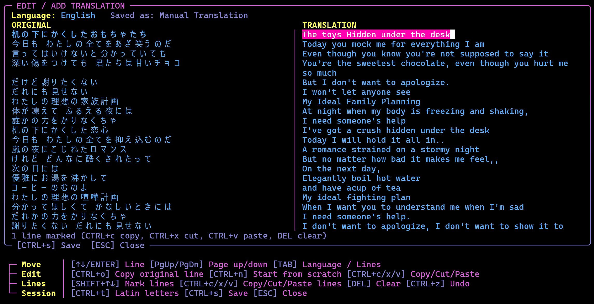

| Key | What it does |
|---|---|
| `↑` / `↓` / `ENTER` | The previous / next line. `PgUp` / `PgDn`: ten lines |
| typing, `←` `→`, `HOME` `END`, `CTRL+←` `CTRL+→`, `DEL`, `BACKSPACE` | Write and move in the line, like in every text field. `CTRL+c` / `CTRL+x` / `CTRL+v` copy, cut and paste |
| `CTRL+o` | Copies the **original line** into the translation (names, "oh oh oh", lines that need no translation) |
| `SHIFT+↑` / `SHIFT+↓` | **Marks whole lines** (from the line where you began to the one with the caret; both columns are lit). While lines are marked: `CTRL+c` copies them, `CTRL+x` cuts them, `CTRL+v` pastes lines over them, `DEL` / `BACKSPACE` clears them, `CTRL+o` puts the originals in. `ESC` or any other key ends the marking |
| `CTRL+z` | **Undoes** the last whole-line change (cut, paste, clear, original copied); `CTRL+z` again brings it back |
| `CTRL+t` (also `CTRL+2`, which many terminals and keyboard layouts do not send; on a German keyboard `SHIFT+2`, the `"` sign, works while the language is chosen) | **Latin letters on / off**: the original column shows Japanese / Korean / Chinese text in Latin letters, as everywhere else (your own text is not changed). In a line the `"` sign is just a character, so only `CTRL+t` / `CTRL+2` work there |
| `TAB` | The language of the translation (`←` `→` or a first letter choose it; `TAB` / `ENTER` go back to the lines) |
| `CTRL+n` | **Start from scratch**: empties all lines and makes the text a new Manual Translation (asks `y` first, because what is written here is dropped) |
| `CTRL+s` | **Saves** and returns to the reader, which shows the new translation |
| `ESC` | Closes; with unsaved changes it asks `y` / any other key |


What is saved: when a translation is shown in the TRANSLATION pane, the editor starts with its text. A **machine translation** (Google, MyMemory) is never changed: your version is saved as a **new Manual Translation**. A **Manual Translation** is changed in place. Without a translation the editor starts empty. The names are *Manual Translation*, *Manual Translation 2*, *Manual Translation 3* … (a number that became free after a delete is used again) and are listed after the machine translations; the file is `<name>.<language>.manual.txt` (`manual2` …) in the `translations` folder next to the lyrics. Like every translation it belongs to the lyrics file it was written for: it is ignored when the lyrics change, and `d` / `DEL` in the TRANSLATION pane deletes it (asks first).

##### Export (`e`)

A small overlay: `←` / `→` choose, `ENTER` writes, `ESC` closes. It names the folder and the file before you press `ENTER`.

**Choices**
- *Original only*
- *Original + translation* (the translation that is shown, when one is saved)
- *Original + transliteration* (the Latin spelling of kana, Hangul and Chinese characters, when the lyrics have any)
- *Original + transliteration + translation*

**The file**
- The text file goes into an **`export`** folder inside the lyrics folder (`<music folder>/lyrics/export/`), named after the track and what it holds (`Song (translation en).txt`).
- With extra lines, each original line is followed by its transliteration and translation and a blank line; the stanza breaks stay.
- An export with the same contents replaces the earlier one.

**Kanji**
- The Latin spelling of kanji comes from the kanji reader in the background (the lines are handed to it as soon as the lyrics open).
- If it has not finished when you press `ENTER`, the overlay says how many lines are left. A second `ENTER` exports anyway; the kanji then stay as they are in those lines.

**Lyrics by file name (the way it worked before *Add manually*).** Mousiki finds lyrics for a track by name: a file called exactly like the track, with the extension `.lrc`, in the `lyrics` folder next to the track (`Music/Artist/Song.mp3` → `Music/Artist/lyrics/Song.lrc`); an `.lrc` right next to the track (`Music/Artist/Song.lrc`) is read as well. So you could always add your own lyrics by copying and renaming a file by hand. *Add manually* does that for you: it needs no renaming (any name, also `.txt`), it can take a file from any `lyrics` folder (or a path you type) for any track of the library, it keeps the lyrics that were in use as an older version, and it can be undone with `DEL`.

**Search lyrics files (`/`, on a German keyboard `SHIFT+7`; the same key as the library search, so it follows `HKeySearch`).** Opens a small **SEARCH LYRICS FILES** panel over the reader. It lists every `.lrc` / `.txt` file in the `lyrics` folders of your library: the `lyrics` folder inside each folder that holds your tracks, inside each music folder from Settings → PATHS and inside the download cache. The list is read when the panel opens. Type to filter by **file name** (every word you type has to be in the name, in any order, upper / lower case does not matter), `↑` / `↓` pick (`HOME` / `END` jump), `ENTER` shows the file in the reader, `BACKSPACE` deletes a letter, `ESC` closes the panel. A row shows the file name and, in brackets, the folder it belongs to. The chosen file is read like a track's own lyrics: plain text, centred, and `t` translates it (the translation is saved in `translations/` of that file's own lyrics folder, and found there again). It stays until you close the reader with `ESC` or `CTRL+L`; opening the reader again shows the lyrics of the playing track.

- The **Read Lyrics pane** is one line with the lyrics files of the track: the lyrics embedded in the audio file, the fetched copy in use (marked `●`) and the older copies that a refetch put aside (see *How the lyrics form works*). The line scrolls sideways when the files do not fit; `◀` / `▶` show that there are more.
- The **TRANSLATION pane** is one line with the translations saved for the chosen file, e.g. `● English (Google Translate) | English (MyMemory) | French (MyMemory)`; `●` marks the one that is shown. A file keeps **one translation per language and per service**: translating into English with MyMemory does not touch the Google translation, and translating again with the same service replaces only that service's translation. Below the pane, the border says how many there are, or that one is being fetched.
- The text below is the plain lyrics: timestamps, word timings and tags such as `[ar:…]` are removed and runs of empty lines become one. The lyrics are **centered**, with two blank rows above and below them.
- **Playing along (`p`).** While the track of the reader is the loaded one, the lyrics are drawn the way the lyrics engine draws them: the active line in the active colour, the words already sung highlighted (and the animation of Settings → Lyrics, when one is set), the Latin letters when they are on; the view scrolls along (`f` switches that off; any scrolling does too) and the translation below the active line is lit with it. The border shows the position (`playing 1:12 / 3:40`). The timing is the one of the file shown (its `[offset:]` included); lyrics without time stamps are spread over the track like in the karaoke view. A lyrics file that was opened with the search has no track to play.
- **Translating (`t`).** Use `↑` / `↓` to pick a row of the overlay and `←` / `→` to change it (a letter jumps to the next language starting with it); `ENTER` fetches, `ESC` closes (the choice is saved in `config.txt`).
  - **Service** – *Google Translate* (default): the key-less web endpoint of Google Translate. It is unofficial and rate limited; the lyrics are sent in a few large requests and a `429` ("too many requests") is retried with growing pauses. If it still answers `429`, wait a minute or pick another service. *MyMemory*: free and key-less, about 5000 characters a day per address (set the environment variable `MOUSIKI_MYMEMORY_EMAIL` to raise that); it translates line by line and is slower. (LibreTranslate was dropped: it needs a paid API key.)
  - **Translate into** – the target language (about 60 are listed). Default: English.
  - **Lyrics are in** – *Auto-detect* (default; the service finds out the language) or a language of your choice. Set it by hand when the detection was wrong, for example for short lyrics or mixed languages.
  - Python 3 and an internet connection are required (the helper is `scripts/translate_lyrics.py`). Lyrics that are already in the target language are reported as such and nothing is saved.
- **A translation takes a while** and runs in the background: opening or closing the translate overlay, choosing another file or closing Read Lyrics does **not** stop it, and it is saved when it is done (the main screen tells when Read Lyrics is closed). While it runs, pressing `ENTER` for another one shows a **warning** instead of starting it. The translation is shown in `( )` **right below the original line**.
- Translations are saved in the lyrics folder, in an extra `translations` folder: `<folder of the track>/lyrics/translations/<name>.<language>.<service>.txt` (one file per lyrics file, target language and service, for example `.en.google.txt`, `.en.mymemory.txt` and `.fr.google.txt`; files from older versions without the service in the name are still read and are replaced by the next translation of the same service). Next time they are read from there, without a connection; delete one in the TRANSLATION pane. When the lyrics are fetched again, a saved translation no longer fits and is ignored.

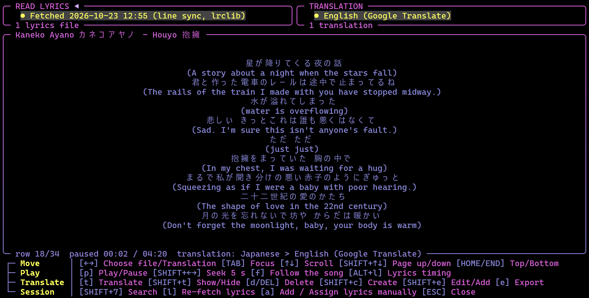

*Read Lyrics with a translation shown below the lines.*

#### Karaoke overlay (`k`)

Fills the whole screen with the lyrics of the track that is playing: the line being sung sits in the middle, the words already sung are drawn in the active-word colour (Settings → COLORS → LYRICS) and the word being sung is underlined (bold in the big sizes), the lines before and after it are dimmed. Lines are centred and separated by an empty row. The track's title and artist are on the top border, the position and length (`[ 1:23 / 3:45 ]`) on the bottom border.

The karaoke picture sits on **both sides**, with four empty columns between each picture and the lyrics, so the lyrics stay centred. It is drawn in the **disk colours** (Settings → COLORS → DISK, top → bottom colour) with a colour wave that runs across it from the left to the right edge, like the radio's ON AIR sign.

**Lyrics size.** The mode keys make the lyrics bigger / smaller (`SHIFT` and `+` / `SHIFT` and `-` on a German keyboard, `'` / `;` on an English one), in steps of 1 from **1 to 5**. Only the lyrics change, the pictures stay as they are. Size 1 is normal text. From size 2 on the letters are drawn with Mousiki's own pixel font in braille dots, each step one pixel bigger (a letter is 3 x 2 cells at size 2, 6 x 4 at size 3, up to 12 x 8 at size 5); long lines wrap between words. The built-in font covers the Latin letters, digits, punctuation, the German umlauts and ß and the common accented letters. **Japanese, Chinese, Korean (and Cyrillic, Greek)** lines are drawn big too: their glyphs are taken from a font installed on your computer and drawn in the same braille dots. These characters need more dots to stay readable, so their steps are different: a letter is 16 / 24 / 32 / 40 dots high, that is **4 / 6 / 8 / 10 rows** for the sizes 2 / 3 / 4 / 5, and a full-width character is as wide as it is high (8 / 12 / 16 / 20 columns). A line with no spaces, like a Japanese line, wraps wherever the row is full, and a line that would be taller than the screen steps down a size by itself (down to normal text if even size 2 is too tall). With only about 50 columns between the two pictures, big letters of sizes 4 and 5 would hardly fit two or three to a row, so **at sizes 4 and 5 the two pictures are left out and the lyrics take the whole width** whenever the song's lyrics contain Japanese / Chinese / Korean text. Mixed lines (Latin and Japanese) are drawn with the system font as a whole. Mousiki looks for the font itself: Windows (Yu Gothic, Meiryo, MS Gothic, Microsoft YaHei, Malgun), macOS (Hiragino, PingFang, Apple SD Gothic) and Linux (Noto Sans CJK, Source Han Sans, WenQuanYi, Droid Sans Fallback, IPA / Takao, Unifont in the font folders; install e.g. `fonts-noto-cjk` if there is none). Bold faces are preferred, thin strokes would vanish. To use a particular font, set the environment variable `MOUSIKI_CJK_FONT` to its file (`.ttf`, `.otf` or `.ttc`). Without any such font, and for emoji, a line is shown in normal text as before. The bottom border briefly shows `[ lyrics size n / 5 ]`, and the size is saved to `config.txt` (`KaraokeLyricsSize=`) when the overlay closes. The keys are the characters `*` and `_`: on a German keyboard `SHIFT` and `+` / `SHIFT` and `-`, on an English (US / UK) keyboard `SHIFT+8` / `SHIFT` and `-`; the legend names them for your keyboard.

**Resizing.** The layout is worked out again for every frame, so it follows the terminal size: the lyrics re-wrap to the width between the pictures, the pictures are cropped evenly at the top and bottom on a short terminal, and when the lyrics would get narrower than 30 columns the pictures are left out and the lyrics take the whole width.

| Key | What it does |
|---|---|
| `ESC` or `k` | Close the overlay |
| `*` / `_` (German `SHIFT` and `+` / `SHIFT` and `-`, English `'` / `;`) | Lyrics bigger / smaller (1 - 5) |
| `p`, `n` / `b`, `#`, `←` / `→`, `+` / `-`, `x`, `m` | Work as on the main screen (play/pause, next/previous, shuffle next, seek, volume, mute, play mode) |
| `l` (`HKeyRetryLyrics`) | Opens the lyrics **re-fetch and version control** form over the karaoke screen (wrong or missing lyrics: fix the title / artist, pick another saved version); closing it returns to karaoke. |
| `a` | **Add manually**: opens Read Lyrics for the playing track with the *Add manually* overlay open straight away (see Read Lyrics). Also `CTRL+n` inside the re-fetch form. |
| `ALT+L` (macOS: `SHIFT+j`) | Opens the [lyrics timing overlay](#lyrics-timing-overlay-altl) **over the karaoke screen**, which is the easiest place to judge an offset: the big lyrics move live while you adjust it. Closing it (save or cancel) returns to karaoke, not to the main screen. |

- The overlay always uses the lyrics engine, **also when it is off on the main screen** (`.`, Settings → ANIMA/VIZ → Use Lyrics Engine): it then fetches the lyrics of the playing track itself -- and again after a track change while it is open -- without changing that setting, so the main screen keeps its visual. While they are being fetched, or when none were found, the overlay says so.
- Synced lyrics follow the timing correction of the lyrics timing overlay, which `ALT+L` (macOS: `SHIFT+j`) opens **from here as well** (see the key table above). Lyrics without timestamps are scrolled along with the song.


### Video

**Video mode** (cheat sheet: VIDEO MODE and FETCH VIDEOS)

| Key | Action | What it does |
|---|---|---|
| `&` (German `SHIFT+6`; other keyboards `SHIFT+y`) | VIDEO SETTINGS overlay | Opens the **VIDEO SETTINGS overlay** (see *Video mode* below): Video Mode on / off (`VideoMode=` in `config.txt`, the key is rebindable as *Video Overlay*), Include Lyrics, Auto Video, Cover, Disk or Thumbnail, Picture Size, Effect, `[ Full Screen Video ]`, `[ Manually Couple Local Files ]`, `[ Search YT ]` and `[ Fetch Videos ]` (`ALT+v`). With the Video mode on: video files (`mp4 m4v mkv mov avi webm wmv flv mpg mpeg ogv 3gp`) are listed in the library (they play as sound; ffmpeg decodes it), `SHIFT+t` gets its fifth step *videos*, and a **video view** joins the `.` cycle right after the lyrics. See *Video mode* below. |
| `ALT+v` (macOS: `SHIFT+d`) | FETCH VIDEOS overlay | Opens the full-screen overlay that finds videos on YouTube for the songs under the cursor (see *Video mode* below). Inside the VIDEO OPTION overlay the same key switches to it for the song. |
| `SHIFT+v` | Library kind | In the playlist editor, the meta editor and the folder overlay: the library lists *audio*, *video + audio* or *video*. |

#### Video mode (`&`)

`&` (German `SHIFT+6`; other keyboards `SHIFT+y`; rebindable) switches the **Video mode**. It is meant for music videos and for sound files that have a video of the same name beside them. The parts of it are described one after the other: *Library, pairing and the video view*, *The VIDEO SETTINGS overlay*, *Big video overlay*, *VIDEO OPTION* (connect a song and a video by hand) and *SEARCH YT* (quick search and download); the overlay that finds videos for many songs at once, **FETCH VIDEOS**, has a section of its own in chapter 4 (*Fetch videos overlay*), like the cover fetch overlay.

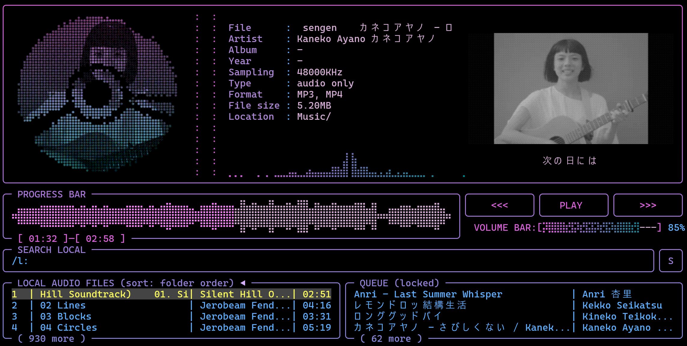

##### Library, pairing and the video view

- **Library:** video files are part of the library whether the mode is on or off, and a video file plays like any sound file: the sound comes from its audio track (queue, playlists and the lists show them by their title). A video that is **paired** with a song (same name beside it, or a link made by hand) is not listed twice: the song stands for both. A video without a song of its name is a track of its own. With the mode on, the lists show the paired videos too, and `SHIFT+t` has a fifth step, **videos**, which shows only the video files. In the meta data the type reads *video + audio*.
- **The video view:** with *When No Video Shows* set to *none*, the `.` / `,` cycle skips the video view for a track that has no video. It joins the `.` / `,` cycle at the place given by **Viz Order 1..5** (by default right after the lyrics) (and is a choice of **Lyrics/Viz Default**: `video`). The field shows the **picture of the track's video** and, under it, the **current lyric line** (in the lyrics colours; the word highlight follows the song). **Two rows under the picture are always reserved**, so the picture keeps its size from line to line: the lyric line sits on the first, the second is for the rest of the line when it has to break (longer breaks are cut). Without lyrics the two rows stay empty. For a track without any video the view shows the lyrics, as the lyrics view does. The top border of the **big video overlay** shows the elapsed and the total time next to the track name (`[ 01:23 / 03:45 ]`). In the big video overlay a track without a video shows an animated film clapperboard (in the colours of the frame gradient; its arm slowly closes and opens again while the board sways a little) instead of a text; under it stands the note "No video for this track. / Fetch video via [ALT+v] or pair local video via [SHIFT+m]" (the keys as bound); in a field too small for the picture (about 50 x 29 cells needed) only the note is shown.
- **Which video belongs to a sound file:** the file itself when it is a video; else a video file with the same name in the same folder; else a video file with the same name anywhere in the library (case does not matter). A video that was connected by hand (VIDEO OPTION, or a Search YT download) comes first. A picture glued into a sound file (a cover) is not a video.
- **How it is drawn:** in a terminal with **Kitty graphics or Sixel** (Windows Terminal 1.22+, Kitty, WezTerm ...) as a real picture, kept in the video's proportions (240 colours, ordered dithering; at most 640 pixels wide, 480 with Sixel); everywhere else in **braille dots** in the VIZ colours (dimmed by the brightness of the picture).
- **Sync:** the picture follows the **sound's clock**. A jump (seek, next track) restarts the picture at the new place, the pause stops it, the picture is decoded in the background by ffmpeg only while the video view is on.
- **Resizing / fullscreen:** the picture on screen is scaled to the new size at once and the decoder follows when the size has stayed the same for a moment (no "video starting" message). A seek forward or backward keeps the last picture until the new one is decoded.
- **Library tags of videos:** a video that is paired with a track (by hand, a download, or the same name beside it) shows that track's artist, title, album and year in the lists, as long as the video has no tags of its own; it follows the pairing when it changes.
- **Format** in the metadata shows the file types: `MP4` for a video file, `MP3, MP4` for a track with a paired video (Video mode on).
- A video that is **shorter** than its track starts again from the beginning for the spare time; a video that is **longer** is simply cut off when the track ends.
- **Limits:** the picture has no sound of its own (the sound is always the track's); a very big video is scaled down by ffmpeg while it is decoded, which costs processor time like any video decoding; the Video mode does not touch the radio or the audio books.

##### The VIDEO SETTINGS overlay (`&`)

The **VIDEO SETTINGS overlay** (`&`) opens from the main screen: `↑`/`↓` choose a row, `←`/`→`/`ENTER` change it, `ESC` closes it. Every change is written to `config.txt` at once.

- *Use Video in Lyrics Field* – on / off (the same switch as **Use Video** in Settings → ANIMA/VIZ, the former *Video Mode* row of this overlay): the video view joins the `.` / `,` cycle of the lyrics field and the video files are listed. The big video overlay does not depend on it.
- *Include Lyrics* – the current lyric line under the picture and the two reserved rows (`VideoLyrics=`); off: the picture gets the whole field. With lyrics on, the picture sits **one row lower** (an empty row above it).
- *Auto Video* – (`VideoAuto=`, on by default) when the Video mode is turned on while a track with a video plays, and whenever a track starts: a track **with a video** shows the video view; a track without one leaves the field on the view you chose with `.` / `,` -- only when the field was on the video view, the *Lyrics/Viz Default* decides: a view (sphere, oscilloscope, spectrogram, lyrics) is shown, *last used* goes back to the view the field had before the video, and *video* stays on the video view, where *When No Video Shows* decides what the field shows.
- *Picture Size* – the picture in the small field (`VideoSize=`, also **Video Size** in Settings → ANIMA/VIZ). `regular`: the whole picture, as before. `cropped`: **two columns are cut off each side** of the picture (the picture itself is not scaled, only trimmed). `full`: the picture **fills the field** (the space of the oscilloscope) and is cropped on every side to fit; the current lyric line is then a **small box with a black background** over the bottom of the picture (in a picture terminal the box is cut out of the picture), and *Include Lyrics* decides whether it is there. `framed`: like `full`, but **one row and two columns smaller on every side**, so an empty frame of one cell is left round the picture (the picture is not cropped more than in `full`, only its field is smaller).
- *Effect* – a retro look for the picture (`VideoFx=`, also **Video Effect** in Settings → ANIMA/VIZ, with a live preview), in the small field and in the big video overlay: `off`, `scanlines` (dark gaps between the lines of a tube, a glow around bright spots, a slow refresh bar), `crt` (scanlines, a little softness, RGB phosphor stripes, dark corners and a faint flicker), `vhs` (colour fringes, a wobbling picture, a tracking band that rolls up, noise at the bottom, film grain, paler colours), `glitch` (now and then slices of the picture slip sideways with split colours; in between small particles: jumping colour-split blocks, hairline slips and coloured specks), `quiet glitch` (listed right below Glitch: the same with few big hits and many more small particles), `pixel` (a slightly pixelated picture: coarse blocks and 16 levels per colour), `gradient` (a wave in the visualizer's gradient colours runs over the picture from the upper left to the lower right, but only through its light parts: the shade follows the brightness, dark parts stay dark), `phosphor green` / `phosphor amber` (a monochrome tube with a glow around the bright parts), `halftone` (newsprint: ink dots on a 45° grid whose size follows the darkness), `dither b/w` (a one-bit picture of ordered Bayer dots in plain black and white, with extra contrast so dark areas get darker; the former plain `dither` is no longer offered, an old `VideoFx=dither` reads as this one) and `dither gradient` (black and the visualizer gradient's wave: the light dots take the wave's colour, the dark parts stay black), `game boy high-res` (four greens in a fine grid; dark parts stay dark) and `game boy high-res gradient` (the same, but the three light shades are the gradient wave's colours in three brightnesses, the darkest shade is black), `game boy low-res` (the same with big blocks, like the old handheld's screen), `game boy high-res b/w` and `game boy low-res b/w` (the same two, in four greys: black, two greys and white), `ega 16` (the 16 colours of old PC graphics, ordered dither), `film` (grain, a faint sepia tone, a flickering gate, a vignette, now and then a scratch and dust), `neon edge` (only the outlines, in the picture's colours, glowing on a deep black; clean lines, not blown out), `neon edge gradient` (the picture in grey under outlines that glow in the visualizer's gradient wave, like the gradient look) or `interlace` (the odd lines come from the frame before: where something moves, the lines comb). The effects move with the video's time, so a paused video stands still; in braille dots they are kept mild.
- *Video Contrast*, *Video Colors*, *Video Chromatic Aberration*, *Video Resolution*, *Video Rounded Corners*, *Show Clap Loading* and *Video Buffer* – the same values as in Settings → VIDEO, changed here directly (`←` / `→`).
- `[ Full Screen Video ]` – the same as the key `v` (see *Big video overlay* below).
- `[ Delete Current Video ]` (section *This track's video*) – deletes the **video file** the playing track shows, for good, after **two questions** in extra panels over the overlay (*Delete the video?* then *Are you really sure?*; both start on *No*, `←`/`→` choose, `ENTER` confirms, `ESC` cancels). Its connections go with it; a video that several songs share says so. A track that is a video file itself is deleted in FETCH VIDEOS → VIDEO FILES.
- `[ Refetch this Video ]` – searches the playing track's video again on YouTube, takes the **hit closest in length** and downloads it, after one question. The old video stays connected until the new one has arrived (a failed download changes nothing). If the old file was **downloaded by Mousiki / yt-dlp** (it lies in the `video_down` folder or in the download list), it is **deleted afterwards** -- unless another song still uses it; a video from **your own folders is never deleted**, it is only replaced for this song. (The `r` key in FETCH VIDEOS is different: it unassigns the old video and leaves its file on the disk, to be found as *video only* in the VIDEO FILES tab.)
- *Cover, Disk or Thumbnail* – the default for all tracks; **each track can have its own** in the meta editor (*Cover Options*: the cover / the video thumbnail, else the cover / the plain disk, and Automatic / no cover / a chosen picture), which goes before this row. `cover`: the disk shows the track's cover as always; `thumbnail`: the disk shows a **frame of the track's video** (taken about a tenth into the video, at most 30 s; the same thumbnail look as the Album Cover), and a track without a video falls back to its **cover**, then to the **disk** ; `disk`: a track **with a video** shows the plain **disk**, no cover and no thumbnail (tracks without a video keep their cover) (`VideoCover=cover|thumbnail|disk`). Choosing the thumbnail turns **Album Cover** on (it is the Album Cover look that draws the picture) and needs the Video mode.
- `[ Manually Couple Local Files ]` (this connects a song and a video file by hand: VIDEO OPTION below), `[ Quick Search/Down. YT ]` and `[ General Fetch Videos Menu ]` open **VIDEO OPTION** and **SEARCH YT** (both below) and the **FETCH VIDEOS** overlay (chapter 4, *Fetch videos overlay*). The on/off rows are drawn as `[x] true` / `[ ] false` switches, the cover choice as `< cover >`, and the three buttons sit under their own heading.

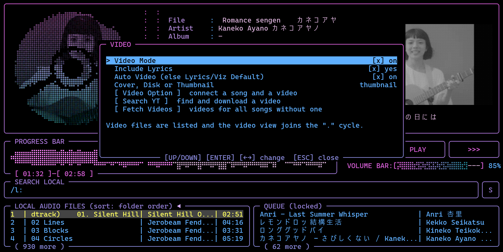

##### Big video overlay (`v`)

**Big video overlay** (`v`, rebindable as *Full Screen Video*, key `HKeyVideoFull`; also the `[ Full Screen Video ]` button of the VIDEO SETTINGS overlay): the video over the **whole screen**, in a frame like the spectrogram's full screen. The picture fits the screen in the video's proportions and the current lyric line sits as a small black box over its bottom. `↑` / `↓` change the **effect**, `TAB` cycles the **lyric line** off → on → on with its **translation** under it (`VideoFullLyrics=`, `VideoFullTranslation=`; the translation is a saved one from READ LYRICS, the one in the translate language if there are several; when the lyrics have none, the status line says so), `SHIFT+↑` / `SHIFT+↓` change the **layout** (`VideoLayout=`): *Video*, *Video + Osci* (an oscilloscope, XY or YT, braille or image), *Video + Spectro* (a spectrogram or waterfall) or *Video + Osci + Spectro*. The video fills the left two thirds of the screen; the oscilloscope / spectrogram sit in one column of the full height on its right: one of them alone, or both with the oscilloscope on top and the spectrogram below it. A screen that is too small shows fewer parts. With a layout, `SHIFT+o` and `SHIFT+i` (the keys of the oscilloscope and spectrogram options) open those options over the picture; their **Mode**, **Style** (and View) rows are the layout's own choice (`VideoLayoutOsciMode=`, `VideoLayoutOsciStyle=`, `VideoLayoutSpectroStyle=`, `VideoLayoutSpectroView=`; *default* = as in the normal options, `R` resets them to default), all other rows are the shared oscilloscope / spectrogram options. `SHIFT+g` switches **grid and scales** of the oscilloscope and the spectrogram on / off (`VideoLayoutScales=`). `SHIFT+s` opens a small **options panel** over the picture (Effect, Contrast, Colors, Chromatic Aberration, Resolution; `↑` / `↓` choose a row, `←` / `→` change it, `d` resets it, `ESC` closes just the panel; the same values as the video rows of the Style Option overlay, without the cover rows), `ESC` or `>` closes it; playback keys (seek `←` / `→`, pause ...) keep working. It opens only while the Video mode is on and the playing track has a video.

##### VIDEO OPTION: connect a song and a video by hand

**VIDEO OPTION** (the `[ Video Option ]` button under the cover in the **meta editor** `SHIFT+m`, or the `[ Manually Couple Local Files ]` row in the VIDEO SETTINGS overlay): connects a song and a video file by hand, e.g. `track.mp3` and `clip.mp4` that are not named alike. It is built like *Add lyrics manually*: two searchable lists, **SEARCH LOCAL SONGS** and **SEARCH LOCAL VIDEOS** (the lists below them are titled SONGS and VIDEO FILES) (all folders of the library, also while the Video mode is off), a locked-in field under each and two buttons. The song you came from is locked in already, and the video it has **now** (connected by hand, downloaded, or found by file name) is shown in the locked-in video field with its origin; `ENTER` in the song list locks a song in, `ENTER` in the video list locks the video in and, with both locked, **connects** them (or `TAB` to `[ Connect song and video ]`). The song list holds **audio files only** (the video files are on the right); `CTRL+f` switches it between **all audio files** and **no video yet** (audio files without a video), and the songs that **have a connected video are highlighted** (and marked `[+]`). The right LOCKED IN box shows a **preview of the video**: the locked-in one, else the one the locked-in song has now (a frame of it as a picture in Kitty / Sixel terminals, a note in others). The panel is bigger than before and uses the height of the terminal. `ALT+v` (the key of the Fetch Videos overlay) switches to **FETCH VIDEOS** with the cursor on the locked-in song (else on the song under the cursor), to search YouTube for its video instead of coupling a local file, `DEL` (or the button **`[ Delete Connection (Not the Video itself) ]`** at the bottom, `TAB` to it, `ENTER`) removes the **connection** of the locked-in song, asking once (press again to confirm): a connection **and** the automatic match by file name, the song is then marked "no video" and the video file stays on the disk (do it again to give the automatic pairing back); to delete the video file itself use `[ Delete COMPLETE VIDEO FILE connected to track ]`; `CTRL+c` clears the choice (it does not quit the program here), `ESC` closes. Nothing is converted or changed in the files: the pair is only remembered. With the Video mode on, the track plays its own sound and the video view shows the connected picture; a connection goes before the automatic match by file name. The highlighted row of the two lists and the lines of the two LOCKED IN boxes (name, current pairing, folder) scroll as a marquee when they are too long for the panel (setting Marquee).

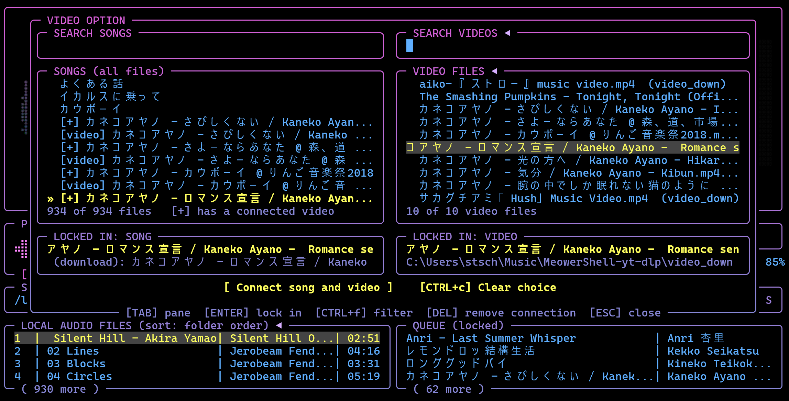

**The pairs follow the files.** They are stored in `video_links.txt` next to `config.txt` (`track<TAB>video` per line). When the meta editor renames a file, both sides of every pair that names it are updated at once (like the saved playlists), and a **video or a song that was moved or renamed outside Mousiki** is found again after a library scan when exactly one video file / song of the library has the same file name (this also works while the Video mode is off; a song's *no video* mark follows too). Two files of the same name are never guessed, and a pair whose song already has another pair is left alone. A pair is never dropped just because a file is missing (a drive that is not plugged in keeps its pairs).

**`SHIFT+v` in the libraries**: in the library pane of the EDIT tab of the meta editor (`SHIFT+m`), in the library of the playlist editor and in the folder overlay `SHIFT+v` steps through *audio*, *video + audio* and *video* (a video that is paired with a song is listed only in the last two); the search, folder view (`f`) and the missing-tag filters keep working. `a` / `SHIFT+f` / `B` put videos on the fetch list like any file; a video that is **connected to a track** (VIDEO OPTION) first takes that track's artist, title, album and year where its own are empty (queue it again to fetch its own). Without a connected track the video is fingerprinted by its **own sound**: the fetch script cuts the audio out of the video (ffmpeg) before Chromaprint (`fpcalc`) looks at it.

**Delete COMPLETE VIDEO FILE connected to track:** the same deletion for the song you are on in **VIDEO OPTION** (the `[ Delete COMPLETE VIDEO FILE connected to track ]` button under the two search panes, `TAB` to it, `ENTER`): **two questions in their own panels** ("Delete the video?", then "Are you really sure?"), both start on *No*. It deletes the video file the locked-in song shows now; a song that has none says so, and a video file itself is deleted in the VIDEO FILES tab.

##### SEARCH YT: quick search and download

**SEARCH YT** (the `[ Quick Search/Down. YT ]` button): searches YouTube (yt-dlp) for videos of the playing song. The search field starts as the **file name** of the song (without the track number) and can be edited (`CTRL+t` **toggles** between the file name and *artist title* of the song as the search text; the field is a regular text field: caret, `SHIFT+←/→` selection, `CTRL+c` / `CTRL+x` / `CTRL+v`, `CTRL+z` undo, `HOME` / `END`); `ENTER` searches, `TAB`/`↓` go to the list. Each result shows title, channel and length, in the **RESULTS** pane (its own box under the search field) with the **thumbnail as a preview** next to the list (a real picture in Kitty / Sixel terminals, braille dots only as the fallback); `o` opens the page in the browser. `ENTER` on a result **downloads** it (picture up to `VideoDownHeight=` pixels, 720 by default, as mp4) into the folder **`video_down`** inside the download folder (Settings → PATHS → DOWNLOAD PATH; the cache folder by default), named like the song, and connects it to the song. **The mp3:** with `CTRL+o` (shown in the panel as *mp3 too: on / off*) the **sound of the video is saved as an mp3 song** too, made with ffmpeg from the downloaded video, named like the video and placed in the **regular download folder** (so it is a song of the library), while the video stays in `video_down` inside it; the two are connected by hand, so the song shows its video. It is **on by default when no song is the target** (nothing loaded) and the Settings row *yt-dlp mp3 from mp4* is `true` (Settings → ANIMA/VIZ → VIDEO, under *Video Buffer*; `VideoMp3=`; `false` turns the automatic mp3 off, `CTRL+o` and the VIDEO FILES command still make one on request) and off when the video is meant for the playing song (the song already has its sound; the video is connected to it as before). A video that was downloaded before gets only its mp3 (no second download). If the mp3 fails (no ffmpeg), the video is still there and the status line says so. The overlay can be closed while it downloads (the status line reports the end); `CTRL+c` in the overlay cancels. It needs `yt-dlp` and `ffmpeg`. Please respect the terms of the site and the rights of the artists, as with the audio download.

### Oscilloscope

| Key | Action | What it does |
|---|---|---|
| `O` (Shift+O) | Oscilloscope tuning | Opens a small overlay to change the oscilloscope **live**: style (braille / image), frame rate, music mode, afterglow, line thickness, tail, glow, Z axis, rotation, colours and more - each style (braille or image) keeps its own values. See *The oscilloscope* below. |
| `=` (German `SHIFT+0`, English the `=` key) | Oscilloscope full screen | The oscilloscope over the whole screen: the **YT** trace on the left, the **XY** figure on the right, values in the border, optional grid. `ESC` or the same key closes it. See *Oscilloscope full screen* below. |
| `)` (German `SHIFT+9`, English `SHIFT+0`) | Scope window | Opens / closes the oscilloscope in **its own window**, drawn by the graphics card at the monitor's refresh rate. See *Scope window* below. (The key is the character `)`.) Works always, also while the oscilloscope is switched off on the GENERAL tab. |

#### The oscilloscope (lyric visual)

When there are no lyrics to show (lyrics engine off, nothing found, or the fetch is still running) the lyrics area is filled by a **lyric visual**. Messages such as *fetching lyrics ...* or *No synchronized lyrics found* appear for a moment as a **small box over the bottom of the visual**, which keeps its full size (it no longer shrinks by a row, so a spectrogram does not jump). With Settings → ANIMA/VIZ → **Lyrics/Viz Default** (or **When No Lyrics Show**, while the lyrics view has no lyrics) set to `osci` (or after pressing `,/.` to the oscilloscope view) that visual is an **XY/YT oscilloscope** instead of the sphere or spectrogram.

**What it can do, in short:**
- **XY oscilloscope** of the music (left channel = horizontal, right = vertical), with an automatic **phase portrait** for mono tracks, a **45° mid/side view** and an automatic or (in *osci music mode*) fixed scale -- the mode for **oscilloscope music**, which then gets the decoded signal before EQ, normalization and volume. What is an XY mode oscilloscope anyway? It models the amplitudes of each of the stereo channels and is usually used to detect phase changes. Assume to plain sine waves on each channel in sync then the XY mode oscilloscope will show a diagonal line (which is the case for mono channels, at least when the setting "Mono Phase Portrait" is set of in the oscilloscope settings). If they are out of synch by 90° magnitude it will show a circle... 
- A **YT mode** next to the XY figure: the classic time-domain scope (amplitude over time, triggered), alone, **on top of the XY figure** (*XY + YT (overlap)*), **below it in a row of its own** (*XY + YT (row)*) or **next to it in a column of its own** (*XY + YT (col)*, XY left, YT right) -- overlay row *Scope mode*. A full-screen view shows both side by side (`SHIFT+0`, below).
- Two **styles**: **braille** characters in any terminal, or an **image** -- a real pixel picture with a glowing beam -- in terminals with Kitty graphics or Sixel (Windows Terminal 1.22+, WezTerm, Kitty, foot …).
- A **phosphor** look: afterglow (Decay), a bright head and a fading tail, smooth anti-aliased lines between the samples (or only the sample dots), a **Z axis** that dims the beam by speed or brightens it by level, a trace length of 128 – 1024 samples.
- **Nine colour schemes**: the VIZ gradient of the settings, palettes that follow the beam speed (a rough "pitch" colour: temperature, aurora, magma, ice, neon, spectrum …), and **classic green**: one phosphor green for the whole picture, only the brightness of the beam varies, like an old scope.
- **30 – 165 frames per second**, and all values kept separately for each style. Higher values may lag, so you might just want to keep this between 30 and 90 and switch to the window mode for your screens refresh rate...
- A separate **scope window** (`)`, German `SHIFT+9`, English `SHIFT+0`) drawn by the graphics card at the monitor's refresh rate, which draws every sample. For this the brightness of the lines were adjusted, since they used to fade strongly when the window was set to full screen. 

**How it draws.** Like a real scope in X-Y mode, the **left channel moves the beam horizontally and the right channel moves it vertically**. A track with a wide stereo image fills the area with a cloud, a pure tone with a phase shift between the channels draws an ellipse, and out-of-phase material leans the other way. The picture is drawn into the largest centred square of the lyrics area, so circles stay circles. A quiet track is boosted automatically, so it still fills the area.

**Mono tracks.** In a true XY scope a mono signal (left = right) can only draw a diagonal line (no phase shift can be detected here, so to speak). When a track is (nearly) mono, the scope therefore fades over to a *phase portrait* of the signal instead (the signal against its own rate of change), which draws loops and circles whose shape follows the sound. The switch is smooth, so a track hovering near the limit does not flicker.

**Look.** The trace is drawn with smooth, anti-aliased lines. Like the phosphor of an old oscilloscope it leaves a short **afterglow** that fades out, and the newest part of the trace is brighter than the oldest. The colour is the **VIZ** gradient (Settings → Colors → VIZ) running left to right, dimmed where the beam is weaker, so the fading trail also fades in colour.

#### Oscilloscope tuning overlay (`SHIFT+o`)

Opens a window in the middle of the screen where the look of the oscilloscope can be changed **while the music plays**. It sits clear of the lyrics area, so you can watch the scope while you adjust it. The same overlay exists in the radio (on the same key).


| Key | Action |
|---|---|
| `↑` / `↓` | Select a row (wraps around) |
| `←` / `→` | Decrease / increase the selected value, or step through its choices |
| `R` | Reset the rows of the style in use to their defaults |
| `ESC` or `SHIFT+o` | Close the overlay. The values are **saved to `config.txt`** when it closes. |
| `SHIFT+i` / `SHIFT+u` | Switch straight to the **spectrogram** options / full screen, without closing this overlay first (the values are saved). |

Playback keeps running while the overlay is open, but its keys are the only ones that react until you close it. The overlay opens on every main screen. The rows are:

| Row | Choices / range | What it does |
|---|---|---|
| Scope mode | XY / YT / XY + YT (overlap) / XY + YT (row) / XY + YT (col) | Which picture the scope draws (`OsciMode=` `xy`, `yt`, `overlap`, `row` or `col`; one setting for both styles). **XY**: the beam figure described above. **YT**: the classic time-domain scope -- the signal (left and right mixed) runs from left to right, amplitude up and down, and a **trigger** (a rising zero crossing, with a small noise guard) starts every picture at the same point of the wave, so a steady tone stands still instead of crawling. The **Trace Length** row sets how many samples fit across the width (fewer = zoomed in, a few periods of a bass note; more = a longer stretch). **XY + YT (overlap)** draws the YT trace *on top of* the XY figure in the same buffer, the trace a little dimmer, with one shared afterglow and palette. **XY + YT (row)** gives each its own half of the area: the XY figure in the top half, the YT trace in the bottom half. **XY + YT (col)** does the same side by side: the XY figure in the left half, the YT trace in the right half. Decay, Dot threshold, Line/Vec. Interpol., Color, Glow, the style (braille / image), the frame rate and Osci music mode (fixed scale instead of automatic size) apply to every picture; Tail, Z-Axis, Rotate 45 deg and Mono Phase Portrait only shape the XY figure. The scope window (`SHIFT+9`) follows the mode too (see *Scope window*). |
| Osci style | braille / image | **braille**: the scope is drawn with Braille characters. **image**: a real pixel picture with glow, drawn by the terminal itself (see *Image style* below). |
| Frame rate | 30 / 45 / 60 / 90 / 120 / 165 fps | Kept **per style**: the braille and the image scope each have their own frame rate (and all their other values), and the one of the style in use applies. How often the screen (and the scope) is redrawn. Only the lines that changed are sent, so 120 and 165 work in a fast terminal (Windows Terminal, WezTerm, Kitty, Alacritty …) on a monitor with that refresh rate; a terminal never shows more frames than its monitor does. At 165 fps the radio's screen is about 2.3 MB/s of output and about a quarter of one CPU core; if the terminal lags behind, step down. The image style sends at most 60 pictures per second whatever the frame rate (see below). |
| Osci music mode | on / off | Kept per style (braille and image each have their own). For tracks composed so that the scope draws pictures (see *Oscilloscope music mode* below) |
| Beam | CRT / classic | Kept per style (`OsciCrtBeam=` / `OsciImageCrtBeam=`), with and without Osci music mode. **CRT** (default of the image style): every sample is drawn once and adds light by the time the beam spends on a spot -- in music mode clean figures without jump lines, with ordinary music a glowing core where the beam lingers and faint fast strokes around it. **classic** (default of the braille style): the look from before -- the newest *Trace Length* samples with the *Tail* fade, max-blended, straight lines between the samples; busier, with the jumps between shapes drawn as lines. The scope window follows it. |
| Dwell brightness | on / off | Only shown with the CRT beam (with or without music mode), kept per style (`OsciDwellBrightness=`, on by default). **on**: the beam's light follows the time it spends on a spot -- slow strokes bright, the fast jumps between shapes nearly invisible. **off**: every stroke is equally bright, so the jump lines (often a frame around the edges of the picture) show again, while the rest of the CRT beam (every sample once, soft trails) stays. Also in the scope window. |
| Low-rate blanking | on / off | Only shown in Osci music mode with the CRT beam, kept per style (`OsciLowRateBlanking=`, on by default). For files below 96 kHz (44.1 / 48 kHz): moves faster than any stroke are faded out as jumps between shapes. Files at 96 kHz and above are never touched. Also in the scope window. |
| Rough mode | on / off | Only shown without Osci music mode, kept per style (`OsciRoughMode=` / `OsciImageRoughMode=`; on by default for braille, off for image). This was actually a suboptimal previous version, but looked cool to me and is therefor kept as a mode: The automatic size follows the *previous* picture's loudest point only, as in Mousiki 2.x: when a beat suddenly gets louder, the new picture is too big and the beam is clamped to the edges, so it runs along the border of the square for a moment -- the rougher, livelier look of the old scope (the overlay shows *on (edge clipping)*). Off, the picture's own loudest point counts at once and nothing is clipped. Best seen with the classic beam (the CRT beam dims the clipped stretches). |
| Image protocol | auto / kitty / sixel / off | Image style only: which terminal graphics protocol is used. |
| Image resolution | third / half / full | Image style only: the picture is drawn at a third, half or the full resolution of the screen area and enlarged on the way to the terminal. Lower = much less work and data per picture (half: about a quarter of the drawing work and half the Sixel data) and a smoother scope at high frame rates; the beam gets softer and a little wider. Default `half`. |
| Image detail | normal / high | Image style only (`OsciImageDetail=`): the widest picture that is drawn. **normal** = up to 560 pixels across (640 per picture in the big overlay), **high** = up to 1024 (1280): thinner, sharper lines and finer small figures, best together with *Image resolution* full. High means up to about three times the pixels per picture -- easy for Kitty, but with Sixel (Windows Terminal) lower the frame rate if the picture stutters. |
| Decay | 0.00 – 0.99 | The **afterglow**. Each frame the picture is dimmed by this factor, so higher values leave longer trails. `0.00` shows only the current trace. Values near `0.99` smear for a long time. |
| Dot threshold | 0.01 – 1.00 | Braille style only. How bright a point must be before it is drawn. **Lower** values give a thicker, softer line with a long fade. **Higher** values give a thin, sharp core, but fast parts of the trace can break into gaps. |
| Tail | 0.00 – 1.00 | The brightness of the **oldest** part of the trace compared with the newest (`1.00`). Low values give a comet with a bright head and a fading tail, `1.00` makes the trace uniformly bright. |
| Glow | 0.00 – 1.00 (step 0.05) | Image style only: how strongly the line glows. |
| Line/Vec. Interpol. | on / off | Connects the sample points with smooth lines. |
| Z-Axis (XYZ Mode) | on / off | Lets the beam brightness follow a third signal, like a real XYZ scope. |
| Z Depth | 0.00 – 1.00 (step 0.05) | How strongly the Z signal dims the beam. |
| Z Source | speed / level | `speed`: the faster the beam moves, the dimmer it gets (like a CRT). `level`: the further from the centre, the brighter. |
| Trace Length | 128 – 1024 samples (step 128), then 2048 / 4096 / 8192 | How much of the signal is drawn at once. In the YT picture it is the time span (1024 samples = 21 ms at 48 kHz, 8192 = 170 ms); in the XY picture, how much of the recent path is drawn. Longer traces take more time to draw. |
| Rotate 45 deg (M/S) | on / off | Rotates the picture by 45°, so mid/side (mono/stereo difference) lies on the axes. |
| Mono Phase Portrait | on / off | Fades a (nearly) mono signal over to a *phase portrait* (see *The oscilloscope*). Off draws the plain diagonal line. |
| Color | gradient, settings, temperature, aurora, magma, ice, neon, spectrum, classic green | `gradient` uses the VIZ colours of **Settings → COLORS**. The palettes in the middle follow the beam speed. **classic green** is a single phosphor green (`Palette=green` in the config files) with the brightness of the beam as the only variation -- the look of an old analog scope. |

##### Oscilloscope music mode

For **oscilloscope music**: tracks composed so that the scope draws pictures, e.g. Jerobeam Fenderson's. Kept per style (braille and image each have their own).

**What changes**
- The scopes get the **decoded signal itself**, before the equalizer, normalization, limiter, volume and the mono fold. What you hear does not change.
- The picture keeps a **fixed scale** (full level = the edge) instead of adjusting its size to the loudness. The mono phase portrait is off.
- The scope window (which follows the *image* style's setting) also smooths more between the samples and draws a finer beam (see *Scope window*).

**The CRT look (Beam: CRT)**
- **Every sample since the last picture** is drawn exactly once. A figure is never cut to Trace Length and broken into dots, and the curve between the samples is smoothed.
- The beam **adds its light** to the phosphor in proportion to the time it spends on a spot: slow strokes and corners are bright, the fast jumps between shapes nearly vanish (so Line/Vec. Interpol. adds no extra lines). Parts that stand still stay crisp; moving parts leave a soft trail.
- The afterglow fades per sample, not per frame. The picture is equally bright at any frame rate, and parts that stand still are equally bright at any Decay (Decay only sets how long a moving figure trails).
- Files **below 96 kHz** (44.1 / 48 kHz) round the jumps between shapes off over a few samples. With *Low-rate blanking* on (the default), moves faster than any stroke are faded out as jumps. The small wiggles a 48 kHz file has along sharp corners are part of the file and stay.
- Set **Beam** to **classic** for the look from before (the newest Trace Length samples, max-blended, with the occasional line around the edges). The braille style starts with *classic*.

**Tips**
- For the look of osci-render, set **Decay to about 0.10** in this mode, **Image resolution to full** and, if the terminal keeps up, **Image detail to high**.
- Play lossless files (FLAC / WAV) for the full effect: MP3, AAC, Opus and internet radio round off corners and blur lines.


**Each style keeps its own values.** The braille and the image style have separate sets of every row -- Frame rate, Osci music mode, Decay, Tail, Glow and all the others (Image protocol and Image resolution exist only for the image style) - so switching the style does not lose your tuning; `R` resets only the style in use (its frame rate stays). Decay, threshold and tail move in steps of 0.01 (tail 0.02).

Two starting points for the braille style: for a crisp, "real oscilloscope" look try Decay `0.65`, Dot threshold `0.35`, Tail `0.60`. For a glowing, dreamy look try `0.90`, `0.20`, `0.25`.

**Image style.** The terminal draws the picture itself, via the **Kitty graphics protocol** (Kitty, WezTerm, Ghostty, Konsole …) or **Sixel** (Windows Terminal 1.22+, foot, xterm …). Without either, the braille scope stays. `MOUSIKI_GFX=kitty|sixel|off` forces a protocol and `MOUSIKI_CELLPX=10x20` sets the cell size (otherwise it is asked from the terminal). In Windows Terminal a smaller Sixel picture is stretched vertically through the Sixel pixel aspect ratio (see below); `MOUSIKI_SIXEL_ASPECT=1` uses that in another terminal too (only useful where the terminal honours the aspect ratio). The scope sends at most as many pictures per second as the **Frame rate**, and never more than 60 with Kitty, 60 with Sixel at `half` / `third` resolution and 30 with Sixel at `full`. A picture is only sent when there is a new one: the text around it is drawn without touching the picture's cells. With Sixel, a smaller picture is enlarged by repeating its pixels (in Windows Terminal the rows through the Sixel pixel aspect ratio, so they are not sent twice); Kitty terminals scale the picture themselves. If the scope stutters, lower **Image resolution** or **Frame rate** first. 

**In radio mode** the overlay is the same, with the radio's own values in `radio_config.txt`, and the environment variables are the same `MOUSIKI_GFX` and `MOUSIKI_CELLPX` (the older names `MOUSIKI_RADIO_GFX` / `MOUSIKI_RADIO_CELLPX` still work; see [What the radio shares with the player](#what-the-radio-shares-with-the-player)).


#### Oscilloscope full screen (`SHIFT+0`)

The oscilloscope over the whole screen, like the spectrogram's full screen (`SHIFT+u`), but with **both pictures at once**: the **YT** trace (amplitude over time) on the **left**, the **XY** figure (left channel horizontal, right channel vertical) on the **right**. Each has its own phosphor buffer, so both keep their own afterglow, but they show the same audio. The key is the character `=`: **`SHIFT+0` on a German keyboard** (on an English one the `=` key itself; `SHIFT+0` there types `)`, the scope window). It is a normal key binding (`HKeyScopeBig` in the player, `ScopeBig` in the radio), so it can be changed on the REFERENCE tab. 

- **Layout.** The two pictures are **boxes of the same size** that look square on screen (a character cell is about twice as high as wide, so a box has twice as many columns as rows): the horizontal grid lines of YT and XY are on the same screen rows. When the terminal is resized the boxes shrink or grow but keep their shape and stay in the middle; what is left over is empty margin. The title is the track (radio: station and song). The name of each picture is centred above its box, kept short so it never reaches into the other picture's field (*samp.*, *horiz.*, *vert.*; when the terminal is narrow the least important parts drop out first): the YT time span in the chosen unit, and what the XY axes are (left / right channel, or side / mid with *Rotate 45 deg*), plus the measurements picked in `SHIFT+p`. The key legend has two centred lines: the last row of the overlay (`LEFT` / `RIGHT` image ↔ braille, `UP` / `DOWN` oscilloscope music mode on / off, `SHIFT+a` grid, `SHIFT+v` values) and the bottom border (`SHIFT+o` options, `=` / `ESC` close, `SHIFT+c` color, `SHIFT+p` metrics); on a narrow terminal the lines get shorter. `LEFT` / `RIGHT` and `UP` / `DOWN` change the same **Style** and **Osci music mode** values as the `SHIFT+o` overlay.
- **Look.** The overlay follows the **Osci style** of the `SHIFT+o` overlay and uses that style's own values (braille: Decay, Dot threshold, Trace Length, Line/Vec. Interpol., Color, Osci music mode ...; image: the glow, palette ... of the image style). With **braille** both pictures are drawn in braille dots. With **image** on a terminal that speaks the **Kitty graphics protocol** or **Sixel** (see *Image style* above) both pictures are real **pixel images**: smooth beams with glow, the grid, frame and axes as thin pixel lines under the beam (so they are not made of dotted characters), the axis values and names as text around them. Image resolution, Image protocol and the frame rate rule apply as in the main screen (the two pictures count double for Sixel, so lower *Image resolution* first if it stutters). The small windows (`SHIFT+o`, `SHIFT+c`, `SHIFT+p`) cut a hole into the pictures where they cover them. Without Kitty / Sixel the overlay draws braille, whatever *Osci style* says. *Scope mode* does not matter here: the two pictures are always YT and XY.
- **`SHIFT+o`** opens the oscilloscope options on top of it, so the look can be tuned while watching both pictures. `ESC` closes the options first, the overlay with the next `ESC` (or the overlay key again).
- **`SHIFT+a`** turns the **axes / grid** on or off (`ScopeGrid=` in the config files; **on by default**). Both pictures are drawn as a **box with a solid frame** (straight lines on all four sides at +-100 %): YT gets a solid zero line, dotted lines at every amplitude division and every time division; XY gets the two axes through the centre and dotted lines at every division. The number of divisions is set in `SHIFT+p`. The grid only shows where the trace is not, so it never changes how the trace looks.
- **`SHIFT+v`** adds the **axis values** (`ScopeValues=`, **on by default**, works with or without the grid): a column on the left of each box with the vertical axis (`+100%` ... `0` ... `-100%`, one value per division), and a row below it with the horizontal axis -- **milliseconds** under YT (0 to the full time span), **percent** under XY (-100 to +100). The values are not an AM modulation depth: they are **percent of the picture's scale**. With the automatic size (the default) 100 % is the loudest part of the signal, with *Osci music mode* it is full scale (what the converter can output). Each picture says it in a line below its box. The boxes become a little smaller to make room for the values. They use the grid colour.
- **`SHIFT+c`** opens a **small window** for the **grid colour**: type a number from **0 to 255** (the 256-colour palette; the window shows a swatch of the colour), `ENTER` accepts, `ESC` cancels, an empty value goes back to the default, which is **the colour of inactive list elements** (the list text colour of your colour scheme). It is saved as `ScopeGridColor=`.
- **`SHIFT+p`** opens a **small window for the grid metrics**, separately for the YT and the XY picture (`UP/DOWN` select a row, `LEFT/RIGHT` change it, `R` resets everything, `SHIFT+p` or `ESC` close; every change is saved at once):

  | Picture | Row | Choices |
  |---|---|---|
  | YT | Time unit | **milliseconds** (default), **samples**, **divisions** (the name then shows *ms/div*) |
  | YT | Time divisions | 4, **8**, 10, 16 (vertical grid lines) |
  | YT | Value divisions | 2, **4**, 8, 10 (horizontal grid lines) |
  | YT | Info | off, **RMS level** (the average loudness), **peak hold** (the highest peak of the last two seconds), or **both** (default) -- in dB, shown in the picture's name |
  | XY | Divisions | 2, **4**, 8, 10 (grid lines per axis) |
  | XY | Info | off, **correlation** (`corr`, +1 = both channels identical / mono, 0 = unrelated, -1 = opposite phase), **balance** (`bal`, which channel is louder, e.g. `L+2 dB`), or **both** (default) |

  **The axis values are always percent** of the picture, and each picture says so in a line below its box: *100% = loudest part* (the picture is scaled automatically so the loudest part of the signal fills the box) or, with *Osci music mode*, *100% = full scale*. They never change while the music plays, only when the grid settings change. 

  **The readouts are made to be read, not to flicker:** This might be suboptimal but was hard to watch before, so RMS level, correlation and balance are averages over about a second, the peak is held for two seconds, and what is shown is refreshed only twice a second and rounded (whole dB, correlation to 0.1). Levels are in dBFS: 0 dB is the loudest a file can be (a full-scale sine has an RMS of -3 dB), typical music sits at about -20 to -10 dB RMS with peaks around -3 dB; `-- dB` means silence. They do not depend on the automatic size of the picture. Correlation tells how mono the sound is (values near +1 mean the picture is a thin diagonal in XY; near 0 a wide cloud; negative values are a mono-compatibility warning), balance whether the sound is leaning to one side. Config: `ScopeYtTimeUnit`, `ScopeYtTimeDiv`, `ScopeYtValueDiv`, `ScopeYtInfo` (`off|rms|peak|both`), `ScopeXyDiv`, `ScopeXyInfo` (`off|corr|balance|both`).
- The usual playback keys keep working. `SHIFT+u` (the spectrogram's full screen) replaces this overlay, and the other way round.


*The big oscilloscope overlay with YT and XY pictures.*

#### Scope window (`)`: German `SHIFT+9`, English `SHIFT+0`)

The key that types `)` opens the oscilloscope in **its own window** next to the terminal (again: closes it). It is drawn by the graphics card, like an analog scope: **every sample** that is played is drawn once as a soft beam, the phosphor keeps an afterglow, dense parts of the trace glow brighter and a bloom lies around the beam. It runs at the refresh rate of your monitor (60, 120, 144 Hz …), independent of the terminal and of **Frame rate**. Integrated graphics are plenty; a dedicated graphics card is not needed! Above limitations had to do with KiTTY and sixel, are not a nowadays common hardware limitation...


| Key (in the window) | Action |
|---|---|
| `F`, `F11` or double-click | Fullscreen on / off |
| `T` | Always on top on / off |
| `ESC`, `Q` or the key of `)` (`9` on a German, `0` on an English keyboard, with or without `SHIFT`) | Close the window (the `)` key in the terminal does the same) |

- **The window follows the style of the `SHIFT+o` overlay.** With **Osci style = image** it is the smooth analog scope described above and uses the values of the *image* style: Decay (afterglow), Glow (bloom), Color palette, Z-Axis / Z Depth / Z Source, Rotate 45 deg, Mono Phase Portrait and Line/Vec. Interpol. (off = sample dots). Trace Length and Tail have no meaning there, because the window draws every sample exactly once. All scope modes (XY, YT, overlap, row, col) are drawn at the **full resolution of the window** as one smooth picture. They get their own brightness lift (`kImageBrightness` in `scope_window_app.cpp`, next to `kBeamAddLight`; higher = brighter), since otherwise lines used to fade away in full screen mode.
- **The scope mode follows too.** With *Scope mode* set to YT, *XY + YT (overlap)*, *XY + YT (row)* or *XY + YT (col)* in the `SHIFT+o` overlay the window draws that picture over its whole width (YT is a wide picture), in the dot style: in the *image* style the dots are simply finer and touch each other, because the smooth GPU beam only knows the XY figure -- so there the glow is missing in these four modes.
- **Braille style in the window.** With **Osci style = braille** the window shows the *braille* scope instead: the same dot grid as in the terminal (2 × 4 dots per cell, the same afterglow, brightness steps and colours), but every lit dot is a square on the screen -- so the braille look can be seen as large as the window, or the whole screen in fullscreen, goes. It uses the braille style's own values from the overlay: Decay, Dot threshold, Tail, Trace Length, Line/Vec. Interpol., Z-Axis, rotation, mono phase portrait, Color and Osci music mode. Changing the style in the overlay switches the open window at once. (The overlay itself is opened in the terminal; the window has no menu of its own.)
- **Smooth curves:** the window interpolates between the samples (Lanczos, to about 192 000 points per second, 384 000 in *Osci music mode*), like the output filter in front of a real scope, so fast strokes become curves and not small polygons. With **Line/Vec. Interpol.** off it draws only the real samples as dots.
- **Osci music mode** (`SHIFT+o`): the unprocessed signal, a fixed scale, no phase portrait, the finer beam and the stronger smoothing above, and - as in the terminal - the beam's light follows the time it spends on a spot, so the fast jumps between shapes nearly vanish and slow strokes stay bright: for oscilloscope music the figures come out as sharp as the file allows. Decay about 0.10 gives the look of osci-render.
- **Brightness** adjusts itself: a tone that retraces the same figure all the time would otherwise burn white, quiet sparse music would be faint.
- **Title**: the playing track (radio: station and song).
- The window remembers its position, size, fullscreen and always-on-top in `~/.config/mousiki/scope_window.txt` (on Windows `%USERPROFILE%\.config\mousiki\`). It stays open when you switch between player and radio and closes with Mousiki.
- **Needs SDL2** (2.0.18 or newer, zlib licence), which Mousiki loads when the window opens; nothing else in Mousiki needs it. The Windows installer and portable zip include `SDL2.dll`, and `setup.ps1` puts it next to `mousiki.exe` when you build yourself (or download `SDL2-<version>-win32-x64.zip` from [github.com/libsdl-org/SDL/releases](https://github.com/libsdl-org/SDL/releases) and copy `SDL2.dll` there). On Linux / macOS the system's SDL2 is used: the `.deb` recommends `libsdl2-2.0-0`, `setup.sh` installs it (`libsdl2-2.0-0`, `SDL2`, `sdl2`, `brew install sdl2`), and for the portable zips install it yourself (Ubuntu: `sudo apt install libsdl2-2.0-0`, macOS: `brew install sdl2`). Without it, the window keys (`)` / `(`) say what is missing.
- The window is a second copy of Mousiki (`mousiki --scope-window`) that gets the audio through a pipe. A graphics driver problem can therefore only close the window, never the player, and dragging the window never stalls the music or the terminal. If the window cannot start, the status line shows why (the reason is also in `~/.cache/mousiki/scope_window_error.txt`). See status/log overlay via `t` to look at status messages.

#### Creator overlay (`^`)

The creator has two modes, chosen in the first row (**Creator mode**): **Text to sound** and **Microphone**.


##### Mode: Text to sound

The creator **makes music out of a text**. It renders a WAV file, saves it, plays it and shows it in a full-screen preview. Two kinds of sound are possible:

- **Oscilloscope (XY)** – *oscilloscope music*. The left channel is the horizontal and the right channel the vertical position of a beam; the outlines of your text are drawn again and again, 30 to 120 times a second (that is also the hum you hear). The preview shows it at once.
- **Spectrogram** – the text **is** the spectrogram: time runs from left to right, pitch from bottom to top and brightness is loudness. To make this always sound pleasant, only the notes of a **musical scale** are played (pentatonic minor by default, so every combination sounds harmonious), at most 12 notes sound at once, notes glide softly into each other and a light reverb joins them. *Exact* plays every pitch instead (more like the text, less like music).

| Row | What it does |
| :--- | :--- |
| **Text** | The field. Typing, caret, selection and clipboard work as everywhere. `\|` starts a new line. Text is drawn with Mousiki's pixel font (Latin letters) or an installed font (Japanese, Cyrillic …). `ENTER` moves on. The small braille picture under the rows shows what will be used. |
| **Sound** | Oscilloscope (XY) or Spectrogram. |
| **Length** | 5, 10, 20, 30 or 60 seconds. |
| **Invert** | **Auto**, **On** or **Off**. *On* makes the background loud instead of the letters. |
| Oscilloscope rows | **Frame rate** (30 / 60 / 90 / 120 per second), **Motion** (None, Spin, Tumble, Pulse – the text moves while it plays) and **Detail** (Low, Medium, High: how exactly the outline is followed). |
| Spectrogram rows | **Scale** (pentatonic minor / major, major, minor, whole tone, chromatic, exact), **Octaves** (3 to 6, from the low C2 upwards) and **Reverb** (Off, Light, Hall). |
| **Scope grid** | On / Off: the grid of the oscilloscope preview (only for *Oscilloscope*; `G` switches it in the preview too). |
| **Create, save and preview** | Renders and saves the WAV, plays it and opens the preview. |
| **Created files...** | Lists the files made so far (newest first). `ENTER` plays the picked file and opens its preview; `ESC` goes back. This is the only place where the created files can be played. |

Keys: `↑` / `↓` or `TAB` pick a row, `←` / `→` or `ENTER` change a value, `ENTER` on *Create* creates, `ESC` closes (`^` again closes it too, except while you type in the text field). **`SPACE` does nothing in this overlay** (it only types a space inside the text field), so a stray space, e.g. from a dead key on a German keyboard, can never create a file.

- **The preview:** after *Create* (or after opening a file from *Created files...*) a full-screen **preview** opens and the file plays in a loop. For *Oscilloscope* it shows the XY scope in oscilloscope-music mode (as a real picture on terminals with Kitty graphics / Sixel, else in braille); for *Spectrogram* it shows the spectrogram, with a line that sweeps across it. The preview has **its own settings**: it neither uses nor changes what you set with `SHIFT+o` and `SHIFT+i`. It loops until you stop it: `ESC` closes the preview and takes you back to the creator overlay (a second `ESC` closes that); the song that was playing before comes back (from its start; if nothing was playing, playback just stops), `SPACE` pauses.


- The file is saved as `<your first music folder>/creator/<name>_scope.wav` or `…_spectrogram.wav` (`~/Music/creator` when no music folder is set; an existing name gets a number). The folder is marked with a small file (`.mousiki-creator`), so **its files are not part of your library**: they do not show up in the file list, the search or the queue, and you listen to them only through *Created files...* in this overlay (they are ordinary WAV files, so you can still copy or share them from the folder).
- **Tips for the scope:** short words, or several short lines with `|`, give big letters. Many small details make the beam slow, so the picture flickers; *Detail: Low* or a bigger frame rate helps.
- **Tips for the spectrogram:** the text becomes a melody-like pattern; short words are most readable in the preview.
- Rendering runs while the overlay waits and takes a moment for long clips (at most a few seconds).
- In the radio the creator is not available; the player plays the files like any other file (they are in your library).
- The key is `HKeyCreator` in `config.txt` (default `^`).

##### Mode: Microphone

Shows your **microphone live** in the big preview and records it on request (also the groundwork for a karaoke mode with singing scores).

| Row | What it does |
| :--- | :--- |
| **Live view** | **Spectrogram** (default), **Oscilloscope (XY)** (left against right channel) or **Oscilloscope (YT)** (the wave over time). |
| **Scope grid** | On / Off (both oscilloscope views). |
| **Start the microphone preview** | Opens the big preview. A song that is playing stops (the microphone would hear it) and comes back when you close the preview. |
| **Created files...** | As above; recordings are listed here, too. |

In the preview: `ENTER` starts a **recording** (the title shows `REC m:ss`) and stops and saves it (`mic_YYYYMMDD_HHMMSS.wav` in the creator folder, at most 5 minutes); `V` changes the view, `G` the grid, `ESC` closes the preview and returns to the overlay (a running recording is saved). Recordings are played from *Created files...* like everything else the creator makes. A microphone with one channel shows the same signal left and right, so *XY* draws a diagonal line; *YT* and the spectrogram are the useful views then. If no microphone can be opened (or the system refuses access), the overlay says so; on macOS and Windows you may have to allow microphone access for your terminal.

### Spectrogram

| Key | Action | What it does |
|---|---|---|
| `I` (Shift+I) | Spectrogram options | Opens the spectrogram overlay (style, motion, scale, frequencies, gain, range, window, colours …). See *Spectrogram* below. |
| `U` (Shift+U) | Spectrogram full screen | The Audacity style spectrogram over the whole screen, with frequency labels and a time ruler; `LEFT` / `RIGHT` image ↔ braille, `UP` / `DOWN` spectrogram ↔ waterfall. `ESC` or `SHIFT+u` closes it. |
| `(` (German `SHIFT+8`, English `SHIFT+9`) | Spectrogram window | Opens / closes the spectrogram in **its own window**, scrolling smoothly at the monitor's refresh rate. See *Spectrogram window* below. Works always. |

#### Spectrogram (`SHIFT+i`, `SHIFT+u`)

The third visual for the lyrics area (and the radio's scope block): a **spectrogram** made the way **Audacity** makes its spectrogram view, with Audacity's default settings and colours - time runs from left to right, the frequency goes up, the colour shows how strong each frequency is. A stereo track is drawn as two channels above each other (left on top), like a stereo track in Audacity. For a perfectly smooth picture open it in its own window with `(` (German `SHIFT+8`, English `SHIFT+9`; see *Spectrogram window*). Switch to it with `,/.` (sphere → oscilloscope → spectrogram → lyrics) or with **Lyrics/Viz Default** = `spectro` (radio: **Osci/sphere** = `spectro`). The default visual is the oscilloscope; the spectrogram is drawn in the image style (the overlays no longer have a *Display* row: switching the visual is the `.` key's job).


**What it can do, in short:**
- **Audacity's spectrogram** with Audacity's defaults and colours (below), of the decoded signal, so volume, EQ and normalization never change the picture; stereo as two channels (or one mix).
- All of Audacity's **frequency scales** (linear, logarithmic, mel, bark, erb, period), a free **frequency range**, **gain**, **range**, **frequency gain**, **window size** and **zero padding** -- changed live, and the last minute is computed again at once, so a change shows immediately.
- Four **colour schemes**: Roseus (Audacity), classic, grayscale, and a gradient from your own VIZ / OSCI colours.
- **5 – 60 s** across the width, moving as **sweep** (page by page with a playhead) or **scroll** (the newest on the right).
- Three places to show it: the **lyrics area** (radio: the scope block), **full screen** with frequency labels and a time ruler (`SHIFT+u`), and its own **window** drawn by the graphics card, perfectly smooth at the monitor's refresh rate (`(`, German `SHIFT+8`, English `SHIFT+9`).
- Two **styles**: an **image** (Kitty graphics / Sixel), and **braille** for any terminal.
- Two **views**: the **spectrogram** (frequency over time) and the **waterfall** (see below), a special view of the same analysis.
- **Four looks, each with its own values:** the spectrogram and the waterfall, each as image and as braille, remember their own colours, scale, frequency range, gain, range, window, time span and (waterfall) graph settings. Switching *View* brings in the other view **with the style it was last shown in** (so braille chosen for the spectrogram does not show in the waterfall, and the other way round) and with its own values; a view you never opened starts as an image with the default values. Switching *Style* within a view brings in that look's values; a style you never used starts with a copy of the values you had. The last style of each view is saved as `SpectroLastStyle0` / `SpectroLastStyle1`. *Reset* (`R`) resets only the look in use. They are saved in the config file as `SpectroProfile0..3` blocks (n = 2 x view + style: view 0 spectrogram / 1 waterfall, style 0 braille / 1 image); the plain `Spectro...` keys are the look in use.

**Waterfall (overlay row *View*):** the same analysis drawn as a **stack of spectra**: every graph is the spectrum of one moment (frequency from left to right, loudness as height), the **newest one in front** and the older ones behind it, each shifted a little up and to the right, so the music seems to flow away into the distance. Every graph is **filled with the spectrogram's colours** (by height: low parts dark, loud peaks in the top colour of the scheme you chose) and has a **fine black outline**, so the graphs are told apart by their outline alone; no graph gets another colour for contrast. A graph hides what is behind it. (In a Sixel terminal that shows two screen rows per picture row, such as Windows Terminal, only every second pixel row can be sent: of every two rows the darker pixel is sent, so no horizontal outline is lost.) In a small picture (the lyrics area) fewer graphs are drawn, evenly spaced, when the set number would lie closer together than their outlines are thick; the time they cover stays the same. The front graph follows the sound live; the others move back one place whenever a spacing is full. It shows in all the places of the spectrogram (lyrics area, full screen `SHIFT+u`, the settings preview), in the image style as a picture and in the braille style as **coloured lines of dots** (braille cannot draw black, so only the outlines are drawn, and a graph still hides the lines behind it). In full screen the frequencies of the front graph stand on the top ruler (`1k`, `5k`, `10k` ...). Scale, frequency range, gain, range, frequency gain, window size, zero padding and colours work as in the spectrogram. Rows that belong to one view only are shown only with it (the waterfall has no *Motion*, *Channels* or *Time span*; the spectrogram none of the waterfall's five). The **spectrogram window** (`(`) shows the waterfall too when it is chosen, drawn by the graphics card at the monitor's refresh rate: there the graphs glide back continuously with the clock instead of moving a slot at a time, the frequencies stand under the picture, and the graphs are drawn as filled shapes with outlines directly at the window's pixel size, so the *Resolution* row does not apply there. The window follows the *Style* row: *image* draws the filled graphs with their black outline, *braille* the same picture as in the lyrics field and the full screen: only the outlines, as lines of dots in the colour of their height on black (the graphs still hide what is behind them). Only simple 2D triangles and lines are drawn, so an integrated graphics chip is enough.

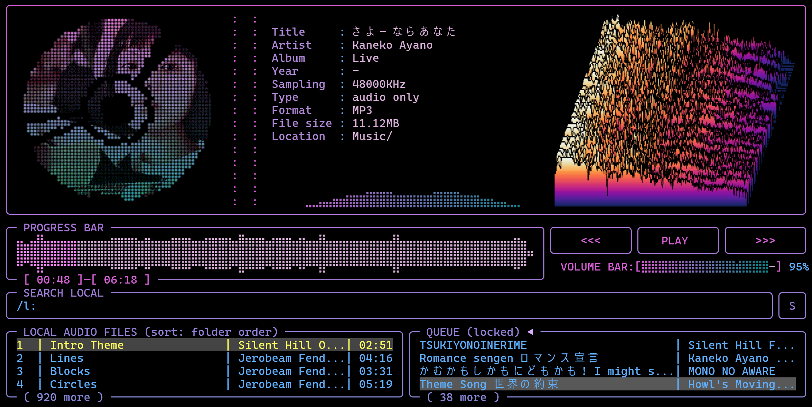

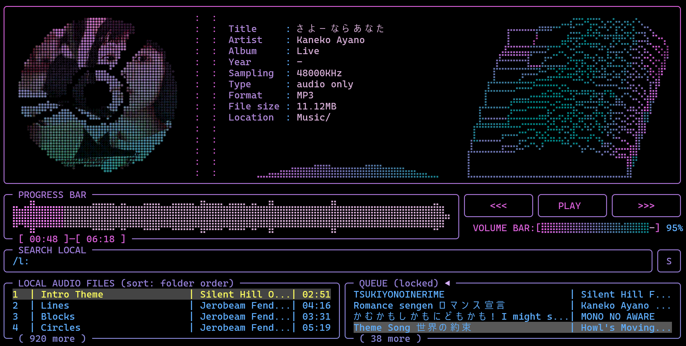

| Waterfall row | Choices | Default |
|---|---|---|
| Graphs | 8 … 100 (steps of 4): how many spectra are in the stack | 40 |
| Graph spacing | 20 … 500 ms between two graphs (so 40 graphs of 120 ms show the last 4.8 s) | 120 ms |
| Slant | 0 … 40 % of the width: how far the back graph is shifted to the right (0 = straight behind each other) | 25 % |
| Peak height | 10 … 60 % of the picture: the height of the loudest peak | 30 % |
| Resolution | normal / high: *high* draws the graphs at twice the resolution and scales them down, so a fine outline keeps its place and is shaded instead of being rounded to a whole pixel (finer lines in quiet parts; about four times the work per picture, and the fill has 40 colour steps instead of 52) | normal |

**Exactly like Audacity (defaults):** a 2048-sample **Hann** window scaled so that a full-scale sine reads 0 dB, **zero padding 2**, the power of every frequency bin in dB, the **Mel** frequency scale from **0 to 20 000 Hz**, **gain 20 dB** and **range 80 dB** (colour = (level + gain + range) / range: −20 dB and louder is the top colour, −100 dB and quieter the bottom one), frequency gain 0 dB per decade, every pixel row shows the strongest frequency bin it covers, and the colour map **Roseus** ("Color (Roseus)", Audacity's default). It analyses the decoded audio itself (before equalizer, normalization and volume), as Audacity analyses the file, so the volume does not change the picture.

**Two styles** (overlay row *Style*):
- **image**: a real picture drawn by the terminal (Kitty graphics or Sixel, like the oscilloscope's image style), pixel for pixel like Audacity. It works whatever style the oscilloscope uses and follows the oscilloscope overlay's **Image protocol** row (`auto` asks the terminal). Where the terminal speaks neither protocol, the braille version is shown and the *Style* row says `image (no Sixel/Kitty here)`.
- **braille**: in any terminal. Every text cell is 2 × 4 braille dots; the louder a spot, the more dots and the brighter the colour. Does not look to nice but is the fallback version when no iamge mode is available to a lack of KiTTY or sixel...

**Motion:** *sweep* (default) writes the newest column from left to right with a thin playhead line and a short dark gap ahead of it (so the new page and the rest of the old one never run into each other), a page at a time like Audacity follows playback. In the image style only the strip being written is sent - up to 30 times a second - which keeps it smooth and light even in full screen. *scroll* keeps the newest column on the right and moves everything. Every pixel column stays tied to one moment of the track, and the picture moves on an even clock (not in the audio's buffer-sized bursts). How the image style moves it depends on the terminal:
- **Sixel in Windows Terminal** (also from WSL): the terminal itself shifts the picture already on screen one cell to the left (DECCRA, "copy rectangular area", which Windows Terminal applies to Sixel pictures too), and only the newest cell column is sent - a few KB per step instead of the whole picture, so even full screen keeps up. It moves in steps of one cell (about 10 pixels): with the default time span of 30 s a full-screen picture of ~230 columns takes ~8 steps a second; a shorter **Time span** (10–15 s) makes it run faster and look more fluid. `MOUSIKI_SIXEL_SHIFT=0` switches this off; `=1` tries it in another terminal (only useful where copying a rectangle also moves the picture).
- **Other Sixel terminals:** the whole picture is sent again each time it moves, at most ~3 MB/s: a small picture moves on every pixel, a full-screen one in even steps of a few pixels -- and a terminal that draws Sixel slowly shows it in jumps.
- **Kitty graphics:** the whole picture, compressed, like other Sixel terminals.
For the smoothest picture anywhere use *sweep* (only the strip being written is sent), or *scroll* in the braille style.

While an overlay (`SHIFT+i`, `SHIFT+o` …) covers part of the picture, the rest - above, below and beside it, also the columns right next to its edges - keeps running; the covered part is drawn again when the overlay closes. When the picture goes away (another view, a menu, the settings) its cells are blanked, so nothing of it is left on the next screen.

**Full screen (`SHIFT+u`)**: the spectrogram over the whole screen, with the track (radio: station and song) as its title, **frequency labels** on the left like Audacity's ruler (both channels), a **time ruler** on top and the scale and range at the upper left of the frame. `LEFT` / `RIGHT` switch between **image** and **braille**, `UP` / `DOWN` between **spectrogram** and **waterfall** (the *Style* and *View* rows of the options). `SHIFT+i` opens the options on top of it, `ESC` or `SHIFT+u` closes it. Playback keys keep working.

**Options (`SHIFT+i`)** -- `↑`/`↓` select, `←`/`→` change, `R` puts everything back to Audacity's defaults (style, motion and view stay), `ESC` or `SHIFT+i` closes and saves. `SHIFT+o` / `SHIFT+0` switch straight to the **oscilloscope** options / full screen without closing this overlay first:

| Row | Choices | Default |
|---|---|---|
| View | spectrogram / waterfall | spectrogram |
| Style | braille / image | image |
| Motion | sweep / scroll (spectrogram view) | sweep |
| Scale | linear / logarithmic / mel / bark / erb / period (Audacity's scales) | mel |
| Min frequency | 0, 20, 50, 100, 200, 300, 500, 1000, 2000 Hz | 0 Hz |
| Max frequency | 1000 … 24000 Hz (never above half the sample rate) | 20000 Hz |
| Gain (dB) | −20 … 100 | 20 |
| Range (dB) | 10 … 200 (steps of 5) | 80 |
| Frequency gain | 0 … 60 dB per decade (brightens the highs; 0 dB at 1 kHz) | 0 |
| Window size | 256, 512, 1024, 2048, 4096, 8192 samples: how many samples one column analyses. **Bigger** = sharper, thinner frequency lines (good for tones and voices), but short sounds smear in time; **smaller** = crisp clicks and drum hits, but the frequencies get blurry. The picture is computed again at once from the last minute of audio, so you see the difference immediately. | 2048 |
| Zero padding | 1, 2, 4, 8: the window is padded with silence to a longer FFT, which draws the same information on a finer frequency grid (smoother, less blocky low end, especially with the Mel scale). It costs memory and time, not detail. Also recomputed at once. | 2 |
| Colors | roseus (Audacity's default), classic (Audacity's "Color (classic)" colours, but from black instead of light grey), grayscale (black to white), gradient (black, then the **VIZ** colours of **Settings → COLORS**, radio: the **OSCI** colours -- like the oscilloscope's *gradient*) | roseus |
| Channels | left + right (stacked, like Audacity) / mix (spectrogram view; the waterfall always uses the mix) | left + right |
| Time span | 5 … 60 s across the width, in steps of 5 s (also recomputed at once; spectrogram view) | 30 s |
| Frequency labels | on / off (full screen) | on |

The settings are stored as `Spectro<Name>=` lines in `config.txt` (radio: `radio_config.txt`). The analysis runs while a track is loaded, whether the picture is shown or not (also in a pause or behind an overlay), so the picture is complete when you open it; the spectrogram window (`(`) only knows what was played while it was open.

#### Spectrogram window (`(`: German `SHIFT+8`, English `SHIFT+9`)

A spectrogram is a colorized/visualization of the short time (Fast) Fourier transform (ST(F)FT) of an audio signal, i.e. the visualizes the FFT of time points and shows the magnitude of different frequencies involved to form a signal at each time point. 

The key that types `(` opens the **spectrogram in its own window** (again: closes it), drawn by the graphics card like the scope window. This is the way to a **perfectly smooth** scrolling spectrogram: a terminal can only move a picture by whole pixels or cells, and only as often as it can take the data, while the window redraws at the monitor's refresh rate (60, 120, 165 Hz …) and moves the picture by fractions of a pixel.

- **The same spectrogram:** the analysis is the one of the terminal spectrogram (Audacity's way, the decoded signal before EQ, normalization and volume), with the options of the `SHIFT+i` overlay - scale, frequencies, gain, range, frequency gain, window size, zero padding, colours (also *gradient* using the theme color gradient used for the disk set in the settings), channels, time span, labels and motion (*scroll* = the newest column on the right, moving smoothly; *sweep* = a page at a time with a playhead; lags in the in-terminal overlay so better use the window version for this mode; for the small field version in main UI the lag does not really appear that intense). 
- **Frequency labels** on the left (Audacity's round numbers), when **Labels** is on.
- Keys in the window: `F`, `F11` or double-click fullscreen, `T` always on top, `ESC`, `Q` or the key of `(` (`8` on a German, `9` on an English keyboard, with or without `SHIFT`) close.
- The window mode works whatever the lyrics area / scope block shows and also while the spectrogram is switched off on the ANIMA/VIZ tab (so does the full screen, `SHIFT+u`: the switch only concerns the field in the main screen). It can be open at the same time as the scope window.
- Title: the playing track (radio: station and song; audio book: book and chapter). Position, size, fullscreen and always-on-top are kept in `~/.config/mousiki/spectro_window.txt`; it stays open when you switch between player and radio and closes with Mousiki.
- Wndowed version needs SDL2, like the scope window. It is a second copy of Mousiki (`mousiki --spectro-window`) that gets the audio through a pipe; if it cannot start the status line says why (also in `~/.cache/mousiki/spectro_window_error.txt`).


### Spectrum bar

The **spectrum bar** is the live frequency display under the meta data (and under the station info in the radio). It is not part of the `.` / `,` cycle of the field on the right; it is always there unless it is switched off.

| Key | Action | What it does |
|---|---|---|
| `B` (Shift+B) | Spectrum bars options | The overlay of the music player (style, Hi-Fi rows incl. frequency scale / gain / range, behavior, fluidity ...), drawn **under the upper pane** with a scroll bar if the terminal is low. `↑`/`↓` select, `←`/`→` change, `R` defaults, `B` / `ESC` close. Rebindable (*Spectrum Bars Options*); also in the menu index (`<`). |

#### Spectrum bars overlay (`SHIFT+b`)

`SHIFT+b` (in the audio book mode `SHIFT+y`) opens the **spectrum bars overlay** under the upper pane. The bars stay visible while you change the values, and the overlay scrolls when the terminal is low. The rows are the same as in Settings → ANIMA/VIZ → SPECTRUM BARS; the full table with every value and its `config.txt` name is in chapter 10 (*Tab 3: ANIMA/VIZ*).

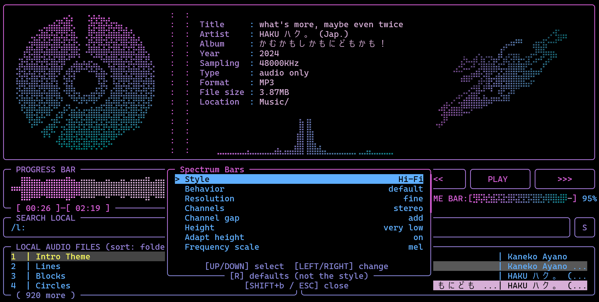

#### Classic and Hi-Fi

- **Bars Style:** *Classic* is the mono display of two text rows, mirrored with the bass in the middle. *Hi-Fi* is a Winamp-like analyzer drawn in braille dots without gaps between the bars: a **stereo** spectrum with the left channel on the left, the right channel on the right and the bass in the middle.
- **Hi-Fi rows** (only shown with Hi-Fi): *Resolution* (fine / rough), *Channels* (stereo / mono), *Height* (full to very low) and *Adapt Height*, *Frequency Scale* (linear, logarithmic, mel, bark, erb), *Gain (dB)*, *Range (dB)*, *Channel Gap* and *Color* (gradient / the colours of the spectrogram).

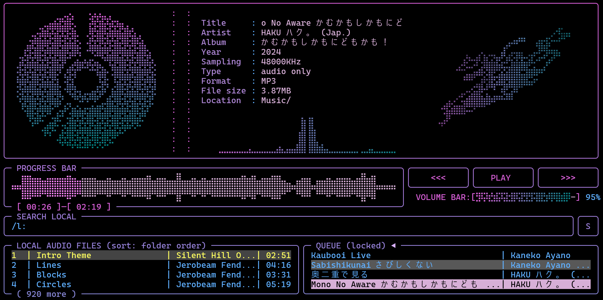

#### Motion

- **Bars Behavior** is a preset (*Lively*, *Default*, *Smooth*, *Slow*) for the three motion rows below it: **Bars Fluidity** (how the bars rise), **Bars Degradation** (how fast they fall) and **Bars Viscosity** (how strongly neighbouring bars are smoothed). Change one of the three and the preset becomes custom.
- The **On/Off** row (`Visualizer=`) hides the bars; the meta data then get the two rows.

## 4. Search (main UI)

The cheat sheet (`?`) lists these under two headings: **SEARCH LOCAL (MAIN UI)** (`/`, `/r:`, `/a:`, `/v:`, `/x:`, the playlist and folder searches) and **SEARCH ONLINE (MAIN UI)** (`/s:`, `/sc:`, `/b:`, `/sv:`).

| Key | Action | What it does |
|---|---|---|
| `/` | Search local folder | (German `SHIFT+7`.) Opens the search box. The list updates **live as you type**. Press `ENTER` to keep the result, or `ESC` to cancel and restore the previous view. |
| `/r:` + query | Search artists only | Local search limited to the **artist**: the artist tag, or the artist folder when a file has no tag. `/r:miles` lists only tracks by artists matching "miles", not tracks that merely have it in the title. The search bar is labelled **SEARCH ARTISTS**. |
| `/a:` + query | Search albums only | Local search limited to the **album** tag. The bar is labelled **SEARCH ALBUMS**. (Album tags are resolved in the background after a scan, so a freshly added folder may need a moment.) |
| `/v:` + query | Videos only | Lists only the video files, searched like normal text, e.g. `/v:live` (with the Video mode on or off). |
| `/x:` + query | Songs and videos | Lists the songs **and** all video files, e.g. `/x:live`. A normal search (`/`) lists the songs and the video files that have **no song of the same name** (a mere music video); a video that is paired with a song is left out, so a title does not show up twice. The library searches of the playlist editor, the meta editor, the folder overlay and the cover fetch follow the same rule (`v:` / `x:` in front of the query; `SHIFT+v` in the playlist editor, the meta editor and the folder overlay steps through *audio*, *video + audio* and *video* without a query). A video that is connected to a track shows that track's tags (artist, title, album, year) in all these lists. |
| `/s:` + query | Search online (YouTube) | Type `s:` followed by your query, then press `ENTER`. Online searches only run on `ENTER`, never per keystroke. |
| `/sc:` + query | Search SoundCloud | The same for **SoundCloud** (through yt-dlp). `ENTER` on a result plays it, the queue keys queue it, the download key saves it to the download folder. The audio is kept as SoundCloud sends it (no second conversion). Tracks SoundCloud only plays as a **30-second preview** (Go+ and some label releases) and tracks that cannot be played at all are **left out** of the results; to tell them apart each result is looked at in full, so a SoundCloud search takes a few seconds longer than a YouTube one. |
| `/b:` + query | Search Bandcamp | The same for **Bandcamp** tracks (the search is asked from Bandcamp by `scripts/bandcamp_search.py`, the download is done by yt-dlp). Bandcamp streams the free 128 kbit/s MP3; the full-quality files are for buyers on Bandcamp itself. |
| `/sv:` + query | Search videos on YouTube | `ENTER` opens **SEARCH YT** (see *Video mode*) with the query already searched, to download a video for the playing song. |
| `↑` / `↓`, then `ENTER` | Play from the search | Moving through the results with `↑` / `↓` while typing and pressing `ENTER` **plays the highlighted entry right away** (the search stays as the list's filter and the list keeps the highlight). Without moving, `ENTER` only keeps the search, as before. |
| `/p:` + query | Search saved playlists | Type `p:` followed by part of a playlist name. The playlist list filters live. `ENTER` on a playlist row queues all of its tracks. |
| `/f:` + query | Search folders | Type `f:` followed by part of a folder name (or of `<parent folder> <folder>`, e.g. `beatles abbey`). The folder list filters live. `ENTER` on a folder row opens it in the LOCAL AUDIO FILES pane and lists all of its files, exactly like the `f` filter (`c` clears it again). |
| `L` (Shift+L) | Big list overlay | Floats a larger version of the list pane (LOCAL AUDIO FILES) over the main UI. See below. |
| `F` (Shift+F) | Big folder overlay | A folder tree of the library with a search bar, floated over the main UI. See below. |
| `C` (Shift+C) | File conversion overlay | Convert high resolution files to MP3 / AAC / Opus. See below. |


**In radio mode** the search works the same way (fuzzy, live, `ESC` clears; the station under the cursor is highlighted while you type, and `ENTER` tunes it); it searches stations, and `p:` the saved station lists (see [Searching: stations, station lists and `p:`](#searching-stations-station-lists-and-p)).

**Local search details**

- The search is **fuzzy**. For example "X Files" also finds "X-Files".
- More about the fuzzy search: accents, some special letters and umlauts are ignored (`arzte` finds *Die Ärzte*, `strasse` finds *Straße*); two swapped letters count as one slip (`teh beatles`); a word typed only as far as it goes matches (`test cov` finds *test_song-cover3*, also with a number behind the word); and words typed **run together** find the words of a name in order, even with words in between skipped (`testcover` finds *test_song-cover3*, `bohrhap` finds *Bohemian Rhapsody*; the fewer words are skipped, the higher it ranks). An exact piece of the name always ranks first.
- It matches the file name, the artist, the embedded title tag and the album tag. Files whose tags have not been read yet can still be found by file name.
- Results are ranked purely by match quality, best first.
- While the search box is open, `↑`/`↓` move through the live preview. `←`/`→` move the text caret, and `SHIFT+←/→` marks text.
- A folder filter (`f`) keeps applying to search results.

### Big list overlay (`SHIFT+l`)

Opens a large window, styled like the lyrics form (`l`), that shows the same list as the small pane (LOCAL AUDIO FILES, or the online / playlist results) with many more rows. It shares the cursor with the small pane, so both always point at the same track.

| Key | Action |
|---|---|
| `SHIFT+↓` / `SHIFT+↑` | Next / previous **page** (faster scrolling). At the end of the list the cursor jumps to the last / first entry. |
| `↑` / `↓` | Move one row |
| `ESC` or `SHIFT+l` | Close the overlay |

Everything else keeps working from inside the overlay: `ENTER` plays, `T` cycles the sort mode, `f` / `c` set / clear the folder filter, `/` searches (the search bar is part of the overlay), `a` adds to the queue, `n` / `b` / `p` / seek / volume as usual, and `l` opens the lyrics form on top of it. The queue pane is hidden while the overlay is open, so its footer shows the current queue size (`queue: N`) together with a page counter. Full-screen menus (Settings, Playlists, ...) hide the overlay while they are open and it returns when they close.


*Big list overlay can be opened via `SHIFT+l` and closed via the same command or `ESC`. Fast scrolling (scroll per page) is possible via `SHIFT+↑/↓`.*

### Big folder overlay (`SHIFT+f`)

A large window with a search bar and the **LOCAL AUDIO FILES FOLDER** pane: a tree of all folders of your library (the folders of the PATHS tab and the download folder, with the number of tracks in each). `ENTER` opens a folder; its subfolders and files appear slightly indented below it, and `ENTER` closes it again.

| Key | Action |
|---|---|
| `↑` / `↓`, `SHIFT+↑` / `SHIFT+↓` | Move one row / one page |
| `ENTER`, `→` / `←` | Open / close the folder (`←` on a closed folder or a file jumps to its parent folder) |
| `f` | On a **folder**: show that folder in the LOCAL AUDIO FILES pane, exactly like `f` on a track (folder order, `c` clears it again). On a **file**: the same for the file's folder, with the file highlighted. Both close the overlay. |
| `CTRL+p` | **Play** the highlighted file (the overlay stays open, so you can keep browsing); on a folder it only shows a hint |
| `/` or `TAB` | Type in the search bar: only folders and files whose name matches (all words) stay in the tree, with the way down to them opened. `ENTER`, `TAB` or `ESC` hand the keyboard back to the tree. |
| `ESC` or `SHIFT+f` | Close the overlay |

Playback keys (pause, next / previous, seek, volume, mute, normalize) keep working. The key can be changed with `HKeyFolderOverlay` in `config.txt`. The overlay and the big list / queue overlays exclude each other.


*The folder overlay (`SHIFT+f`).*

### File conversion overlay (`SHIFT+c`)

Turns high resolution files into lighter ones. A large window with a search bar and the list **FILES TO CONVERT**: every file of the library with its format, sample rate / bit depth, bitrate, size and the estimated size after the conversion. The first line inside the list holds the pre-filter and the target, the second shows the export folder, the progress of a running conversion or the result of the last one.

| Key | Action |
|---|---|
| `↑` / `↓`, `SHIFT+↑` / `SHIFT+↓` | Move one row / one page |
| `SPACE` | Mark / unmark the highlighted file (and move on) |
| `a` | Mark everything that is shown, or unmark it again when all of it is marked |
| `t` / `SHIFT+t` | Pre-filter **type**, forward / backward: all files, lossless (FLAC, WAV, ALAC), FLAC, WAV, M4A, OGG, OPUS, AAC, MP3 |
| `r` / `SHIFT+r` | Pre-filter **minimum bitrate**: any, 320, 500 or 1000 kbps |
| `h` | Pre-filter **hi-res only**: more than 16 bit or more than 48 kHz |
| `←` / `→` | The **target**: MP3 320 kbps, MP3 V0 (about 245 kbps, variable), MP3 192 kbps, AAC 256 kbps (`.m4a`), Opus 128 kbps |
| `/` or `TAB` | Type in the search bar (folder and file name, all words must match); `TAB` or `ESC` hand the keyboard back to the list, `ENTER` too (in a plain file search) |
| `f:` / `p:` in the search bar | Same as in the main search: typing `f:` turns the bar into `/f:` and the list into the **folders** that hold files (filtered by what you type after it), `p:` turns it into `/p:` and lists the saved **playlists**. `ENTER` on a folder or playlist narrows **FILES TO CONVERT** to just its files (a folder: the files directly in it, like `f` in the main list; the pre-filter still applies, the info line says how many match). The search then works inside that selection. Typing `/` in the bar goes back to the full search (and drops the selection); `BACKSPACE` on an empty `/f:` or `/p:` removes the prefix; `ESC` leaves the folder / playlist list, then the selection, then closes the overlay. |
| `ENTER` | Convert the marked files (the highlighted one when nothing is marked) |
| `c` | Cancel the running conversion |
| `CTRL+p` | Play the highlighted file (the overlay stays open) |
| `ESC` or `SHIFT+c` | Close the overlay. A running conversion goes on in the background and reports on the status line. |

The files are read with `ffprobe` in the background right after the overlay opens (the list says `reading 12/340` meanwhile); filters that need those details (hi-res, minimum bitrate, lossless M4A) show a file as soon as it has been read. The converted files go to the **CONVERSION EXPORT PATH** (Settings → PATHS; by default the `conversion-export` folder inside the download folder), in the same sub folders as the originals below your library folder, with the new extension. **The originals are never changed or deleted.** A file that already exists in the export folder is skipped (so converting the same song to a second MP3 preset needs the old file moved away first). Tags and the cover picture are copied (not to Opus); sample rates above 48 kHz become 44.1 or 48 kHz, more than two channels become stereo. The export folder is left out of the list. Needs `ffmpeg` with `libmp3lame` and `libopus`; the installers and `setup.sh` / `setup.ps1` provide it. The key can be changed with `HKeyConvertOverlay` in `config.txt`.

### Latin letters for Japanese, Korean and Chinese text

Press **`"`** (that is `SHIFT+'` on a US keyboard; on a German keyboard `SHIFT+2`) to show / transliterate Japanese, Korean and Chinese text in Latin letters, press it again to go back. It converts what is *shown*: the titles, artists, albums and file names in the lists, the queue, the metadata panel and the editors, the lyrics in the main screen, the karaoke overlay and the Read Lyrics overlay (translations as well). The files and tags themselves are never changed. The status line says `Latin letters: on` / `off`; the switch is remembered (`LatinLetters=true/false` in `config.txt`; the key is `HKeyTranslit` in Settings → REFERENCE).

**In the radio mode** the same key switches the station names, the title that plays now, the station lists, the presets and the radio browser (the radio's cheat sheet lists it); the setting is the same one, so it carries over when you switch modes, and the radio writes `LatinLetters=` into `config.txt` for you.

| Script | Becomes | Example |
|---|---|---|
| Japanese kana (hiragana, katakana) | Hepburn romaji: `shi`, `tsu`, `kya`; the small *tsu* doubles the next consonant (`がっこう` → `gakkou`, `まっちゃ` → `matcha`); the long vowel mark gets a macron (`ラーメン` → `rāmen`); `ん` before a vowel gets an apostrophe (`しんあい` → `shin'ai`); `ファ`, `ティ`, `ウィ` ... as `fa`, `ti`, `wi` | `さくら` → `sakura` |
| Korean Hangul | Revised Romanization, sound by sound (`한국어` → `hangugeo`); a final consonant before a vowel moves on to it. Pronunciation changes between consonants (nasalisation ...) are not applied | `안녕하세요` → `annyeonghaseyo` |
| Chinese characters | Hanyu Pinyin with tone marks, one syllable per character; a character with several readings gets its most common one (`长` is always `cháng`, `行` always `xíng`; sung and spoken text will be wrong in places) | `周杰伦` → `zhōu jié lún` |

**Kanji and Chinese characters: Japanese or Chinese?** The same characters are read very differently (`東京` is *tōkyō* in Japanese and *dōng jīng* in Chinese; in Japanese the reading even depends on the word), and only a large dictionary could name the Japanese reading. So Mousiki only converts Chinese characters when it is **sure the text is Chinese**, and leaves them alone otherwise (a wrong reading is worse than none). A text counts as...
- **Japanese** when it has kana in it, or when any other tag of the same track has (`ありがとう` as the title makes the artist `周杰倫` Japanese for that track), or when it has a character only Japanese uses (`桜 楽 変 沢 畑 峠` ...). The characters stay: `愛してる` becomes `愛 shiteru`.
- **Chinese** when it has a character only Chinese uses (the simplified forms `们 这 乐 伦 爱 谢` ...), or when another tag of the track says so. They become pinyin.
- **Not known** when nothing says it (`東京`, `周杰倫`, `你好` are the same in every writing): unchanged. Once **one** track of an artist is recognised (a title with kana, a simplified-only character in any tag), the artist's name is remembered as Japanese / Chinese for all the other tracks, as soon as their tags are read.
- The switch `LatinHanziDefault` in `config.txt` decides what such unknown characters are: `leave` (default) leaves them alone, `chinese` reads them as Chinese (pinyin), if your library is mostly Chinese, and `japanese` treats them as Japanese, if your library is mostly Japanese (**Settings → GENERAL → TRANSLITERATION → Translit. Kanji** does the same: `Leave` / `Chin.` / `Jap.`): they stay as they are unless the optional kanji reader (below) is installed, which then reads them in the background like any other kanji of Japanese text.

**Names written both ways.** A name stored as `Kenshi Yonezu (米津玄師)`, `米津玄師 - Kenshi Yonezu` or `Kenshi Yonezu / 米津玄師` (a Latin part and a part in Chinese characters or kana, separated by `(` `)`, `[` `]`, ` - ` or ` / `) is shown as just its **Latin part** when the switch is on, and the pair is learned: the same characters on their own in another tag (`米津玄師` as the artist of another track) are then shown as `Kenshi Yonezu` too.

**Learned from your own library.** Many libraries name the files in Latin letters while the tags use the original script (`Music/Eason Chan/...` with the artist tag `陈奕迅`). When at least three tracks of an artist written in Chinese characters or kana sit in folders (artist or album folder) or in files (`Artist - Title`) that name the same Latin spelling - and no other spelling is as frequent - Mousiki learns the pair and shows the Latin name from then on. Learned pairs, and pairs from `Name (名前)`-style tags, are kept in `kanji_readings_learned.txt` next to `config.txt` (you can edit or delete lines; your own `kanji_readings.txt` always wins).

**Spelling of Japanese (Settings → GENERAL → TRANSLITERATION).** By default Japanese is written the way English and German readers find easiest: long vowels spelled out (`kienuyou`, `koohii`) and the particle を as `o` (`koe o kikasete`). A small っ doubles the next consonant (`ittemo`); a full-size つ before て / た after another kana, as many lyrics sites write it (`いつて` for `いって`), is read the same way (`itte`, not `itsute`; `かつて` stays `katsute`). The particle は is written `wa` when it stands alone (`は いけない` = `wa ikenai`), after で / に / と / へ / から at the end of a phrase or before ない (`kokodewa ikenai`), and after a kanji (`僕は` = `boku wa`); inside words it stays `ha` (`nihatori`). **Latin Macrons** (on) writes long vowels with a macron instead (`kienuyō`, `kōhī`, `ōkii`); **Latin Wo** (on) writes を as `wo`. Both are off by default and take effect at once. **Translit. Kanji** (same category: `Leave` / `Chin.` / `Jap.`, default `Leave`) decides what characters that could be Japanese or Chinese (`東京`) are read as, see the switch `LatinHanziDefault` above: it is the same setting, so it also changes `config.txt`. Spaces are only where the text has them: the conversion does not split a run of kana into words.

**Latin Name Lookup (opt-in, Settings → GENERAL → TRANSLITERATION).** For artists written in *Chinese characters* whose Latin name is still unknown, Mousiki can ask MusicBrainz in the background, one name at a time (about every 1.5 seconds, longer pauses when MusicBrainz is busy or you are offline). The answer is kept in `kanji_readings_learned.txt`, so every name is asked for only once; names MusicBrainz does not know are remembered as well (`none: <name>`). It needs Python 3, like the cover fetch. **Privacy:** switching it on sends the artist *names* from your library - and, as with any web request, your IP address - to musicbrainz.org. Nothing else (no titles, files, paths or play history) is sent. That is why it is **off by default** (`LatinNameLookup=false`); with it off nothing leaves your computer.

**Kanji readings with pykakasi (optional).** Kanji in Japanese text stay as they are, because their reading depends on the word. If you install the small Python package **pykakasi** (`pip install pykakasi`; about 10 MB), Mousiki uses it while the Latin letters are on: titles, artists and albums of Japanese tracks whose kanji stayed are read in the background in batches (`scripts/kanji_reading.py`), and then show up in Latin letters (`夜に駆ける` → `yoru ni kakeru`). The readings are kept in `kanji_readings_cache.txt` next to `config.txt` (each text is read once; delete the file to read everything again). It all happens on your computer, nothing is sent anywhere, and without pykakasi everything works as before (the status line says once that it is not installed). Your own `kanji_readings.txt` wins over it. pykakasi is **not** part of Mousiki and is not downloaded by the build: it is licensed GPL-3.0-or-later, so it is a separate program that you install if you want it; Mousiki only calls it. Texts that could be Chinese as well as Japanese (`東京` alone, without kana or other hints) are never sent to it. **Word spacing (janome, optional).** Japanese is written without spaces, so kana alone (`わたしはあなたがすきです`) come out as one long word (`watashihaanatagasukidesu`). With the small package **janome** (Apache-2.0, pure Python, about 20 MB with its dictionary; `pip install janome`) next to pykakasi, the reader cuts every Japanese line into words first: `watashi wa anata ga suki desu`, `raamen o tabe ni ikou` (particles stand alone and は / へ / を are read wa / e / o; endings stay with their verb). Lines with five or more kana are sent to the reader as well, not only those with kanji. Korean already keeps the spaces of the text, and Chinese is written one syllable at a time (`wǒ ài nǐ`), so only Japanese needs this. Readings read before janome was installed stay as they were: delete `kanji_readings_cache.txt` to read everything again. **Installing it:** the Windows installer has an unticked option, *Download pykakasi so kanji are shown in Latin letters too*; it downloads pykakasi, janome and their small helper packages from pypi.org (five pure-Python files, the same on every platform; each is checked against the exact checksum pinned in `scripts/kanji_pins.json`, any other file is refused; `python release.py pin` refreshes the pins) into the `pylib` folder of the installation, using the Python that comes with Mousiki. It needs internet during the installation; if the download fails, Mousiki just goes without. `setup.sh --with-kanji` / `setup.ps1 -WithKanji` run `pip install --user pykakasi janome` for a source build. A new installation of a newer version removes `pylib`; the option is remembered and downloads it again. **Common repairs on top of the two packages:** the na of a na-adjective, the endings *desho* / *darou*, and *kedo* / *keredo* are written as words of their own (`oshare na`, `nai desho`, `kamoshirenai kedo`); `donna ni` / `sonna ni`; `saretatte` (not `sareta tte`); a full-size つ before て / た is read as the small っ (`いつて` = `itte`); and a hiragana のむ right after a katakana word is the verb 飲む (`コーヒーのむのよ` = `koohii nomu no yo`); *kara* / *node* / *noni* / *shi* / *ga* after a verb are words of their own (`dekiru kara`, `wakaranai node`); `nandemo` is one word; numbers against Japanese text are read out (`1日` = `ichinichi`, `3周` = `sanshuu`, `2羽` = `niwa`, `15ぴょこ` = `juugo pyoko`; `F1` stays); loanword sounds are spelled as sung (`ティー` = `tii`, `ウィ` = `wi`); and a space in the lyrics always starts a new word; `は` before `ない` stays apart (`nikumitaku wa nai`), a noun after a verb ending too (`tsubureta bun`), the figures of a number belong together (`nijuuni seiki`), `一人` / `二人` are `hitori` / `futari`, the middle dot `・` and `( )`, `-`, `,` in Latin remarks are spaced as in writing (`parappa parappa (wow-oh)`), and a katakana `ヘ` after a katakana word is the particle `e`. A line of a song with a Latin remark in brackets is no longer taken for a "name (Latin name)" pair. The reader marks long vowels, so they follow the **Latin letters: macrons** setting like the built-in conversion does (`kyou` / `kyō`, `koohii` / `kōhī`). The cache file remembers a fingerprint of `scripts/kanji_reading.py`: when the reader's rules change (an update, or your own edit of the script) the file is started again by itself and everything is read again with the new rules. Installing or upgrading pykakasi / janome themselves is not noticed; delete `kanji_readings_cache.txt` by hand after that.

**Name and spelling side by side.** A tag such as `Kaneko Ayano カネコアヤノ` or `HAKU ハク。 (Jap.)` (the Latin name followed by the same name in kana, without brackets) shows just the Latin part: when the kana really spell the Latin name (also with the words swapped, long vowels and small spelling differences ignored). Artist tags with kanji (`Anri 杏里`, `Ichiko Aoba 青葉市子`) are shown as the Latin part too, as soon as the track has been seen in a list; the characters alone elsewhere (`杏里`) then show the Latin name as well. Particles after a kanji get their own word (`日本 no shitipoppu`), and kana written with a separate voicing mark (ト+゛) are joined first.

**The reading dictionary.** Mousiki knows the readings of some fifty well-known Japanese artists whose names are written in kanji (`米津玄師` = Yonezu Kenshi, `椎名林檎` = Shiina Ringo, `坂本龍一` = Sakamoto Ryuichi ...). You can add your own words (or correct one) in the text file `kanji_readings.txt` in the folder of `config.txt` (`~/.config/mousiki/`, `%USERPROFILE%\.config\mousiki\` on Windows), one per line, UTF-8:

```
# a word (or a whole title) = its reading; the longest match wins, also inside longer texts
夜に駆ける = Yoru ni Kakeru
一青窈 = Hitoto Yo
# which language a text is (used for its characters when nothing else says it)
chinese: 周杰倫
japanese: 東京事変
```

The file is read when Mousiki starts. The dictionary wins over everything else, and the searches use it too.

**Searching** needs no switch: the library search (`/`), the meta editor, the playlist editor and the search of the queue overlay always also look at the Latin spelling of titles, artists and albums, so `sakura` finds `さくら`, `hanguk` finds `한국어 노래` and `zhou jielun` finds `周杰伦` (Chinese: only when the text is recognised as Chinese, see above; the typo tolerance, the accents and the run-together words of the fuzzy search work on that spelling too). The characters themselves are found as before. The **radio's** station search (the main screen, the menus and the station lists) does the same with the Latin spelling of station names, genres and countries. The **Radio Browser** search (the online station search) is answered by the radio-browser.info server, which only matches the text as it is stored there, so the Latin spelling does not apply to it. The radio's station search (main screen, menus, station lists) does the same with station names, genres and countries. The **Radio Browser** search (`SHIFT+s`-style online search) is answered by the radio-browser.info server, which only matches the text as it is written there, so it cannot use the Latin spelling unfortunately.

### Cover fetch overlay (`ALT+c`)

*On macOS the default is `SHIFT+q` (see [`ALT` on macOS](#alt-on-macos-option)); rebind *Open Cover Fetch* under Settings → Reference if you like.*

Finds the **front cover** of albums on MusicBrainz / the Cover Art Archive and saves it next to your music. It is an overlay of its own (and not a tab of the meta editor) on purpose: MusicBrainz is sometimes wrong or unsure about album titles that come from loose files, so fetching those was not included in the meta data menu and should be a deliberate step on a list you have looked at, not something that runs along while tags are edited. Music player only (`HKeyCoverFetch` in `config.txt` changes the key; `SHIFT+c` stays the conversion overlay). Needs Python 3 (`scripts/fetch_cover.py`, only the standard library) and an internet connection.

Two tabs, switched with `←` / `→` or `ALT+←` / `ALT+→`:

**ALBUM LIBRARY** looks like the meta editor: a search bar on top, the **ALBUM LIBRARY** on the left, the **ALBUM ART** on the right.

- The search works like the meta editor's: `f:` lists matching folders (`f:abbey`), anything else searches the whole meta data of the tracks. The result is a list of **folders** (`ENTER` or `SPACE` opens one, the albums are indented below it); inside a folder only the **album names** (the album tag) are listed, each once, with the number of covers it has. Tracks without an album tag are not listed (the pane says how many).
- An album **without any cover** is drawn in the legend colour. "Cover" means a picture connected to the album: the one inside the first file, a fetched cover, a picture of the folder whose name is close to the album, `cover.jpg` / `folder.jpg` ... when the folder holds only this album, or a picture you chose for it.
- Filters: `x` albums with **no cover**, `o` with **one cover**, `s` with **several covers**, `p` albums with a **previous unsuccessful fetch**, `r` albums **recently fetched** (the last 14 days; the list shows just album and artist; check the covers in the picture pane), (the pane title shows it, `ESC` takes it off). Albums MusicBrainz or the Cover Art Archive had nothing for are **remembered** and are not listed any more, so they are not asked for again and again; only `p` shows them, and `a` on one tries it again. A temporary problem is not remembered but tried again: HTTP 500 (*internal server error*) and 503 (*service unavailable*) mean that the MusicBrainz / Cover Art Archive server is busy or hiccups, not that the album is unknown. Such albums are asked for again after the rest of the list, up to three more times, after pauses of 45, 90 and 135 seconds (the status line counts down; `SHIFT+c` stops). The title search first asks for the exact title and then uses MusicBrainz' fuzzy search, which tolerates typos and small differences (a close title is still required). While the covers are still being counted the footer says so.
- The ALBUM ART pane starts with the **album title and the artist**; the highlighted album's row and these two lines scroll as a marquee when they are too long (Settings → *Marquee Scrolling*).
- `SHIFT+d` **removes the album title** of the highlighted album (after a question): the album tag of all its tracks becomes an empty, *pending* edit of the meta data editor, so a wrong title can be taken away here and the album is tagged again there; nothing is written to the files until `CTRL+s` in the meta editor (`CTRL+SHIFT+x` discards). The album leaves this list as an untagged one. Pending album edits of the meta editor are also what this list shows.
- `a` puts the highlighted album (on a folder row: all its albums) on the fetch list, `SHIFT+f` puts everything the search shows (respecting the filter) on it.
- `t` switches the cover of the right pane between **ASCII** (braille dots) and **full resolution** (a real picture, with Kitty / Sixel terminals). Full resolution is the default; a terminal without Kitty / Sixel always shows ASCII. The switch is shared with the cover pane of the meta editor (`t` there, see below).
- `TAB` moves the focus search bar → library → **ALBUM ART**. The right pane shows the cover the album has now and, below it, the pictures that belong to it. In that list `↑` / `↓` preview a picture, `ENTER` makes it the **cover of this album name** (an album default), `n` shows no cover for the album, `c` clears the choice (Settings → Cover Search decides again), `DEL` / `d` deletes the picture from the disk after a question (not the one inside a file). A picture you chose for a **single track** in the meta editor goes before this album default.

**FETCH LIST** holds the albums to fetch. `ENTER` (after a question that says that the album name and the artist (the one most tracks of the album have) are sent to MusicBrainz, and song titles only as a fallback: the search asks for album + artist first, exact and then fuzzy; only when that finds nothing, up to three song titles of the album are added, which limits the search to releases that contain one of those songs, and a release found that way is marked `[songs confirmed]` in the `r` filter) fetches them one after the other, `SHIFT+c` stops, `DEL` removes one, `SHIFT+d` empties the list. Every album is asked for **once**, however many songs it has; only the **front** cover is taken, and where the archive offers several sizes the lightweight JPEG is preferred. The cover is saved as `fetched_covers/<album>.jpg` **inside every folder that holds a track of the album** (copied when the album is spread over several folders, so there can be duplicates; that is fine with JPEGs). The folder is part of every Cover Search option except **Within File Only**, so a fetched cover is found by the player and the other overlays right away. Albums MusicBrainz does not know, or without a front cover in the archive, are marked in the legend colour with the reason. Closing the overlay does not stop a running fetch. `ALT+c` opens the overlay and closes it again (also from the search field); `SHIFT+r` rescans the music folders (new, moved or removed files) without leaving the overlay.


### Fetch videos overlay (`ALT+v`)

The video counterpart of the cover fetch overlay: it finds the videos of many songs at once. It is part of the Video mode (chapter 3, *Video mode*), but works while the mode is off as well. It opens with `ALT+v` (`SHIFT+d` on a Mac), from the `[ General Fetch Videos Menu ]` button of the VIDEO SETTINGS overlay and from VIDEO OPTION.

**FETCH VIDEOS** (`ALT+v`, `SHIFT+d` on a Mac; the `[ General Fetch Videos Menu ]` button of the VIDEO SETTINGS overlay; key `HKeyVideoFetch`): a **full-screen overlay** built like the cover fetch and meta data menus. **Left: SONGS** – the songs that have no video yet (no connection and no video of the same name beside them; also while the Video mode is off) and the playing song, on which the cursor starts; the filter field on top narrows the list. **Right: VIDEOS** – the videos found on YouTube (yt-dlp) for the song under the cursor, with the **preview** (thumbnail as a real picture in Kitty / Sixel terminals, braille dots otherwise) of the video under the cursor. The search starts **by itself** when the cursor has rested on a song for a moment; it searches with the **file name and the tags** (artist + title) and merges the hits (`CTRL+t`: file name + tags / file name / tags). A song is marked `[ ]` not searched, `[~]` searching, `[?]` several videos – **a choice is needed**, `[x]` chosen, `[-]` nothing found. `ENTER` on a song goes into its videos, `↑`/`↓` look at them (the preview follows; `≈` marks the one whose length is closest to the song's; `o` opens its page), `ENTER` / `SPACE` **chooses** the highlighted one (the cursor stays on that song), `c` clears the choice. A single hit is the choice already; several hits are **never picked automatically**. `s` searches the song again, `SHIFT+s` searches every shown song one after the other. `/` (`SHIFT+7` on a German keyboard) jumps to the filter field; `CTRL+f` changes **which songs are listed**: missing video only (default; plus the playing song) → all songs → songs that have a video (marked `[v]`, re-fetch with `r`). A song that **has a video already** (the playing one) is marked `[v]`, is **not searched by itself** and shows its video in the VIDEOS pane instead; `r` offers a **re-fetch**: after a warning that the former video is unassigned from the song (the file stays on the disk) it is searched like the others, and a downloaded choice replaces the pairing. `SHIFT+f` **downloads only the chosen videos** (picture up to `VideoDownHeight=` pixels, mp4) into `video_down` in the download folder, named like the song, and pairs each with its song; songs without an active choice are left alone (the status line says how many still need a choice). `CTRL+c` cancels a running download; `ESC` goes back / closes (a running download goes on and the end is reported in the status line). It needs `yt-dlp` and `ffmpeg`; please respect the terms of the site and the rights of the artists.

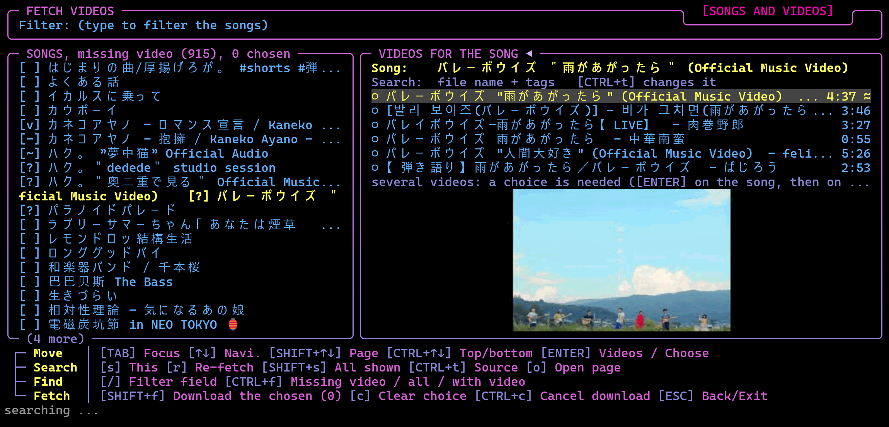

#### The VIDEO FILES tab

**FETCH VIDEOS, the second tab VIDEO FILES** (`ALT+←` / `ALT+→`, or `←` / `→` outside a text field, switch between the two tabs): the place to **overlook and delete videos**. **Left:** every video file of the library (also while the Video mode is off) and every video a song is connected to, even outside the library folders; the ones that are **coupled with a song are highlighted** and marked `[c]`, the others (`[ ]`) are *video only*. **Right:** the video under the cursor with its folder and size, the **song or songs that show it** (a connection by hand or a download, or the same file name beside it; a song that was set to *no video* does not count) and a **frame of the video** as a picture (Kitty / Sixel; no picture in other terminals). For a **video only** file the detail pane offers `[CTRL+3 / m]` **makes an mp3 song from this video** (ffmpeg, in the background): the sound is saved in the regular download folder, named like the video, and connected to it (the song then shows the video). The row sits above the note about the deletion; the picture has an empty row above and below it. `CTRL+3` is reported only by terminals that send modified keys (kitty, xterm with modifyOtherKeys); a classic terminal sends `ESC` for it, so `m` does the same everywhere. A video without a sound track says so. `CTRL+f` steps through the filters **all videos / coupled / video only / newest first** (all videos, the ones added or downloaded last on top, by the time the file was last changed), `/` jumps to the filter field (it matches the file name, the folder and the names of the coupled songs). `DEL` **deletes the video file** after a question (`DEL` or `ENTER` again confirms, anything else cancels); `u` **undoes the last deletion**, one after the other, and brings the file back to its folder together with its connections. A deleted video is only moved to a holding folder (`video_trash` next to `config.txt`) and is removed for good when Mousiki closes, so an undo works until then (the replaced file of a *Refetch this Video* is deleted at once and cannot be brought back); its connections go with it and the songs that used it have no video afterwards (a coupled video asks with the number of songs). Only the chosen file is deleted, never a song.

#### Videos nobody uses and no double downloads

**Videos that nobody uses:** FETCH VIDEOS only downloads the videos you **choose** (`SHIFT+f`), once per video (the same file is connected again instead of fetched twice, see *No double downloads*). Nothing is fetched that no song asked for. What can be left over is a video that a **re-fetch** (`r`) replaced: the former video is unassigned but its file stays on the disk -- it shows as *video only* in the VIDEO FILES tab, where `DEL` removes it.

**No double downloads:** every video Mousiki downloads (SEARCH YT, FETCH VIDEOS) is written to `history/downloaded_videos.txt` in the download folder (yt-dlp's archive format, `youtube <id>`) and to `history/downloaded_videos_files.txt` (which file it became). When the same video is chosen again and its file is still there, Mousiki **connects that file** to the song instead of fetching it again; a deleted file can be downloaded again. Videos have a list of their own because the same YouTube id can also be a song (`downloaded_history.txt`). The same two files are used by a shell function that downloads videos from a terminal (for PowerShell, `down_vid "url"` saves `<title> [<id>].mp4` into `video_down`), so a video fetched there or here is never fetched twice.


## 5. Queue (main UI)

The queue is a list of tracks that play **before** the normal list continues. The bottom border of the pane shows how many titles are below the visible rows (`( 5 more )`), like the list pane. Press `TAB` to move focus into the queue panel when you want the arrow keys or `d`, `4`, `5`, `SHIFT+4`, `SHIFT+5` to work on it.

| Key | Action | What it does |
|---|---|---|
| `a` | Add hovering track as **next** | With the **list** focused, puts the highlighted track at the **front** of the queue, so it plays next. Pressing `a` on several tracks in a row keeps their order: A, B, C play as A, B, C. On a playlist row it queues all of the playlist's tracks at the end instead. With the **queue** focused, `a` does nothing (the **bulk-add** panel is `SHIFT+g`, see below). |
| `e` | Add hovering track to the **end** | With the **list** focused, adds the highlighted track to the end of the queue. On a playlist row it queues the whole playlist at the end. With the queue focused it only reminds you to focus the list first. |
| `d` | Remove hovering track from queue | Removes the highlighted queue item. Focus the queue with `TAB` first. |
| `4` | Move hovering queue item up | Moves the highlighted queue item one place up. Focus the queue first. |
| `5` | Move hovering queue item down | Moves the highlighted queue item one place down. Focus the queue first. |
| `$` (Shift+4) | Move to top | Moves the highlighted queue item to the very top of the queue. |
| `%` (Shift+5) | Move to bottom | Moves the highlighted queue item to the very bottom of the queue. |
| `!` | Lock / unlock the queue | The queue is **locked by default**: a played track moves to the end of the queue. Unlocked, it leaves the queue. See *Locked queue* below. |
| `X` (Shift+X) | Clear the whole queue | Asks "Want to clear queue?" first. See below. |
| `CTRL+SHIFT+z` | Undo the last queue clear | Brings back the queue that `SHIFT+x` cleared. See *Undo clear* below. |
| `CTRL+SHIFT+u` | Queue to playlist | Saves the queue's local tracks as a playlist. See *Queue to playlist* below. |
| `SHIFT+a` | Add the highlighted library track to a playlist | Opens a small overlay (new / existing playlist) and saves the track into it at once. See *Add a track straight to a playlist* in the Playlists chapter. |
| `SHIFT+g` | Bulk add | Opens the bulk-add panel (paste a YouTube playlist link) from any pane, not only with the queue focused. See *Bulk add* below. Rebindable (Settings → REFERENCE: *Bulk Add*). |
| `K` (Shift+K) | Big queue overlay | Floats a larger version of the QUEUE pane over the main UI. See below. |


### Big queue overlay (`SHIFT+k`)

The same idea as the big list overlay, for the queue: a large window that shows the QUEUE pane with many more rows. It is on `SHIFT+k` (and not on `q`) so that you cannot quit the app by accident. It shares the cursor with the small queue pane, and the queue is automatically focused while it is open, so the arrow keys move through the queue. The artist column has twice the room it has in the small pane (32 characters instead of 16, in a window wide enough for it).

| Key | Action |
|---|---|
| `SHIFT+ARROW_DOWN` / `SHIFT+ARROW_UP` | Next / previous **page**. At the end the cursor jumps to the last / first entry. |
| `ARROW_UP` / `ARROW_DOWN` | Move one row |
| `4` / `5` (default) | Move the hovered track up / down in the queue |
| `SHIFT+4` / `SHIFT+5` (default) | Move the hovered track to the top / bottom of the queue |
| `!` (default) | Lock / unlock the queue |
| `SHIFT+s` | **Shuffle order**: puts the queue in a random order (on a locked queue the track that plays now stays at the end). Only inside the big queue overlay; on the main screen `SHIFT+s` is still the Style Option overlay |
| `SHIFT+u` | **Undo shuffle**: the order from before the last shuffle comes back (one level). Tracks added since stay behind the others, tracks removed or played since are simply gone from it; on a locked queue the track that plays now stays at the end. `X` (clear all) forgets the backup. Only inside the big queue overlay; on the main screen `SHIFT+u` is still the full-screen spectrogram |
| `d` | Remove the hovered track from the queue |
| `a` | Does nothing while the queue is focused: it only adds a track from the library pane. Use `SHIFT+g` (rebindable: **Bulk Add**) to open the bulk-add panel from any pane |
| `SHIFT+x` | Clear the whole queue (asks first) |
| `CTRL+SHIFT+z` | Undo the last queue clear |
| `CTRL+SHIFT+u` | Save the queue as a playlist (opens the playlist editor) |
| `ESC` or `SHIFT+k` | Close the overlay (the previous focus is restored) |

Only one of the big overlays can be open at a time: `SHIFT+k` while the list overlay is open switches to the queue overlay, and vice versa. The same goes for the **folder overlay** (`SHIFT+f`): from the list or the queue overlay `SHIFT+f` switches to it, and inside it `SHIFT+l` / `SHIFT+k` switch back, without closing the overlay first. Pressing `/` in the queue overlay opens its own **search bar at the bottom** (under the queue box, so it cannot be mistaken for the search of the list overlay): the entries of the queue that match (typo tolerant like the library search; it looks in the title, artist, album, year, file and folder names and in **every tag of the file**, also the ones no screen shows, such as genre, composer, album artist or comment: the tags of the queued files are read in the background when you start typing, so a match on a hidden tag can take a moment to appear) are marked in the header colour and the cursor jumps to the first one; `↑` / `↓` go to the previous / next match, `ENTER` leaves the bar (the matches stay marked), `ESC` clears the search (and the next `ESC` closes the overlay). The queue keeps its order, nothing is hidden. The bar shows the number of matches. Playback keys (`n`, `b`, `p`, seek, volume) keep working. The bottom border of the frame shows the page counter and the number of tracks. All commands of the overlay are listed in a gray **legend below the frame** (`[d] delete`, `[SHIFT+x] clear all`, `[4/5] move up/down`, `[SHIFT+4/5] move to top/bottom`, `[!] lock` / `[!] unlock`, `[CTRL+SHIFT+u] queue to playlist`, `[CTRL+SHIFT+z] undo clear`, `[SHIFT+UP/DOWN] page`, `[ESC] close`).


*Big queue overlay can be opened via `SHIFT+k` and closed via the same command or `ESC`. Fast scrolling (scroll per page) is possible via `SHIFT+↑/↓`.*

### Locked queue (`!`)

The queue is **locked by default**. A locked queue keeps all its tracks: when a track is played (by auto-advance or by `n`) it **moves to the end of the queue**, so the queue loops instead of draining, and the next track is always the one at the top, also in shuffle mode: `n` and the end of a track always take the next title of the queue, only `#` picks a random one (it is sent to the end the same way). `d` and `SHIFT+x` still remove tracks, locking only stops tracks from disappearing by themselves. The panel title shows `QUEUE (locked)`.

Press `!` to **unlock**: a track then **leaves the queue** once it is played, and the queue runs empty. Press `!` again to lock it. The lock state is part of the saved session, so a session saved by an older version keeps the state it was saved with (press `!` once if it comes back unlocked). The play modes do not change this, with one exception: in `Q` (queue then stop) a locked queue is played through once and playback then stops instead of looping.

### Undo clear (`CTRL+SHIFT+z`)

Brings back the queue that was cleared last with `SHIFT+x`. The restored tracks go in **front of** anything that was queued after the clear. There is **one** level of undo: after it is used (or before anything was cleared) the status line says that there is nothing to undo.

### Queue to playlist (`CTRL+SHIFT+u`)

A small overlay asks first: **New playlist** or **Existing playlist** (`←` / `→` or `TAB` to choose, `ENTER` confirms, or press `n` / `e` directly; `ESC` closes it). With **Existing playlist** the overlay shows a search field and a list of the saved playlists (all of them while the search is empty); `↑` / `↓` choose, `ENTER` adds the queue's tracks to that playlist (ones it already holds are skipped), `ESC` goes back. Either way the playlist editor then opens on the Create/Edit tab and **the change still has to be saved with `CTRL+s`**.

With **New playlist** the editor opens with the queue's tracks already in the new playlist and the **name field focused**: type a name and press `CTRL+s` to save (the editor stays open, `ESC` leaves the name field, a second `ESC` leaves the editor). Playlists hold local files only, so **online (streamed) queue items are left out** and counted in the status line; duplicate files are added once. With an empty queue, or a queue with online tracks only, nothing opens and the status line says so.

### Clear queue prompt (`SHIFT+x`)

The prompt starts on **No**, so an accidental `ENTER` never wipes the queue.

| Key | Result |
|---|---|
| `←` | Highlight Yes |
| `→` | Highlight No |
| `TAB` | Toggle between Yes and No |
| `ENTER` | Take the highlighted answer |
| `y` | Yes: clear the queue |
| `n`, `ESC` or any other key | No: cancel |

If the queue is already empty, the status line just says so. A cleared queue can be brought back with `CTRL+SHIFT+z` (see above).

### Bulk add (`SHIFT+g`)

Paste a YouTube playlist link to queue tracks from it. Bulk add only puts the titles into the queue: **nothing is downloaded when adding**; each track is fetched when it is played.

1. **Type or paste the link** and press `ENTER` to fetch it (`ESC` cancels). The link field is a normal text box: `←` / `→` move the caret, `SHIFT+←` / `SHIFT+→` mark, `HOME` / `END`, `DEL`, `CTRL+c` / `CTRL+x` / `CTRL+v`.
2. Once the results appear: `↑`/`↓` move, `SPACE` stars or unstars a row, `a` queues **all** of them, and `ENTER` queues **only the starred** ones.
3. `ESC` throws everything away.


*Bulk add with the fetched results.*

---

## 6. Playlists

`P` (Shift+P) opens the **playlist editor**, a full-screen overlay for building playlists from your local (or downloaded) tracks. It has two tabs: **Create/Edit** and **Saved Playlists**. Playlists are used from the main screen with `/p:` (see [Search](#4-search-main-ui)). The editor uses the same tab strip as the settings: the title and, on the Create/Edit tab, the **name field** (25 characters) sit on its top line, the tab names on the right.

The LIBRARY and TRACKS panes of the Create/Edit tab share four columns: **Filename** (a narrow one: half as wide as it used to be), **Title**, **Artist** and **Album** (the album tag, `-` when there is none). On the row under the cursor every column that is too long for its width scrolls as a marquee (Settings → GENERAL → *Marquee Scrolling*; off: cut with `...`).

Playlists are stored in **one** folder, set under **Settings → PATHS → PLAYLIST PATH**. Without it, the first local path plus `/playlists` is used. Changing the playlist path **copies** the existing playlists to the new folder; nothing is moved or deleted.

When the meta editor **renames** a file, every saved playlist that contains it is updated, so the track does not turn up as `[missing]`. A track whose file is no longer at the stored path (moved to another folder, or a folder renamed) is looked up by file name in your library, i.e. in the folders added under **Settings → PATHS**, and is used from its new place; the playlist file is rewritten when you save the playlist and also whenever the library is rescanned (the rescan updates all saved playlists and the titles already in the queue, and re-reads their tags). Only a file moved outside those folders stays `[missing]`. The title and artist columns of the Create/Edit tab are read from the files' tags in the background, also for files outside your library (for example a download folder); until a file has been read the columns show `-` and the folder name.


***Create / Edit** tab: the name field, the library picker with its search (`/`), and the tracks of the playlist being built.*

**The name field:** while it has the focus (and likewise the library search before anything is typed) `←` / `→` switch the tab. `ENTER` opens its **edit mode** with the whole name marked (typing replaces it, an arrow key keeps it for editing; a name has 25 characters at most, the status line says so); typing a letter opens the edit mode too: the field is drawn in the **CHANGE** colours of the Colors tab (*CHANGE TEXT* / *CHANGE BG*, the same as every other input), `←` / `→` move the caret, `ENTER` confirms and goes on to the library, `ESC` leaves the edit mode. **Renaming:** when a playlist that was loaded from the SAVED PLAYLISTS tab gets another name and is saved (`CTRL+s`), it is *renamed*: the file of the old name is replaced, no copy stays. A name that another playlist already has is refused.


***Saved Playlists** tab: the search field and the list of saved playlists with their track counts.*


| Key | What it does |
|---|---|
| `P` | Open Playlists (create / manage) |
| `←` / `→` | Switch between the Create/Edit tab and the Saved Playlists tab. In the name field or a search box they move the caret instead **once you have typed something there**; `ESC` leaves the box and gives them back to the tab switch (see [Menus with tabs and text boxes](#menus-with-tabs-and-text-boxes)). |
| `ALT+←` / `ALT+→` | Switch the tab from every pane, also while typing. |
| `TAB` | Cycle focus. On Create/Edit: name field → library picker → track list. On Saved Playlists: search box ↔ list. |
| `↑` / `↓` | Move through the focused list or picker |
| `ENTER` | Depends on focus. See the table below. |
| `4` / `5` | Move the highlighted track up or down in the playlist you are building |
| `SHIFT+t` | Library picker: cycle the **sort** of the library list (and of a search result): folder order → *Filenames A-Z* → *Title A-Z* → *Artist A-Z* → *Album A-Z* → *Recently added* (newest first, by when the file arrived in the library). The current sort is shown in the LIBRARY title. Works as long as nothing was typed in the search box yet (a capital `T` typed into the box is a letter; press `ESC` to leave the box, or start with a small `t`). The key is the main list's *cycle sort* hotkey (`HKeyCycleSortMode`). |
| `SHIFT+r` | Library picker: **rescans the library** (new files copied in while the editor is open show up at once; the status line says how many tracks there are now). Like `SHIFT+t` it works as long as nothing was typed in the search box yet (`ESC` leaves the box). |
| `/f:` in the search | Search **folders**: the hits are shown as **folder rows** (`▸ parent / folder (n)`), like the folder overlay of the main list. `ENTER` on a folder row **opens / closes** it (its files hang indented below); `ENTER` on a file adds that file. |
| `SHIFT+a` | Library picker: adds the **whole folder** (the hovered folder row, or the folder of the hovered file) to the playlist; files that are in it already are skipped. Same rule as `SHIFT+t`: not while the box has been typed into. |
| `SHIFT+u` | Library picker: **undoes the last add** (one file, or a whole folder from `SHIFT+a`), step by step back. |
| `/f:` | In the search box: search **folders**. `/f:abbey` lists every track whose folder (or its parent folder) contains `abbey`; several words must all match. Combines with the sort. |
| `D` / `DEL` / `BACKSPACE` | Remove the highlighted track (track list focused). On the Saved Playlists tab, `DEL` deletes the selected playlist after a Yes/No confirmation. |
| `e` | On the Saved Playlists tab (list focused): **export** the selected playlist (or, with the scope *Currently (filtered) list*, every playlist the (filtered) list shows) as **M3U8** (default) or **M3U** files. See *Exporting a playlist* below. |
| `c` / `g` | On the Saved Playlists tab (list focused): **filter** the list: `c` shows only the playlists **created** in the program (the playlist folder itself), `g` shows **all given** playlists: the playlist folder and `imported_lists` together (the `export` and `import` folders are never listed); the same key again goes back (the title says `[CREATED]` / `[ALL GIVEN]`; in the combined list the imported ones carry a `↓`). |
| `i` | On the Saved Playlists tab (list focused): **import** `.m3u` / `.m3u8` files from a folder (default: the `import` folder inside the playlist folder, or the PLAYLIST IMPORT PATH if one is set). `SPACE` marks a file, `a` marks all, `TAB` goes folder field -> list -> scope row (*Marked / hovered* or *Whole folder*: every file of the folder), `ENTER` imports, `ESC` cancels. The files in the import folder are **never removed or changed**: the import makes a **copy** in the `imported_lists` folder inside the playlist folder, so the playlist folder itself holds only the playlists you created (the filter keys `c` / `g` tell them apart: created only / everything). A track whose file does not exist on this computer (a list from someone else) is **looked up in your library**, see *Importing a list from another computer* below; what is not found stays in the list as missing, and stream URLs are skipped. The status line counts the matches, the missing files and the URLs. |
| `CTRL+s` | Save the playlist (from every pane of the Create/Edit tab, also while typing) |
| `SHIFT+←` / `SHIFT+→`, `HOME` / `END` | Mark text / jump to the start or end in the name and search fields |
| `CTRL+C` / `CTRL+X` / `CTRL+V` | Copy, cut and paste text in those fields |

### Add a track straight to a playlist (`SHIFT+a`)

In the **main player UI**, with the **library / search result pane** focused (not the library picker inside the playlist menu), `SHIFT+a` (rebindable: **Add Track To Playlist**) adds the highlighted track to a playlist without opening the playlist editor. It uses the same small overlay as *Queue to playlist*: **New playlist** or **Existing playlist** (`←` / `→` or `TAB`, `ENTER`, or `n` / `e`). With **Existing playlist** you search and pick from the saved playlists; with **New playlist** you type a name. `ENTER` adds the track and **saves the playlist at once**; the status line reports it. A track that is already in the playlist is not added twice.

Only tracks can be added, not playlist rows or folder rows (the status line says so). A track from **YouTube, SoundCloud or Bandcamp** is **downloaded automatically** into the download folder first (in the background, the status line says `downloading ...`) and is then added as the local file it has become, so it also shows up in your library. With the queue pane focused the key only reminds you to focus the library pane.

### What `ENTER` does in the playlist editor

| Where | Result |
|---|---|
| Name field | Confirms the name and jumps to the library picker |
| Library picker | Adds the highlighted track to the playlist. (Typing in this pane filters the library live.) |
| Saved Playlists, search box | Moves focus to the list |
| Saved Playlists, list | Loads the selected playlist into the editor |

### Importing a list from another computer

The paths in a playlist made elsewhere (`D:\Music\...`, another user name, another drive) rarely exist here. For every track whose file is not found, the import looks into your **library** (the folders of LOCAL PATH) in two steps, in this order:

1. **File name.** The name without folder and extension: `Queen\01 - Bohemian Rhapsody.flac` finds `Bohemian Rhapsody.mp3`. Case, accents, spaces, punctuation, bracketed parts such as `(Remastered)` and a leading track number do not count. With several files of that name the one in a folder of the same name wins. A file of the same name is **not** taken when both sides name an artist (the `#EXTINF` line of the list and the tag of the file) and the two are clearly different (a second `Intro`).
2. **Title and artist, fuzzy.** Both must be **at least 75 % alike** (similarity = 1 - edit distance / length of the longer text, so `Wonderwal` finds `Wonderwall`). The list side comes from the `#EXTINF` line (`Artist - Title`), from the file name (`Artist - Title.mp3`) and the folder name; the library side from the tags (as far as they have been read - the library reads them in the background after a scan) and from the file names and folders. The order of the words in a name does not matter (`Yonezu Kenshi` = `Kenshi Yonezu`). A track with **no artist anywhere** is taken only on a title that is at least 90 % alike, and only when exactly one library track fits - otherwise it would be a guess.

**Japanese, Korean and Chinese** text is compared twice, as written and by its Latin spelling (the same spelling as the *Latin letters* switch, `SHIFT+'`): a list with `米津玄師 - Lemon` finds `Kenshi Yonezu - Lemon`, `さくら` finds `Sakura`, `사랑` finds `Sarang`, and the other way round. Chinese characters whose language cannot be told (Japanese or Chinese?) stay as written unless LatinHanziDefault or the reading file (`kanji_readings.txt`) says otherwise, so those compare only when both lists use the same characters.

A found track is stored with the **path of your library file**, so it plays and works like any other track of the list; tracks that are not found keep their original path and are skipped when the list is queued. The import never changes the files of the library. The match is made once, when the list is imported: after adding the missing music to your library, import the list again (the copy in `imported_lists` gets the name with ` (2)`).

### Exporting a playlist (M3U8 / M3U)

On the **Saved Playlists** tab, select a playlist in the list and press `e`. A small overlay opens:

| Row | What it is |
|---|---|
| Folder | Where the file goes. It starts as **Settings → PATHS → PLAYLIST EXPORT PATH** (or, while that is empty, the `export` folder inside the playlist folder, created when needed; the lists ignore that folder, so exported files never show up as playlists) and can be changed right here for this one export. The usual text keys work (`←`/`→`, `SHIFT+←/→`, `HOME`/`END`, `CTRL+C/X/V`); `~` is your home folder. A folder that does not exist yet is created. |
| Export | **This playlist** or **Currently (filtered) list**: every playlist the (filtered) list shows right now (the created / given filter `c` / `g` and the search apply, so `c` and then `e` exports only the created ones). `←`/`→` or `SPACE` switch. One file per playlist. |
| Format | **M3U8** (the default, UTF-8) or **M3U**. `←`/`→` or `SPACE` switch while the row is selected. |
| File | The file name that will be written: the playlist name plus `.m3u8` / `.m3u`. An existing file of that name is replaced. |

`TAB` or `↑`/`↓` move between Folder, Format and Export, `ENTER` (or `CTRL+s`) exports, `ESC` cancels. The file is an *extended M3U*: `#EXTM3U`, the playlist name, and per track an `#EXTINF` line (`Artist - Title`, length unknown = `-1`) followed by the track's absolute path. Both formats are written as UTF-8, which current players expect for `.m3u` too. Tracks whose file no longer exists are left out; the status line says how many were exported and how many were missing.

### Leaving

In a text box you typed into, the first `ESC` only leaves the box (the text stays). The next `ESC` closes the editor. If there are unsaved changes on the Create/Edit tab (a typed name counts), it asks `Save changes to "…" before exiting?`: `y` saves, `n` discards and leaves, `ESC` cancels the question and keeps editing.

---

## 7. Meta editor

`M` (Shift+M) opens the **meta/tag editor** for changing a file's **file name**, **artist**, **title**, **album** and **year**, and for looking up missing tags with AcoustID (an audio-fingerprint service) and, for album and year, MusicBrainz. It took quite a while to make this editor and its legends understandable but it is a rather complex menu that may need some time to understand. Alterantive software you could use are Metatogger, but this menu, together with the cover fetch menu,  serves the same purpose. If you have ideas to make it even more accessible, feel free to discuss on the github repo of Mousiki Plus! 

**Important safety rules**

- Editing never touches your files directly. All changes go into a **pending edit session**, which is autosaved after every keystroke to `~/.cache/mousiki/meta_session/`. Closing the editor, quitting, or even a crash keeps the session.
- **The main screen follows the editor live.** The first line (`Title` / `File`) and the `Artist` / `Album` / `Year` lines of the metadata block (and the track title in the oscilloscope / spectrogram windows) show the pending edits of the track that is playing right away, typed by hand or fetched in the editor with `SHIFT+n` / `SHIFT+b`, before anything is saved. The first line is labelled **Title** or **File** and follows `SHIFT+n` like the list rows do: **Title** is the title tag (the file name if the file has none), **File** is the file name (a pending FILE rename shows there). Edits left over from an earlier run appear as soon as the track starts. `CTRL+s` writes them, and the screen keeps showing the saved values. Sampling, Type, Format, File size and Location are read from the file and are not affected.
- Touched fields and the matching library rows are drawn in the **header colour**, so you can see what will be written.
- Only `CTRL+s` writes to the files, and it asks first.


***Edit** tab (the search field sits on the second line of the tab strip, left of the tab names): the search field, the library on the left, and the five fields (FILE, ARTIST, TITLE, ALBUM, YEAR) of the highlighted file on the right. The footer lists every key as a small tree table: one row per group (Move, Fetch, View, Session), the group name on the left, its keys on the right.*


***Fetch List** tab: the titles queued for an AcoustID lookup. The status line below the footer confirms what was added.*


| Key | What it does |
|---|---|
| `M` | Open the meta editor |
| `←` / `→` | Switch between the **Edit** tab and the **Fetch List** tab. In the **search field** they move the caret instead once you have typed something there (`ESC` gives them back to the tab switch); in the **field editor** they always move the caret. |
| `ALT+←` / `ALT+→` | Switch the tab from everywhere, also while typing. |
| `TAB` | Cycle panels on the Edit tab: search field → library → field editor |
| `↑` / `↓` | Move through the focused list, or between the five fields in the field editor |
| `ENTER` | Depends on focus (see below). On the **Fetch List** tab it fetches the full list (with the ticked options). On a field with several fetched options it opens the choice overlay. |
| `SHIFT+←` / `SHIFT+→` | Mark text in the search field and the field editor |
| `CTRL+C` / `CTRL+X` / `CTRL+V` | Copy, cut, paste in the search field and the field editor |
| `a` | Add the highlighted file to the **fetch list** (library focused). Add a single title and tick the boxes on the Fetch List tab to fetch just some tags of it |
| `SHIFT+f` | **Add full (searched/filtered) list**: adds every title the library pane shows right now to the fetch list (library focused). The search and the missing-tag filter (`x`, `SHIFT+t/a/l/y`) are applied, titles already on the list are skipped, the status line says how many were added. Typical use: filter for `SHIFT+l` (missing album), press `SHIFT+f`, switch to the Fetch List tab and press `ENTER` |
| `f` | **Folder view** (library focused) | Groups the FILE LIBRARY by folder (the title shows `[FOLDERS]`): every folder is a header row (`▾ Album folder  (5)`) and its files are listed under it, numbered from 1 again in each folder (1-5 in the first folder, 1-7 in the second ...). `↑`/`↓` move over the headers too. On a **folder header**, `a` adds all titles of that folder (as far as the search and the filters show them) to the fetch list, and `ENTER` closes / opens the folder (`▸` / `▾`). `f` again returns to the plain list. |
| `r` | Toggle **edited files on top** of the library pane. If **no titles appear** (or fewer than you expect), a missing-tag filter (`x`, `SHIFT+t/a/l/y`) may still be active: it hides every file that is not missing that tag. The status line then ends with `NOTE: [MISSING TITLE] filter active, hit [ESC] to clear filter` (the name of the active filter); `ESC` in the library pane clears the filter (a second `ESC` then switches the `r` / `n` order off). The same note appears after `n`. |
| `n` | Toggle **recently added first** in the library pane (newest arrived files on top; with `r` on, the edited files stay above them). What is active is shown in the pane title, joined with a plus: `FILE LIBRARY [EDITED FIRST + ADDED FIRST + MISSING TITLE]`. `ESC` in the library pane takes things off step by step: the first `ESC` clears the missing-tag filter, the next one switches `r` and `n` off, the one after that moves up to the search bar (`r` and `n` can also be switched off by pressing them again). |
| `x` | Filter the library to files missing **any** metadata (library pane focused; press again to clear) |
| `SHIFT+t` | Filter the library to files missing a **title** (press again to clear) |
| `SHIFT+a` | Filter the library to files missing an **artist** (press again to clear) |
| `SHIFT+l` | Filter the library to files missing an **album** (press again to clear) |
| `SHIFT+y` | Filter the library to files missing a **year** (press again to clear) |
| `SHIFT+p` | **Play** the hovering track (library pane and fetch list) |
| `f`, `r`, `x`, `SHIFT+t`, `SHIFT+a`, `SHIFT+l`, `SHIFT+y` | The folder view, the re-sort and the missing-tag filters: after each of them the **view moves to the top** of the list. |
| `SHIFT+b` | **Fetch missing tag**: look up the highlighted title via AcoustID and fill in only its empty tags (asks first). Only while the library list has the focus (in the search box and the field editor a capital B is typed). Rebindable (*Fetch Missing Tags (Meta Editor)*). |
| `SHIFT+c` | **Jump to the song that plays now** (EDIT tab, library list): it is hovered in the list, whatever was typed or filtered: the search text and the missing-tag filter are removed. |
| `SHIFT+n` | **(Re-)fetch all**: the same, but all tags are fetched and overwrite the existing ones (library pane or fetch list focused; asks first) |
| `SHIFT+c` | **Cancel the running fetch** (Fetch List tab). The lookup stops at once. What had already arrived stays as pending edits; the titles that were not fetched yet (and the failed ones) stay on the fetch list, so you can start them again later |
| `DEL` / `d` | Remove the highlighted title from the **fetch list**. It only takes a title off that list: it never deletes the file and does not touch pending edits. If the title is not on the fetch list, the status line says `not on the fetch list`. |
| `CTRL+s` | Apply all pending edits to the files (asks first). Every file is rewritten through ffmpeg (the audio is copied, not re-encoded), so hundreds of edits take a while. The program stays alive: the status line counts `saving 37 / 412 ...`, and when it lasts longer than about a second a **Please wait, this may take a few seconds** panel with a progress bar appears. `ESC` stops after the current file; what is not saved yet stays pending, and so does a file that failed |
| `SHIFT+d` / `SHIFT+DEL` | **Empty the whole fetch list** (fetch list tab; asks first). Only the list: pending edits -- the tags already fetched included -- stay until `CTRL+s` saves or `CTRL+SHIFT+x` discards them. Not while a fetch runs (`SHIFT+c` stops it). |
| `CTRL+SHIFT+x` | Discard all pending edits, fetched tags included, **and** empty the fetch list (asks first) |
| `SHIFT+r` | Rescan the library (library pane or fetch list focused), e.g. after new files arrived |
| `SHIFT+↑` / `SHIFT+↓` | Library pane, fetch list and fields: move one **page** up / down |
| `CTRL+↑` / `CTRL+↓` | The same lists: jump to the **first / last** row (some desktops use `CTRL+↑↓` themselves, e.g. macOS Mission Control; then use `SHIFT+↑↓`) |
| `ESC` | In the field editor: back to the library. In the library pane with a missing-tag filter (`x` / `SHIFT+t` / `a` / `y` / `l`) on: the **first `ESC` only removes the filter**, the next one moves to the search field. In the search field: the first `ESC` **clears the query**, the next one closes the editor (the session is kept). Otherwise: close the editor. |
| `/f:` | In the search field: search **folders**, e.g. `/f:abbey` lists every track whose folder (or its parent folder) contains `abbey` (several words must all match). Same as in the playlist editor. |

### What `ENTER` does in the meta editor

| Where | Result |
|---|---|
| Search field | Keeps the filter and moves to the library list |
| Library list | Starts editing the highlighted file's fields |
| Field editor | Finishes editing this field and goes back to the library (`ESC` does the same). On a field with several fetched options: opens the choice overlay. |
| Fetch List tab | **Fetch full list**: every title in the list, only the ticked tags (asks first) |

### The cover in the meta editor: Cover Options

On the EDIT tab the cover of the highlighted track is shown under the five fields (centred in the free space). It shows what the disk shows of the track: its cover, a **frame of its video** when the track is set to the video thumbnail (and has a video), or the plain disk when it is set to that or has no cover. It is a real picture on Kitty / Sixel terminals (the default) and braille dots otherwise; `t` switches between **ASCII** and **full resolution** (the same switch as in the cover fetch menu; shown in the Filter row of the legend). While a floating panel (Cover Options, a tag choice, saving) is open the cover is drawn as dots. Below the fields sits the button **Cover Options** (move to it with `↓`, `ENTER` opens it). The overlay lists what the track can use, with a preview of the highlighted one on the right. The list has two groups under their own headings. **The disk shows** (always in view) is what the disk shows of this track when it has a video, one of four, drawn as `(o)` / `( )`: *As in the VIDEO SETTINGS (default)*, *The cover*, *The video thumbnail, else the cover* (a frame of **this track's video**; a track without a video uses its cover) and *The plain disk*. It is a setting of its own: the picture chosen for the track below stays as it is, and the same choice is the row *Use Cover or Thumbnail* of the Style Option. *The plain disk* is the "no cover" of a track. Under **Picture of this track** (scrolls) are:

- **Automatic**: Settings → Cover Search decides (removes your picture choice for the track),
- the picture **inside the file**, the pictures in the track's **folder** and in its **`fetched_covers`** folder, and the covers of the track's album (the one in use, marked `[x]`, is listed first, right under Automatic),
- a **search by file name** (`/`): filters that list and also looks into the folders around the track.

`TAB` stops at the three places in turn: the *disk* options (the cursor lands on the one in use), the pictures (on the one in use) and the search field. `ENTER` uses the highlighted picture for **this track**; `DEL` / `d` on a picture in the folder or in `fetched_covers` deletes it from the disk after a question; `DEL` on **Automatic** or on the picture **inside the file** (which cannot be deleted) gives the track **no cover at all**: the disk is shown, also where the folder holds a picture that Automatic would take. The choice then appears as `(o) No cover: the disk is shown` in the list; **Automatic** (or any picture) brings a cover back. `ESC` closes. A choice made here goes **before** the album's default (cover fetch overlay) and before the Cover Search setting, with one exception: **Within File Only** always uses the picture inside the file. Choices are kept in `~/.cache/mousiki/covers/choices.txt`.

### The style of a track: Style Option

Next to the button **Cover Options** sits **Style Option** (`→` / `←` switch between the two buttons, `ENTER` opens). Its small overlay tunes how the cover of **this track** looks, row by row (`↑↓` select, `←→` change, `DEL` or `d` puts a row back to *as in Settings*). On a terminal at least 100 columns wide the overlay grows a **preview** on its right: the cover of the track with the look, contrast, brightness and colors you have chosen so far (the plain disk when the look is *Disk* or the track has no cover): in a **Kitty / Sixel terminal as a real picture** (the default) and in braille dots otherwise; `t` switches between picture and braille, as in the cover options. The *Cover ASCII* looks are braille dots anyway.

With the **Video mode on** the overlay gets a row **Use Cover or Thumbnail** (*as in VIDEO SETTINGS* / *the cover* / *the video thumbnail* / *the plain disk*). It is the same per-track setting as *The disk shows* in *Cover Options* above (it does not touch the picture chosen for the track); the VIDEO SETTINGS overlay's *Cover, Disk or Thumbnail* is the default for the tracks that say *as in VIDEO SETTINGS*.

The rows are grouped under category lines: **Cover** (look, contrast, brightness, colors, chromatic aberration and, with the Video mode on, *Use Cover or Thumbnail*), **Video** (with the Video mode on) and **Album** (the last row). More rows follow with the Video mode on, for the **video of this track**: *Video of this track* (`on` / `off`: `off` hides its video, the track then counts as one without a video), *Use Lyrics on Video* (*as in VIDEO SETTINGS* / `off` / `on`: the lyric line under this track's picture; the VIDEO SETTINGS overlay's *Include Lyrics* is the default), *Video Size* and *Video Effect* (*as in VIDEO SETTINGS* / `regular`, `cropped`, `full`, `framed` / `off`, `scanlines`, … `interlace`), *Video Contrast* and *Video Colors* (0–100 %, steps of 5: the same two settings as in Settings → ANIMA/VIZ; colours 0 % = greyscale) and *Video Chromatic Aberration* (*as in Settings* / `off`, `subtle`, `medium`, `strong`) and *Video Resolution* (*as in Settings* / `standard`, `high`, `full`; takes effect at once). One more row sits in the cover block: *Cover Chromatic Aberration*. They are kept per track like the cover choices; `DEL` or `d` puts a row back to the default. In the big video overlay, `↑` / `↓` change the track's own effect when it has one, else the default.

**From the main screen:** `SHIFT+s` opens this overlay for the **track that plays**, on its own (no meta editor behind it); `ESC` closes it. Opened this way it also has `m`, which leads on to the **meta data of that very song** (the meta editor, with that track picked). The key can be changed in Settings → REFERENCE (*Open Style Options*, `HKeyStyleOptions` in `config.txt`). Music player only; the track has to be in your library.

- **Look of this track**: *as in Settings*, *Disk (no cover)*, *Just Cover*, *Cover with Gradient*, *Cover behind Disk*, *v2*, *Full Anima*, *Cover ASCII*, *Cover ASCII with Gradient*,
- **Cover Contrast**, **Cover Brightness**, **Cover Colors**: 0–100 % in steps of 5, the same settings as in Settings → Disk → Cover, but only for this track,
- **Look of the whole album**: the same list, for every track with the same album tag (a track without one: for its folder).

What a track has of its own wins over the album's look, and that over Settings → *Album Cover* / *Cover Mode*. While the track plays, `CTRL+T` / `CTRL+Z` change its look (the track's own, else the album's). Everything is saved at once in `~/.cache/mousiki/covers/choices.txt`.

### Using the AcoustID lookup

- `SHIFT+b` (**Fetch missing tag of a single track**, EDIT tab) looks up one title and fills in only its empty tags. It works **only in the meta editor** (on the main screen `SHIFT+b` opens the spectrum bars overlay). The meta editor **opens on the song that plays now**, with the filters and the search text cleared, so the list always starts where you are listening. `SHIFT+n` (**Fetch all tags**, meta editor) overwrites all its tags. Neither uses the fetch-option boxes; for other combinations add the title to the fetch list and tick the boxes there.
- `a` collects titles into the fetch list (`SHIFT+f` adds the whole filtered library pane at once), and `ENTER` on the Fetch List tab runs them as a batch.
- A running batch is **not** stopped by leaving the meta editor: it continues in the background, the progress (`AcoustID: 3/12 ...`) shows in the status line of the main screen, and the results arrive as pending edits (open the editor again to review them). `SHIFT+c` on the Fetch List tab stops it. Quitting Mousiki (or switching to the radio) cancels a running batch too and keeps what had arrived.
- Before anything is fetched you get a disclaimer that the result is not always accurate and that only `all` or ticked tags overwrite existing tags. Answer with `y`, `n` or `ESC`.
- Results only land in the **edit session**, never directly in the files. Low-confidence matches are reported as "no match" rather than written as wrong tags.
- Applying (`CTRL+s`) writes the tags without re-encoding the audio. A file name edit becomes a plain rename.

### Choosing what is fetched: the fetch options

The header of the **Fetch List** tab has an option line with one checkbox per option:

`Fetch: [x] missing only  [ ] all  [ ] artist  [ ] title  [ ] album  [ ] year`

| Key | What it does |
|---|---|
| `TAB` | move the focus between the list and the option line (`◀` marks the focus) |
| `←` / `→` | move the cursor over the boxes (on the option line) |
| `SPACE` | tick or untick the box under the cursor |
| `ENTER` | fetch **every track in the list**, only the ticked tags |

| Option | Fetches |
|---|---|
| `missing only` (default) | only the tags that are **empty**; anything that already has a value, typed or in the file, stays as it is |
| `all` | artist, title, album and year, **overwriting** what is there |
| `artist` / `title` / `album` / `year` | the ticked tags only, overwriting them; these four combine freely |

`missing only` and `all` exclude each other and the four tag boxes: ticking one of them unticks the others, and ticking a tag box unticks `missing only` / `all`. At least one box always stays ticked. The choice is saved with the session and applies to the fetch list (`ENTER`); `SHIFT+b` / `SHIFT+n` do not use it. A title with nothing to fetch is skipped with the message *nothing to fetch*. The lookup itself uses the audio fingerprint only; tags that are already there are not part of the search.

### Album and year: MusicBrainz and the choice overlay

Album and year belong to one specific release, so a song often has several answers (the album, its remaster, ...). The data comes from MusicBrainz (one request per second) and is due to several mentions (simetimes also compilations) not accurate (I'd say 90-95% it is,but don't just save changes). The first answer is put into the field; the colour shows what is left to do, what has coices etc.:

| Colour | Meaning |
|---|---|
| Header colour | like any edit: typed by you, fetched with only one candidate, or a choice you made |
| **Legend colour** | several candidates: a choice is waiting. The matching **file row in the LIBRARY pane** uses the same colour |

`ENTER` on a field with several candidates opens the **choice overlay**: `↑`/`↓` select, `ENTER` takes the highlighted one, `DEL` or `d` discards the fetched value together with all options (the field goes back to what the file has), `ESC` closes it. Choosing an album also sets the year of that release while the year is still a fetched suggestion. Open choices are part of the autosaved session. `CTRL+s` mentions them in its question; if some are still open, the first candidate is what gets saved.

---

## 8. History

`H` (Shift+H) opens the **listening history** overlay, with four tabs. Browse through your top tracks and playlists, or even add a top list to the queue. 

| Key | What it does |
|---|---|
| `H` | Open the history (and close it again). `ESC` and `q` also close it. |
| `←` / `→` | Switch the tab (not while the ADD SMART HISTORY TO QUEUE pane has the focus, see below) |
| `1` – `4` | Jump to the tab: **1 History**, **2 Top Tracks**, **3 Top Playlists**, **4 Habits** |
| `↑` / `↓` | Move the cursor in History and Top Tracks. On Top Playlists and Habits they scroll. |
| `r` | On **Top Tracks**: flip between *most played first* and *least played first* |
| `TAB` | On **Top Tracks**: switch between the track list and the **ADD SMART HISTORY TO QUEUE** pane. `TAB` never switches tabs. |
| `ENTER` | On a track in **History** or **Top Tracks**: **play it right away** (the overlay stays open and the footer says `playing: …`). A local file that no longer exists is reported instead. In the ADD SMART HISTORY TO QUEUE pane: queue the highlighted list. |
| `ESC` | In the ADD SMART HISTORY TO QUEUE pane: give the focus back to the track list. Otherwise: close the history. |

### The four tabs

- **History**: the last 100 plays. `ENTER` plays the hovered one.
- **Top Tracks**: one row per title with its artist (separated from the title by ` | `, as in the playlist editor), its length and play count, sorted by play count. `ENTER` plays the hovered title.
- **Top Playlists**: the five most played saved playlists of the **week**, **month**, **quarter**, **year** and **overall**, all in one pane (two columns on a wide terminal), with the number of plays and the time listened, plus a small summary (playlists played, plays from playlists, share of all plays). A play counts for a playlist when the track was queued from it (`ENTER` or `a` on a playlist row in the main list, or a queue restored from the last session). Tracks you picked one by one count for no playlist, and plays from before this tab existed carry no playlist, so the lists fill up from now on. Week, month, quarter and year are the last 7, 30, 91 and 365 days, like the smart lists below.
- **Habits**: listening statistics, including average session length, listening time per day, tracks per session, skips, replays and completion rates. *Listening by weekday* shows, per weekday, the **AVERAGE** time (every such weekday since your first play counts, days without music as 0; the bar follows this value) and the **CUMULATIVE** lifetime total.


*TOP PLAYLISTS tab.*


***History** tab: when each track was played, its title and artist (in separate columns, laid out like on the Top Tracks tab), its length and its state (`PLAY` = playing now, `done` = played to the end, `skip` = skipped).*


***Top Tracks** tab: titles by play count, with the queue pane underneath (now called **ADD SMART HISTORY TO QUEUE**, see below; the screenshot shows the older version).*


***Habits** tab: sessions, time played per day, and play behaviour.*


The list cursor behaves like the one of the local file list: the column header stays in place and the window only scrolls when the cursor leaves it.

The history is stored in `history.json`. The folder is set under **Settings → PATHS → HISTORY PATH** (one folder). If the new folder already holds a `history.json` it is used, otherwise the current one is copied there.

**In radio mode** the radio has its own history of channels, see [Listening history](#listening-history-h).

### ADD SMART HISTORY TO QUEUE

The pane under the Top Tracks list holds **sixteen ready-made lists** in four columns, separated by `|` in the border colour:

| TOP TRACKS | TOP OF THE ... | TIME OF DAY | REDISCOVER |
|---|---|---|---|
| Top 10 tracks | Top 25 of the week | Morning (7-11 a.m.) | Last 25 newly added |
| Top 25 tracks | Top 25 of the month | Day (11 a.m.-6 p.m.) | Least 25 played |
| Top 50 tracks | Top 25 of the quarter | Evening (6-10 p.m.) | Least played: month |
| Top 100 tracks | Top 25 of the year | Night (10 p.m.-7 a.m.) | Least played: year |

1. Press `2` (or `→`) for Top Tracks.
2. Press `TAB` to move into the pane (a `◀` appears behind its title).
3. Pick a list with the arrow keys. **While the pane has the focus, `←` / `→` move between its columns and do not switch tabs.**
4. Press `ENTER` to add the list to the end of the queue. `ESC` (or `TAB`) takes you back to the track list.

What the lists contain:

- **Top 10 / 25 / 50 / 100:** the most-played titles of all time. "Top N" always means the N most-played titles, even if you flipped the list above with `r`. While fewer titles have been played, the number in brackets shows how many there are.
- **Top 25 of the week / month / quarter / year:** the 25 titles played most in the last 7 / 30 / 91 / 365 days.
- **Morning / Day / Evening / Night:** the 25 titles you play most at that time of day (by the time a play started): morning 7-11 a.m., day 11 a.m.-6 p.m., evening 6-10 p.m., night 10 p.m.-7 a.m.
- **Last 25 newly added:** the 25 files that arrived in your music folders most recently (by the time the file was created / copied there, or its modification time if that is newer). Taken from the local library, played or not.
- **Least 25 played:** 25 tracks of your local library with the fewest plays; tracks never played count as 0. Tracks with the same count come in a random order every time, so this is a good way to rediscover forgotten music.
- **Least played: month / year:** among the titles played in the last 30 / 365 days, the 25 played least often.

Files that have been moved or deleted since they were played are skipped, and the status line reports how many tracks were queued (and how many were missing, or that fewer were available). Online tracks are queued as online tracks.

The history keeps the newest 1000 plays one by one and folds older ones into lifetime totals per title. From v3.1.0 on those totals also remember the day and the time of day of every play, so the period and time-of-day lists stay exact over years. Plays folded by an older version only count for the all-time lists.

---

## 9. Downloads

| Key | Action | What it does |
|---|---|---|
| `y` | Save stream | Saves the **currently playing streamed track** -- from YouTube (`/s:`), SoundCloud (`/sc:`) or Bandcamp (`/b:`) -- into your download folder (**Settings → PATHS → DOWNLOAD PATH**, or `~/.cache/mousiki` if none is set). The file is named `Title - Artist.ext`, the cached copy is removed, and the library refreshes so the file appears as a local track. The file keeps the format the site delivered: Opus for YouTube, MP3 / Opus / AAC for SoundCloud, the 128 kbit/s MP3 stream for Bandcamp. |

Status messages:

- `saved to <path>`: success
- `already saved: <name>`: a file with that name is already in the folder
- `not a cached stream`: the current track is a regular local file, so there is nothing to download

---

## 10. Settings (individual tabs)

Press `s` on the main screen to open **Settings**. It has six tabs: **COLORS**, **GENERAL**, **ANIMA/VIZ**, **PATHS**, **REFERENCE** and **ABOUT APP**. Settings always open on the first tab. The footer shows `[TAB] Switch  [ENTER] Edit  [s] Save settings  [ESC/q] Discard` (on the COLORS tab also `[e] Edit/Save current state  [SHIFT+e/i] Ex-/Import theme`), and the line below it reports what just changed. While there are changes that are not saved yet, that line shows a green ``Unsaved changes! Save with `s` or discard with `ESC`.`` note. While a field is being edited the footer changes to `[ENTER] Apply  [ESC] Cancel  [←→] Cursor  [SHIFT+←→] Mark  [HOME/END] Jump  [Ctrl+C/X/V] Copy/Cut/Paste`. On every tab that scrolls, `SHIFT+↑` / `SHIFT+↓` moves a whole **page** (`[SHIFT+↑↓] Page` in the legend). The bottom line shows the message of your last change (e.g. `lyrics name variants: off ...`) followed by *(unsaved)* while the settings differ from the saved ones.

### Moving around and editing (all tabs)

| Key | What it does |
|---|---|
| `TAB` | Next tab (wraps from ABOUT APP back to COLORS). The cursor returns to the first row. Not while a field is being edited. |
| `↑` / `↓` | Previous or next row. On ABOUT APP they scroll the text. |
| `←` / `→` | On a row with a fixed list of values (switches, sliders, choices), steps through the values and applies the change **immediately**. On COLORS they move between the first and second cell of a row instead. |
| `ENTER` | Edits the value in place as free text. Not available on ABOUT APP or on the read-only rows of REFERENCE. On PATHS it edits the selected path, or adds one on a `+ new path` row. |
| `s` | **Saves to `config.txt` and closes** Settings. |
| `ESC` / `q` | **Discards** every change made since Settings were opened (they are put back as they were) and closes Settings. |

**Good to know**

- Every change is **live**. It takes effect as soon as you make it, so you can see and hear it while you are still in Settings.
- Only `s` writes the changes to `config.txt`. If you leave with `ESC` or `q` instead, everything you changed on the screen, including paths, is put back as it was when you opened Settings. The radio's settings work the same way (see [Radio settings](#radio-settings)).
- **Text editing** (after `ENTER`, in every field: colours, paths, values, keys): `←`/`→` move the caret, `SHIFT+←/→` mark text, `HOME`/`END` jump, `DEL`/`BACKSPACE` delete, `CTRL+C/X/V` copy, cut and paste. `TAB` and the arrows never leave the field: only `ENTER` (confirms) or `ESC` (cancels and discards the edit) do. Ordinary fields hold up to 18 characters, folder paths up to 240.

### Tab 1: COLORS


*The COLORS tab with the live preview on the right.*

In a window too short for all rows (the tab is 25 lines high) the list **scrolls with the chosen row**; a `▲` / `▼` at the right edge shows that rows are hidden above / below.

#### Border gradient (SMOOTHNESS)

The row under BORDER_COLOR switches the frame gradient between **smooth** (default: the border lines fade row by row from the TOP colour to the BOTTOM colour) and **rough** (only the bottom border line of each pane takes the BOTTOM colour). `←→` or `ENTER` toggle it; config key `BorderGradient=smooth|rough` (music player and radio each have their own). The smooth gradient also colours the frames of the floating overlays (big list, queue, folder, conversion and the other panels), not only the main screen.

#### Colour themes

The first row of the COLORS tab (music player **and** radio) is **THEME**. `ENTER` on the theme name opens a list of ready-made colour schemes with swatches; `ENTER` applies one (the field shows `(custom)` when the colors match none). Two themes carry the standard Mousiki look: `SeriousMeowerShell(Default)` (the default of the music player; the colors of the default config.txt) and `MeowerShell`. The default of the radio is `Dracula` and `Soft Pastel` for the audio book player. Thirty more ship with it: Soft Pastel, Cyberpunk, Greyscale, Nord, Dracula, Solarized Dark, Gruvbox, Monokai, Ocean, Forest, Sunset, Matrix, Amber Terminal, Sakura, Midnight, three colour-blind-friendly schemes (Deuteranopia, Protanopia, Tritanopia), High Contrast, Coffee, Catppuccin Mocha, Tokyo Night, Rose Pine, Everforest, Kanagawa, Vaporwave, Outrun, Ember, Glacier and Lavender Haze. Themes you made yourself are listed after the built-in ones, with their names in the header colour. The list scrolls with `↑` `↓` (`SHIFT+↑` / `SHIFT+↓` a page at a time) and `HOME` `END` when there are more themes than fit on the screen; a scrollbar on the right shows where you are. The template picker of CREATE THEME works the same way. A theme only changes the Colors tab, and like any change it is kept when you save with `s` and dropped with `ESC`.


*CHOOSE THEME: every theme with its colours; `SHIFT+p` shows the main screen in the highlighted one.*

`→` to **CREATE THEME** and `ENTER` opens a full-size editor: type a name on top (27 characters at most), optionally press `ENTER` on **CHOOSE THEME AS TEMPLATE** to start from an existing theme, then edit any color cell like on the tab (with the live preview). `s` stores the theme and applies it; `ESC` throws it away -- but with anything changed it **asks first** (*Unsaved theme!* `s` save it, `d` discard it, `ESC` keep editing), so a theme is not lost by forgetting `s`. If the name is already a theme of your own, `s` asks **"Do you want to overwrite theme ...?"** (`y` overwrites, anything else goes back); a built-in theme can never be overwritten, its name is refused.


*CREATE THEME: name, template and every colour cell with its live preview.*

**Preview (`SHIFT+p`).** In the CHOOSE THEME list (player and radio) `SHIFT+p` shows a **still copy of the main screen** drawn with the highlighted theme; any key goes back to the list (nothing is applied). The list's scrollbar is drawn in the colour of the border gradient at its row.

**Colours that look the same everywhere.** Colour numbers 16-255 are fixed colours: every terminal shows them the same way. 1-15 are the terminal's 16 base colours and follow its colour scheme -- 10 is green in CMD's default scheme but may be yellow in yours -- and an empty text colour means the terminal's own text colour. The built-in themes therefore only use 16-255 (since v4.2.0; a config that still held the old SeriousMeowerShell / MeowerShell values is moved to the new ones once). With **Black Background** on, text that has no colour of its own takes the theme's LIST INACTIVE colour (the terminal's default text colour is set while Mousiki runs and given back on exit), so plain text looks the same in CMD, PowerShell, Windows Terminal or any other terminal.

**Colour-blind friendly themes.** *Colorblind Deuteranopia* and *Colorblind Protanopia* (red-green) build on blue / orange / yellow contrasts instead of red against green, *Colorblind Tritanopia* (blue-yellow) on red / cyan; *High Contrast* helps on dim screens. Each can be the template of a theme of your own.


**Delete a theme (`SHIFT+d`).** In the CHOOSE THEME list `SHIFT+d` deletes the highlighted theme of your own, after the question *Do you want to delete theme "..."?* (`y` deletes, anything else keeps it). Built-in themes cannot be deleted. If the deleted theme is the one in use, its colors stay set until you pick another.

**Edit the theme in use (`e`).** On the Colors tab `e` opens the same editor on the colors currently set. If they are a theme of your own, its name is already in the NAME field: change the colors and press `s` to overwrite it (after the question above), or change the name to save a copy. For a built-in theme (or colors that match no saved theme) the name is empty: give it a new name. Theme names are at most 27 characters, as wide as the highlight in CHOOSE THEME.

**Leaving the settings.** `ESC` / `q` leave without saving, as before -- but if anything was changed, a line at the bottom asks *Unsaved changes!* `s` save and leave, `d` discard and leave, `ESC` keep editing (player and radio).

**Export / import:** `SHIFT+e` on the Colors tab opens **EXPORT THEME**: name (27 characters at most) and folder (default `~/.config/mousiki`), `s` writes the colors now set as `<name>.theme` (player and radio colors in one file). `SHIFT+i` opens **IMPORT THEMES**: pick a folder, `ENTER` imports the highlighted `.theme` / `.txt` file (it may hold several `[Name]` themes), `a` imports every file listed. An imported theme whose name exists gets ` (2)`, ` (3)` ... added; it then shows up in the THEME row.

Note: every colour number is a palette number, in every field -- text, background and the ends of a colour fade (`104` is palette colour 104 wherever you type it). Older `config.txt`, `radio_config.txt` and `themes.txt` files, which still used `30`–`37`, `90`–`97` (text) and `40`–`47`, `100`–`107` (background) as plain 16-colour codes, are converted once when they are loaded, so your colours look the same; the files then carry `ColorCodes=palette` (themes: `# format: 7`). Black is `16`, because `0` means "no colour".

All themes live in `themes.txt` next to `config.txt` (`~/.config/mousiki/`); player and radio share the file. Each theme is a `[Name]` line followed by `ColorXxx=value` lines using the keys of the config files (keys starting with `Radio.` are the radio's own values: `Radio.ColorHeader`, `Radio.ColorLegend`, `Radio.ColorFocus` in the built-in themes, and *every* colour of a theme made or saved in the radio). Built-in themes can be edited there.

**Player and radio can look different.** Each program keeps its own colours (`config.txt` / `radio_config.txt`) and picks its own theme: choosing a theme in one mode never changes the other. A theme made in the radio stores its colours as `Radio.` keys, so the player's look of that theme is not touched; a theme made in the player has no radio values of its own, so the radio shows the same colours for it (except the radio's header, legend and focus colours).


Sets the colours of the interface. Each row has a name (drawn in the **header colour**), one or two value cells, a colour swatch next to each value and a **live preview** on the right.

**Values** are numbers from the 256-colour terminal palette (`1`–`255`); any number works in any field. `0` or an empty field means "no colour", so the terminal's own default is used (black is `16`; `8` is the usual dim grey).

| Row | First cell | Second cell | What it colours |
|---|---|---|---|
| BORDER_COLOR | TOP | BOTTOM | The frame lines, fading from top to bottom. |
| DISK | TOP | BOTTOM | The spinning disk (gradient). |
| METADATA | KEY | VAL | The labels and the values in the metadata panel. |
| VIZ | LEFT | RIGHT | The visualizer bars (gradient). |
| PROGRESS_BAR | PLAYED | PENDING | The played and the remaining part of the progress bar. |
| LIST | INACTIVE FG | BG | Ordinary rows of the track list (text / background). |
| | PLAYING FG | BG | The row of the track that is playing. |
| | CURSOR FG | BG | The highlighted (hovering) row. |
| QUEUE | INACTIVE FG | BG | Ordinary rows of the queue. |
| | PLAYING FG | BG | The queue row that is playing. |
| | CURSOR FG | BG | The highlighted queue row. |
| LYRICS | INACTIVE FG | BG | Lyric lines that are not active. |
| | ACTIVE L FG | BG | The active line. |
| | ACTIVE W FG | BG | The active word. |
| HEADER | TEXT | none | The section titles in Paths and Reference. Text colour only, no background. |
| LEGEND | KEY-CMD | COMMAND | The key command legends: the hint lines such as `[ESC] close` at the bottom of the Settings, the big list and queue overlays (`SHIFT+l` / `SHIFT+k`), the playlist editor, the meta editor and the listening history, plus the small `< ↔ >` and note hints inside the Settings. **KEY-CMD** colours the keys in `[square brackets]` (default `199`), **COMMAND** the descriptions behind them (in both MeowerShell themes the TOP border colour, the list text colour in the others; KEY-CMD there is the BOTTOM border colour, "just the other way round"); the row labels of the tree-table legends (`Move`, `Fetch` ...) keep the HEADER colour, while the tree lines left of them fade from the HEADER colour in the first row to the KEY-CMD colour in the last. One-line legends use the same two colours. A legend of several lines under a big overlay (`SHIFT+l`, `SHIFT+f`, `SHIFT+k`, `SHIFT+c`) is centred on the main screen's bottom border line (with three rows the second one lies on it); the tree lines of those follow the border colour as a smooth gradient. The option overlays (oscilloscope `SHIFT+o`, spectrogram `SHIFT+i`, loudness `SHIFT+v`, equalizer `SHIFT+e`; in the radio too) draw their legend in the bottom border colour and centred on the panel's bottom border line the same way (two rows: one inside, one on the line; three rows: the second one on the line, the third below the panel). Text colours only, no background; `0` = the terminal's own text colour. Also available as `ColorLegend=` and `ColorLegendCommand=` in `config.txt` (the radio keeps its own values in `radio_config.txt`). |
| SEARCH | FG | BG | The text the user typed into a search bar (the `/` box, the meta editor's, the playlist editor's SEARCH LIBRARY and `Search:` rows). Only highlighted behind the length of the query, and only once something was typed. Empty = same as LIST INACTIVE. Also `ColorSearchFg=` / `ColorSearchBg=` in `config.txt`. |
| | INACTIVE FG | BG | The rest of the search bar (prefix, placeholder, empty field). Empty FG = same as LIST INACTIVE; empty BG = no background, so only the query is highlighted. Also `ColorSearchInactiveFg=` / `ColorSearchInactiveBg=`. |
| TAB_NAMES | CURRENT | OTHER | The tab names of Settings and of the playlist, meta and history menus: the current tab (drawn as `[NAME]`) and the others. Text colour only. Also `ColorTabCurrent=` / `ColorTabOther=` in `config.txt`. |
| FOCUS | TEXT | — | The pane focus indicator **◀** after the title of the pane that has the keys (main screen: search box, list or queue; also the meta and playlist editors). Defaults to the header colour; every theme sets it to its header colour. |

`FG` is the text colour, `BG` the background. Use `←`/`→` to pick the cell, then `ENTER` to type a new number.

### Tab 2: GENERAL

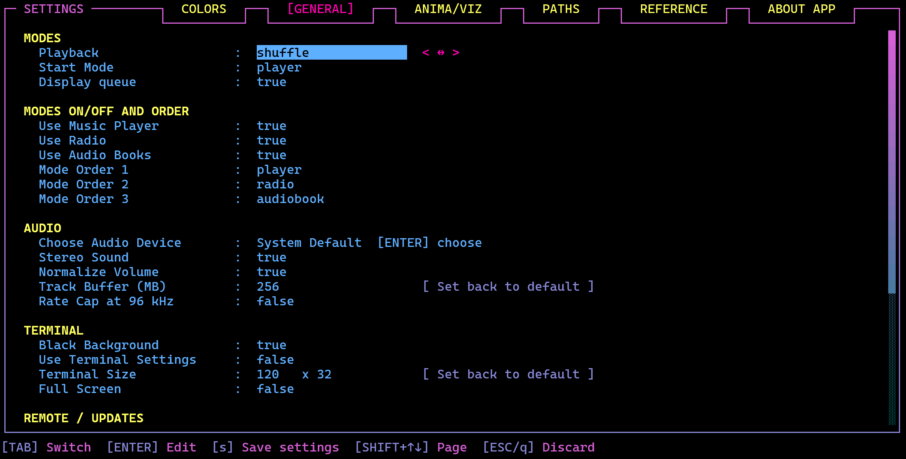

*The GENERAL tab: its categories (MODES, MODES ON/OFF AND ORDER, AUDIO, TERMINAL, REMOTE / UPDATES, TEXT AND TRANSLITERATION (JAP./KOR./CHIN.)). (The folder settings are on the PATHS tab; the screenshot is from before the categories.)*


The tab has several categories (in the header colour); change a row with `←`/`→`:

**MODES**

| Setting | Values | What it does |
|---|---|---|
| Start Mode | player, radio, audiobook | Which mode Mousiki **opens with**. Picked in any mode's Settings; it is one value, stored as `StartMode=` in the player's `config.txt`, so it is the same whichever mode you set it in. Only the modes that are switched on can be picked. `Start Mode` only decides the start: you can still switch at any time with `*` / `_`. (`StartMode=`) |
| Playback | list, loop, shuffle, stop, queue then stop | The play mode. Same as the `m` key (`loop` is the mode shown as *repeat*). (`PlaybackMode=`) |
| Display queue | Shows or hides the Queue panel. (Not in the audio book mode: the chapter list is always there.) |

**MODES ON/OFF AND ORDER**

| Setting | Values | What it does |
|---|---|---|
| Use Music Player, Use Radio, Use Audio Books | true, false | Whether the mode is part of the `SHIFT` and `+` / `SHIFT` and `-` cycle. **One mode always stays on**: the last one cannot be switched off. A start mode that is switched off moves to the first mode that is on. (`UseModePlayer=`, `UseModeRadio=`, `UseModeAudiobook=`) |
| Mode Order 1, 2, 3 | player, radio, audiobook | The order of the cycle, set like *Viz Order 1..5* on the ANIMA/VIZ tab: giving a place a mode swaps it with the place that held that mode, so the order always has all three. `SHIFT` and `-` walks the same order backwards. (`ModeOrder=player,radio,audiobook`) |

**AUDIO** -- switches, most of them true/false. (The folder settings are on the PATHS tab; the **Lyrics/Viz Default**, **No-Lyric** and **Viz Order** rows are on ANIMA/VIZ.)

| Setting | What it does |
|---|---|
| Choose Audio Device | Shows the sound output in use (**System Default** unless you picked one). `ENTER` opens the **CHOOSE AUDIO DEVICE** overlay (also from the main screen with `°`, see below): every sound output of this computer (speakers, headphones, HDMI, USB and Bluetooth devices ...), the first row being **System Default** with the name of the device the system uses now. `↑`/`↓` choose, `ENTER` switches **at once** (a track that plays goes on at the same place on the new device, a paused one stays paused), `r` reads the list again (a headset that was just plugged in), `ESC` closes. The choice is **one value for the music player, the radio and the audio books** and is written to `config.txt` at once (`AudioDevice=`, the name as the system gives it; empty = the system default), so `s` / `ESC` of the settings screen neither save nor undo it. A chosen device that is not there (unplugged) plays on the default one until it is back; the overlay lists it as *(not found)*. |
| Playback Speed | **Audio book mode only.** `0.5x` - `3.0x` in steps of 0.05, default **1.0x**; `←`/`→` (or typing a number) change it. The voice keeps its pitch. The same value as `SHIFT+←` / `SHIFT+→` on the audio book's main screen ([Books, chapters and the keys](#books-chapters-and-the-keys)). Config: `BookSpeed=`. |
| Stereo Sound | On plays in stereo (about twice the memory per loaded track), off folds left and right into mono. Turning it **off** is immediate. Turning it **on** applies from the next track. |
| Normalize Volume | Loudness normalization on or off. Same as the `SHIFT+v` overlay's switch (the radio keeps `v`). Target and boost are set in that overlay. |
| Track Buffer (MB) | A number, `64` - `16384` (at most 6 digits; `[ENTER]` types it, `→` then `ENTER` on *Set back to default* restores 256). Default **256**. A track is decoded into RAM as 32-bit float (stereo takes about 21 MB per minute at 44.1 kHz, 23 MB at 48 kHz, 46 MB at 96 kHz and 92 MB at 192 kHz; mono half of that). While the decoded audio is not bigger than this number the **whole track is held in RAM**: seeking anywhere is instant, which helps most when you adjust lyrics timing. A bigger track is held in a moving **2-minute window** around the playing position instead (so a very long file or mix does not need gigabytes); a jump outside the window then takes a moment while the decoder moves there. `ENTER` types a number; `→` moves to the button **[ Set back to default ]**, and `ENTER` on it restores 256. The change applies to the next track that is loaded. Config: `TrackBufferMB`. Only the audio counts: the extra 25 % that is reserved on top (the length comes from the file header and can be a little off, and the buffer must not move while it plays) is address space that is only used as far as the decoder fills it. |
| Rate Cap at 96 kHz | true, false | Default **true**: a track above 96 kHz (176.4 / 192 kHz ...) is brought down to 96 kHz, which is far beyond hearing and beyond what the scopes need. **false** plays it at its own rate (up to 768 kHz): the decoded audio then needs more RAM (it grows with the rate; see *Track Buffer (MB)*, a long file is held as a 2-minute window anyway), and the audio device has to accept the rate. The next track that is loaded uses the change. Config: `RateCap96`. |

**TERMINAL**

| Setting | Values | What it does |
|---|---|---|
| Black Background | true, false | Default **true**: while Mousiki runs, the terminal's background is **black** and text without a colour of its own takes the theme's LIST INACTIVE colour (Mousiki sets the terminal's default background with the standard OSC 11 sequence). On exit -- quitting, `Ctrl+C`, closing by a signal -- the terminal gets its own background back: Mousiki asks the terminal for its colour the first time (Linux / macOS) and resets it (OSC 111). One value for the player and the radio (`BlackBackground=` in the player's `config.txt`; the radio's row writes that line). Most terminals support it (Kitty, WezTerm, foot, Alacritty, xterm, GNOME Terminal, iTerm2, Windows Terminal); one that does not simply keeps its colour. `false` leaves the terminal's background alone. |
| Use Terminal Settings | true, false | Default **false**. **true**: Mousiki leaves the terminal exactly as it is: **Terminal Size and Full Screen are ignored** (they keep their values and apply again when you switch this back). Config: `UseTerminalSettings=`. |
| Terminal Size | two numbers: columns × rows | Default **120 × 32** (it shows four rows in the list and queue panes). When Mousiki starts, and when you change the numbers, it **asks the terminal to resize itself** to this size. `←` / `→` choose a field or the **[ Set back to default ]** button, `ENTER` types the number (or sets the size back to 120 × 32); `0` in either field means *leave the terminal as it is*. The smallest size is **100 × 28**, the largest what fits on the screen (the terminal is asked for its screen size; a terminal that does not tell gets a rough estimate). Config: `TerminalCols=`, `TerminalRows=`. **Terminals decide for themselves** whether they obey: xterm, GNOME Terminal, iTerm2, Terminal.app and recent versions of Windows Terminal usually do; Konsole, kitty, Alacritty, tmux and tiling window managers ignore the request, and then the size stays as it is. |
| Full Screen | true, false | Default **false**. **true**: the terminal is asked for full screen at every start (and now) and **Terminal Size is ignored**. xterm-style terminals get the full-screen sequence; under Windows Terminal Mousiki presses the window's `F11` for you (only while that window is in front, and only if it is not already full screen). Config: `FullScreen=`. |

**REMOTE / UPDATES**

| Setting | Values | What it does |
|---|---|---|
| Remote App | `[ENTER] settings` | Opens the **REMOTE APP** overlay ([The remote app](#the-remote-app-android--phone-browser)): on / off (default **off**), port, PIN, the address and a QR code for the phone. One value for the player and the radio (`RemoteApp=`, `RemoteAppPort=`, `RemoteAppPin=` in the player's `config.txt`). |
| Update Notice | true, false | Default **true**. At start-up Mousiki looks, in the background and at most **once a day**, whether a newer release exists on the project's GitHub page and shows a small **New version** window (player and radio) with the new version and the address of the release -- **once per version**. `ESC` closes it, `o` opens the release page in your browser. Nothing is installed or downloaded, nothing about you or your music is sent (only the public releases page is asked, by the small script `scripts/check_update.py`, which needs Python 3 like the lyrics). Without Python or a network nothing happens. Read at the next start. (`UpdateCheck=`) |
| Check Update | action row | Not a switch: press `ENTER` on the row to ask GitHub for the newest release **now**. The answer is written on the settings screen in one line: *Mousiki 4.7.1 is the newest release (checked just now)*, or *a newer release is out: Mousiki ... (you have ...): <address>*, or the reason the check failed (no Python, no network, no release listed). It works even when **Update Notice** is off; if a newer version is found, the same window as at start-up opens as soon as you leave Settings (`[ESC]` closes it, `[o]` opens the release page); it installs nothing. While the check runs the row reads *checking ...*. |
| Media Keys | true, false | Default **true**. **Windows:** the media pop-up of the volume flyout / lock screen and the media keys. **Linux:** Mousiki appears in the desktop's media widgets (MPRIS: the volume pop-up, a panel applet, the lock screen, `playerctl`) and its media keys, headphone buttons and sliders control it. **macOS:** Now Playing and the media keys. See [System media controls](#system-media-controls-media-keys-and-now-playing-windows-linux-macos). Read at the next start; player and radio. (`MediaKeys=`) |


**TEXT AND TRANSLITERATION (JAP./KOR./CHIN.)** (its category at the bottom of the GENERAL tab; *Font* is its first row)

| Setting | Values | What it does |
|---|---|---|
| Terminal Default Font | **false** (default) = Mousiki's window uses **Cascadia Mono** (Windows Terminal: the profile *Mousiki*; macOS Terminal, iTerm2 and the old Windows console: Mousiki's window), **true** = Mousiki leaves the terminal's own font alone. Applied and saved at once (`TerminalDefaultFont=`), one value for all modes. Another font than Cascadia Mono: `TerminalFont=<font name>` in `config.txt` (no row in the settings). |
| Replace Emoji | *All* (default): every emoji in a title is drawn as a single `?`, so the frame borders stay aligned. *Safe*: plain one-codepoint emoji (note, radio, book) are kept; only the ones terminals and fonts draw differently (joined sequences such as the black cat, flags, skin tones, heart-style forms with a variation selector, keycaps) become `?`. *Off* draws every real emoji. (`ReplaceEmoji=true` / `safe` / `false` in `config.txt`.) |
| Marquee Scrolling | On (default): a name that is too long for its column scrolls -- the hovered book folder and chapter in the audio book mode, the row under the cursor in the lists, Name / Artist / Album of the metadata block, the playlist editor's lists. Off: nothing scrolls anywhere and a too long text is cut off with `...`. (`MarqueeScrolling=` in `config.txt`.) |
| Latin Macrons | true, false | Default **false**. (`LatinMacrons=`) Japanese long vowels with a macron (`kōhī`) instead of spelled out (`koohii`, `ou`). |
| Latin Wo | true, false | Default **false**. (`LatinWo=`) The particle を as `wo` instead of `o`. |
| LatinHanziDefault | leave, chinese, japanese | Default **leave**. Characters that could be Japanese or Chinese (`東京`): leave them, read them as Chinese (pinyin) or as Japanese. Settings → GENERAL → TRANSLITERATION → **Translit. Kanji** (`Leave` / `Chin.` / `Jap.`). |
| Latin Name Lookup | true, false | Default **false**. Asks MusicBrainz in the background for the Latin name of artists written in Chinese characters (one name at a time; needs Python 3). **Sends the artist names, and so your IP address, to musicbrainz.org** - nothing else; answers are kept in `kanji_readings_learned.txt`. See *Latin letters for Japanese, Korean and Chinese text*. (`LatinNameLookup=`) |
| Lyrics Name Variants | true, false | Default **true**. (`LyricsNameVariants=`) A lyrics search that finds nothing also tries the Latin spelling, the title / artist without their Latin or Japanese part, and the title alone. |

**The album cover (music player).** With **Album Cover** on, the disk's place shows the cover of the track that is playing, taken from the file or from its folder. **Cover Mode** chooses how it is shown, in seven ways:

1. **Just Cover** -- the cover in its own colours, fitted into the field with a little room around it.
2. **Cover with Gradient** -- a grey version of the cover with the gradient of the disk put over it (disk colour to disk colour end, set under COLORS). The gradient is a slow **moving wave** that runs diagonally over the picture, from the upper left to the lower right, like the colour wave of the audio book cover.
3. **Cover behind Disk** (default) -- the grey cover in **full resolution** fills the field **behind the turning disk**, and the disk's braille dots act as a kind of **pinhole pattern**: the background stays **black**, and the cover only comes through the dots of the disk, at full brightness (in the gradient colours). The dots stay on their fixed grid (blocks of horizontal lines) and only the **pattern of the disk turns** through them, at the speed of *Disk Speed* (ANIMA/VIZ); no dot comes or goes. Think of the terminal background as a sheet of paper in front of the cover and the dots as holes in it: outside the dots you see the background (black with *Black Background*, else the terminal's own colour). A cover with a **removed background** (transparent parts, such as the audio book's standard picture) does not cut the disk down to its silhouette: the dots over the transparent parts show a plain grey, so the whole disk stays visible.
4. **Cover behind Disk v2** -- like 3, but the **dots themselves turn** around the centre, smoothly (they do not stay on the grid).
5. **Cover behind Disk (Full Anima)** -- like 3, but the pinholes follow the **exact braille animation of the disk**: its dots are turned and rounded to the dot grid, so some of them **come and go** as the disk turns (the same effect as the *disk* look of the *Volume Indicator*).
6. **Cover ASCII** -- the cover as **braille dots** in its own colours (dithered), also where the terminal could show a real picture. A look of its own for terminals with Kitty / Sixel: the oscilloscope's image style and the picture slot stay free.
7. **Cover ASCII with Gradient** -- the same dots under the disk's moving gradient.

**Dark covers behind the disk:** in the *Cover behind Disk* looks (and the dots of the looks that use the disk's dots) a dark part of a cover would make the disk's silhouette disappear. Where the cover is dark, the dots are therefore lifted a little towards white (up to about a quarter of the way) and given some extra local contrast, so the lifted features do not turn grey. The lift follows the *local* brightness, smoothly: bright parts, also a bright part at the edge of an otherwise dark cover, are left exactly as they are, and a cover that is bright anyway is not touched.

With the pixel looks 1 to 5 the oscilloscope can be an image (its *Style* in `SHIFT+o`) in the main screen at the same time: the cover and the oscilloscope are two pictures side by side.

| |
|:---:|
| <br>**Just Cover** |
| <br>**Cover with Gradient** |
| <br>**Cover behind Disk** |

With **Kitty graphics or Sixel** (Windows Terminal 1.22+, Kitty, WezTerm, Ghostty, foot ...) the cover is a real picture at the terminal's full resolution (at most 640 x 640 pixels, whatever *Image Resolution* says: *Just Cover* and *Cover with Gradient* are only sent when the cover changes). Sixel draws 240 colours (*Just Cover*) or 16 gradient steps of 15 brightnesses (the other two), Kitty all of them. While a cover is a picture, the oscilloscope next to it is drawn in braille, like beside the audio book picture. Without Kitty and Sixel the same looks are drawn with **braille dots**: the cover dithered (*Just Cover*, *Cover with Gradient*), or the turning disk with every cell lit by the part of the cover under it (the *Cover behind Disk* looks); the status line says so when the row is changed.

**Where the cover comes from.** Per track, the cover is looked for in two places:

- **Inside the file:** the picture attached to the audio file (mp3's ID3 picture, FLAC / Ogg / Opus pictures, the cover of an m4a ...), read by ffmpeg in the background.
- **In the folder of the file** (not the folders below it): the picture whose name is **close to the title of the track or to its album tag** (the title falls back to the file name). "Close" means a **fuzzy match**: upper and lower case, punctuation and track numbers do not matter, a word more or less or a typo does not either (`Abbey_Road - front.jpg` and `abbey road.png` both belong to the album *Abbey Road*). That makes it possible to keep the covers of **tracks from different albums in one folder**: each track gets the picture named like its album (or like itself). If no picture is close enough, a picture named `cover`, `folder`, `front`, `albumart` or `album` is taken. If **nothing** of this gives a picture, the **first picture of the folder by name (alphabetically)** is taken as the last resort -- in every Cover Search value except *Within File Only*, which never looks at the folder.

**Picture formats.** Pictures in the folder can be jpg / jpeg / jpe / jfif, png / apng, webp, bmp / dib, gif, tif / tiff, avif, heic / heif, jxl, jp2, ico, tga, ppm / pgm / pnm, pcx -- every regular picture format, read by ffmpeg (avif, heic and jxl only if your ffmpeg build can decode them). Camera RAW files and other very large formats are not looked at. The **audio book mode** uses the same list for the cover of a book. The name only has to be close: `test-song-cover.jpg` belongs to `test_song-cover3.mp3`, and an abbreviation such as `cov` counts for `cover`. The console log (`t`) names the closest picture and its match in percent when none was close enough.

**Cover Search** decides the order of the two places:

| Value | What is looked at |
|---|---|
| Default | First the picture **inside the file**. If it has none, the folder: the closest-named picture, then `cover.jpg` and its like. |
| Folder First | First the **folder** (the closest-named picture, then `cover.jpg` and its like), and only then the picture inside the file. |
| Within File First | First the picture **inside the file**; if there is none, only a **closely named** picture of the folder (no `cover.jpg` fallback -- a folder of mixed albums does not give every track the same picture). |
| Image in Folder Only | **Only the folder** (closest-named picture, then `cover.jpg` and its like); the pictures inside the files are never looked at. |
| Within File Only | **Only the picture inside the file**; the folder is never looked at. |

A track that has no cover keeps the disk (the console log, `t`, says what was tried: `album cover: none for ... (no picture inside the file; no closely named picture in the folder; ...)` and which file was used: `album cover: using ...`). While the next track of the same album is read, the cover on screen stays.

**How these switches work together.** No combination is left contradicting itself: choosing a view that is switched off (in Lyrics/Viz Default or When No Lyrics Show) **turns its Use switch on**; switching a Use switch off **takes its dependents with it** instead of being undone -- Use Lyrics Engine off stops the field showing the lyrics, Use Oscilloscope / Spectrogram / Sphere / Lyrics Engine off moves Lyrics/Viz Default and When No Lyrics Show to the next view that is on (When No Lyrics Show to `none`, an empty field, when none is left). The status line says what moved. Earlier versions turned the oscilloscope (or the spectrogram) back on by themselves while it was the No-Lyrics pick, so it could not be switched off.

**Preview of the highlighted option (GENERAL and ANIMA/VIZ).** On a terminal at least 107 columns wide, the empty space right of the rows holds a **preview box that shows only the option you are on** (never several at once), live and in the colours and settings you have at that moment:

- *Lyrics Alignment, Lyrics Animation, Use Lyrics Engine*: four sample lines that are sung in a loop, drawn by the real lyrics renderer;
- *Eliment Disk / Cover, Disk Speed*: the disk, turning at the chosen speed (nothing when *Eliment Disk / Cover* is *Remove Field*, and then no cover either); *Album Cover, Cover Mode, Cover Contrast, Cover Brightness, Cover Colors, Cover Search*: the colour version of the audio book picture as the sample cover, in the chosen look: a real image in a Kitty / Sixel terminal (unless *Full Res.* is off or the mode is one of the ASCII ones), braille dots otherwise;
- *Dummy Buttons*: the three buttons (on or off); *Volume Indicator*: the volume bar at **85 %**;
- *Spectrum Bars* rows: the bars below the metadata with the fluidity, degradation and viscosity you set; *Progress Waveform* rows: a sample waveform (raw or smooth) with the played part moving along, or the plain bar when it is off;
- *Use Oscilloscope, Use Spectrogram, Use Sphere* (*Modes Share Settings* has no preview) (and the *Lyrics/Viz Default* / *When No Lyrics Show* rows, which show the visual they are set to): the visual with a test signal. The oscilloscope and the sphere use the signal of the radio station **TEST Stereo Chords** (**not a file, no internet**: the radio makes it with ffmpeg (`lavfi:chords`), the preview makes the very same two-tone signal inside Mousiki, so not even ffmpeg is needed); the spectrogram **and the spectrum bars** use a spectrogram made by the Creator from the text **"Mousiki Plus"** (a lively, moving sound, stereo, with a pause between two rounds), so you see the letters scroll by and the bars have something to move to. The spectrogram preview always shows the **plain default look** (the regular spectrogram as an image, mel scale, Roseus colours) and is **not connected to the SHIFT+i values** (colours, scale, view, style ...), so it shows what a spectrogram is, not your current settings. The spectrogram preview scrolls over a short stretch of time and is drawn as a **picture** in every Kitty / Sixel terminal, whatever the spectrogram style is set to, and in braille dots only where the terminal has neither;
- on GENERAL: *Latin Macrons, Latin Wo, Translit. Kanji, Latin Name Lookup*: the transliteration examples of this manual (さくら, がっこう, しんあい, ラーメン, コーヒー, きえぬよう, こえをきかせて, 안녕하세요, 周杰伦, 東京, 愛してる, Kenshi Yonezu) shown for the option you are on, with the result for each of its values side by side and the one in use lit (*Latin Macrons*: `raamen | rāmen`, *Latin Wo*: `koe wo | koe o`, `anata wo | anata o`, `suki wo | suki o`, *Translit. Kanji*: 東京 as it is / `dōng jīng` / `toukyou`, *Latin Name Lookup*: カネコアヤノ `kanekoayano | Kaneko Ayano`, with a note that the Latin spelling is looked up online at MusicBrainz), and a few examples that never change (さくら, 猫の手も借りたい, しんあい, 안녕하세요) and a short poem split into its phrases (草の名も / 寂しうなりけり / 春の雨), which shows how the words of unspaced Japanese are cut. The Chinese example is the Taiwanese independent singer-songwriter 张悬. A row that is too wide for the box is split instead (the source on one row, each result on a row of its own, named by its value) and long explanations wrap, so nothing scrolls; *Replace Emoji*: note, radio, alien, book, heart and thumbs up with skin tone for each of All / Safe / Off; *Marquee Scrolling*: a long (cat-themed) title that scrolls or is cut; *Lyrics* options use meow lines as the sample text; *Dummy Buttons* shows the real framed `<<<` / PLAY-PAUSE / `>>>` buttons (only the play button on a narrow box).

On narrower terminals the preview is left out.

### Tab 3: ANIMA/VIZ

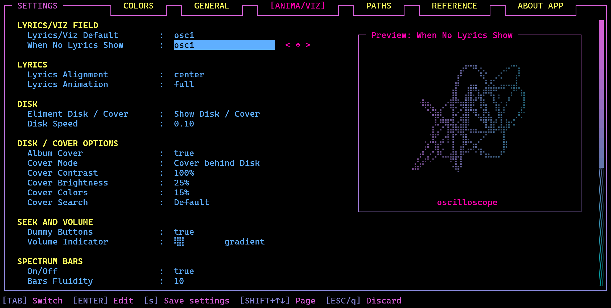

*The ANIMA/VIZ tab (the screenshot shows its predecessor, the ANIMATION tab). The `< ↔ >` hint shows that `←`/`→` cycle the value.*

The tab collects everything about the **animations and the visualizations**, in these categories (in the header colour, with a blank line before each). All rows are cycled with `←`/`→` (or typed after `ENTER`). If the terminal is too short, the tab **scrolls with the cursor (a scrollbar like the help wizard's marks where you are)** (▲ / ▼ show that there is more) while the note at the bottom stays in place.

**LYRICS/VIZ FIELD**

| Setting | What it does |
|---|---|
| Lyrics/Viz Default | The view the field **starts with when Mousiki opens**: `sphere` (the audio-reactive ball), `osci` (the XY oscilloscope, see *The oscilloscope* above), `spectro` (the spectrogram, see *Spectrogram*) `lyrics`, `video` (the video view, see *Video mode*; without the Video mode it shows the lyrics), or **`last used`**. The `.` key changes the view while Mousiki runs, but that is not remembered: the next start begins with the chosen view again (picking a value here also shows it at once). With `last used` it is remembered after all: Mousiki opens with the view it was closed on. Default `osci`. With the lyrics view on and no lyrics found, **When No Lyrics Show** below decides what is shown. The sphere and the oscilloscope's *gradient* palette use the **VIZ** colors (Settings → Colors → VIZ); the spectrogram has its own colour schemes. The oscilloscope's look is tuned with `SHIFT+o`. (`VizDefault=sphere\|osci\|spectro\|lyrics\|video\|last` in `config.txt`) |
| When No Video Shows | What the field shows on the **video view while the track has no video** (no video file with the same name next to it, none linked): `lyrics` (default: the lyrics as usual), `sphere`, `osci`, `spectro` or `none` (an empty field). Like *When No Lyrics Show*, a visual that is switched off in **Use Sphere** / **Use Oscilloscope** / **Use Spectrogram** is turned on when you pick it. (`NoVideoViz=`) |
| When No Lyrics Show | What the lyrics area shows while the **lyrics view is on but there are no lyrics** (nothing found, still fetching, track without lyrics): `sphere`, `osci` (default), `spectro` or `none` (an empty field). Before this row existed the area showed whatever view `.` had been on before the lyrics. If the visual you pick is switched off in **Use Sphere** / **Use Oscilloscope** / **Use Spectrogram**, picking it turns that switch **on**; switching the switch off later moves this pick on to the next visual that is on. (`NoLyricsViz=`) |

**LYRICS**

| Setting | Values | What it does |
|---|---|---|
| Lyrics Alignment | left, center, right | Where lyric lines sit in their area. |
| Lyrics Animation | full, word by word, line by line, letter by letter, active line only, active word only | How lyrics are revealed and highlighted as the song plays. |

**VIDEO**

The rows of the video (shown in the small field, in the big video overlay and per track in the Style Option overlay); they need no Video mode of their own to be set.

| Setting | What it does |
|---|---|
| Video Size | How big the video's picture is in the small field: `regular`, `cropped` (two columns cut off each side), `full` (fills the field, cropped to fit, the lyric line a small black box over it) or `framed` (like `full`, one row and two columns smaller on every side). The same as *Picture Size* of the VIDEO SETTINGS overlay (`VideoSize=`); the preview shows the sample video. |
| Video Effect | A retro look for the video's picture: `off`, `scanlines`, `crt`, `vhs`, `glitch`, `quiet glitch`, `pixel` or `gradient` and the newer ones (`VideoFx=`; the list shows them as Off, Scanlines, CRT, VHS, Glitch, Quiet Glitch, Pixel, Gradient, ...); the preview shows the sample video with the effect. |
| Video Contrast | 0% (default) to 100% in steps of 5%: more contrast for the video's picture (`VideoContrast=`), the same measure as Cover Contrast. |
| Video Colors | 0% to 100% in steps of 5%, default 100%: the video's colours (`VideoColors=`). 0% is greyscale. |
| Video Chromatic Aberration | `off` (default), `subtle`, `medium`, `strong` (`VideoChroma=`): red and blue are pushed apart, more and more towards the corners, like a lens that does not focus every colour alike. It works together with every effect (the grade — contrast, colours, chromatic aberration — is applied first, then the effect). |
| Video Rounded Corners | `false` (default) / `true` (`VideoRound=`): the corners of the video's picture are cut round, like the corners of the UI; also in the big video overlay. Also **Rounded Corners** in the VIDEO SETTINGS overlay and a row in Style Option (and S in the big video overlay) for a single track. |
| Video Resolution | How sharp the video's picture is (`VideoResolution=`): `standard` (up to 640 px wide, Sixel 480: the soft look, light on the terminal), `high` (1280 px, Sixel 720) or `full` (1920 px, Sixel 960). On Kitty `high` and `full` send the picture in true colour (no 240-colour palette, no dither) and scale it with a sharper filter; on Sixel only the width grows (Sixel has at most 256 colours). A picture is never decoded wider than the video itself. Wide pictures need more of the terminal and the processor: if the picture stutters, go back one step. Braille dots are not affected. |
| Show Clap Loading | `true` (default) / `false` (`VideoClap=`): while a video loads (after a track change, a seek or a new picture size) a small open clapperboard in the colours of the border gradient shows instead of the text "video: starting ...": a transparent picture in a Kitty / Sixel terminal, braille dots elsewhere. In the small field and in the big video overlay. Also in the VIDEO SETTINGS overlay. |
| Video Buffer | Megabytes of decoded video frames that are kept ahead of the picture (`VideoBuffer=`: `8`, `16`, `32`, `64`, `128` or `256`). A wider picture holds fewer seconds in the same buffer (the status line tells how many for a 16:9 picture); at least six frames are always kept. A bigger buffer rides out a slow moment of the decoder, a smaller one uses less memory. |
| yt-dlp mp3 from mp4 | `true` / `false` (`VideoMp3=`, default `true`). SEARCH YT also saves the sound of a downloaded video as an mp3 song in the download folder, connected to the video, when no song is the target. `false` turns this automatic mp3 off (`CTRL+o` in SEARCH YT asks for one per download; `CTRL+3` / `m` in FETCH VIDEOS → VIDEO FILES makes one from a file). |

**DISK**

| Setting | Values | What it does |
|---|---|---|
| Eliment Disk / Cover | Show Disk / Cover, Remove Field. Default **Show Disk / Cover**. | **Show Disk / Cover** shows the **disk field** in the player area: the spinning disk or, with *Album Cover* on, the cover of the playing track. **Remove Field** takes it away (the meta data move left; the preview on the right shows nothing then). (`ElimentDisk=true` / `false`; before: *Eliment Disk*) |
| Disk Speed | 0.01, 0.05, 0.10, 0.17, 0.25, 0.50, 0.75, 1.00 | How fast the disk spins. Default `0.10`. |

**DISK / COVER OPTIONS**

| Setting | Values | What it does |
|---|---|---|
| Album Cover | true, false. Default **false**. **true**: the **album cover of the playing track** is shown in the disk's place (see *The album cover* below). A track without a cover (and every stream) keeps the disk. Needs *Eliment Disk / Cover* to be true. Music player only. (`AlbumCover=`) |
| Cover Mode | *Just Cover*, *Cover with Gradient*, *Cover behind Disk* (default), *Cover behind Disk v2*, *Cover behind Disk (Full Anima)*, *Cover ASCII*, *Cover ASCII with Gradient*. How the cover is shown, see below. (`CoverMode=` `cover` / `gradient` / `disk` / `disk2` / `full` / `ascii` / `ascii2`) |
| Cover Contrast | 0% (default) to 100% in steps of 5%: adds contrast to the cover, but only where the cover is shown through the gradient or the disk: *Cover with Gradient*, *Cover ASCII with Gradient* and the *Cover behind Disk* looks (music player), and the book cover with the *Book Gradient Wave* on (audio book mode). *Just Cover*, *Cover ASCII*, a book cover in its own colours and every preview (meta editor, cover fetch) always show the picture as it is. (0% = the cover as it is; 100% = the brightnesses move 2.5 times as far from the middle grey). (`CoverContrast=`) |
| Cover Brightness | 0% to 100% in steps of 5%, default **50%**. *Cover behind Disk* looks (music player): the brightnesses of the cover are spread over the whole range, so the dots shine as brightly as the plain disk's, and dark parts of the cover are lifted to at least this share of full brightness (0% = dark parts may go black, 100% = even black parts are clearly lit); these looks also show more detail (the cover is sharpened inside the dots). **Audio books** (BOOK COVER on the ANIMA/VIZ tab, the cover with *Book Gradient Wave* on): a brightness curve, 50% = the cover as it is, more = brighter (dark parts lifted), less = darker. The same value for both modes. (`CoverBrightness=`) |
| Cover Colors | 0% (default) to 100% in steps of 5%. How much of the cover's **own colours** shows through the gradient: in the *Cover behind Disk* looks (music player) and on the **book cover with the gradient wave** (audio books, BOOK COVER on the ANIMA/VIZ tab; also on the phone). 0% = the gradient colours only (as before), 50% = the gradient lies over the cover and its colours shine through, 100% = the cover in its own colours (the gradient is gone, the brightness, the dots and the wave's shape stay). With Sixel (Windows Terminal) these pictures use a fixed set of 240 colours with fine dithering. (`CoverColors=`) |
| Cover Chromatic Aberration | `off` (default), `subtle`, `medium`, `strong` (`CoverChroma=`) | Red and blue of the cover are pushed apart towards the corners. It acts where the cover is shown in its own colours: Just Cover, Cover Colors above 0%, and the ASCII looks; the pure gradient looks have no colour channels to split. Per track in Style Option. |
| Cover Search | *Default*, *Folder First*, *Within File First*, *Image in Folder Only*, *Within File Only*. Where the cover is looked for, see below. (`CoverSearch=` `default` / `folder first` / `file first` / `folder only` / `file only`) |

**Switch the cover look with the keyboard:** on the main screen `CTRL+T` goes one look back and `CTRL+Z` one forward, in the order *plain disk* (Album Cover off) → *Just Cover* → *Cover with Gradient* → *Cover behind Disk* → *v2* → *Full Anima* → *Cover ASCII* → *Cover ASCII with Gradient* → back to the plain disk. In the audio book mode the same keys switch between the **default picture**, the **book cover with the gradient wave** and the **book cover in its own colours**. They only work while **Eliment Disk / Cover** is on; the choice is saved at once and the status line names it. Both keys can be changed in Settings → REFERENCE (*Cover Look Back* / *Cover Look Forward*). When the playing track or its album has **its own look** (meta editor → Style Option, see above), the keys change that look and Settings stay as they are. On macOS and Linux `CTRL+Z` normally stops (suspends) a terminal program; Mousiki switches that off while it runs, so the key reaches it.

**SEEK AND VOLUME**

| Setting | Values | What it does |
|---|---|---|
| Dummy Buttons | Shows or hides the three decorative buttons next to the progress bar. |
| Volume Indicator | What the **VOLUME BAR** is drawn with: `#`, `⠶`, `⣿`, `⡾⣽` or the **disk** look (shown as two moving braille blocks). The first three repeat one character; `⡾⣽` is a fixed, not repeating row of braille characters, so 100% reads `[⣾⣳⢯⡿⣷⣟⡾⣽⢯⣟⡾⣟⡾⣽⢯⣟⡾⣽⣳⣻]`. The **disk** look follows the braille effect of the disk animation: the bar is a strip of solid dots that is turned around a centre two cells in from the left, so close to that centre all dots are there and further out (also towards the left end) dots come and go as the disk turns (it stands still while the disk does). Right of the look sits **gradient / no gradient**: with *gradient* the filled part takes the colours of the VIZ gradient from left to right, like the oscilloscope (`VolumeGradient=`). `←` / `→` switch between the two values of the row, `ENTER` changes the one that is lit. The Colors tab previews follow the look but never show the gradient; the empty rest of the bar (`-`) stays as it is. Default: the **disk** look, in all three modes. Also set in the radio (**Volume indicator** on its GENERAL tab). (`VolumeIndicator=`) |

**Seek indicator.** When you seek within a track with the arrow keys (5 seconds per press), the `<<<` or `>>>` label turns the colour of **BORDER_COLOR BOTTOM** (Settings → COLORS) for about 0.7 seconds, so you can see which way you went. Seeks from a phone or the remote app do not light it up. The same works in the audio book mode; the radio's `<<<` and `>>>` change stations, so they do not light up.

**SPECTRUM BARS** -- the bars under the meta data (the *On/Off* row was *Spectrum Bars* on the General tab; before: *WAVE*, *Wave Fluidity* …).


`SHIFT+b` opens the **spectrum bars overlay** under the upper pane: the bars stay visible while you change the values, and the overlay scrolls (scroll bar in its right border) when the terminal is low.


| Setting | Values | What it does |
|---|---|---|
| On/Off | Shows or hides the **spectrum bars below the meta data** (the live frequency bars; before: *Visualizer*). With it off the meta data get the two rows. Their motion is set on ANIMA/VIZ → SPECTRUM BARS. (`Visualizer=`) |
| Bars Style | Classic / Hi-Fi | **Classic** is the bar display described above (mono, two text rows, mirrored with the bass in the middle). **Hi-Fi** is a Winamp-like analyzer drawn in braille dots without gaps between the bars: a **stereo** spectrum (left channel on the left, right on the right, bass in the middle, one empty dot column between the two channels), one column of dots per frequency step, 2–4 text rows high (it takes the room the window has), redrawn at the frame rate of the program (*Frame Rate* in the oscilloscope settings), so it moves much livelier. Fluidity, Degradation and Viscosity apply to it too. Default Hi-Fi. (`VisualizerStyle=`) |
| Hi-Fi Resolution | Fine / Rough | Only shown with *Bars Style* = Hi-Fi. **Fine**: every dot column is its own frequency step. **Rough**: two dot columns (one cell) share a step. Default Fine. (`HifiResolution=`) |
| Hi-Fi Channels | Stereo / Mono | Only shown with Hi-Fi. **Stereo**: left and right channel separately. **Mono**: both channels mixed (only for this display; the sound is not changed). Default Stereo. (`HifiChannels=`) |
| Hi-Fi Height | Full / Medium / Low / Very low | Only shown with Hi-Fi. How high the bars reach: **Full** is the plain level scale, **Medium**, **Low** and **Very low** bend the curve more and more, so that the middle levels stay low while the peaks still reach the top and everything stays visible. Default Low. (`HifiScale=`) |
| Hi-Fi Adapt Height | Off / On | Only shown with Hi-Fi. **On**: the height adapts to the song. The program watches the mean level over a few seconds; dense, heavily compressed music that fills the whole frequency range is bent down more (so the bars do not stand at the top everywhere), sparse music is left as it is. Works on top of *Hi-Fi Height*. Default On. (`HifiAdapt=`) |
| Hi-Fi Frequency Scale | Linear / Logarithmic / Mel / Bark / Erb | Only shown with Hi-Fi. How the frequencies are spread over the bars, with the same scales as the spectrogram options. Default Mel. (`HifiFrequencyScale=`) |
| Hi-Fi Gain (dB) | -20 … 20 | Only shown with Hi-Fi. Moves all levels up or down. Default -2. (`HifiGain=`) |
| Hi-Fi Range (dB) | 40 … 100 | Only shown with Hi-Fi. The range from the bottom to the top of the bars: a small range is steeper, a large one flatter. The top stays where it is. Default 68. (`HifiRange=`) |
| Hi-Fi Channel Gap | Add / Remove | Only shown with Hi-Fi and stereo. **Add**: one empty dot column between the left and the right channel. **Remove**: the channels touch. Default Add. (`HifiSplit=`) |
| Hi-Fi Color | Gradient / Corresponding | Only shown with Hi-Fi. **Gradient**: the bar colours from left to right as set in the colour options (default). **Corresponding**: the colours of the spectrogram waterfall (its colour scheme), by level: every cell takes the colour of the level at its highest lit dot (a step per dot line, as far as one braille cell can hold one colour), and the colours follow *Hi-Fi Height* -- a lower height does not leave the top colours unused, because the colour belongs to the level the dot stands for. Default Gradient. (`HifiColor=`) |
| Bars Behavior | Lively / Default / Smooth / Slow | A **preset** for the three motion rows below, so you do not have to tune them one by one. **Lively**: snappy rise, quick fall, bars independent of each other (fluidity 2, degradation 9, viscosity 1). **Default**: what the bars always did (10 / 8 / 3). **Smooth**: soft rise, slower fall, neighbours blended (10 / 4 / 6). **Slow**: floaty and wobbly (10 / 2 / 8). The row shows **custom** when the three values below match no preset (after you changed one of them); `LEFT`/`RIGHT` then pick the next preset. **Classic and Hi-Fi keep their own values**: the three motion rows (and with them this preset) always belong to the *Bars Style* in use, so each style can have its own look; switching the style brings its values back. (The `config.txt` keys of Classic are `VisualizerFluidity=`, `VisualizerDegradationSpeed=`, `VisualizerViscosity=`; Hi-Fi has `HifiFluidity=`, `HifiDegradationSpeed=`, `HifiViscosity=`.) |
| Bars Fluidity | 1–10 | How the spectrum bars **rise**. It affects only the rising motion. Default `10`. |
| Bars Degradation | 1–10 | How quickly bars **fall**. `1` is a slow, VU-meter-like fade, `10` a near-instant cutoff. Default `8`. |
| Bars Viscosity | 1–10 | How strongly the bar motion is damped and smoothed between neighbouring bars. Default `3`. |

**PROGRESS WAVEFORM** -- the braille waveform in the progress bar.

| Setting | Values | What it does |
|---|---|---|
| On/Off | Shows or hides the braille **waveform inside the progress bar** (the whole track as a wave). With it off, a plain `[####----]` bar is drawn instead. (`ElimentWaveForm=`) |
| Waveform Style | raw, smooth | Waveform drawing style of the progress bar. Same as the `w` key. |


**OSCI/SPECTRO SETTINGS**

| Setting | Values | What it does |
|---|---|---|
| Modes Share Settings | true, false | Default **false**. **true**: the radio uses the player's oscilloscope and spectrogram settings (the `SHIFT+i` / `SHIFT+o` screens) instead of its own, so both modes look the same. The radio's own values are **not lost**: they are kept as a backup in `radio_config.txt` (lines starting with `## own `) and come back unchanged when you turn the switch off. While it is on, the radio's visual settings are shown but changes there change the player's values. Stored as `ShareProfiles=` in the player's `config.txt`; the row exists in both modes' Settings. The colours and themes are **never** shared by this switch. |

**VIZ/LYRICS ORDER**

| Setting | What it does |
|---|---|
| Viz Order 1 … 5 | The order of the five views (`sphere`, `osci`, `spectro`, `lyrics`, `video`) when you press `.` / `,`. Each row says which view comes at that place; `←` / `→` puts another view there, and the view that was there takes the place it left, so every view stays in the list. Exactly two rows change at a time. The status line shows the whole order and which row took the view you moved away, e.g. `"." cycle: osci > lyrics > spectro > sphere > video   (Viz Order 2 took lyrics in return)`. The `video` view is only visited while **Use Video** is on, and not for a track without a video when *When No Video Shows* is *none*. (`VizOrder=osci,lyrics,spectro,sphere,video`) |

**MAIN UI VIZ/LYRICS FIELD** (the field right of the meta data; before: *VIZ/LYRICS FIELD*)

| Setting | What it does |
|---|---|
| Viz/Lyrics Field | The master switch of the **field right of the meta data** (lyrics, sphere, oscilloscope, spectrogram). `false`: the field is gone, the meta data and the spectrum bars take its width, no lyrics are fetched for it and `.` says so. The big overlays and the windows still work. Default `true`. (`VizLyricsField=`) |
| Use Lyrics Engine | `false` switches the lyrics off **entirely**: they are never fetched and `.` skips them (the field then only shows the visuals). `true` lets the field show the lyrics (fetched from the net when it does; turning it on while a track plays fetches them at once); whether the field starts with them is set by **Lyrics/Viz Default**, and `.` switches the view while Mousiki runs. Default `true`. (`UseLyrics=`; this replaces the former *Lyrics Engine* row, which did the same) |
| Use Video | The **Video mode** as a setting (the same switch as the `&` key, see *Video mode*): `true` lists the video files and puts the video view into the `.` cycle at its place of **Viz Order 1..5**; `false` hides the videos again and leaves the view out. The **preview** on the right plays a short sample video (a loop made from the Mousiki GIF, `scripts/preview_video.mp4`): a real picture in Kitty / Sixel terminals, braille dots otherwise; without the file or without ffmpeg it shows the lyrics as before. (`VideoMode=`) |
| Use Oscilloscope | `false` leaves the oscilloscope out: `.` and the **Lyrics/Viz Default** row skip it, and the picks that pointed at it (Lyrics/Viz Default, When No Lyrics Show) move on to the next visual that is on. The scope window (`)`) still works. (`UseOscilloscope=`) |
| Use Spectrogram | `false` leaves the spectrogram out of the lyrics area: `.` skips it. Full screen (`SHIFT+u`) and the spectrogram window (`(`) still work. (`UseSpectrogram=`) For example: Use Oscilloscope and Use Spectrogram `false` = `.` only switches between the lyrics and the sphere. |
| Use Sphere | `false` leaves the sphere out of the `.` cycle (it used to be always there). Picks that pointed at it move on to the next visual that is on; picking it in **Lyrics/Viz Default** or **When No Lyrics Show** turns it on again. (`UseSphere=`) |


### Tab 4: PATHS


*The PATHS tab: the folders Mousiki reads music from, downloads to, and keeps playlists and the history in. (The screenshot is from before the PLAYLIST EXPORT PATH row was added.)*

Seven sections, each under its header in the header colour. Move onto a row and press `ENTER` to edit it. The tab scrolls with the cursor (a scrollbar like the help wizard's marks where you are) (a scrollbar like the wizard's shows where you are), so a short terminal is fine.

| Section | Rows | What it does |
|---|---|---|
| LOCAL PATH | `Local Path 1`, `2`, … plus `+ new path` | The folders scanned for music. `ENTER` edits one. `+ new path` (`ENTER`) adds an empty line and opens it for typing. Committing a change **rescans the library immediately**. |
| DOWNLOAD PATH | one row | Where `y` (Save stream) puts downloaded tracks. Until you set one it shows the default cache folder (`~/.cache/mousiki`). It is added to the scanned folders automatically, so you do not repeat it as a local path. The radio uses the same folder by default. |
| AUDIO BOOK PATH | one row | The **one** folder of the audio book mode (chapter 12): every folder in it that directly holds audio files is one book, a single long file works too. Under the path a note says that a `.cue` file beside each book records where you last stopped listening. Empty = no audio books. Changing it rescans the books, and the music player's library no longer lists the files in this folder, in no list, search or folder filter. **The book folder may lie inside a music folder** (e.g. `Music` as the local path and `Music/Books` as the audio book path): the books stay out of the player. **The very same folder is a conflict**: the settings refuse it with a message (in the PATHS tab of every mode, in either direction, also for the download folder); pick a folder around it or beside it. A music folder that lies inside the book folder keeps its own files. It is the **last row** of the PATHS tab. The row is on the PATHS tab of **every** mode (the radio's settings list it too and keep it in the player's `config.txt`). (`AudioBookPath=`) |
| PLAYLIST PATH | one row | The **one** folder playlists are loaded from, saved to and deleted in. If none is set, the first local path plus `/playlists` is used. Under the path a note says that changing it copies the existing playlists to the new folder. |
| CONVERSION EXPORT PATH | one row | The **one** folder the file conversion overlay (`SHIFT+c`) writes its converted files to. Empty = the `conversion-export` folder inside the download folder (the row shows the folder in effect). Changing it only affects the next conversion. (`ConversionExportPath=`) |
| PLAYLIST EXPORT PATH | one row | The **one** folder `e` on the playlist editor's Saved Playlists tab exports M3U8 / M3U files to (see [Exporting a playlist](#exporting-a-playlist-m3u8--m3u)). Empty = the `export` folder inside the playlist folder (shown as the default). Nothing is copied or moved when it changes. |
| PLAYLIST IMPORT PATH | one row | The **one** folder `i` on the playlist editor's Saved Playlists tab reads M3U8 / M3U files from. Empty = the `import` folder inside the playlist folder (shown as the default, created when needed). The files there stay untouched: the lists are **copied** and land in the `imported_lists` folder of the playlist folder. Nothing is copied or moved when it changes. |
| HISTORY PATH | one row | The **one** folder that holds the listening history (`history.json`). Under the path a note says that an existing `history.json` in the new folder is used, otherwise the current one is copied there. |

**Shared download archive.** Every YouTube track Mousiki downloads is also written as `youtube <video id>` to `<download folder>/history/downloaded_history.txt`, the file format of yt-dlp's `--download-archive`. Use the same file for downloads you make in a terminal, e.g. `yt-dlp -x -P <download folder> --download-archive <download folder>/history/downloaded_history.txt <playlist-url>`: yt-dlp then skips what Mousiki already fetched and Mousiki's downloads are known to the next terminal run. Changing DOWNLOAD PATH copies this file to the new folder's `history/` (the old one stays; an existing one in the new folder is kept). Mousiki only appends to the file and never skips a download because of it. An existing `downloaded_history.txt` lying directly in the download folder is moved into `history/` the first time Mousiki records a download. Do not put `--download-archive` into yt-dlp's own config file: Mousiki's yt-dlp would then refuse to fetch a song whose file you deleted.

DOWNLOAD PATH, AUDIO BOOK PATH, PLAYLIST PATH, PLAYLIST EXPORT PATH, PLAYLIST IMPORT PATH, CONVERSION EXPORT PATH and HISTORY PATH are single paths and therefore have no `+ new path` line. Paths accept `~` and `%USERPROFILE%` shortcuts, and both slash directions on Windows. Emptying a path line and pressing `ENTER` removes that path (for the single paths: resets it to the default). Changed folders only take effect for good when you save with `s`; with `ESC` or `q` they are put back.

### Tab 5: REFERENCE


*The REFERENCE tab: the rebindable hotkeys (scroll for the rest).*

The longest tab. It scrolls as one list and has two parts: the hotkeys, then the font map.

**Hotkeys** (editable). A note at the top says that keys not listed here are fixed and points to the cheat sheet (`?`), and the rebindable commands (including *Next Mode* / *Previous Mode* under SYSTEM and *Karaoke Lyrics Bigger / Smaller* under VIZ, LYRICS & KARAOKE) are listed under the headers PLAYBACK, NAVIGATION & VIEW, VIZ, LYRICS & KARAOKE (the cheat sheet calls this group LYRICS & KARAOKE), VISUALIZATIONS, SEARCH, QUEUE, PLAYLISTS, META EDITOR, HISTORY, EQUALIZER, DOWNLOADS, LIBRARY and SYSTEM. Each row shows a label and the key currently bound to it.

- Press `ENTER` on a row, type the new key, and press `ENTER` again.
- A key is written as the character itself (`n`, `T`, `#`, `+`; a capital letter means `SHIFT` + the letter) or as a name: `ENTER`, `TAB`, `SPACE`, `BACKSPACE`, `ARROW_KEY_UP`, `ARROW_KEY_DOWN`, `ARROW_KEY_LEFT`, `ARROW_KEY_RIGHT` (any case is accepted; `UP`, `DOWN`, `LEFT`, `RIGHT` work as well).
- A combination cannot be typed as a character. **Press it while the field is being edited** and its name is entered: `ALT+L` (`OPTION+L` on a Mac; `SHIFT+j` there by default), `ALT+C` (`SHIFT+q` on a Mac by default), `CTRL+L`, `CTRL+T`, `CTRL+Z`, `CTRL+SHIFT+U`, `CTRL+SHIFT+Z`. These seven are the combinations that can be bound; in `config.txt` they are written by name, e.g. `HKeyReadLyrics="CTRL+L"`.
- An empty field **unbinds** the command (it then shows `-` in the cheat sheet and legends). `DEL` on a row restores its default.
- Something that is not a key (`foo`) is refused with `NOT A KEY -- …`; `*` (switches to the radio) and `ESC` (back to the home view) are reserved and refused.
- If the key is **already used by another action**, the change is refused with `KEY "x" ALREADY USED BY "<command>" -- try another key`, and you can type another one.
- The help wizard's key (`SHIFT+w`) is listed under SYSTEM and can be rebound like the others.
- Since this version the tab also lists **Rescan Library** (`SHIFT+r`), **Spectrum Bars Options** (`SHIFT+b`), **Set Bookmark (Audio Book)** (`SHIFT+b` in the audio book mode), **Lyrics Timing Overlay**, **Read Lyrics Overlay**, **Undo Clear Queue** and **Save Queue As Playlist**. They used to be fixed keys.
- Only `/` (opens the search) is a key. The prefixes typed *inside* the search box (`s:` `sc:` `b:` `p:` `f:` `r:` `a:`) are fixed and are no longer listed here; the cheat sheet describes them.

**What stays fixed, and why.** These are not listed on the tab because rebinding them would break something. In general, making every key rebindable would atm mean to change a loooot of if statements etc., so I have not taken this into account so far. I am more interested on community feedback on what would be a key that makes sense to make it rebindable and what default bindings would make more sense than the current... Other key bindings that are reseverd are just too conventional, such as CTRL+x to cut marked text, apart of meaning too much work to rewrite the current code...

| Fixed key | Reason |
|---|---|
| `ESC`, `ENTER`, `TAB`, the arrow keys in menus | They mean the same in every overlay; `ESC` is the way out of anything. (The main screen's *Play*, *Switch Cards*, *Navigate Up / Down* and *Seek* are rebindable.) |
| The mode keys and the karaoke size keys | Rebindable now (*Next Mode*, *Previous Mode*, *Karaoke Lyrics Bigger / Smaller* in the REFERENCE tab; default `*` / `_`, i.e. `SHIFT and +` / `SHIFT and -`, on a German keyboard; `'` / `;` on an English (US / UK) one, chosen when `config.txt` is first made - an older file keeps the keys it has). The radio reads the two mode keys from the same `config.txt`, so they are the same in all modes; a key you give them also works there, so pick one the radio does not use itself (it uses `[` `]` `{` `}`, for example). |
| `Y` / `N` in prompts, `CTRL+s`, `CTRL+SHIFT+x` | Confirmation keys must not collide with typed text or a rebound command. |
| Keys inside an overlay (playlist and meta editors, Read Lyrics `t` / `SHIFT+t` / `d` / `e`, conversion, history, equalizer, normalization, oscilloscope and spectrogram overlays, sleep timer, big folder / list / queue overlays, the windows' own `F` / `F11` / `T`) | They only exist while that overlay is open, are shown in its own legend, and share letters with the main screen on purpose. |
| Text editing: `SHIFT+←→`, `CTRL+C/X/V`, `HOME` / `END`, `DEL` | Terminal conventions for any text field. |
| `SHIFT+↑↓` (pages in the big overlays), `CTRL+p` (play in the folder / conversion overlay) | Modifier combinations that only mean something inside those overlays. |

**FONT / CHARACTER MAP** (read-only). Shows the `A = A, a` table from `config.txt`, which lets you re-font the interface with fancy Unicode letters without changing the terminal font. It cannot be edited here. Edit the `font_en={ … }` block in `config.txt` while the app is closed.

### Tab 6: ABOUT APP

The credits and versions of the original app and of this port, centred on the tab (each line, and the block in the vertical middle, two rows higher than the exact centre); `↑` / `↓` scroll it only when the window is too short to show all of it. The text is built into the program (no longer part of `config.txt`, where it used to collect empty lines over time) and always shows the running version. An old `ClassTextAboutApp= { … };` block in an existing `config.txt` is ignored and disappears with the next save.


*The ABOUT APP tab.*

### Settings that exist (only) in `config.txt`

| Key in `config.txt` | What it does |
|---|---|
| `ConsoleVerbosity` | `basic` logs every command the app runs and its raw output. `verbose` adds internal and OS-level events. |
| `AutoSave` | Resumes the exact song, position, queue and play mode at the next launch. |
| `AutoSaveIndicator`, `AutoSaveChr`, `AutoSaveIndicatorType`, `AutoSaveC1`, `AutoSaveC2` | The small autosave indicator: whether it shows, its character, `blink` or `color` style, and the two pulse colours. |
| `SidPlayLength` | How many seconds of a C64 SID tune are rendered and played (10 – 1800, default 180). SID tunes have no end of their own. |
| `WizardSeen` | Whether the [help wizard](#the-help-wizard-shiftw) (`SHIFT+w`) has already opened itself once (default `false`, set to `true` the first time it is closed). `false` makes it greet you again on the next start. The radio has the same line in `radio_config.txt`. |
| `AutoSaveDelayInSec` | How often the session snapshot is saved (default 30 seconds). |
| `UpperLeftCorner`, `Vertical`, `Horizontal`, `Seprator`, `ListSeparator` and the other border entries | The characters used to draw frames and the list column separator. |

---

## 11. Radio mode

Besides the music and audio book player, Mousiki contains an **online radio**. It is tuned like an old radio set: a frequency band with a needle, an **ON AIR** sign while a station is live, 16 quick-tune presets and a search for stations all over the world. The radio lives in the same program but has its **own audio path, its own settings (`radio_config.txt`) and its own files**; nothing is shared with the player's `config.txt`.

Chapters 1 to 10 describe the music (-video) player. **This chapter only describes what is new in the radio or different from the player.** Everything the two modes have in common (equalizer, oscilloscope, loudness normalization, sleep timer, text fields, the settings screen and so on) is explained once in the chapters above, and the section [What the radio shares with the player](#what-the-radio-shares-with-the-player) lists the few places where the radio behaves differently.

Requirements: `ffmpeg` (decodes the streams, also needed by the player), `curl` for the Radio Browser search, and a terminal of at least **100 x 28** characters (the default window is 120 x 32).

### Switching between player and radio

Press the next-mode key to switch to the next mode (the previous-mode key: the previous one), in the player and in the radio; with the audio books switched off in the settings the two modes just switch between each other: `SHIFT` and `+` / `SHIFT` and `-` on a German keyboard (the characters `*` / `_`), `'` / `;` on an English (US / UK) one. The first line of the cheat sheet (`?`) of both modes shows the combination that fits **your keyboard layout** (detected automatically, `MOUSIKI_KEYBOARD=us|de|fr|…` overrides it). The keys can be rebound under Settings → Reference (the radio reads them from the same `config.txt`).

- **Player → radio:** the player is **paused and kept in memory** with its queue, position and screen exactly as they were.
- **Radio → the next mode:** the radio is **closed completely** (threads, audio device, buffers), so it only uses resources while you are in it. The player comes back instantly, without a loading screen.
- Files added to your music folders while you were in the radio are not known to the player yet: press `SHIFT+r` to rescan the library (see chapter 1).
- `q` (or `CTRL+c`) in the radio quits the program; both modes end.

### The radio screen


*The radio's main screen with a test station tuned.*

From top to bottom:

- **Top pane.** The **ON AIR** sign (the **OFF AIR** sign while nothing is live) with a colour wave, the **station info** (station, title, artist, genre, bitrate, sampling rate, type, country, stream) and the **oscilloscope**, the audio-reactive **sphere** or the **spectrogram** on the right (`.` switches, see below). A spectrum analyser sits under the station info.
- **FREQUENCY BAND (MHz).** A tuning dial. The needle shows the tuned station, small dots mark the other stations of your list (each station may carry its own dial frequency). The line underneath shows the signal strength bars, `STEREO` or `MONO`, `LIVE` with the time since you tuned in (`‖ PAUSED -m:ss` while paused, `◑ TIMESHIFT -m:ss` while you listen behind live), and `REC mm:ss` while you record.
- **Volume bar** and the three decorative buttons next to the dial.
- **SEARCH STATIONS** with the **play mode letter** on its right (`S` shuffle or `L` list, `m` toggles; it only affects `b`).
- **STATIONS** (your station list) and **PRESETS** (the 16 slots of the active preset) side by side.

The frame is as tall as the terminal. A wider terminal widens the top pane and the search box, a taller one gives rows to STATIONS and PRESETS. With only four list rows the 16 presets switch to four columns.

### Keys on the main screen

All of them are also in the radio's own cheat sheet (`?`, categorized and scrollable). Keys that are not hard coded can be rebound under **Settings → REFERENCE** (see [Radio settings](#radio-settings)). Letters are **case sensitive** in the radio: `r` is a preset key, `R` reconnects.

| Key | Action |
|---|---|
| `↑` / `↓` | Move in the station list |
| `ENTER` | Tune the hovered station |
| `n` / `b` | Next / previous channel. `b` follows the mode letter: in `S` it goes back to the channel played before, in `L` to the one before it in the list. |
| `#` | A random channel (never the one already tuned) |
| `m` | Mode `S` shuffle ↔ `L` list (only affects `b`) |
| `1 2 3 4 5 6 7 8 9 0 e r t d f g` | Recall slot 1 to 16 of the active preset |
| `SHIFT+←` / `SHIFT+→` | Previous / next preset |
| `/` | Search (see [Searching: stations, station lists and `p:`](#searching-stations-station-lists-and-p)) |
| `p` | Mute / unmute. With no channel loaded it tunes the hovered station like `ENTER`. |
| `+` / `-` | Volume |
| `R` | Reconnect the tuned station |
| `x` | Stop |
| `SHIFT+t` | Sort stations: list order ↔ name A-Z |
| `SHIFT+i` / `SHIFT+u` | Spectrogram options / spectrogram full screen (see chapter 3, *Spectrogram*) |
| `SHIFT+0` (the `=` key) | Oscilloscope full screen: YT left, XY right; inside it `SHIFT+a` grid, `SHIFT+v` axis values, `SHIFT+c` grid colour, `SHIFT+p` grid metrics, `SHIFT+o` options (see chapter 3, *Oscilloscope full screen*) |
| `.` | Scope block: oscilloscope → sphere → spectrogram, skipping what **Use oscilloscope / Use spectrogram** switch off on the GENERAL tab (the same key that cycles the lyrics area in the player; up to v3.0.0 this was `o`, which no longer does anything; an old `HKeyScopeToggle=o` line in `radio_config.txt` is ignored and rewritten as `.`) |
| `v` / `SHIFT+v` | Loudness normalization on/off / its overlay |
| `SHIFT+e` | Equalizer overlay |
| `SHIFT+o` | Oscilloscope tuning overlay |
| `)` / `(` | Scope window / spectrogram window: the oscilloscope / the spectrogram in their own windows (see chapter 3). German `SHIFT+9` / `SHIFT+8`, English `SHIFT+0` / `SHIFT+9` |
| `SHIFT+z` | Sleep timer |
| `SPACE` | Pause / resume the station; the stream keeps buffering (see [Timeshift and recording](#timeshift-and-recording-space-----y)) |
| `[` / `]` | Jump back / forward 30 seconds in the timeshift buffer (German keyboard: `ALT GR+8` / `ALT GR+9`) |
| `{` / `}` | Jump back 5 minutes / back to live (German keyboard: `ALT GR+7` / `ALT GR+0`; English: `SHIFT` and `[` / `]`) |
| `y` | Record: opens the RECORD overlay, or stops a running recording (see [Timeshift and recording](#timeshift-and-recording-space-----y)) |
| `SHIFT+p` / `SHIFT+s` / `SHIFT+k` | PRESETS menu / RADIO BROWSER / STATION LISTS |
| `SHIFT+l` | Big STATIONS overlay |
| `h` | Listening history |
| `s` | Settings |
| `SHIFT+w` | [Help wizard](#the-help-wizard-shiftw): the same wizard, with the radio chapters (3) at its end |
| `?` | Cheat sheet |
| `°` (German `SHIFT+^`; other keyboards `&`) | Choose audio device: the sound outputs of this computer, `ENTER` switches at once (one choice for all modes; rebindable as *Choose Audio Device*) |
| `<` (German; English `SHIFT+,`) | Menus index: every menu and overlay of the radio by category with its key (`↑↓←→` select, `ENTER` opens, `ESC` closes; rebindable as *Menus / Overlays Index*) |
| `*` (German `SHIFT` and `+`, English `'`) | Switch to the music player |
| `q` / `CTRL+c` | Quit |

### What the radio shares with the player

The following features exist in both modes, with the same keys and the same overlays. They are described in the chapters named in the table; only the differences are listed here.

| Feature | Where it is described | What is different in the radio |
|---|---|---|
| **Equalizer** (`SHIFT+e`) | Chapter 2, *Equalizer overlay* | Same overlay, same 12 presets and keys. It is applied to the stream before volume and normalization and is stored separately in `radio_config.txt` (`EqualizerEnabled`, `EqualizerBands`, `EqualizerPreset=`), so the radio and the player can use different curves and custom presets. There is no conflict with the preset key `e`: the radio tells `e` and `SHIFT+e` apart. |
| **Spectrogram** (`SHIFT+i`, `SHIFT+u`) | Chapter 3, *Spectrogram* | The same spectrogram in the scope block (`.` or **Osci/sphere** = `spectro`), the same overlay and full screen; the stream is analysed as it arrives. The overlay starts with the **View** row: `waterfall` shows the stack of spectra (see *Waterfall* in chapter 3) in the scope block, in the full screen (titled WATERFALL, frequencies on top) and in the spectrogram window, with its own rows (graphs, spacing, slant, peak height, resolution). Settings in `radio_config.txt`. |
| **Scope window** (`)`) and **spectrogram window** (`(`) | Chapter 3, *Scope window* / *Spectrogram window* | The same windows: they stay open when you switch modes and show the station and song as their title. |
| **Oscilloscope** (`SHIFT+o`) and the lyric visual | Chapter 3, *The oscilloscope* and *Oscilloscope tuning overlay* | Same scope, same overlay rows, braille and image style included. In the radio the scope sits right of the station info instead of in the lyrics area, and `.` switches between oscilloscope, sphere and spectrogram. The radio keeps its own values in `radio_config.txt` (`OsciStyle=`, `Osci<name>=`, `OsciImage<name>=`). The image-style environment variables `MOUSIKI_GFX` / `MOUSIKI_CELLPX` apply to both (the older `MOUSIKI_RADIO_GFX` / `MOUSIKI_RADIO_CELLPX` are still accepted). |
| **Loudness normalization** (`v`, `SHIFT+v`) | Chapter 2 and *Loudness normalization overlay* | Same overlay, range and gating. A live stream has no end, so the loudness is measured **since you tuned in** and the gain glides in over about a second. Settings: `radio_config.txt`. |
| **Sleep timer** (`SHIFT+z`) | Chapter 2, *Sleep timer overlay* | Same minute entries (15 / 30 / 60 / 90 / 120). When the time is up the stream is **stopped** (a radio has no song to wait for), and there is **no "Stop after current song"** entry. The fade-out works the same way. |
| **Search** | Chapter 4 | Fuzzy and typo tolerant like the player's. `-` `_` `.` `/` count as spaces. With a query the best match comes first; `SHIFT+t` (A-Z) overrides that order. The Radio Browser menu searches on the server and is neither fuzzy nor transliterated. |
| **Text fields** | *Before you start* and the editors' chapters | Same editing keys in every field: `←/→` caret, `SHIFT+←/→` mark, `HOME/END`, `DEL` / `BACKSPACE`, `CTRL+C/X/V`. While a text field has the keyboard `CTRL+c` copies instead of quitting and `SHIFT+←/→` marks text instead of switching the preset. |
| **Lists** | Chapter 3 | The window only moves when the cursor leaves it. A hovered row that is too long scrolls as a marquee. |
| **Playlist-style menus** | Chapter 6 | The STATION LISTS menu is built like the playlist editor, the PRESETS menu is laid out like it. |
| **Listening history** | Chapter 8 | The radio has its own history with channels instead of tracks (see [Listening history](#listening-history-h)). |
| **Settings** | Chapter 10 | Same frame and tab strip, but its own file, `radio_config.txt` (see [Radio settings](#radio-settings)). |
| **Cheat sheet, rebinding** | Chapter 1 and *Settings → REFERENCE* | Own list of keys, rebindable under the radio's Settings → REFERENCE. |

### Searching: stations, station lists and `p:`

`/` opens the search box under the frequency band. The list filters live as you type; `ENTER` tunes the hovered hit and `ESC` clears the search.

| Typed in the empty box | What it does |
|---|---|
| (a name, genre or country) | Filters the STATIONS pane |
| `s:` | Back to searching stations (the default) |
| `p:` | Searches the **saved station lists** (see [STATION LISTS menu](#station-lists-menu-shiftk)): the STATIONS pane turns into STATION LISTS and filters live. `ENTER` fills the STATIONS pane with that list's stations **and tunes its first station**. |

While a list is shown, the pane title reads `STATIONS (LIST: name - ESC: all)` and its rows are numbered by position in the list. **`n`, `b` and `#` surf only through the stations of that list**, in the list's order. `ESC` clears a search that is still in the box; the next `ESC` returns to all stations, and surfing covers every station again. The station list itself is not affected by the search.

### PRESETS menu (`SHIFT+p`)

A **preset** is a named set of 16 station slots on the keys `1 2 3 4 5 6 7 8 9 0 e r t d f g`. You can keep as many presets as you like. The active one is shown in the title of the PRESETS pane (`PRESETS (Morning)`), and `SHIFT+←/→` switches to the previous / next one from the main screen.


*The PRESETS menu (`SHIFT+p`): stations on the left, the slots of the selected preset on the right.*

The full-screen menu is laid out like the player's playlist menu, from top to bottom: **SEARCH STATION / SEARCH PRESET** (`s:` filters stations, `p:` presets), **SELECT PRESET** (names in four columns) and **STATIONS** beside **PRESETS** (the 16 slots of the active preset). A small `◀` behind a pane's title shows which pane has the keyboard.

| Key | Where | What it does |
|---|---|---|
| `TAB` | anywhere | Next pane: SEARCH → SELECT PRESET → STATIONS |
| `↑` `↓` `←` `→` (or `j` `k` `h` `l`) | SELECT PRESET / STATIONS | Move |
| `ENTER` | STATIONS | Tune the hovered station |
| `ENTER` | SELECT PRESET | Open the hovered preset **and tune its first filled slot** |
| `ENTER` | search | Tune the hovered station / open the hovered preset, then jump to that pane |
| `SHIFT+n` / `SHIFT+c` | SELECT PRESET | New preset / rename the hovered one (a small name box: `ENTER` applies, `ESC` cancels) |
| `SHIFT+d` | SELECT PRESET | **Delete** the hovered preset. Press it twice, any other key cancels. The last remaining preset cannot be deleted. |
| `1`…`0`, `e r t d f g` | STATIONS | Set the hovered station as that slot of the active preset. The same key again clears it. A station sits in one slot only, so it moves. |
| `DEL` / `BACKSPACE` | STATIONS | Remove the hovered station from the active preset |
| `/` | STATIONS / SELECT PRESET | Back to the search box |
| `SHIFT+←/→` | outside the search box | Previous / next preset |
| `ESC` | search | Clear the search; if it is already empty, close the menu |
| `ESC` | STATIONS / SELECT PRESET | Close the menu |

Names have 1 to 24 characters and must be unique (capital letters don't matter). Presets are saved on every change to `presets.txt`.

### RADIO BROWSER menu (`SHIFT+s`)

Searches the public station directory [radio-browser.info](https://www.radio-browser.info/) and tunes or adds what it finds. Six input panes sit on top, **RESULTS** and **STATION INFO** (every detail of the hovered result) below.


*The RADIO BROWSER with a search for "Soma". A dot in front of a result means it is already in your list.*

| Pane | What you type |
|---|---|
| NAME | Part of the station name |
| TAGS | Comma separated, **every** tag has to match (`rock, 80s`) |
| COUNTRY | A name (`Germany`) or a two-letter code (`DE`) |
| STATE / REGION | Part of the region name |
| LANGUAGE | As Radio Browser spells it (`german`) |
| BITRATE | In kbps: `128` = at least 128, `64-192` = range, `-192` = at most 192 |

| Key | What it does |
|---|---|
| `TAB` | NAME → TAGS → COUNTRY → STATE → LANGUAGE → BITRATE → RESULTS → NAME |
| `ENTER` | In a pane: search (focus jumps to RESULTS when the results arrive). In RESULTS: tune the hovered station. |
| `↑` / `↓` | In a pane: one pane row up / down (down from the last row: RESULTS). In RESULTS: move the cursor. |
| `a` | In RESULTS: **add the hovered station to your station list** (appended at the end, so presets keep their slots) |
| `/` | In RESULTS: back to NAME |
| `ESC` | In a pane: clear it. Empty pane or RESULTS: close the menu. |
| `?` / `CTRL+c` | Cheat sheet (RESULTS only) / quit (in a pane `CTRL+c` copies) |

Every search sends "hide broken streams" and sorts by clicks (most clicked first), with at most 200 results. Empty panes are left out. Results whose last check failed are dimmed and hidden by default. The line under the results shows what is tuned in right now, including the track title if the stream sends one. Tuning a station counts one click at Radio Browser, as their API asks. If `a` finds no `stations.txt` yet, it creates one from the built-in list plus the new station.

### STATION LISTS menu (`SHIFT+k`)

Named, ordered collections of stations (a "jazz" list, a "morning" list …), built and managed like the player's playlist editor. Use `p:` in the search box (see [Searching: stations, station lists and `p:`](#searching-stations-station-lists-and-p)) to open one on the main screen.

Two tabs, switched with `←` / `→` like the player's playlist editor (see [Menus with tabs and text boxes](#menus-with-tabs-and-text-boxes)): in the name field and the search boxes the arrows move the caret once you have typed something there, until `ESC`, `TAB` or `ENTER`. `ALT+←/→` (`Option` on macOS) switches from every pane, also while typing.

- **CREATE / EDIT.** The top pane holds the list's `Name:` field (25 characters, the field turns red while you type). Below it: SEARCH ALL STATIONS (name, genre, country), then STATIONS (all stations, or the search results) beside LIST CONTENTS (what you are building).
- **SAVED STATION LISTS.** The search field and the saved lists.


*CREATE / EDIT: name field, search, all stations on the left, the list being built on the right.*


*SAVED STATION LISTS.*

| Key | Where | What it does |
|---|---|---|
| `←` / `→` | lists, and text boxes not typed in yet | Switch tab |
| `ALT+←/→` | anywhere | Switch tab |
| `TAB` | anywhere | Tab 1: name → search → STATIONS → LIST CONTENTS. Tab 2: search ↔ list. |
| `ENTER` | name | On to the search |
| `ENTER` | search, STATIONS | Add the hovered station to the end of the list (a station is in a list once) |
| `ENTER` | LIST CONTENTS | Tune the hovered station (to audition the list) |
| `SHIFT+t` | STATIONS | Sort: list order ↔ name A-Z (also sorts search results) |
| `4` / `5`, `DEL` / `BACKSPACE` / `d` | LIST CONTENTS | Move the hovered station up / down, remove it |
| `CTRL+s` | every pane of tab 1 | Save under the typed name and stay in the menu (the same name overwrites; an empty name: "enter a name first") |
| `ENTER` | tab 2 search / list | To the list / load the hovered list into tab 1 |
| `DEL` | tab 2 list | Delete the hovered list after a Yes/No question |
| `/` | STATIONS, LIST CONTENTS, tab 2 list | Back to the search box |
| `ESC` | a text box you typed in | Leave the box (the text stays; `←` / `→` switch tabs again) |
| `ESC` | search with text | Clear it |
| `ESC` | otherwise | Close. With unsaved changes on tab 1 it asks `Save changes to "x" before exiting? [Y]es [N]o [ESC] cancel`. |

`CTRL+s` saves from every pane, also while typing. As in the player, opening the menu starts a fresh list; an existing one comes back through tab 2 → `ENTER`. A dot behind a station in STATIONS means it is already in the list being built. Lists are stored in `stationlists.txt`; stations are matched by URL, then by name, and a station that has been removed from `stations.txt` is dropped when the list is read.

### Big STATIONS overlay (`SHIFT+l`)

The STATIONS pane with the whole screen for its rows and an extra **PRESET NAME** column; here the station list is also edited (add, edit, delete, undo). It shares the search box and the state of the main screen (`/`, `p:`, `s:`, `SHIFT+t`; `ESC` clears the search, leaves a list, then closes). `ENTER` tunes the hovered station and `n` `b` `#` `p` `x` `+` `-` work as on the main screen. Keys that would open another menu are ignored while it is open.


*The big STATIONS overlay with the PRESET NAME column. Its key legend takes as many rows as it needs, so nothing is cut off on a narrow terminal.*

| Key | What it does |
|---|---|
| `a` | **Add a station by its stream URL.** `TAB` switches URL ↔ NAME, an empty NAME becomes the host name. The station is appended to the end (so the preset slots stay valid) and written to `stations.txt`. A stream that is already in the list is refused. |
| `SHIFT+c` | **Edit entry** of the hovered station: NAME, PRESET NAME (a shorter second name shown in the PRESETS pane instead of the station name; empty = the station's own name), URL, GENRE, COUNTRY, CODEC and KBPS. `TAB` / `↑` `↓` move between the fields, `ENTER` saves, `ESC` cancels. A name must not be empty, the URL has to be an `http(s)` address that no other station has, KBPS is a number. The change is written to `stations.txt` (the comment lines at its top stay) and `preset_names.txt`; presets and station lists follow the new name and URL. The search also looks at the preset name. |
| `DEL` | **Delete** the hovered station, after a warning (`Y` deletes, `N` / `ESC` keeps it). It leaves `stations.txt`, every preset slot and every station list; a stream that plays at that moment goes on. The last station of the list cannot be deleted. |
| `SHIFT+u` | **Undo** the last deletion or edit (up to 20 steps while the radio runs): the station comes back at its place, in its presets and station lists, and the files are written again. The legend shows how many steps are left. |
| `SHIFT+l` / `ESC` | Close |

### Timeshift and recording (`SPACE`, `[`, `]`, `{`, `}`, `y`)

**Timeshift.** From the moment a station is tuned, the radio keeps the last minutes of it in a rolling buffer on disk (**Timeshift buffer** on the GENERAL tab: 5, 15, 30, 45 or 60 minutes, default 30). That lets you treat live radio like a recording:

| Key | Action |
|---|---|
| `SPACE` | Pause. The station keeps arriving in the buffer; `SPACE` again resumes exactly where you stopped, now behind live. |
| `[` / `]` | Back / forward 30 seconds |
| `{` | Back 5 minutes |
| `}` | Back to live |

- Every jump is shown for 4 seconds at the bottom of the oscilloscope / sphere block, for example `-0:30 | 2:30 behind live`; the dial's footer shows `‖ PAUSED -m:ss` or `◑ TIMESHIFT -m:ss` while you are behind.
- You cannot go back further than the moment you tuned in (or further than the buffer size), and not ahead of live; at the edges the jump stops there. Catching up with `]` hands back to the live stream without a gap.
- If a pause is longer than the buffer, the oldest part is overwritten and playback continues from the oldest audio still there.
- Tuning another station, `x` or quitting clears the buffer. Internet radio streams (Icecast / Shoutcast) only deliver from "now", so the buffer can never reach back before you tuned in.
- The buffer is the file `radio_timeshift.pcm` in `~/.cache/mousiki/` (on Windows `%USERPROFILE%\.cache\mousiki\`), about 11.5 MB per minute (so about 345 MB for 30 minutes). It is written by the stream thread and is never touched by the screen loop, so the interface stays as fast as without it. It is deleted when the radio closes.

**Recording.** `y` opens the **RECORD** overlay and freezes the moment it was pressed, so no time is lost while you choose:

| Row | Starts the recording at |
|---|---|
| From now on (when this opened) | The moment you pressed `y` (what you heard then) |
| The last 1 / 5 / 10 / 15 / 30 minutes | That much before the moment you pressed `y`. If the buffer does not reach that far back, the row says *only m:ss* and the recording starts at the oldest buffered audio. |
| Everything buffered | The oldest audio in the buffer |

`↑` / `↓` choose, `ENTER` or `y` starts recording, `ESC` cancels. While it runs the dial's footer shows `REC mm:ss`; `y` again stops (at what you are hearing at that moment, so in timeshift it ends at your listening position). The recording is written from the buffer as a WAV file, which ffmpeg then converts in the background to `<YYYY-MM-DD_HH-MM-SS>.mp3`, named by the time the first recorded second was **on air** (the ID3 title is the current "artist - title", or the station name). The WAV is removed afterwards (it is kept if the conversion fails). Tuning another station or `x` ends the recording too, and recordings shorter than half a second are discarded. Recordings go to the radio's download folder (see [Radio settings](#radio-settings), PATHS), which by default is the player's one. The recording is taken before volume, mute and the mono fold.


*The RECORD overlay: where the recording starts.*

### Listening history (`h`)

The radio keeps its own listening history, shaped like the player's (chapter 8) but with **channels** instead of tracks. Three tabs (`1` `2` `3`, `←/→`, `TAB`), `↑/↓` move, `HOME/END` jump to the ends, `ESC`, `q` or `h` close. The bottom border shows the line count or the sort direction.


*HISTORY tab with the "Find on YouTube + download" overlay open.*

- **HISTORY.** WHEN / CHANNEL / ARTIST / TITLE / HEARD. A new line starts whenever the channel, artist or title changes; lines heard for less than 3 seconds are dropped.
  Hover a line and press **`y`**: a small overlay searches YouTube for "artist title" (the player's own online search). `ENTER` downloads the hovered result (yt-dlp, opus) into the download folder; `[..]` means downloading, `[ok]` done, `[!!]` failed. `TAB` edits the search query, `ESC` closes the overlay.
- **TOP CHANNELS.** Channels by time listened; `r` flips most / least first.
- **HABITS.** Sessions (a gap of 30 minutes starts a new one), time per day, channels, and listening by hour of the day and by weekday (AVERAGE time per weekday plus the CUMULATIVE total).


*TOP CHANNELS.*


*HABITS.*

Like the player's, the history is light-weight: the newest 10 000 lines are kept in memory and in `history_radio.txt`; beyond that the oldest line is folded into `archive_radio.txt` (totals per channel, per day, per hour and per weekday), so TOP CHANNELS and HABITS stay lifetime figures.

### Radio settings

`s` opens the radio's settings with the same frame, tab strip and editing keys as the player's (chapter 10): `TAB` next tab, `↑/↓` rows, `←/→` or `ENTER` change a switch, `ENTER` edits a colour, a folder or a key. **`s` saves and closes, `ESC` / `q` / `CTRL+c` discard** what was changed meanwhile and close. The settings always open on the first tab. They are stored in `radio_config.txt`; colours from the player's `config.txt` are not carried over. While a colour, folder or key is being edited (after `ENTER`), `←` / `→` move the caret (`SHIFT+←/→` marks, `HOME` / `END`, `CTRL+C/X/V` work as in every other field) and `TAB` stays in the field; only `ENTER` (apply) or `ESC` (cancel) leave it. Colour fields take digits only.


*The radio's settings, GENERAL tab (Remote App opens its own overlay).*

**COLORS.** Cells hold palette numbers 0 to 255 (empty or 0 = the terminal's own colour). The rows that exist only in the radio:

| Row | Cells | What it colours |
|---|---|---|
| ON_AIR | UPPER_LEFT, BOTTOM_RIGHT | The ON AIR sign's diagonal gradient (also needle, lamp, LIVE text) |
| OSCI | LEFT, RIGHT | The oscilloscope |
| FREQUENCY_BAR | LINE, MHz | The dial's line and ticks / the numbers and the small dots |
| VOLUME | CURRENT, POSSIBLE | The `#` and `-` of the volume bar |
| PRESETS | INACTIVE FG/BG, KEY FG | Unassigned preset slots / the shortcut letters |

BORDER_COLOR, METADATA, VIZ, LIST, HEADER, LEGEND and TAB_NAMES work as in the player. **FOCUS** (`ColorFocus`) colours the pane focus indicator **◀** after the title of the pane that has the keys in the radio's menus; a `radio_config.txt` without it follows the radio's HEADER colour.

**GENERAL** has the categories **MODES**, **MODES ON/OFF AND ORDER**, **TERMINAL**, **REMOTE / UPDATES**, **AUDIO** and **TEXT**, as in the player (the rows the radio does not share with the player are left out):

**MODES**

| Row | What it does |
|---|---|
| Playback | `shuffle` or `list` for the station surf (same as `m`). Saved as `PlaybackMode=`. |
| Start Mode | `player`, `radio` or `audiobook`: which mode Mousiki opens with (only modes that are on). The same value as in the player's Settings (`StartMode=` in the player's `config.txt`; the radio reads and writes that one line). |
| **MODES ON/OFF AND ORDER**: Use Music Player, Use Radio, Use Audio Books, Mode Order 1..3 | The same rows as in the player (`UseMode…=` and `ModeOrder=` in the player's `config.txt`): which modes the `*` / `_` keys switch between, and in which order. One mode always stays on; if the radio is the only one, the key says so. |
| **TERMINAL**: Black Background | `true` (default) / `false`: the terminal's background is black while Mousiki runs and is given back on exit. The same value as in the player's Settings (`BlackBackground=` in the player's `config.txt`). |

**REMOTE / UPDATES**

| Row | What it does |
|---|---|
| Remote App | Opens the REMOTE APP overlay (its own overlay, the same as in the player; one setting for both) |

**AUDIO**

| Row | What it does |
|---|---|
| Choose Audio Device | The sound output; `ENTER` opens the CHOOSE AUDIO DEVICE overlay (also `°` / `&` on the radio's main screen). One choice for all modes, written to the player's `config.txt` at once (`AudioDevice=`); the stream moves to the new device without stopping. |
| On air ascii | The ON AIR sign and its colour wave |
| Pulse wave | The faint circle burst behind the sign |
| Dummy buttons | The `<<< MUTE >>>` boxes next to the dial (the volume bar stays) |
| Stereo sound | Off folds left and right into mono (the dial's footer then says MONO) |
| Normalize volume | Loudness normalization, as `v` |
| Tuning noise | Off by default. On: static with crackle fades in while another station is tuned and stays until the new stream plays. It follows volume, mute and the sleep-timer fade and is not recorded. |
| Timeshift buffer | How many minutes of the tuned station are kept for pause / rewind and recording from the past: 5, 15, 30 (default), 45 or 60 min (see [Timeshift and recording](#timeshift-and-recording-space-----y)). Saved as `TimeshiftMinutes=`. |
| Use oscilloscope / Use spectrogram | `false` leaves that visual out of the scope block: `.` skips it (the sphere is always there). Full screen (`SHIFT+u`) and the windows `)` / `(` still work. (`UseOscilloscope=`, `UseSpectrogram=`) |

**TEXT**

| Row | What it does |
|---|---|
| Marquee scrolling | On (default): a station name that is too long for its column scrolls while the row is hovered (and the tuned preset). Off: it is cut off with `...`. (`MarqueeScrolling=` in `radio_config.txt`.) |

**ANIMA/VIZ** (the tab used to be called ANIMATION) has these categories and, like the player's, a note at the bottom about `SHIFT+o`, `SHIFT+i`, `SHIFT+u`, `)` and `(`:

| Category | Rows |
|---|---|
| ON AIR SIGN | **Gradient wave speed** (cycles per second of the ON AIR sign's colour wave) and **Pulse wave speed** (loops per second of the circle burst) |
| SEEK AND VOLUME | **Volume indicator** (what the volume bar is drawn with, as in the player's SEEK AND VOLUME) |
| SPECTRUM BARS | **On/Off** (the spectrum bars under the station info; before: *Spectrum Bars* on the General tab), Bars Behavior (preset), Bars Fluidity, Bars Degradation, Bars Viscosity and the **Bars Style** (Classic / Hi-Fi with its Resolution, Channels and Color rows), as in the player (before: Wave …) |
| OSCI/SPECTRO SETTINGS | **Modes Share Settings** (`ShareProfiles=`: the radio uses the player's oscilloscope and spectrogram settings instead of its own; the same row as in the player's ANIMA/VIZ tab), **Osci/sphere** (right of the station info: oscilloscope, sphere, off, or spectrogram (`spectro`)) and **Osci style** (`braille` or `image`) and **Scope mode** (`XY`, `YT`, `XY + YT (overlap)`, `XY + YT (row)` or `XY + YT (col)`, set in the `SHIFT+o` overlay; `OsciMode=` in `radio_config.txt`). The oscilloscope full screen (`SHIFT+0`, with grid `SHIFT+a`, axis values `SHIFT+v` and grid colour `SHIFT+c`) is there too (`ScopeBig`, `ScopeGrid=`, `ScopeValues=`, `ScopeGridColor=`) |

The player's Waveform Style, Disk Speed, Lyrics Alignment and Lyrics Animation do not exist in the radio, so those categories are missing. The radio's Share Profiles row sits in OSCI/SPECTRO SETTINGS on this tab, not on the GENERAL tab.

**PATHS.** The radio's files live below these folders. The layout is the player's: the name of the setting in the header colour, its value in the list colour. Every path is a *base*; the radio creates its own sub-folders below it.

| Row | Result |
|---|---|
| STATION LISTS PATH | `<path>/stations/stations.txt` (the overall list) and `<path>/station_lists/stationlists.txt` |
| PRESETS PATH | `<path>/presets/presets.txt` |
| DOWNLOAD PATH | `<path>/radio_downloads/`: recordings (`y`) and YouTube downloads from the history. Below the path: *SAME PATH AS THE MUSIC PLAYER IS USED* while the next row is on. |
| Same folder as music player | On = use the player's download folder instead of DOWNLOAD PATH |
| HISTORY PATH | `<path>/radio_history/` (`history_radio.txt`, `archive_radio.txt`) |
| AUDIO BOOK PATH | The player's audio book folder (`AudioBookPath=` in the player's `config.txt`), listed here so every mode can set it. No sub folder is made. |

An empty path shows the default folder in effect. When folder paths are changed, the respective files are **only copied, never moved, and no deletions are performed**; playback is stopped and everything is reloaded from the new place.

**REFERENCE.** The keys that are not hard coded, grouped like the player's. `ENTER` edits the hovered key: type one character (case matters) or `SPACE` / `TAB` / `BACKSPACE`; `DEL` restores the default. A key already in use is refused (the fixed keys count too: the preset slot keys and `j` / `k`). The first line, *Reset all keys to default*, sits under the cheat-sheet note; `CTRL+SHIFT+u` undoes the last five key changes. Keys are stored as `HKey<Action>=` lines. The cheat sheet always lists the default keys.

**ABOUT APP.** The same text as the player's.

### The radio's files

| File | What it holds | Default place |
|---|---|---|
| `radio_config.txt` | The radio's settings, colours, equalizer and oscilloscope values | The config folder (`~/.config/mousiki/`, on Windows `%USERPROFILE%\.config\mousiki\`) |
| `stations.txt` | Your station list | Config folder, or next to the executable |
| `presets.txt` | The presets and the active one | Config folder |
| `stationlists.txt` | The saved station lists | Config folder |
| `preset_names.txt` | The preset names (`url<TAB>name`) | Next to `stations.txt` |
| `radio_history/` | `history_radio.txt` and `archive_radio.txt` | Config folder |
| `radio_timeshift.pcm` | The timeshift buffer (raw audio, about 11.5 MB per minute; deleted when the radio closes) | `~/.cache/mousiki/` |
| Recordings and downloads | MP3 recordings, YouTube downloads | The player's download folder, otherwise `<path>/radio_downloads/` |

`stations.txt` has one station per line: `name | genre | country | codec | kbps | url | [*] | [dial MHz]`. A `*` fills the first preset slots of the preset "Default" until a `presets.txt` exists. The URL `lavfi:chords`, `lavfi:tone` or `lavfi:noise` is an offline test signal generated by ffmpeg.

`presets.txt` is plain text and can be edited by hand:

```
@keys 1234567890ertdfg
@active Morning
[Default]
1 | https://stream.radioparadise.com/aac-128 | Radio Paradise
[Morning]
1 | https://st01.sslstream.dlf.de/dlf/01/128/mp3/stream.mp3 | Deutschlandfunk
```

The `@keys` line names the letters of the slots the file was written with (slot 1 = first letter … slot 16 = last), so presets keep their slots if the key letters ever change.

### Not done yet

- Station lists steer `n` / `b` / `#`, but not yet the presets: the presets always refer to the overall station list.
- The PRESETS menu has no page-jump keys (arrows only).
- The radio is untested on macOS and Windows beyond what is described here.

---

## 12. Audio book mode

The third mode of Mousiki Plus is the music player shaped in an optomized way for listening to **audio books**: the left pane lists the books, the right pane the chapters of the open book (it takes the place of the queue), an **opening book** turns where the disk is, seeking gets faster the longer you hold the key, and the tag editor knows what a book has: author, narrator, chapter.

Everything the audio book player has in common with the music player (progress bar, volume, equalizer, loudness normalization, sleep timer, oscilloscope, spectrogram, sphere, settings, cheat sheet, help wizard, remote control) works as described in chapters 1 to 10. **This chapter only describes what is new or different.** It is a second player inside the same program, like the radio is: the music player keeps its queue, its position and its screen while you are in another mode.

### Switching, setting up and the screen

**Switching.** `SHIFT` and `+` (German keyboard; the `'` key on an English one) goes to the next mode, `SHIFT` and `-` (the `;` key on an English one) to the previous one. The order is music player → radio → audio books by default. **Settings → GENERAL → MODES** has *Use Music Player*, *Use Radio*, *Use Audio Books* (a mode that is off is skipped; one mode always stays on), *Mode Order 1..3* and *Start Mode*. The rows are in the settings of every mode.

**Setting it up.** **Settings → PATHS → AUDIO BOOK PATH** takes **one** folder. Every folder in it (also nested ones) that directly holds audio files is one **book**; its files are the chapters. A single long file (an `.m4b` or `.mp3`, for example) in a folder of its own is a book with one chapter. Under the path a note says that a `.cue` file beside each book records where you last stopped listening. The first time the audio book mode opens, Mousiki scans the folder; **SHIFT+r** scans it again.

**Walking through folders.** The books pane (left) shows one folder level at a time: a folder that only holds audio files is a **book**; a folder that holds other books is shown as `▸ Name` with the number of books below it. `ENTER` on it goes in: the level below lists first the container's own audio files (when it has any, as a book named like the folder, `this folder` in the parent column), then its books and sub folders; the first row `← ..` (`ENTER`) goes back up and keeps the cursor on the folder you came from. While a search (`/`) is typed the list is flat, with every matching book of any level.


*The audio book player: the books on the left, the chapters on the right, the opening book where the disk is, the meta data of the book and the field for the visualizations.*


*The audio book player, a second view of the main screen.*

**The screen** is the music player's screen with these differences:

| Where | Music player | Audio book player |
|---|---|---|
| Disk | The spinning disk | A picture of a woman reading a book, or the cover of the open book (see *Audio book disk* below) |
| Library pane (left) | Titles | **Only folders**: one row per book with its number of chapters. |
| Queue pane (right) | The queue | The **chapters** of the open book |
| Field with the visualizations | Lyrics or a visualization | The notes field: a visualization (sphere, oscilloscope, spectrogram, as in the player). While **no book is loaded** a **stack of books** builds itself up there. |
| Meta data | Title, artist, album, year, … | **Book**, **Author**, **Narrator**, **Chapter** (number and title), **Publisher** (with the year), **Genre**, the **Length** of the whole book and how much of it you have **Heard** (a `+` after the length: not every chapter length is known yet), then sampling, format and file size (no location in this mode) |

#### Audio book disk

**The standard picture**
- A **picture of a woman reading a book** (a grey version of a colour picture with a transparent background), drawn as small braille dots (a dithered 60 x 60 dot field), centred between the left border and the `:` of the separator.
- It is a still picture. The colour wave of the radio's ON AIR sign (from the disk colour to the disk colour end) runs over it **diagonally** from the upper left to the lower right. The wave runs a little slower than the ON AIR sign's.
- **Pixel image:** where the terminal speaks Kitty graphics or Sixel (Windows Terminal 1.22+, Kitty, WezTerm, Ghostty, foot ...), the picture is a **real transparent image** at the full pixel resolution of the field (the original, 494 x 505 pixels, scaled down with an area average; its dark parts are dark grey, its transparent background stays transparent), and the diagonal colour wave runs over it. Without Kitty or Sixel the braille picture is used.
- The image resolution follows *SHIFT+o → Image Resolution* (`ImageScale`) and the protocol *GfxProtocol*, like the oscilloscope's image style. While the picture is an image, the oscilloscope in the audio book mode is drawn in braille.
- Where the visualizations are, a **stack of books** builds itself up in the same braille look while no book is loaded.
- Original image by Kamara Rahmat (iyaniyan) from Unsplash (https://unsplash.com/de/grafiken/young-woman-reading-a-blue-book-on-a-blanket-outdoors-brNfZ1TdBN0).

**Book Cover** (*Settings → GENERAL → AUDIO → **Book Cover***, `BookCover`; replaces the former *Eliment Book* and *Book Pic Image* rows: the field is always there and always a picture)
- *false* shows the standard picture. *true* shows the **cover image of the open book** where its folder holds one: a file named `cover`, `folder`, `front` or `albumart`, else the first picture there (jpg, png, webp, bmp, gif, tif); with no picture file, the cover art inside the first audio file. It is decoded by ffmpeg in the background.
- Like every switch the row changes with `←` / `→`.
- The cover is a real image, so it needs **Sixel or Kitty**. Windows Terminal speaks Sixel only, not Kitty graphics, so Sixel is the right protocol there. If the terminal is not recognised, `OsciImageProtocol=sixel` in `config.txt` forces it.
- When you switch Book Cover on, the status line reports the protocol and the cover file that was found (`book cover: on | sixel | cover: cover.jpg`) or why there is none (`no cover: ffmpeg could not read ...`). If the cover cannot be read, the console log (`t`) has the full path.
- The cover is scaled to fit the field with its own proportions, centred, with a row of room above and below and a column at the sides (the standard picture fills the field). A book without a cover image shows the standard picture.
- The chapter list is always shown in this mode (there is no *Chapter Display* row).

**Colours and contrast**
- ***Book Gradient Wave*** (`BookCoverWave`, `←` / `→` toggle true / false, the row below Book Cover): the cover has the same grey and colour wave; set to *false* it is drawn in its own colours (240 colours, no wave).
- **Cover Contrast** (the same row as in the music player, `CoverContrast=`, 0 to 100 % in steps of 5) adds contrast to the book's cover.


### Books, chapters and the keys

| Key | What it does in the audio book player |
|---|---|
| `ENTER` | On a **book**: opens it, its chapters fill the right pane and the focus moves there. On a **chapter**: plays it. |
| `TAB` | Moves the focus between the books and the chapters (the `◀` marks it). |
| `↑` / `↓` | Move in the pane that has the focus. |
| `/` | Searches the **books** (fuzzy, over the folder names). `ESC` shows all books again. In the **chapter pane** `ESC` moves the focus back to the library pane. In the library pane, **inside a folder**, `←` and `ESC` both go **one step up** in the folder tree (the `← ..` row); at the top level `ESC` shows all books again. |
| `n` / `b` | The next / the previous chapter (asks about a bookmark first, [Bookmarks and book notes](#bookmarks-and-book-notes)). The same happens when a chapter ends (`m`, below, can change that). |
| `m` | Cycles the play mode: **on to the next chapter**, **repeat the chapter**, **stop after the chapter**. |
| `→` / `←` | Seek forward / backward: **5 seconds** with the first press, then **faster and faster the longer the key is held**; after a few seconds one second of holding jumps by minutes, so a long book can be crossed quickly. Releasing the key and pressing it again starts with 5 seconds again. |
| `SHIFT+→` / `SHIFT+←` | **Playback speed** faster / slower in steps of 0.05, from **0.5x to 3.0x**. The voice keeps its pitch (the audio is stretched in time, not played faster like a record). A small box **left of the play-mode box** (right of the search bar) shows the speed, `1.0x`, `1.25x` ...; it is as wide as its text and the search bar gives up those columns. The speed is saved at once (`BookSpeed=` in `config.txt`) and is also a row in Settings -> GENERAL -> AUDIO (*Playback Speed*). Times, bookmarks, notes and the progress bar stay in the time of the book itself: at 1.5x a 60-minute chapter still shows 60:00, it just takes 40 minutes. The music player and the radio always play at 1.0x. |
| `°` (other keyboards `&`) | The **CHOOSE AUDIO DEVICE** overlay, as in the player (chapter 10, GENERAL -> AUDIO). |
| `p`, `+` / `-`, `x`, `SHIFT+z`, `SHIFT+e`, `SHIFT+v` | Pause, volume, mute, sleep timer, equalizer, loudness normalization: as in the player. |
| `SHIFT+m` | The **book tag editor** ([The book tag editor](#the-book-tag-editor-shiftm)). |
| `SHIFT+b`, `SHIFT+n`, `SHIFT+l`, `CTRL+SHIFT+u` | A **bookmark**, a **note**, the **notes overlay** and the **undo** of a deleted time stamp ([Bookmarks and book notes](#bookmarks-and-book-notes)). |
| `SHIFT+k` | The **list of time stamps**: the auto-marks, bookmarks and notes of all books ([The list of time stamps](#the-list-of-time-stamps-the-library-overlay-and-the-reading-history)). |
| `SHIFT+s` | The **library overlay**: search pane and books with their chapters ([The list of time stamps](#the-list-of-time-stamps-the-library-overlay-and-the-reading-history)). |
| `SHIFT+h` | The **reading history** ([The list of time stamps](#the-list-of-time-stamps-the-library-overlay-and-the-reading-history)). |
| `ALT+l` (macOS: `SHIFT+j`) | **Chapter marks** and cutting a file into chapters ([Chapter marks and cutting a file into chapters](#chapter-marks-and-cutting-a-file-into-chapters)). |
| `SHIFT+c` | The **file conversion** overlay works on the audio books too; `/f:` searches folders (the way it does in the player). |

### The book tag editor (`SHIFT+m`)

`SHIFT+m` opens a small overlay instead of the meta editor of chapter 7. It is **only an editor**: nothing is fetched, no AcoustID, no MusicBrainz. It shows **one chapter at a time** with seven rows:

| Row | Stored as |
|---|---|
| File name | The file's name (a rename; the extension stays, typing `Chapter 3` gives `Chapter 3.mp3`) |
| Book title | the `album` tag |
| Author | the `artist` and `album_artist` tags |
| Narrator | the book's `.cue` file (`REM NARRATOR`), also the `composer` and `narrator` tags (many taggers keep the narrator as the composer) |
| Chapter | the `title` tag |
| Publisher, Year | the `publisher` and `date` tags: one row, written like `Penguin, 2019` (a last part with four digits is the year) |
| Genre | the `genre` tag |

`↑` / `↓` pick a row, `ENTER` types into it (a second `ENTER` puts the cursor away; the usual text keys work: `SHIFT+←/→` mark, `CTRL+C/X/V`, `HOME`, `END`). A changed row is drawn in the header colour. `←` / `→` go to the other chapters (with unsaved changes they ask you to save or drop them first). `s` writes this chapter, `d` drops the changes. **`a`** writes the changed **book rows** (book title, author, narrator, publisher + year, genre) to **every chapter** of the book in one go; the chapter title stays each chapter's own. **The file name row** edits the name only: the ending (`.mp3`, `.m4a`, …) is shown after it and cannot be changed. **The chapter number always goes in front of the name** (`01 Dune`, `02 Dune`, …): the folder is sorted by name, so the number keeps the chapters in their order however the titles are changed. With `a` a changed file name becomes the base of **all** files and every file gets its number in front; before it does so, the editor says it in the note rows and waits for `y` (rename all) or `n` (back). With `s` the renamed chapter gets its chapter number in front of the new name. **A number that is there already is not added twice:** the editor looks at all file names of the folder; if every name starts with its own number, that number stays; if every name **ends** with its own number (`Dune 01`), the numbers are **removed from the end and put in front** of **every** file of the folder (`01 Dune`) - with a warning that says why (to keep the track order from getting jumbled) and waits for `y` / `n`. A number you type yourself in front (or at the end, where the folder has them) is not doubled. The bookmarks, the auto-mark, the chapter marks and the notes follow the new file names. The files are renamed in two steps, so a chapter may take the name another one has just left, and if anything fails every file is put back. The legend of the editor is centred in several rows, in the colour of the bottom border. `ESC` leaves; with unsaved changes it asks `y` save / `n` discard / `ESC` keep editing.

Every file is a copy through `ffmpeg -c copy` (the audio is not touched), one file per frame, so the screen stays alive while a whole book is written. **Narrator, publisher and year** are also written to the book's **`.cue` file** (`<book folder>/<folder name>.cue`: `REM NARRATOR "…"`, `REM PUBLISHER "…"`, `REM DATE 2019`, and with `a` also `TITLE` / `PERFORMER`), and the cue is read first, so they survive in a **WAV** file, which has no tags for them. Other lines in the cue are kept as they are. A file that is being played cannot be replaced on Windows (the status line says so); pause or pick another chapter first. The tag values shown in the chapter pane and the meta data block are read again afterwards.

### Bookmarks and book notes

A book carries **three kinds of time stamps**. They all live in the book's own files and all of them can be listed ([The list of time stamps](#the-list-of-time-stamps-the-library-overlay-and-the-reading-history)), played from and deleted:

| Kind | What it is | Where it is kept |
|---|---|---|
| **Auto-mark** | Where you stopped listening. The program writes it by itself every few seconds while a chapter plays and when you leave (change the chapter, switch the mode, quit). A book has one. | `REM AUTOMARK "Dune 01.wav" 1234.5 <date>` in the `.cue` |
| **Bookmark** | A place you set on purpose. A book (and a chapter) may carry **many**; they are numbered automatically: *Bookmark 1*, *Bookmark 2* … in the order they were set. | `REM BOOKMARK "Dune 01.wav" 1234.5 <date>` in the `.cue` |
| **Note** | A bookmark **with a text** ([Bookmarks and book notes](#bookmarks-and-book-notes), below). A note works like a bookmark; if it has no title it is numbered automatically: *Note 1*, *Note 2* … | `<folder>_notes.txt` |

In the chapter pane the chapter that carries the newest bookmark is drawn in the **header colour** with a `◆` in front of its title. When you open the book (`ENTER`), the cursor is on it.

| Key / event | What happens |
|---|---|
| `SHIFT+b` | Sets a bookmark **right now** (chapter and exact time); the status line says which number it got. Several bookmarks can be set in a book and in one chapter. |
| `d` (chapter pane) | **Deletes the bookmark** of the chosen chapter: a small overlay asks first (`y` / `ENTER` delete, `n` / `ESC` keep). `CTRL+SHIFT+u` brings it back. |
| `n`, `b`, `ENTER` on another chapter | Before the chapter changes, a question asks **Set a bookmark here?** with the chapter and the exact time (`mm:ss` or `h:mm:ss`) and what you are about to do. `y` / `ENTER` sets it, `n` does not, `ESC` stays where you are (the audio goes on). **The audio is paused while the question is open.** |
| `SHIFT` and `+` / `SHIFT` and `-` (another mode), `q` (quit) | The same question first, then the mode switches or Mousiki quits. |
| `ENTER` on a chapter that was left and **not bookmarked** (it only carries the auto-mark) | The question **Do you want to continue where you left?** with the time: **`y`** / `ENTER` **Continue** there: the chapter starts at the auto-mark (from there you can listen on or set a bookmark by hand). **`n`** **Leave, but keep the auto-mark**: nothing is played, the auto-mark stays as it is. **`b`** **Convert auto-mark to bookmark and leave**: the auto-mark becomes a regular bookmark (kept for good), nothing is played. Only *yes* starts the chapter; after a leave you open the chapter again on purpose. `ESC` cancels like `n`. |
| `ENTER` on a chapter with **one bookmark** | The **Resume** overlay: *right on the spot*, *10 / 20 / 30 / 60 seconds before* (each with the time it jumps to), or *the start of the chapter*. `↑` / `↓` and `ENTER`, or `1` to `6`; `ESC` does not play it (the chapter that was paused for the question goes on). `n` / `b` arriving at the chapter show it as well. |
| `ENTER` on a chapter with **several time stamps** (a bookmark and the auto-mark, or more bookmarks) | An overlay lists them with their time: **Auto-mark**, **Bookmark 1**, **Bookmark 2** …, the notes of the chapter by their title (or *Note 1* …) and *the start of the chapter*. `↑` / `↓` and `ENTER`, or `1` to `9`; the choice opens the Resume overlay above. An auto-mark within five seconds of a bookmark is the same place and is not listed twice. |
| `CTRL+SHIFT+u` | **Undo**: brings back the last deleted time stamp (bookmark, note or auto-mark), at its old place in the list. Up to 30 deletions are remembered, newest first; it works in the book window, in the `SHIFT+k` list and in the notes overlay. |

*Settings → GENERAL → BOOKMARKS → Ask for Bookmark* switches the question *Set a bookmark here?* off (`BookmarkAsk=false`); `SHIFT+b` still works and the auto-mark is written in any case.

**Notes.** A note is a title and a text that belongs to a point in a chapter. **The point is the time at which you pressed `SHIFT+n`**, not the time at which you save: it is shown in the editor's header (*set when SHIFT+n was pressed* where there is room). The header and the line under a shown note are `chapter  @ h:mm:ss`; when the field is narrow the **chapter name is cut (`...`) and the time stamp always stays whole** and stays while you type, also when the chapter changes meanwhile.

| Key | What it does |
|---|---|
| `SHIFT+n` | **Writes a note** at the current time. The field of the visualizations turns into the editor: the first line is the **title**, `ENTER` goes on to the text (`ENTER` is a new line there, `↑` / `↓` change the line, the usual text keys work). The audio goes on. `CTRL+SHIFT+s` saves (the legend under the editor wraps to the width of the field). `ESC` stops the typing; then `SHIFT+s` saves, `ENTER` types on and `ESC` again discards (it asks `y` / `n` when there is text). Long lines wrap to the width of the field or the overlay (only on the screen, the text keeps its lines); `CTRL+C` copies instead of ending the program: in the editor the marked text (nothing marked: the whole text), on a note that is shown in the field or chosen in the notes overlay the whole note. |
| `CTRL+n` | **Small field ↔ big overlay.** In the small field (while you write a note, or while one is shown) `CTRL+n` opens the **big notes overlay** with the same note: the text and the caret stay where they are and you go on writing in the right pane. A note that is only shown is opened there for editing; with no note in the field a new one starts there. In the overlay's editor `CTRL+n` goes back to the small field. |
| `SHIFT+s` / `SHIFT+k` / `SHIFT+m` / `SHIFT+l` (in one of these overlays) | The library overlay, the time stamp list, the tag editor and the notes overlay **switch to each other** without closing first (not while something is typed or asked; the tag editor with unsaved changes asks first). The key of the overlay that is open closes it, as before. |
| `.` / `,` | Switch the field between the notes and the visualizations (forward / backward); a note that is shown is put away by `.`, and the view that was on before the note (sphere, oscilloscope, spectrogram or lyrics) comes back. `,` on a note that is shown (for example right after saving it) **writes it again**: the note opens in the editor. |
| `SHIFT+l` | The **notes overlay**, a big window. **The window fills the whole terminal.** **Left:** every note with its chapter number, file name, time and title (the bookmarks and the auto-marks are in the [list of time stamps](#the-list-of-time-stamps-the-library-overlay-and-the-reading-history) as well). **Right:** the chosen note. `↑` / `↓` choose. `ENTER` (or `t`) **changes the note right there** (see below). **`f`** shows the note in the field of the main screen (the overlay closes). **`SHIFT+p`** opens the note and **starts playing from that point**; the overlay stays, and the note is in the field once you close it. The right pane becomes the editor (title, then the text; the keys are those of the editor in the field: `ENTER` new line, `CTRL+SHIFT+s` saves, `ESC` stops typing, then `SHIFT+s` saves or `ESC` throws it away) and the list stays visible. **`n`** writes a **new note** at the point that plays, also in the overlay. `x` deletes a note (asks `y` / `n`; `CTRL+SHIFT+u` brings it back). **`SHIFT+t`** sorts the list: by **chapter** with the highest chapter and, inside a chapter, the furthest time on top (the default), or by the **last edit**, the most recently written or changed note first (notes without a date come last); `ESC` closes the window and the next one opens in the chapter order again. `ESC` closes. The legend below the window is a small table like the legends of the meta editor: the group names (*List*, *Note*, *File*) in the header colour, the keys and their descriptions in the legend and command colours. |
| `SHIFT+e` / `SHIFT+i` (in the overlay) | **Export / import** the notes: a path field appears (the file `<folder>_notes_export.txt` in the folder **`notes`** inside the book folder is suggested; the folder is made when the file is written); `ENTER` does it. An import adds only the notes you do not have yet and says how many it added. |

The notes are saved in **`<book folder>/<folder name>_notes.txt`**, a text file you can read and edit by hand:

```
=== Dune 01.wav | 0:12:34 | The title of the note
the text of the note,
as many lines as it takes
```

While a chapter plays and passes the time of a note, the note **shows itself in the field** (for 20 seconds, or until the chapter changes); the oscilloscope and spectrogram are shown whenever no note is. A text line that starts with `===` is written with a space in front of it.


*The main screen while a note is shown in the field of the visualizations (it appears when the playback passes it, or with `f` / `,`).*


*The big notes overlay (`SHIFT+l`, or `CTRL+n` from the small field) with the note being edited in the right pane.*

### The list of time stamps, the library overlay and the reading history

A book has an **auto-mark**, any number of **bookmarks** and **notes** ([Bookmarks and book notes](#bookmarks-and-book-notes)). Three big windows help to find your way around the books. Like the notes overlay they fill the whole terminal and have their legend in the table of the meta editor's legends: categories in the header colour, then the keys with their descriptions (list of time stamps: *List*, *Time stamp*; library overlay: *Open*, *Play*, *Find*; chapter marks: *Marks*, *Listen*, *Cut*).

**The list of time stamps (`SHIFT+k`).** Every auto-mark, bookmark and note of every book, one row each: when it was set (notes have no date: `-`), the **TYPE** (*Auto-mark*, *Bookmark* or *Note*), the book, the chapter (a bookmark with its number, a note with its title or number) and the time; the newest first, the notes after them. `↑` / `↓` choose (`SHIFT+↑` / `SHIFT+↓` turn a page). **`ENTER`** opens that book, goes to its chapter and shows the *Resume* choices of [Bookmarks and book notes](#bookmarks-and-book-notes) (after the usual question about a bookmark where you are). **`SHIFT+p`** opens the book and plays at once from the time stamp; the list stays open. **`SHIFT+b`** converts an **auto-mark** into a regular bookmark (the row turns into *Bookmark N*). **`SHIFT+t`** switches the sorting: **by the date the time stamp was set** (the newest first; the default; a note counts from the day it was written, older notes have no date: `-`) or **by book** (the books A-Z; inside a book the **highest chapter first**, inside a chapter the **furthest mark first**, so the top row of a book is how far you have come). `ESC` goes back to the date sorting and closes the list. **`SHIFT+d`** discards the chosen time stamp of **any** kind: a warning in the header colour says so, `y` does it, anything else cancels. **`CTRL+SHIFT+u`** brings the last discarded time stamp back (up to 30). `ESC` (or `SHIFT+k` again) closes.


*The list of time stamps (`SHIFT+k`): auto-marks, bookmarks and notes of every book with the TYPE column.*

**The library overlay (`SHIFT+s`).** A big window made like the folder overlay of the player: the **search pane** on top (`/` types, the words narrow the list, `ESC` / `ENTER` / `TAB` leave the field) and the **audio book pane** below it: the book folder and its books with their number of chapters. `ENTER` (or `→`) on a book **opens it and inserts its chapters** below it, `←` closes it again (or goes up to the book). A `◆` in front of a chapter marks a bookmark. The book that is open in the chapter pane is opened already. **`ENTER` on a chapter** plays it (the question about a bookmark comes first, then the continue question, the Resume choices or the list of time stamps if the chapter carries any), **`CTRL+p`** plays it from the start at once and the overlay stays, **`f`** opens the book in the chapter pane and closes the overlay. `SHIFT+↑` / `SHIFT+↓` turn a page. `ESC` or `SHIFT+s` closes. The playback keys (pause, seek, volume) work while it is open.


*The library overlay (`SHIFT+s`): the search pane on top, the books below with their chapters inserted.*

**The reading history (`SHIFT+h`).** The listening history of the player, made for books and kept in its own file, **`reading_history.json`**, next to `history.json`. Every chapter you listen to is recorded with the book as its "artist" and "playlist". Four tabs (`←` / `→` or `1` to `4`): **HISTORY** (the last plays: when, chapter, book, length, whether it was played to the end or skipped), **TOP CHAPTERS**, **TOP BOOKS** (how often and how long each book was heard) and **HABITS** (when you listen). `ENTER` on a chapter of the history opens its book and plays it. `ESC` closes. (The history is switched off for everything with *History* off in the settings, as in the player.)

### Chapter marks and cutting a file into chapters

A book often is **one long file**. `ALT+l` (macOS: `SHIFT+j`; the key of the lyrics timing in the player) opens the **chapter marks** of the chapter that plays; if nothing plays, the chapter under the cursor starts. A big window shows where you are (`playing at 0:12:34 of 1:20:00`), and a list of the marks: number, time, title, length; the part you are in is marked with a `▶`. You set marks while you listen:

| Key | What it does |
|---|---|
| `m` | **Marks the point you are listening at.** The first mark also adds the start (`0:00:00`, *Chapter 1*). A new mark gets the **standard title "Chapter N"** (N is the number of the chapter at that place; the standard titles are renumbered when a mark is inserted), and the title field opens with the title selected: `ENTER` keeps it, typing replaces it. |
| `a` | Adds a mark **by its time**, typed as `h:mm:ss` (or `m:ss`; the field starts with the current time, selected); then the title field. |
| `t` / `r` | Change the **time** (`h:mm:ss`) or the **title** of the chosen mark. The first mark always stays at `0:00:00`. |
| `x` | Deletes the mark (asks `y` / `n`). |
| `←` / `→` | **Seek** as in the player: 5 seconds at first, **faster and faster the longer the key is held**, up to jumps of minutes; `p` pauses, `+` / `-` change the volume. |
| `ENTER` | Plays from the chosen mark. |
| `c` | **Cuts the file** (below). |
| `SHIFT+d` | **Deletes the backup** (below). |
| `ESC` | Closes (the marks are saved in the book's `.cue` after every change, as `REM CHAPTER "Dune.wav" 3723.5 "Chapter 4"` lines, and are there when you come back). |

**Cutting.** `c` asks once (`y` / `n`) how many chapters the file becomes. **`t`** answers yes **and trims the blank audio** at the edges of the parts: ffmpeg (`silencedetect`, -50 dB, stretches of 2.5 s or more) looks for silence at the start and the end of every part, and a blank of, say, 10 s is cut down to **2 s** (the blank at the end of one part and at the start of the next are each trimmed). The audio itself is still copied without re-encoding. A part that is blank nearly all through is left alone. Bookmarks, the auto-mark and notes follow the new times: a place inside the removed blank moves to the edge of its part. The status row says how many parts were trimmed. Then `ffmpeg` copies the parts **without re-encoding** (`-c copy`, the audio is not touched; the tags of the file are copied, and each part gets its chapter title as title tag and its number as track) into the book folder as **`01 Chapter 1.wav`, `02 The Storm.wav`, …** (the number comes first so the natural order is the order of the book; characters a file system refuses are left out of the title). The playback of that file stops while the cut runs (one part per frame, the screen stays alive). If anything fails, the new files are removed again and the original is untouched.

**The backup.** When all parts are written, the original is renamed to **`Dune.wav.mousiki-backup`** in the book folder (it has no audio ending, so the library does not list it as a book or a chapter) and **stays there until you delete it on purpose**: `SHIFT+d` in the chapter marks window shows how many files and how much space they take, and asks `y` / `n` (*the uncut original is gone then*). Mousiki lets go of the file itself first (the decoder that plays or analyses a long file is told to close it). If another program still holds the file (a virus scanner, a sync client) Mousiki **waits for it for up to 90 seconds** (the status row counts the seconds) before it gives up with the system's reason; nothing is changed then. A book with a backup says so in the status row of the window. To get the original back, delete the new parts and remove the `.mousiki-backup` ending by hand.

**Bookmark and notes follow the cut.** The bookmark and every note that pointed into the cut file are moved to the part that holds their place, with the time inside that part (a note at 0:25:00 of the old file, with a chapter starting at 0:10:00, is at 0:15:00 of the new second chapter). Bookmarks and notes in other files are not touched; the marks that were used up are removed from the `.cue`. The library is scanned again, so the new chapters show up in the chapter pane at once.

### Settings in the audio book mode

The settings are the same screen as in the other modes, with the rows that make no sense for a book left out (and *Ask for Bookmark* added under BOOKMARKS): the GENERAL tab has no *Playback*, no lyrics switches, but *Playback Speed* under AUDIO (the same value as `SHIFT+←` / `SHIFT+→`); the ANIMA/VIZ tab no lyrics rows and no *Disk Speed*, but *Notes/Viz Default*, *When No Notes Show* and the *Viz/Notes Order*. The PATHS tab is the same in every mode.

**Rows with the book's own names.** A few rows carry other names in the audio book mode, with the same meaning as in the music player: *Viz/Notes Field* (= *Viz/Lyrics Field*, the field under the meta data: the book's notes, the oscilloscope, the spectrogram, the sphere), *Use Book Notes* (= *Use Lyrics Engine*: the notes view takes part in the `,` / `.` cycle), *Notes/Viz Default* (= *Lyrics/Viz Default*, `NoLyricsViz` / `LyricViz` keys), *When No Notes Show* (= *When No Lyrics Show*) and *Viz Order 1* to *4* (the order of the views in the cycle; the player has five). *Mode Order 1* to *3* is the order of the modes in the mode switch. *Normalize Volume* is the same switch as the first row of the `SHIFT+v` overlay, and *Book Gradient Wave* is described under *Colours and contrast* in [Switching, setting up and the screen](#switching-setting-up-and-the-screen).

**The audio book mode has its own look.** Its colours and theme, the border characters, which elements and visualizations are shown (with their oscilloscope and spectrogram settings), the volume bar, the disk and spectrum tuning, the list display (*Show meta data only*), the play mode and the sound (loudness normalization, equalizer, stereo / mono) are kept apart from the music player's and the radio's, in **`audiobook_config.txt`** next to `config.txt` (same notation, only these lines). It starts with the theme **Rose Pine** (a profile that is still an untouched copy of the player's look gets it, too); from then on a theme picked or a colour changed in the audio book mode changes nothing in the other modes and the other way round. Everything that concerns all players stays shared in `config.txt`: the paths (library, download, playlists, history, conversion, audio books), the hotkeys, the mode switches and their order, Black Background, the remote app, buffer size, media keys and the like. The radio keeps its own look in `radio_config.txt` as before.

---

## 13. Remote control and key bindings

A running Mousiki (player, radio **or** audio book player) can be controlled from outside with the same program:

```
mousiki --cmd next             mousiki --cmd volume 60       mousiki --cmd seek +10
mousiki --status               what is playing (state, title, artist, volume, playback mode ...)
mousiki --cmd --help           the list of commands (also: mousiki --cmd help, mousiki --remote-help)
mousiki --remote-info          address and PIN of the remote app (13.1)
mousiki --help / --version     the command line options / the version
mousiki --selftest-fetch       the fetch health check (below)
```

**Fetch health check.** `mousiki --selftest-fetch` (in a terminal; no window, no sound) checks everything Mousiki fetches or downloads and prints one line per check: `OK`, `WARN` (works partly or is optional, e.g. no `yt-dlp` or `fpcalc`), `FAIL` (that part cannot do its job right now) or `SKIP`. It tests the two lyrics sources (Better Lyrics and LRCLIB) with a lookup of a famous song, MusicBrainz and the Cover Art Archive with a famous album, the GitHub releases page of the update check, the helper programs (`ffmpeg`, `ffprobe`, `yt-dlp`, `fpcalc`), the helper scripts, and whether the downloads pinned for the kanji reader still exist on their servers. Options: `--offline` (only what needs no internet), `--verify-pins` (downloads the pinned files and compares their SHA-256), `--only lyrics,cover,update,tools,pins,scripts` and `--json`. The exit code is 0 when nothing FAILed. Use it first when lyrics or covers suddenly stop arriving: a website that changed its address or went down shows up here in seconds, and network failures that happen only once are simply a reason to run it again. The same program is `scripts/selftest_fetch.py` (`python3 scripts/selftest_fetch.py`).

**Checksum failures.** Downloads that are pinned (the kanji reader on Windows or with `setup.sh --with-kanji`, SDL2, the SID player of `setup.sh`) are compared with their SHA-256 before anything is installed. A damaged download is tried a second time; if the checksum still differs, nothing is installed, the message names the expected and the received checksum, and Mousiki simply works without that optional part. Run the installer again later; if it keeps failing, the file on the server is not the one that version of Mousiki was built with (update Mousiki, or report it on GitHub). Never install such a file by hand.

Commands: `play-pause`, `play`, `pause`, `stop`, `next`, `prev`, `shuffle` (player: shuffle next; radio: a random station), `volume-up`, `volume-down` (optional number, default 5), `volume <0-100>` (`+10` / `-10` change it), `mute`, `unmute`, `toggle-mute`, `seek <seconds>` (`-30` jumps back; in the radio inside the timeshift buffer), `live` (radio), `playback-mode` (player: the next play mode like `m`; radio: S ↔ L like `m`), `wizard` (opens / closes the help wizard), `switch-mode`, `quit`. Exit code: 0 sent, 1 nothing running, 2 wrong command or value.

**Keyboards without media keys.** Mousiki itself only sees keys while its terminal has the focus. For keys that work everywhere, bind **any key combination you like** in your system to a `mousiki --cmd ...` line:

| System | Where |
|---|---|
| GNOME | Settings -> Keyboard -> Custom Shortcuts: name *Mousiki next*, command `mousiki --cmd next`, shortcut e.g. `Ctrl+Alt+Right` |
| KDE Plasma | System Settings -> Shortcuts -> Add Command |
| i3 / sway | `bindsym Ctrl+Mod1+Right exec mousiki --cmd next` in the config file |
| Hyprland | `bind = CTRL ALT, Right, exec, mousiki --cmd next` |
| Windows | AutoHotkey: `^!Right::Run "mousiki.exe" --cmd next, , Hide` |
| macOS | Shortcuts app (action *Run Shell Script*, then a keyboard shortcut) or skhd: `ctrl + alt - right : mousiki --cmd next` |

How it works: the program keeps a small folder `control/` in the config folder. The client writes one command file; the running Mousiki reads and deletes it (about ten times a second) and writes `status` once a second. Only the fixed command names above with a short number are accepted; anything else is ignored.

### The remote app (Android / phone browser)

Mousiki can be controlled from a phone in the same network. It is part of the program itself: it works the same with a Mousiki you built yourself and with an installed one -- nothing else has to be installed on the computer.

**Setting it up:** Settings (`s`) -> GENERAL → REMOTE / UPDATES → Remote App -> `ENTER` (or `←`/`→`) opens the **REMOTE APP** overlay (player or radio; one setting for both):

* **REMOTE APP** `< ON >` / `< OFF >` (`←`/`→`/`ENTER`): switches the small web server on; the first time a 6-digit PIN is made.
* **PORT** (`ENTER`, type, `ENTER`): 1024-65535, default 4747. **PIN** (`ENTER`, type 4-8 digits, `ENTER`); `n` makes a new random PIN.
* **ADDRESS** and **SERVER** (running / off / why it does not run, e.g. the port is in use) are shown, and a **QR code**: scan it with the phone camera and the remote opens in the phone's browser, already logged in (the code carries the PIN). The QR code needs a window of about 70 x 27; in a smaller one the address is written out instead.
* `ESC` closes the overlay; `s` on the settings screen saves (as for every setting). `mousiki --remote-info` prints the address and the PIN as well.


*The REMOTE APP overlay: switch, port, PIN, address and the QR code for the phone.*

* **Android app** (`remote_app/android`, APK from the GitHub workflow *Remote app (Android)*, see `remote_app/README.md`): enter the address (or tap *FIND MOUSIKI IN THIS NETWORK*) and the PIN once; it connects by itself from then on.
* **Any phone browser:** open the address, enter the PIN ("Add to home screen" makes it look like an app).

The phone shows a narrow version of the main screen, **drawn by Mousiki itself** in the colours of the theme in use (the border gradient included), and follows the mode:

* **Player:** the spinning braille disk (speed 0.10; tap it: play / pause), the meta data, the waveform progress bar (tap: jump there), the dummy buttons -- working here: `<<<` / `>>>` seek 5 s, PLAY / PAUSE -- the volume bar (tap: mute), and boxes for PREV (`b`), RANDOM (`#`), NEXT (`n`), VOL - / VOL +, MUTE, the playback mode (`m`, shows the current one), LISTS and MANUAL (opens this manual on the phone).
* **LISTS** (player) opens two lists. On top **LOCAL AUDIO FILES**, the local list as it is sorted and filtered on the computer (the playing title marked ▶; it opens on its page): tap a title and it plays (`mousiki --cmd track <n>`). Below it, smaller, **PLAYLISTS**, your saved playlists (A-Z, with the number of titles): tap one and its titles go into the queue; when nothing was playing, the first one starts (`mousiki --cmd playlist <n>`).
  * One list has the focus (▶ and the colour of the current tab in its title). A tap on the other list only gives it the focus; then its titles can be tapped. ▲ UP / ▼ DOWN move the list in focus by a whole page, BACK returns to the main screen.
  * **CLEAR QUEUE (n)** at the very bottom clears the queue: tap it, then tap again within 5 seconds (`TAP AGAIN TO CLEAR`). `CTRL+SHIFT+Z` on the computer brings it back (`mousiki --cmd clear-queue` clears at once).
* **Radio:** the ON AIR / OFF AIR sign with its colour wave (tap: pause / resume), the station, the state (LIVE, PAUSED, how far behind live), `<<<` / `>>>` previous / next station, PLAY / PAUSE, the volume bar, RANDOM, MUTE, STOP, VOL - / VOL +, LIVE, MODE S / L, STATIONS, MANUAL.
* **STATIONS** (radio) opens the whole station list (number, name, genre, bitrate / codec, country; the tuned one is marked ▶): tap a station and it is tuned. ▲ UP / ▼ DOWN page, BACK returns. Same as `mousiki --cmd tune <n>`.
* **Audio book player:** the same screen as the player, but the picture of the audio book mode (the standard picture, or the cover of the book when *Book Cover* is on) takes the disk's place (tap: play / pause) -- as a real picture at full resolution (the phone fetches it once per book; the cover in its own colours, or in the disk colours when the colour wave is on; braille dots only while the cover is being read or when the picture cannot be loaded) (meta data of the chapter, waveform, the buttons); PREV / NEXT walk the chapters (no questions are asked on the computer: the auto-mark is kept and the chapter plays from its start), RANDOM does nothing. **LISTS** opens the **library** in the style of the big library overlay, with its folder hierarchy: a folder (`▸` closed, `▾` open, with the number of chapters below it) opens and closes with a tap, the books and their chapters are indented below it, the chapter that plays is marked ▶, and the book that is open is already unfolded. A tap on a chapter plays it from its start (`mousiki --cmd track <n>`; `mousiki --cmd book-open <n>` opens / closes row n). There is no search field. ▲ UP / ▼ DOWN page, BACK returns.
* **[PLAYER] [RADIO] [BOOKS]** at the top (the modes that are on, in the order of the mode key; or `Switch >>` at the right, which goes to the next mode) changes the mode: a tap on a tab goes to that mode (`mousiki --cmd switch-mode` the next one, `switch-mode -1` the previous one).
* Long-press anywhere or tap the title: the remote's own settings -- the 16 base colours (pick the scheme of your terminal: Windows Terminal, xterm, GNOME), the size of the braille dots (thick / normal / small), the PIN, the manual.

<p align="center"> &nbsp; </p>
<p align="center"> &nbsp; </p>

*The phone remote in the music player (theme SeriousMeowerShell) and in the radio (theme Cyberpunk).*

**No connection?** Check, in this order:

1. **Same network:** the phone in the same Wi-Fi as the computer (not the mobile network, not a guest Wi-Fi that keeps devices apart).
2. **VPN on the computer (or the phone):** most VPN apps send everything through the VPN and block the home network. Switch on *allow local network / LAN access* (the name differs: "Local network sharing", "Allow LAN", "Split tunneling" ...) in the VPN app, or switch the VPN off. With a VPN the overlay marks it in red and lists the computer's other addresses (**ALSO**): the phone needs the home-network one (usually `192.168.x.x`), which the overlay puts first.
3. **Windows firewall:** if Windows' question was answered with "cancel", or the network is marked *public*, incoming connections are blocked. `f` in the REMOTE APP overlay adds a rule that opens the port (Windows asks for administrator rights); by hand: `netsh advfirewall firewall add rule name="Mousiki Remote" dir=in action=allow protocol=TCP localport=4747 profile=any` in an administrator terminal.
4. **Port:** another program on 4747 (the overlay's SERVER line says so): choose another PORT.
5. **Test on the computer:** open `http://127.0.0.1:4747` in its browser. If that page loads, Mousiki works and the block is between the phone and the computer (points 1-3).

The boxes are labelled with the keys of the computer (your own key bindings). Settings rows `RemoteApp=`, `RemoteAppPort=` (default 4747) and `RemoteAppPin=` are in `config.txt`. **Security:** off by default; only the home network can reach it (nothing is forwarded to the internet unless you set that up in your router); it answers only addresses of the home network and the computer itself (192.168.x, 10.x, 172.16-31.x, link-local, hotspot / Tailscale 100.64-127.x; anything else is turned away); every command needs the PIN, and 10 wrong PINs in a row lock **that device** out for a minute (another device on the Wi-Fi cannot lock your phone out by guessing); only the fixed remote commands exist. The connection is plain HTTP, like most remotes for the home network: someone who can read your Wi-Fi traffic can read the PIN, so use it on a network you trust, and change the PIN in the REMOTE APP overlay if you think it got out. On Windows the firewall asks once whether Mousiki may accept connections: allow *private networks*.

### System media controls: media keys and now playing (Windows, Linux, macOS)

Mousiki (player **and** radio) shows what is playing to the operating system and answers its media controls, so the keys of your keyboard and headset, the volume pop-up and the lock screen work without any set-up:

| System | What you get |
|---|---|
| **Linux** | **MPRIS**, the desktop standard: Mousiki is listed as *Mousiki Plus* in the media widgets of GNOME, KDE, Cinnamon, XFCE panels and in tools such as `playerctl` (`playerctl -p mousiki next`, `playerctl metadata`). Play / pause, next, previous, stop, seeking (the position slider) and the volume slider work; the title, artist, album and length are shown. Needs a desktop session with D-Bus (a normal Linux desktop); on a server or over SSH the feature stays off by itself. The D-Bus library (`libdbus-1`) is loaded when needed, nothing has to be installed for Mousiki. |
| **macOS** | **Now Playing** (the widget in the menu bar / Control Center) shows the title, artist, album and position, and the media keys (play/pause, next, previous) and the headphone buttons control Mousiki. |
| **Windows** | The **System Media Transport Controls**: Mousiki appears in the media pop-up of the volume flyout and on the lock screen with title, artist, album and a position bar, and the media keys (play/pause, next, previous, stop) and headset buttons control it. If your keyboard has none, bind keys to `mousiki --cmd ...` (see above). |

In the radio, a live station has no length, so the position slider is off; the song is the title and the station is shown as album (or as the title when the station sends no song name). Switch the feature off with Settings -> GENERAL → REMOTE / UPDATES → Media Keys or `MediaKeys=false` in `config.txt` (read at the next start). If another Mousiki is already running, the second one registers under its own name (`org.mpris.MediaPlayer2.mousiki.instance<pid>`).

*Good to know (macOS):* the system sends the media keys to the app it considers "the" Now Playing app. A program started from a terminal is not always picked for that; when the keys still go to Music, start playback in Mousiki first (so it becomes the last app that played), or use the `mousiki --cmd` bindings above.

## 14. Automated tests

`cmake -DMOUSIKI_BUILD_TESTS=ON ..` then `make mousiki_tests && ./mousiki_tests` (Windows: `cmake --build . --config Release --target mousiki_tests`, then `Release\mousiki_tests.exe`) runs the checks of the text editor and fuzzy search, themes, settings files and their upgrade backup, the shared oscilloscope settings, Share Profiles, the remote control, the remote app's server and phone screen, the oscilloscope drawing, the JSON reader, the lyrics text helpers, saved playlists, the listening history of the player and of the radio, the playback speed (time stretching keeps the pitch), the library's tag cache and the audio device setting, that text from outside reaches the screen without control characters, the remote's per-device lockout and home-network check, and Mousiki's own terminal font (227 tests). On GitHub the workflow *Tests* builds and runs them on Linux, macOS and Windows with every push. `./mousiki_tests remote` runs only the tests whose name contains "remote". The tests use a temporary config folder and never touch yours. GCC and Clang builds (Linux, macOS, MinGW) compile Mousiki's own sources with the warnings `-Wall -Wextra` (the vendored libraries in `third_party/` stay quiet); `-DMOUSIKI_WARNINGS=OFF` switches that off. Warnings never stop a build; MSVC keeps its `/W3`.

**Faster builds while developing.** `cmake -DCMAKE_BUILD_TYPE=Dev ..` compiles with `-O1` instead of `-O3` (about a third faster per file; the program is a little slower). The player and `mousiki_tests` are linked from the same compiled objects (the object library `mousiki_core` holds everything but `main()`), so building the tests no longer compiles the program a second time. `tests/ui_smoke.py` starts its scenarios in parallel worker processes: `MOUSIKI_SMOKE_JOBS=<n>` sets how many run at once (default: the number of cores, at most 4; `1` runs them one after the other; `--only name,name` runs some of them).

**Screen and installer tests (Python, no extra build).** `ctest` also runs three Python checks next to `mousiki_tests` (build the target `mousiki` as well: `cmake --build . --target mousiki mousiki_tests`). `tests/ui_smoke.py <path to mousiki>` starts the real program in a pseudo terminal (needs `pip install pyte`; Linux and macOS; it is reported as *skipped* without it) with a temporary home folder and a tiny generated library and walks through the first-start help wizard, the lists, the cheat sheet, the MENUS index, every settings tab, the meta editor with its cover options (in a Kitty-graphics terminal too: `[t]` must switch between the picture and braille dots), the radio mode's Latin-letters key and `mousiki --selftest-fetch`, and checks that nothing crashes, that frames keep their right border in one column, and that the Latin-letters key really turns Japanese and Korean titles into Latin ones and back. `tests/test_install_kanji_reader.py` runs the kanji installer against a local web server (right checksum, wrong checksum, a damaged download that is fine on the second try, a wheel with an unsafe path). The third check runs the offline part of the fetch health check. On GitHub they run with every push on Linux and macOS (the installer test on Windows too).

## 15. Upgrades and your settings

**New version notice.** With **Update Notice** on (Settings -> GENERAL -> REMOTE / UPDATES, `UpdateCheck=true`, the default), Mousiki asks the project's releases page once a day, in the background, whether a newer version exists and tells you **once per version** with a small window (*Mousiki 4.7.1 is out. You are using 4.6.0.* and the address of the release, plus the note that your configuration stays the same when you update by installing the newer version (a new command whose default key you already use for something else is left unbound, see Settings -> REFERENCE); for the portable versions the note says: unzip the new version over the old folder, or copy your `data` folder into the new one, and keep `portable.txt` next to the launcher (without it the configs in `data` are not found); `ESC` Close, `o` Go to release). It appears as soon as the main screen is showing (not on top of a menu or the help wizard). It never installs anything -- how to update depends on how you installed Mousiki (`winget upgrade`, `scoop update`, `brew upgrade`, the installer or the `.deb`). The answer is kept in `update_check.txt` in the config folder. **Check Update** (Settings -> GENERAL -> REMOTE / UPDATES, the row under *Update Notice*) does the same check at once: press `ENTER` on the row and the answer appears on the settings screen; it ignores the once-a-day rule and works even when *Update Notice* is off.

Installing a new version never deletes your settings (`config.txt`, `radio_config.txt` ... live in the config folder, not in the program folder). The first time a new version saves a settings file, the previous file is kept as **`config.txt.bak`** / **`radio_config.txt.bak`** next to it (one backup, replaced at the next upgrade), so you can go back if something looks wrong. The files carry a `# Written by Mousiki v...` line for that.

---

## About this app

### Original developer of v1.0

| | | | |
|---|---|---|---|
| **Developer** | ender | **GitHub** | [itzender5820](https://github.com/itzender5820) |
| **Email** | itz.ender5820@gmail.com | **Version** | original and final v1.0 |
| | | **Licence** | Apache Licence 2.0 |

### Windows port, incl. extensive modifications up to v5.0.0 (including the radio and audio book modes)

| | | | |
|---|---|---|---|
| **Developer** | Steffen Schwerdtfeger | **GitHub** | [StSchwerdtfeger](https://github.com/StSchwerdtfeger) |
| **Email** | fanti.blub@gmail.com | **Version** | current v5.0.0 |
| | | **Licence** | Apache Licence 2.0 |

### Third-party software and licences

Mousiki is licensed under the Apache Licence 2.0 (file `LICENSE`). It contains or uses the following third-party software; the full licence texts are in `THIRD_PARTY_LICENSES.txt`, which is next to the program in every installer and portable package (and in the repository root).

| Component | Used for | Licence | How |
|---|---|---|---|
| miniaudio 0.11.26 | Audio output and decoding of MP3 / FLAC / WAV | Public domain (Unlicense) or MIT-0 | Compiled in |
| KISS FFT | Spectrum visualizer, spectrogram | BSD-3-Clause | Compiled in |
| miniz 3.1.2 | Compresses the image-style pictures (Kitty graphics) | MIT | Compiled in |
| Roseus colour map | Default spectrogram colours | CC0 1.0 | Compiled in |
| Chromaprint 1.6.2 (with its own KISS FFT) | `fpcalc`, the AcoustID fingerprint helper | MIT (upstream treats the full project as LGPL-2.1 because of FFmpeg parts that are not included here) | Compiled into `fpcalc` |
| SDL2 | Scope window and spectrogram window | zlib | Loaded at run time; `SDL2.dll` is included in the Windows packages |
| FFmpeg (`ffmpeg`, `ffprobe`) | Decoding, metadata, tag writing, radio streams, recordings | GPL-3.0 (bundled builds) | Separate program; bundled on Windows and in the Linux portable zip |
| yt-dlp | YouTube / SoundCloud / Bandcamp streams and downloads | Unlicense | Separate program; bundled in the packages |
| Python (embeddable, Windows) | Lyrics, fast search, AcoustID and Bandcamp scripts (standard library only, no PyPI packages) | PSF | Bundled in the Windows package |
| sidplayfp, libopenmpt, libgme | C64 SID tunes, tracker modules, game music | GPL-2.0+ / BSD-3-Clause / LGPL-2.1+ | Optional, not bundled (sidplayfp runs as a program, the others through FFmpeg) |
| curl | The radio's Radio Browser search | curl licence | Separate program (part of Windows 10+, macOS and most Linux systems) |

Each package also has a `THIRD-PARTY.txt` that lists the tools bundled in exactly that package, with their download sources.
